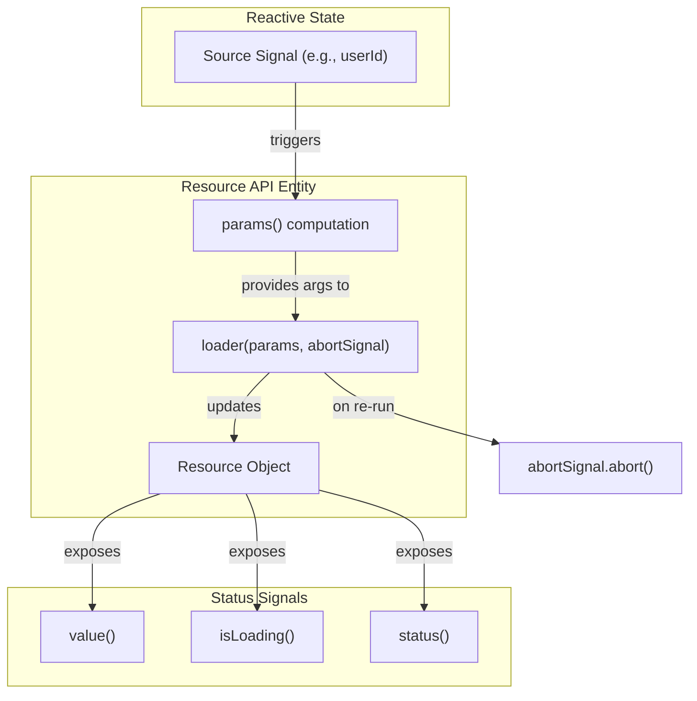
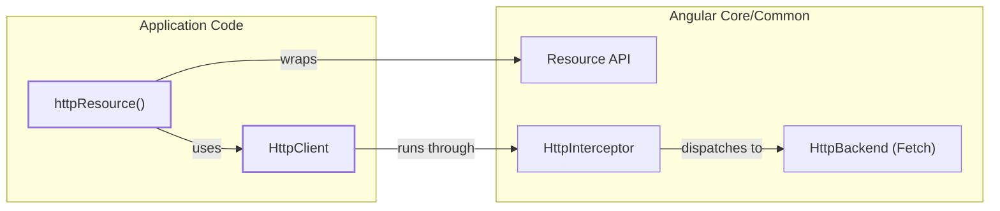

<!-- source: DeepWiki mcp.deepwiki.com · repo angular/skills · page 3.3 Async Reactivity with resource and httpResource · fetched 2026-10-27 -->

# Async Reactivity with resource and httpResource

<details>
<summary>Relevant source files</summary>

The following files were used as context for generating this wiki page:

- [README.md](README.md)
- [angular-developer/references/http-client.md](angular-developer/references/http-client.md)
- [angular-developer/references/resource.md](angular-developer/references/resource.md)

</details>


The `resource()` API and its specialized variant `httpResource()` incorporate asynchronous data fetching into Angular's signal-based reactivity system. These APIs bridge the gap between reactive signal dependencies and async operations (like `fetch` or `HttpClient` calls), exposing the status and result as synchronous signals.

## The resource API

The `resource()` function creates a `Resource` object that executes an async loader function whenever its reactive dependencies change. It is designed to replace complex `switchMap` logic or manual `effect` + `fetch` patterns.

### Core Configuration
A resource is defined by two primary properties:
1.  **`params`**: A reactive computation (similar to `computed`). When any signal read inside `params` changes, the resource triggers a re-fetch [angular-developer/references/resource.md:9-9]().
2.  **`loader`**: An async function that performs the actual data fetching. It receives the current `params` and an `abortSignal` [angular-developer/references/resource.md:10-10]().

### Implementation Example
```ts
import { Component, resource, signal, computed } from '@angular/core';

@Component({...})
export class UserProfile {
  protected readonly userId = signal('123');

  protected readonly userResource = resource({
    // Reactively tracking userId
    params: () => ({ id: this.userId() }),

    // Executes whenever params change
    loader: async ({ params, abortSignal }) => {
      const response = await fetch(`/api/users/${params.id}`, { signal: abortSignal });
      if (!response.ok) throw new Error('Network error');
      return response.json();
    }
  });
}
```
Sources: [angular-developer/references/resource.md:12-29]()

### Lifecycle and Aborting
If the `params` signal updates while a previous `loader` execution is still in progress, the `Resource` automatically attempts to cancel the outstanding request using the provided `abortSignal` [angular-developer/references/resource.md:44-44](). Developers should always pass this `abortSignal` to their async calls (e.g., `fetch`) to prevent race conditions and unnecessary network traffic [angular-developer/references/resource.md:44-44]().

### Resource Status Signals
The `Resource` object exposes several signals to track the state of the async operation:

| Signal | Description |
| :--- | :--- |
| `value()` | The resolved data or `undefined`. |
| `hasValue()` | A type-guard boolean; `true` if a value is present. |
| `isLoading()` | Boolean indicating if the loader is currently active. |
| `error()` | The error thrown by the loader, if any. |
| `status()` | String constant: `'idle'`, `'loading'`, `'resolved'`, `'error'`, `'reloading'`, or `'local'`. |

Sources: [angular-developer/references/resource.md:56-62]()

### Local Mutation and Reloading
*   **`.reload()`**: Forces the loader to re-run even if `params` have not changed [angular-developer/references/resource.md:48-52]().
*   **Local Mutation**: The `value` signal can be updated directly (e.g., for optimistic UI updates). Doing so changes the resource `status()` to `'local'` [angular-developer/references/resource.md:66-70]().

---

## The httpResource API

`httpResource` is a specialized wrapper around `resource` that leverages the Angular `HttpClient` stack [angular-developer/references/resource.md:74-74](). It allows async data to participate in dependency injection, functional interceptors, and Angular's security features (like XSRF protection) [angular-developer/references/http-client.md:3-3]().

### Usage Pattern
```ts
import { httpResource } from '@angular/common/http';
import { input } from '@angular/core';

export class UserProfile {
  readonly userId = input.required<string>();
  
  // Eagerly fetches when userId changes
  readonly user = httpResource(() => `/api/users/${this.userId()}`);
}
```
Sources: [angular-developer/references/http-client.md:92-98]()

### Key Differences from HttpClient Observables
Unlike the standard `HttpClient` which returns "cold" Observables, `httpResource` is eager and signal-native.

| Feature | `HttpClient` (Observable) | `httpResource` (Signal) |
| :--- | :--- | :--- |
| **Execution** | Cold (requires subscription) [angular-developer/references/http-client.md:44-44]() | Eager (executes on dependency change) [angular-developer/references/http-client.md:101-101]() |
| **Cancellation** | Manual unsubscription or `switchMap` | Automatic on dependency change [angular-developer/references/http-client.md:102-102]() |
| **State** | Must be managed manually or via `async` pipe | Built-in `isLoading`, `hasValue`, `error` signals [angular-developer/references/resource.md:56-62]() |
| **Best Use Case** | Mutations (POST, PUT, DELETE) [angular-developer/references/http-client.md:104-104]() | Data Reads (GET) [angular-developer/references/http-client.md:104-104]() |

### Specialized Fetching and Metadata
*   **Non-JSON Responses**: Use `httpResource.text`, `httpResource.blob`, or `httpResource.arrayBuffer` [angular-developer/references/http-client.md:106-106]().
*   **Validation**: The `parse` option allows for runtime schema validation or transformation of the response [angular-developer/references/http-client.md:107-107]().
*   **Metadata**: Access `headers()`, `statusCode()`, and `progress()` signals directly from the resource [angular-developer/references/http-client.md:108-108]().

---

## Data Flow and Entity Mapping

### Resource Data Flow
This diagram illustrates how a change in a reactive dependency triggers the resource lifecycle.

**Resource Lifecycle Flow**

Sources: [angular-developer/references/resource.md:7-30](), [angular-developer/references/resource.md:44-44]()

### Code Entity Space: httpResource vs HttpClient
This diagram maps the relationship between the high-level `httpResource` API and the underlying `HttpClient` infrastructure.

**HTTP Reactivity Mapping**

Sources: [angular-developer/references/resource.md:74](), [angular-developer/references/http-client.md:3-3](), [angular-developer/references/http-client.md:65-67]()

---

