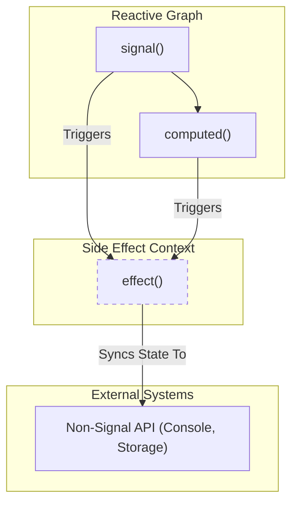
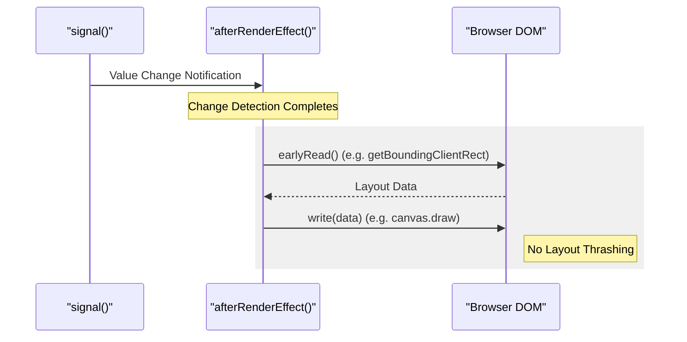

<!-- source: DeepWiki mcp.deepwiki.com · repo angular/skills · page 3.4 Effects and Side Effects · fetched 2026-10-27 -->

# Effects and Side Effects

<details>
<summary>Relevant source files</summary>

The following files were used as context for generating this wiki page:

- [angular-developer/references/effects.md](angular-developer/references/effects.md)

</details>


In Angular, an **effect** is an operation that runs whenever one or more signal values it tracks change [angular-developer/references/effects.md:3-3](). Effects are the primary mechanism for integrating the reactive signal system with imperative APIs and the browser DOM.

## The `effect()` API

The `effect()` function creates a side effect that executes asynchronously during the change detection process [angular-developer/references/effects.md:20-20](). An effect always runs at least once upon initialization [angular-developer/references/effects.md:20-20]().

### Injection Context Requirement
Effects must be created within an **injection context**, such as a component constructor, a field initializer, or via `runInInjectionContext` [angular-developer/references/effects.md:29-31]().

### Cleanup Logic
The `effect` function provides an `onCleanup` callback. This is used to perform manual cleanup (e.g., clearing timeouts or unsubscribing from external events) before the next execution of the effect or when the containing context is destroyed [angular-developer/references/effects.md:31-37]().

```ts
// Example of effect with cleanup
effect((onCleanup) => {
  const currentCount = this.count();
  const timer = setTimeout(() => console.log('Action for', currentCount), 1000);

  onCleanup(() => clearTimeout(timer)); // Runs before next execution [angular-developer/references/effects.md:37-37]
});
```

### Valid Use Cases
Effects should be reserved for syncing signal state to **non-signal APIs** [angular-developer/references/effects.md:7-7]():
*   **Analytics**: Logging data to external services [angular-developer/references/effects.md:11-11]().
*   **Storage**: Syncing state to `localStorage` or `sessionStorage` [angular-developer/references/effects.md:12-12]().
*   **Manual Rendering**: Custom drawing to a `<canvas>` or initializing 3rd-party charting libraries [angular-developer/references/effects.md:13-13]().

### CRITICAL RULE: State Synchronization Anti-Pattern
**Do not use effects to propagate state.** Using `.set()` or `.update()` on a signal inside an effect to keep it in sync with another signal is a significant anti-pattern [angular-developer/references/effects.md:15-16](). This leads to:
1.  `ExpressionChangedAfterItHasBeenChecked` errors.
2.  Infinite loops.
3.  Difficult-to-debug data flows.

**Solution:** Always use `computed()` or `linkedSignal()` for state derivation [angular-developer/references/effects.md:16-16]().

### Data Flow: Signal to Side Effect
The following diagram illustrates how the `effect` scheduler reacts to signal changes without feeding back into the reactive graph.

**Effect Execution Flow**

Sources: [angular-developer/references/effects.md:3-7](), [angular-developer/references/effects.md:15-16]()

## DOM Manipulation with `afterRenderEffect`

Standard `effect()` calls run **before** Angular updates the DOM [angular-developer/references/effects.md:45-45](). When you need to inspect or modify the DOM after it has been rendered (e.g., measuring an element's size for a chart), use `afterRenderEffect` [angular-developer/references/effects.md:45-47]().

### Render Phases
To prevent **layout thrashing** (repeatedly reading and writing to the DOM, causing multiple reflows), `afterRenderEffect` organizes operations into specific phases [angular-developer/references/effects.md:49-51]().

| Phase | Description | Rule |
| :--- | :--- | :--- |
| `earlyRead` | First phase for reading DOM layout. | Use for `getBoundingClientRect()`. |
| `write` | Phase for modifying the DOM. | **Never read** from the DOM here. |
| `mixedReadWrite` | Legacy/Emergency phase. | Avoid if possible. |
| `read` | Final phase for reading. | **Never write** to the DOM here. |

### Implementation Example
`afterRenderEffect` only executes on the client and is ignored during Server-Side Rendering (SSR) [angular-developer/references/effects.md:83-83]().

```ts
afterRenderEffect({
  earlyRead: () => {
    // Read phase [angular-developer/references/effects.md:63-65]
    return this.canvas().nativeElement.getBoundingClientRect().width;
  },
  write: (width) => {
    // Write phase receives the signal from earlyRead [angular-developer/references/effects.md:67-70]
    setupChart(this.canvas().nativeElement, width());
  }
});
```

### Entity Mapping: Rendering Pipeline
This diagram maps the code entities to the DOM rendering lifecycle.

**DOM Interaction via afterRenderEffect**

Sources: [angular-developer/references/effects.md:43-52](), [angular-developer/references/effects.md:61-74]()

## Summary of Differences

| Feature | `effect()` | `afterRenderEffect()` |
| :--- | :--- | :--- |
| **Timing** | Before DOM update [angular-developer/references/effects.md:45-45]() | After DOM update [angular-developer/references/effects.md:47-47]() |
| **Primary Use** | Non-DOM APIs (Logging, Storage) [angular-developer/references/effects.md:9-13]() | DOM Integration (Canvas, 3rd party UI) [angular-developer/references/effects.md:45-45]() |
| **SSR Support** | Yes | No (Client only) [angular-developer/references/effects.md:83-83]() |
| **Phased Execution**| No | Yes (`earlyRead`, `write`, etc.) [angular-developer/references/effects.md:76-81]() |

Sources: [angular-developer/references/effects.md:1-83]()

---

