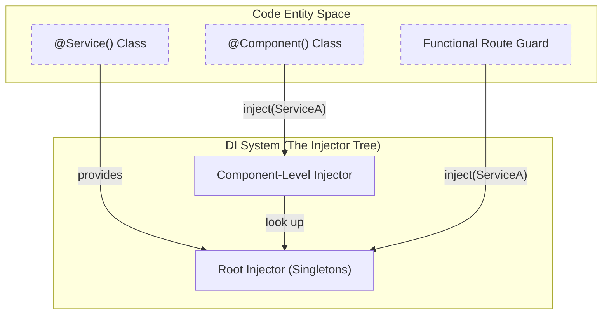
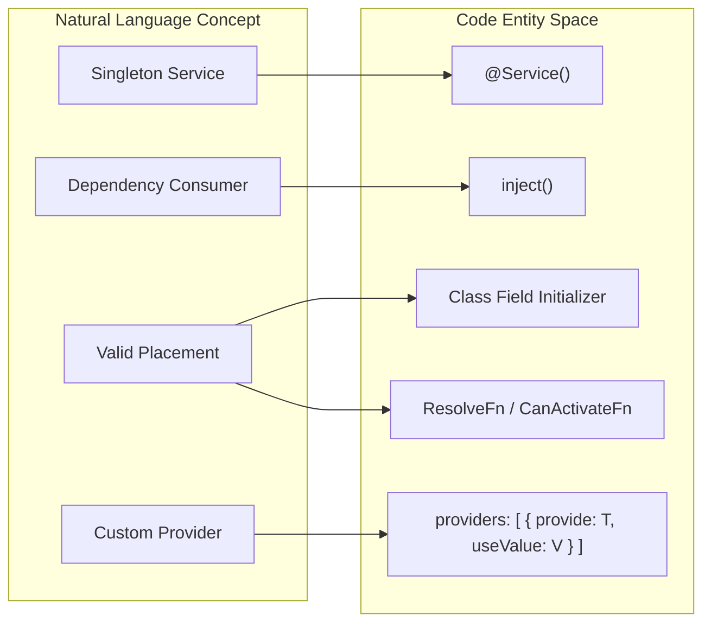

<!-- source: DeepWiki mcp.deepwiki.com · repo angular/skills · page 4 Dependency Injection · fetched 2026-10-27 -->

# Dependency Injection

Relevant source files

The following files were used as context for generating this wiki page:

- [angular-developer/references/creating-services.md](angular-developer/references/creating-services.md)
- [angular-developer/references/di-fundamentals.md](angular-developer/references/di-fundamentals.md)

Dependency Injection (DI) is the core design pattern in Angular used to organize, share, and manage code across an application. It allows you to "inject" features—such as services, configurations, or tokens—into components and other services, enhancing maintainability and testability [angular-developer/references/di-fundamentals.md:1-4]().

The system operates on two primary actions:
1.  **Providing**: Making values (objects, functions, or primitives) available to the DI system [angular-developer/references/di-fundamentals.md:9]().
2.  **Injecting**: Requesting those values from the system, typically via the `inject()` function [angular-developer/references/di-fundamentals.md:10,43-45]().

### DI Architecture Overview

The following diagram illustrates the relationship between the DI system, the `inject()` function, and the code entities that consume dependencies.

**DI System Interaction Map**

Sources: [angular-developer/references/di-fundamentals.md:5-12](), [angular-developer/references/creating-services.md:31-37]()

---

### Core Concepts

#### 1. Services and DI Fundamentals
Services are TypeScript classes decorated with `@Service()`. They are the primary vehicle for sharing business logic, data fetching, and state management [angular-developer/references/creating-services.md:1-3](). By default, services are singletons available throughout the entire application, which enables efficient tree-shaking [angular-developer/references/creating-services.md:31-37]().

For details, see [DI Fundamentals and Services](#4.1).

#### 2. Providing Dependencies and Tokens
While `@Service()` handles most use cases automatically, Angular allows for manual control over how dependencies are created and scoped. This includes using `useClass`, `useValue`, and `useFactory` providers, as well as `InjectionToken` for non-class dependencies like configuration objects [angular-developer/references/creating-services.md:88-93]().

For details, see [Defining Providers and Injection Tokens](#4.2).

#### 3. Injection Context and Hierarchical Injectors
The `inject()` function is not available everywhere; it must be called within an **Injection Context**. This includes class field initializers, constructor bodies, and specific functional APIs like route guards [angular-developer/references/di-fundamentals.md:71-81](). Angular resolves these dependencies through a hierarchical tree of injectors, starting from the local element up to the root environment [angular-developer/references/creating-services.md:88-91]().

For details, see [Injection Context and Hierarchical Injectors](#4.3).

---

### Code Entity Mapping

This diagram maps the natural language concepts of DI to the specific code symbols used in the Angular framework.

**Entity Mapping: Natural Language to Code**

Sources: [angular-developer/references/di-fundamentals.md:43-52](), [angular-developer/references/di-fundamentals.md:71-81](), [angular-developer/references/creating-services.md:15-19](), [angular-developer/references/creating-services.md:88-93]()

### Summary Table of DI Usage

| Feature | Code Symbol | Primary Use Case |
| :--- | :--- | :--- |
| **Service Creation** | `@Service()` | Reusable business logic and state [angular-developer/references/creating-services.md:18-19]() |
| **Dependency Access** | `inject()` | Accessing services in components or guards [angular-developer/references/di-fundamentals.md:43-45]() |
| **State Exposure** | `.asReadonly()` | Exposing signals from services safely [angular-developer/references/creating-services.md:20-23]() |
| **Isolation** | `providers: []` | Component-specific service instances [angular-developer/references/creating-services.md:91]() |
| **Reactive Logic** | `computed()` | Deriving state from multiple injected services [angular-developer/references/creating-services.md:70-72]() |

Sources: [angular-developer/references/creating-services.md:1-93](), [angular-developer/references/di-fundamentals.md:1-116]()

---

