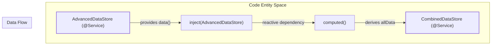
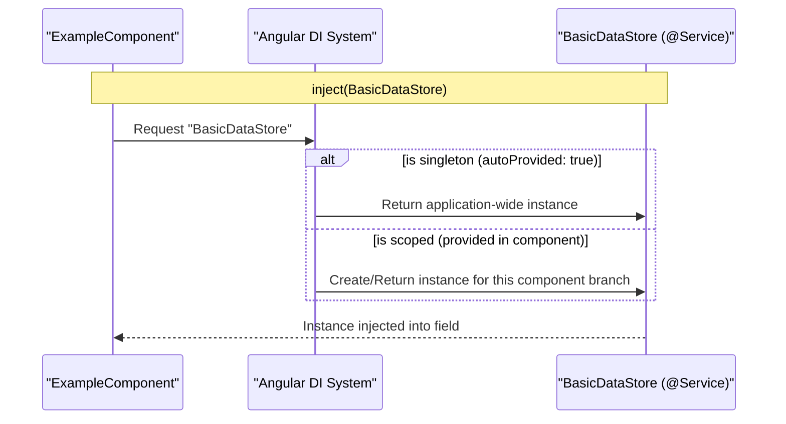

<!-- source: DeepWiki mcp.deepwiki.com · repo angular/skills · page 4.1 DI Fundamentals and Services · fetched 2026-10-27 -->

# DI Fundamentals and Services

<details>
<summary>Relevant source files</summary>

The following files were used as context for generating this wiki page:

- [angular-developer/references/creating-services.md](angular-developer/references/creating-services.md)
- [angular-developer/references/di-fundamentals.md](angular-developer/references/di-fundamentals.md)

</details>


Dependency Injection (DI) is a core design pattern in Angular used to organize and share code across an application. It allows for the "injection" of features into different parts of the system, which improves maintainability, scalability, and testability [angular-developer/references/di-fundamentals.md:1-3]().

## The Service Pattern

A **service** is a TypeScript class decorated with `@Service()` that typically handles data fetching, business logic, or state management [angular-developer/references/creating-services.md:3-5](), [angular-developer/references/di-fundamentals.md:16-17]().

### The @Service() Decorator
Using the `@Service()` decorator is the recommended approach for creating services in modern Angular. By default, it provides the following benefits:
*   **Singleton Instance**: Angular creates a single instance for the entire application [angular-developer/references/creating-services.md:35]().
*   **Automatic Provisioning**: The service is available everywhere without needing to be listed in manual `providers` arrays [angular-developer/references/creating-services.md:36]().
*   **Tree-shaking**: The service is only included in the final production bundle if it is actually injected somewhere in the code [angular-developer/references/creating-services.md:37]().

### Creating a Service
Services can be generated via the CLI using `ng generate service <name>` [angular-developer/references/creating-services.md:7-11]().

```ts
import {Service, signal} from '@angular/core';

@Service()
export class AnalyticsLogger {
  private readonly events = signal<string[]>([]);

  // Expose state as a read-only signal
  readonly history = this.events.asReadonly();

  trackEvent(category: string, value: string) {
    this.events.update(prev => [...prev, `${category}: ${value}`]);
    console.log('Event logged:', {category, value});
  }
}
```
*Sources: [angular-developer/references/creating-services.md:13-29](), [angular-developer/references/di-fundamentals.md:22-31]()*

## Injecting Dependencies

Angular uses the `inject()` function to request dependencies from the DI system [angular-developer/references/di-fundamentals.md:43-45]().

### The inject() Function
The `inject()` function retrieves an instance of a service or any other provided token [angular-developer/references/di-fundamentals.md:47-48](). While it can be used in constructors, the recommended pattern is to use **class field initializers** [angular-developer/references/di-fundamentals.md:59-60](), [angular-developer/references/di-fundamentals.md:77]().

### Injection Context
The `inject()` function must be called within an **Injection Context**. Valid contexts include:
1.  **Class field initializers** [angular-developer/references/di-fundamentals.md:89]().
2.  **Constructor bodies** [angular-developer/references/di-fundamentals.md:93]().
3.  **Functional Route Guards and Resolvers** [angular-developer/references/di-fundamentals.md:112-115]().
4.  **Factory functions** used in providers [angular-developer/references/di-fundamentals.md:80]().

### Service Composition and Reactive State
Services can inject other services to compose functionality. By using `computed()`, services can derive reactive state from their dependencies [angular-developer/references/creating-services.md:68-71]().

**Service Composition Flow**

*Sources: [angular-developer/references/creating-services.md:72-85]()*

## Singleton vs. Component-Scoped Instances

While `@Service()` creates singletons by default, Angular allows for hierarchical scoping.

| Pattern | Configuration | Lifecycle |
| :--- | :--- | :--- |
| **Singleton** | Default `@Service()` | One instance for the entire app. |
| **Component-Scoped** | `@Service({autoProvided: false})` + `@Component({ providers: [MyService] })` | New instance created for each component instance; destroyed with the component. |

*Sources: [angular-developer/references/creating-services.md:31-41](), [angular-developer/references/creating-services.md:87-93]()*

### Dependency Resolution Diagram
This diagram illustrates how a component requests a service and how the DI system resolves the instance based on its scope.


*Sources: [angular-developer/references/creating-services.md:43-66](), [angular-developer/references/di-fundamentals.md:5-12]()*

## Summary of Key Symbols

| Symbol | Role | Source |
| :--- | :--- | :--- |
| `@Service()` | Decorator to define a class as an injectable service. | [angular-developer/references/creating-services.md:18]() |
| `inject()` | Function used to retrieve a dependency from the current context. | [angular-developer/references/di-fundamentals.md:47]() |
| `autoProvided` | Option in `@Service` to control automatic singleton behavior. | [angular-developer/references/creating-services.md:39]() |
| `asReadonly()` | Signal method used to expose state without allowing external mutation. | [angular-developer/references/creating-services.md:23]() |

**Sources:**
*   [angular-developer/references/creating-services.md:1-93]()
*   [angular-developer/references/di-fundamentals.md:1-116]()

---

