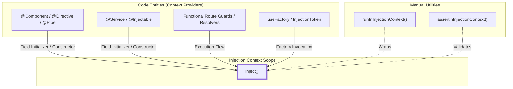
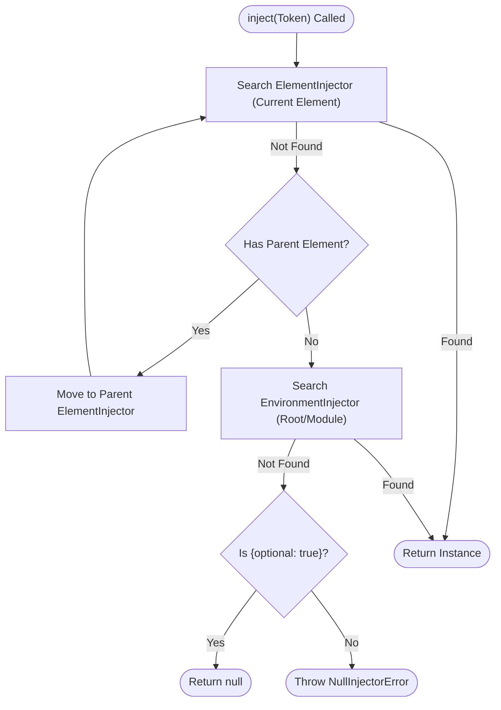

<!-- source: DeepWiki mcp.deepwiki.com · repo angular/skills · page 4.3 Injection Context and Hierarchical Injectors · fetched 2026-10-27 -->

# Injection Context and Hierarchical Injectors

<details>
<summary>Relevant source files</summary>

The following files were used as context for generating this wiki page:

- [angular-developer/references/cli.md](angular-developer/references/cli.md)
- [angular-developer/references/hierarchical-injectors.md](angular-developer/references/hierarchical-injectors.md)
- [angular-developer/references/injection-context.md](angular-developer/references/injection-context.md)
- [angular-developer/references/testing-fundamentals.md](angular-developer/references/testing-fundamentals.md)

</details>


Dependency Injection (DI) in Angular is governed by two primary concepts: the **Injection Context**, which determines *where* and *when* dependencies can be requested, and the **Hierarchical Injector Tree**, which determines *how* those dependencies are located and instantiated across the application.

## 1. Injection Context

The `inject()` function is the modern standard for retrieving dependencies in Angular. However, it requires an active "Injection Context" to function. This context provides the necessary reference to the current injector responsible for resolving the requested token.

### Valid Injection Contexts
An injection context is automatically established by the framework in the following locations:

1.  **Field Initializers**: Properties assigned at the class level in classes managed by DI (e.g., `@Component`, `@Service`). [angular-developer/references/injection-context.md:7-9]()
2.  **Constructors**: The standard `constructor` of a DI-managed class. [angular-developer/references/injection-context.md:10-10]()
3.  **Factory Functions**: Functions defined in `useFactory` or as part of an `InjectionToken` configuration. [angular-developer/references/injection-context.md:11-11]()
4.  **Functional APIs**: Modern functional primitives executed by the framework, such as functional Route Guards, Resolvers, and Interceptors. [angular-developer/references/injection-context.md:12-12]()

### Manual Context Management
When code needs to execute outside these standard locations (e.g., inside an event handler or an asynchronous callback), the context must be manually managed or asserted.

| Function | Purpose | Example Usage |
| :--- | :--- | :--- |
| `runInInjectionContext` | Executes a callback function within the context of a specific injector. | `runInInjectionContext(this.injector, () => inject(Router))` [angular-developer/references/injection-context.md:34-49]() |
| `assertInInjectionContext` | Guards a function to ensure it is only called where `inject()` is valid. | `assertInInjectionContext(myFunc);` [angular-developer/references/injection-context.md:54-63]() |

### Context Flow and Entity Mapping
The following diagram maps the conceptual "Injection Context" to the specific code entities that establish or verify it.

**Diagram: Injection Context Entity Map**

**Sources:** [angular-developer/references/injection-context.md:1-63]()

---

## 2. Hierarchical Injectors

Angular organizes injectors into two distinct, parallel hierarchies. This hierarchy allows for service scoping, where a service can be a global singleton or local to a specific component subtree.

### Injector Types
1.  **EnvironmentInjector**: These injectors are associated with the application environment. The "root" `EnvironmentInjector` holds global singletons configured via `providedIn: 'root'` or `ApplicationConfig.providers`. [angular-developer/references/hierarchical-injectors.md:7-7]()
2.  **ElementInjector**: These are created for every DOM element. They are populated via the `providers` or `viewProviders` arrays in the `@Component` or `@Directive` decorators. [angular-developer/references/hierarchical-injectors.md:8-8]()

### Resolution Rules
When `inject(Token)` is called, Angular follows a specific search algorithm:
1.  **Element Tree**: It traverses upwards through the `ElementInjector` tree starting from the requesting element. [angular-developer/references/hierarchical-injectors.md:14-14]()
2.  **Environment Tree**: If not found in the element tree, it switches to the `EnvironmentInjector` tree, searching from the local environment up to the root. [angular-developer/references/hierarchical-injectors.md:15-15]()
3.  **Error/Optional**: If the token is not found in either hierarchy, Angular throws an error unless the `optional` flag is used. [angular-developer/references/hierarchical-injectors.md:16-16]()

### Resolution Logic Data Flow
The following diagram illustrates the data flow when resolving a dependency across the hierarchies.

**Diagram: Dependency Resolution Flow**

**Sources:** [angular-developer/references/hierarchical-injectors.md:10-17]()

---

## 3. Resolution Modifiers

The behavior of the hierarchical search can be customized using a metadata object passed as the second argument to `inject()`. [angular-developer/references/hierarchical-injectors.md:20-20]()

| Modifier | Description |
| :--- | :--- |
| `optional` | Returns `null` if the provider is missing instead of throwing an error. [angular-developer/references/hierarchical-injectors.md:22-22]() |
| `self` | Only checks the `ElementInjector` of the current component/directive. [angular-developer/references/hierarchical-injectors.md:23-23]() |
| `skipSelf` | Starts the search at the parent `ElementInjector`, ignoring the current element's providers. [angular-developer/references/hierarchical-injectors.md:24-24]() |
| `host` | Limits the upward search in the `ElementInjector` tree to the host component's boundary. [angular-developer/references/hierarchical-injectors.md:25-25]() |

```ts
// Example usage of modifiers
const parentService = inject(MyService, { skipSelf: true, optional: true });
```
[angular-developer/references/hierarchical-injectors.md:27-36]()

---

## 4. Providers vs ViewProviders

When defining providers at the component level, the choice between `providers` and `viewProviders` affects how dependencies are visible to children.

*   **`providers`**: Visible to the component itself, its internal template, and any **projected content** (children passed via `<ng-content>`). [angular-developer/references/hierarchical-injectors.md:42-42]()
*   **`viewProviders`**: Visible to the component and its internal template, but **hidden** from projected content. This is used to encapsulate internal implementation details. [angular-developer/references/hierarchical-injectors.md:43-43]()

**Sources:**
- [angular-developer/references/injection-context.md:1-63]()
- [angular-developer/references/hierarchical-injectors.md:1-43]()

---

