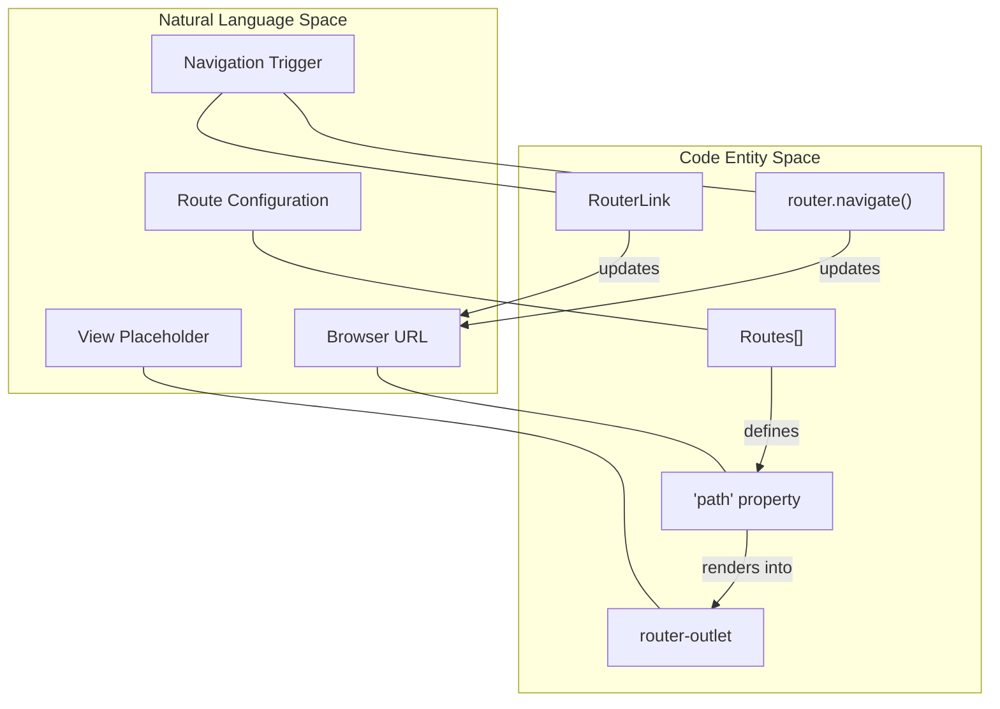
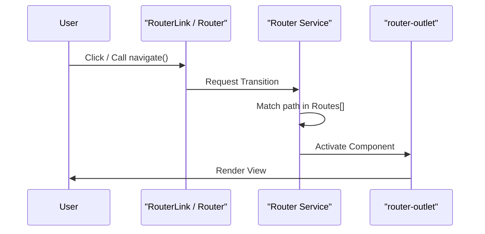

<!-- source: DeepWiki mcp.deepwiki.com · repo angular/skills · page 5 Routing · fetched 2026-10-27 -->

# Routing

Relevant source files

The following files were used as context for generating this wiki page:

- [angular-developer/references/component-styling.md](angular-developer/references/component-styling.md)
- [angular-developer/references/define-routes.md](angular-developer/references/define-routes.md)
- [angular-developer/references/navigate-to-routes.md](angular-developer/references/navigate-to-routes.md)

Angular's router enables navigation by interpreting browser URLs as instructions to transition between views and manage application state. It allows developers to define a hierarchy of routes, handle data fetching before navigation completes, and secure specific paths using guards.

### Core Routing Architecture

The routing system bridges the browser's URL to the application's component tree. The `Router` service manages this mapping using a configuration array of `Routes`.

**Router Entity Mapping**

Sources: [angular-developer/references/define-routes.md:3-14](), [angular-developer/references/navigate-to-routes.md:5-10](), [angular-developer/references/navigate-to-routes.md:29-33]()

---

### Defining Routes and Loading Strategies
Routes are defined as an array of objects where each entry maps a `path` to a `component`. Angular employs a "first-match wins" strategy, requiring specific paths (like static strings) to be defined before generic ones (like wildcards).

*   **Static and Dynamic Paths**: Paths can be fixed strings or dynamic segments prefixed with colons (e.g., `user/:id`).
*   **Wildcards**: The `**` path acts as a catch-all for undefined routes and must be placed last.
*   **Redirects**: Routes can redirect to other paths using `redirectTo`, which supports both static strings and conditional logic functions.
*   **Loading**: Components can be loaded eagerly or lazily to optimize bundle sizes.

For details, see [Defining Routes and Loading Strategies](#5.1).

Sources: [angular-developer/references/define-routes.md:7-31](), [angular-developer/references/define-routes.md:32-57]()

---

### Navigation, Outlets, and Route Lifecycle
Navigation occurs either declaratively via the `RouterLink` directive in templates or programmatically by injecting the `Router` service.

*   **RouterLink**: Used on anchor tags to handle clicks and apply active classes via `RouterLinkActive`.
*   **Programmatic Navigation**: Uses `router.navigate()` for command-based arrays or `router.navigateByUrl()` for string paths.
*   **Router Outlets**: The `<router-outlet />` serves as the placeholder where the matched component is rendered.
*   **Lifecycle Events**: The router emits events (such as `NavigationStart` or `NavigationEnd`) that allow developers to track the state of a transition.

For details, see [Navigation, Outlets, and Route Lifecycle](#5.2).

**Navigation Flow**

Sources: [angular-developer/references/navigate-to-routes.md:5-24](), [angular-developer/references/navigate-to-routes.md:29-64](), [angular-developer/references/define-routes.md:72-75]()

---

### Route Guards and Data Resolvers
Guards and Resolvers manage the logic that occurs between the request for a route and its final activation.

*   **Guards**: Functional primitives like `CanActivate` or `CanMatch` determine if a user is allowed to navigate to or leave a route based on logic (e.g., authentication).
*   **Resolvers**: The `ResolveFn` allows for pre-fetching data (e.g., from an API) so that the component is initialized with the necessary data already available.

For details, see [Route Guards and Data Resolvers](#5.3).

Sources: [angular-developer/references/define-routes.md:61-65](), [angular-developer/references/define-routes.md:67-70]()

---

### Route Animations and Transitions
Angular integrates with the browser's View Transitions API to provide smooth visual changes when moving between routes. This allows for customized entry and exit effects for components as they are swapped within a `router-outlet`.

For details, see [Route Animations and Transitions](#5.4).

Sources: [angular-developer/references/component-styling.md:24-33]() (Conceptual basis for view isolation).

---

