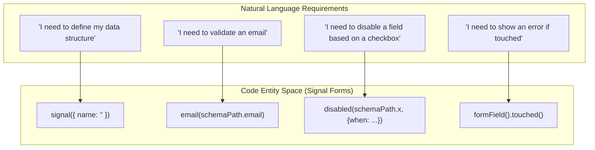
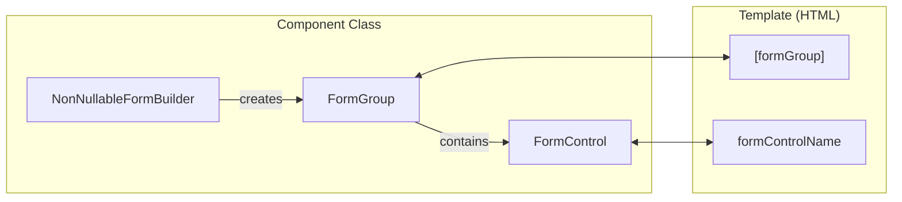

<!-- source: DeepWiki mcp.deepwiki.com · repo angular/skills · page 6 Forms · fetched 2026-10-27 -->

# Forms

Relevant source files

The following files were used as context for generating this wiki page:

- [angular-developer/references/reactive-forms.md](angular-developer/references/reactive-forms.md)
- [angular-developer/references/signal-forms.md](angular-developer/references/signal-forms.md)
- [angular-developer/references/template-driven-forms.md](angular-developer/references/template-driven-forms.md)

Angular provides three distinct strategies for handling user input and form state. While **Signal Forms** is the preferred approach for modern Angular development (v22+), legacy **Reactive Forms** and **Template-Driven Forms** remain supported for existing applications.

## Strategy Selection

Choosing the right form strategy depends on the Angular version and the complexity of the requirements.

| Strategy | Recommended Version | Primary Primitive | Core Philosophy |
| :--- | :--- | :--- | :--- |
| **Signal Forms** | **v22+ (Preferred)** | `signal()`, `form()` | Model-driven, reactive, type-safe, built on Signals. |
| **Reactive Forms** | v2 - v21 | `FormControl`, `FormGroup` | Model-driven, based on RxJS Observables. |
| **Template-Driven Forms** | v2+ | `ngModel` | Template-centric, two-way binding. |

### From Natural Language to Form Entities
The following diagram maps common form requirements to the specific code entities used in the modern Signal Forms approach.

Form Logic to Code Entities

Sources: [angular-developer/references/signal-forms.md:34-69](), [angular-developer/references/signal-forms.md:71-109](), [angular-developer/references/signal-forms.md:111-127](), [angular-developer/references/signal-forms.md:139-156]()

## Signal Forms (Preferred)

Signal Forms provide a type-safe, signal-native way to manage form state. They eliminate the need for `FormControl` or `FormGroup` classes, instead deriving the form structure directly from a source signal model [angular-developer/references/signal-forms.md:34-36]().

Key features include:
*   **Model-Driven Synchronization**: The form structure is defined by a `signal` model passed to the `form()` function [angular-developer/references/signal-forms.md:34-40]().
*   **Strict Null Safety**: Initial values must never be `null` or `undefined`; use empty strings, zeros, or empty arrays instead [angular-developer/references/signal-forms.md:47-64]().
*   **Declarative Rules**: Validation, visibility (`hidden`), and interactivity (`disabled`, `readonly`) are defined via a schema function [angular-developer/references/signal-forms.md:81-109](), [angular-developer/references/signal-forms.md:146-156]().
*   **Automatic Binding**: The `[formField]` directive automatically synchronizes the template with the field's signal state, including its `disabled` and `readonly` status [angular-developer/references/signal-forms.md:160-167]().

For details, see [Signal Forms](#6.1).

Sources: [angular-developer/references/signal-forms.md:1-224]()

## Reactive Forms

Reactive Forms use an explicit, model-driven approach built around RxJS. They provide synchronous access to the data model and are highly testable.

### Reactive Forms Architecture
This diagram illustrates the relationship between the component class and the template in the Reactive Forms strategy.

Reactive Forms Data Flow

Sources: [angular-developer/references/reactive-forms.md:5-12](), [angular-developer/references/reactive-forms.md:27-44](), [angular-developer/references/reactive-forms.md:47-74]()

Key characteristics:
*   **Explicit Control**: Developers manually instantiate `FormControl`, `FormGroup`, and `FormArray` [angular-developer/references/reactive-forms.md:7-12]().
*   **Observables**: State changes can be tracked via the `events` observable or `valueChanges` [angular-developer/references/reactive-forms.md:99-111]().
*   **Predictability**: Value updates are handled via `patchValue()` or `setValue()`, providing strict control over how data enters the model [angular-developer/references/reactive-forms.md:85-97]().

For details, see [Reactive Forms and Template-Driven Forms](#6.2).

Sources: [angular-developer/references/reactive-forms.md:1-118]()

## Template-Driven Forms

Template-driven forms rely on two-way data binding (`[(ngModel)]`) and are primarily managed within the HTML template. They are suitable for simple forms where the overhead of a model-driven approach is not required.

Key characteristics:
*   **Directives-Based**: Logic is defined in the template using `NgModel` and `NgForm` [angular-developer/references/template-driven-forms.md:5-11]().
*   **Implicit State**: Angular automatically manages the underlying `FormGroup` and applies CSS classes like `ng-touched` and `ng-invalid` based on state [angular-developer/references/template-driven-forms.md:63-84]().
*   **Template References**: Control state is accessed in the template via local variables (e.g., `#nameCtrl="ngModel"`) [angular-developer/references/template-driven-forms.md:86-101]().

For details, see [Reactive Forms and Template-Driven Forms](#6.2).

Sources: [angular-developer/references/template-driven-forms.md:1-114]()

---

