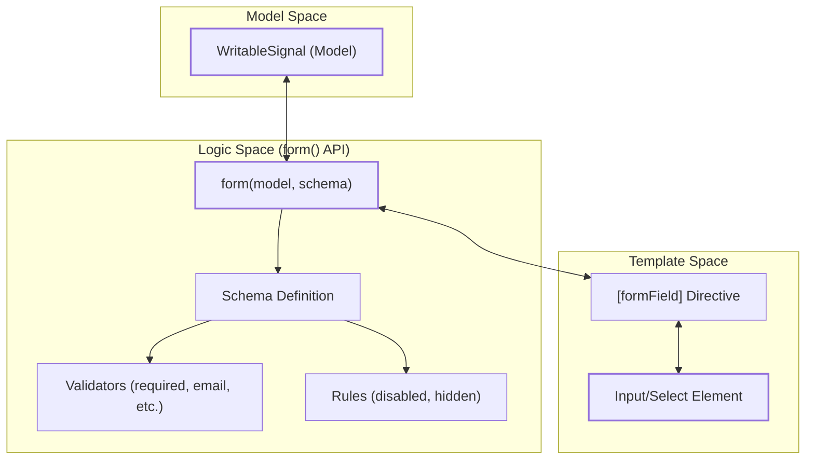
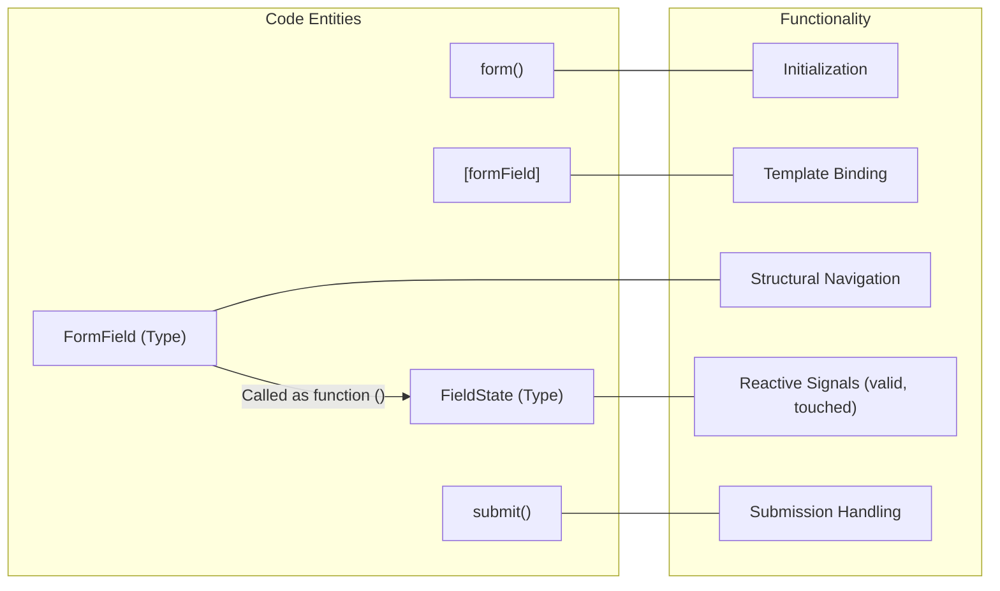

<!-- source: DeepWiki mcp.deepwiki.com · repo angular/skills · page 6.1 Signal Forms · fetched 2026-10-27 -->

# Signal Forms

<details>
<summary>Relevant source files</summary>

The following files were used as context for generating this wiki page:

- [angular-developer/references/signal-forms.md](angular-developer/references/signal-forms.md)

</details>


Signal Forms represent the recommended approach for handling forms in modern Angular applications (v21+). They provide a reactive, type-safe, and model-driven architecture to manage form state using Angular Signals. Unlike legacy Reactive Forms, Signal Forms derive their structure directly from a Signal-based model, eliminating the need for `FormControl`, `FormGroup`, or `FormBuilder` [angular-developer/references/signal-forms.md:1-5](), [angular-developer/references/signal-forms.md:205-209]().

## Creating a Form

Forms are created using the `form()` API. The structure of the form is derived automatically from the provided Signal model [angular-developer/references/signal-forms.md:34-36]().

### Model Definition Rules
*   **No Nulls/Undefined**: You MUST NOT use `null` or `undefined` as initial values or types for any fields. Use empty strings `''`, zeros `0`, or empty arrays `[]` instead [angular-developer/references/signal-forms.md:5-5](), [angular-developer/references/signal-forms.md:47-57]().
*   **Signal-Based**: The model must be a `WritableSignal` [angular-developer/references/signal-forms.md:48-48]().

### Basic Implementation
```ts
import {Component, signal} from '@angular/core';
import {form, FormField} from '@angular/forms/signals';

@Component({
  imports: [FormField],
  template: `<input [formField]="userForm.name" />`
})
export class Example {
  protected readonly userModel = signal({
    name: '', 
    age: 0,
    address: { street: '' }
  });

  protected readonly userForm = form(this.userModel);
}
```
Sources: [angular-developer/references/signal-forms.md:38-68](), [angular-developer/references/signal-forms.md:163-164]()

## FormField vs. FieldState

A critical distinction in Signal Forms is the difference between the **structural** representation and the **stateful** representation of a field.

| Concept | Access Method | Purpose |
| :--- | :--- | :--- |
| **FormField** | `form.field` | Structural navigation (used for `[formField]` binding). |
| **FieldState** | `form.field()` | Accessing reactive signals (validity, touched, dirty, hidden). |

**Rule**: You must **CALL** a field as a function to access its state signals [angular-developer/references/signal-forms.md:111-115]().

```ts
// Structural access (FormField)
const nameField = userForm.name; 

// State access (FieldState)
const isTouched = userForm.name().touched(); // VALID
const isHidden = userForm.address().hidden(); // VALID
```
Sources: [angular-developer/references/signal-forms.md:111-137]()

## Schema and Validation

The `form()` function accepts an optional schema function as a second argument. This is used to define validators and state rules (disabled, hidden, etc.) [angular-developer/references/signal-forms.md:79-82]().

### Standard Validators
Validators are imported from `@angular/forms/signals` and applied to specific paths in the schema [angular-developer/references/signal-forms.md:73-77]().

*   `required(path, options)`: Marks a field as required. Supports a `when` condition [angular-developer/references/signal-forms.md:83-91]().
*   `email(path, options)`: Validates email format [angular-developer/references/signal-forms.md:96-96]().
*   `min(path, value)` / `max(path, value)`: For numeric validation [angular-developer/references/signal-forms.md:98-100]().
*   `minLength(path, value)` / `maxLength(path, value)`: For strings or arrays [angular-developer/references/signal-forms.md:102-104]().
*   `pattern(path, regex)`: Regex validation [angular-developer/references/signal-forms.md:106-107]().

### State Rules
Control the behavior of fields based on the state of other fields using `valueOf` [angular-developer/references/signal-forms.md:146-156]().

*   `disabled(path, {when})`: Disables the field based on a condition [angular-developer/references/signal-forms.md:148-148]().
*   `hidden(path, {when})`: Marks the field as hidden (it remains in the model) [angular-developer/references/signal-forms.md:150-151]().
*   `readonly(path)`: Sets the field to read-only [angular-developer/references/signal-forms.md:154-154]().

### Custom and Async Validation
*   `validate()`: For custom synchronous logic.
*   `validateHttp()`: For server-side validation.
*   `validateStandardSchema()`: Integration with external schema libraries.
Sources: [angular-developer/references/signal-forms.md:25-28](), [angular-developer/references/signal-forms.md:140-156]()

## Data Flow and Template Binding

The `[formField]` directive synchronizes the DOM element with the Signal model.

### Binding Restrictions
When using `[formField]`, the directive takes control of specific attributes. Setting these manually in the template is **FORBIDDEN** [angular-developer/references/signal-forms.md:169-176]():
*   `value`, `[value]`, `[attr.value]` (except for radio/checkbox identifying values).
*   `min`, `max`, `[attr.min]`, `[attr.max]`.
*   `[disabled]`, `[readonly]`.

### Signal Forms Architecture
The following diagram illustrates the relationship between the Signal Model, the Form API, and the Template.

**Signal Forms Synchronization Flow**

Sources: [angular-developer/references/signal-forms.md:34-68](), [angular-developer/references/signal-forms.md:158-176]()

## Entity Mapping

The following diagram maps the high-level form concepts to their specific code entities within the `@angular/forms/signals` package.

**Signal Forms Code Entity Map**

Sources: [angular-developer/references/signal-forms.md:9-32](), [angular-developer/references/signal-forms.md:111-127]()

## Summary of Key Functions

| Function | Description |
| :--- | :--- |
| `form(model, schema?)` | Entry point for creating a Signal Form [angular-developer/references/signal-forms.md:13](). |
| `submit(form, callback)` | Helper for handling form submission with validation checks [angular-developer/references/signal-forms.md:15](). |
| `applyEach(path, ...)` | Applies rules to every element in a collection [angular-developer/references/signal-forms.md:23](). |
| `applyWhen(path, condition, ...)` | Conditionally applies rules to a path [angular-developer/references/signal-forms.md:22](). |
| `metadata(path, data)` | Attaches custom metadata to a field [angular-developer/references/signal-forms.md:30](). |

Sources: [angular-developer/references/signal-forms.md:9-32]()

---

