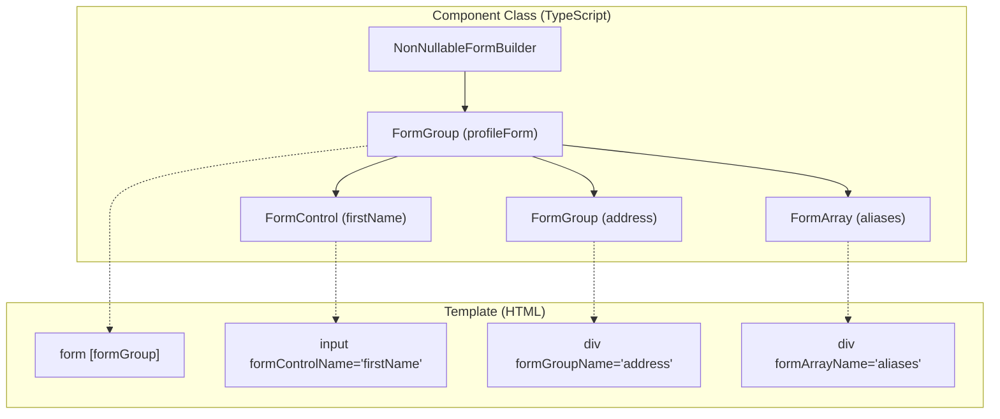
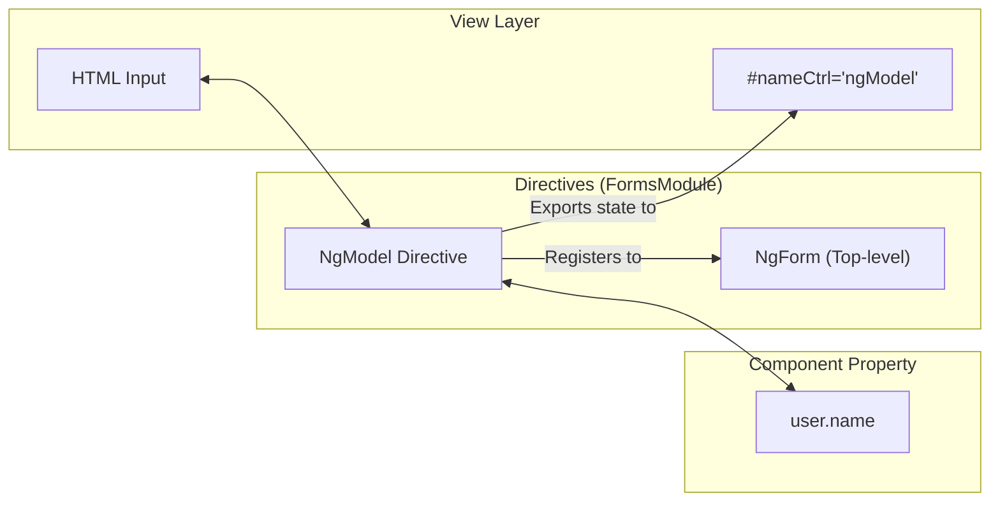

<!-- source: DeepWiki mcp.deepwiki.com · repo angular/skills · page 6.2 Reactive Forms and Template-Driven Forms · fetched 2026-10-27 -->

# Reactive Forms and Template-Driven Forms

<details>
<summary>Relevant source files</summary>

The following files were used as context for generating this wiki page:

- [angular-developer/references/reactive-forms.md](angular-developer/references/reactive-forms.md)
- [angular-developer/references/template-driven-forms.md](angular-developer/references/template-driven-forms.md)

</details>


Angular provides two distinct strategies for handling user input through forms: **Reactive Forms** and **Template-Driven Forms**. While both are supported, modern Angular development increasingly favors Reactive Forms for complex logic and Signal Forms for modern, signal-native reactivity.

## Overview of Form Strategies

| Feature | Reactive Forms | Template-Driven Forms |
| :--- | :--- | :--- |
| **Setup** | Explicitly defined in Component class | Implicitly defined in Template |
| **Data Model** | Structured and immutable (via `FormControl`) | Unstructured and mutable (via `[(ngModel)]`) |
| **Predictability** | High (synchronous access) | Low (asynchronous data flow) |
| **Validation** | Functions in TypeScript | Attributes in HTML |
| **Scalability** | High (complex arrays/groups) | Low (simple forms) |

---

## Reactive Forms

Reactive forms provide a model-driven approach to handling form inputs. They are built around observable streams and provide synchronous access to the data model, making them more scalable and testable than template-driven forms [angular-developer/references/reactive-forms.md:3-3]().

### Core Classes
The system is built on four fundamental classes from `@angular/forms`:
*   `FormControl`: Manages the value and validity of an individual input [angular-developer/references/reactive-forms.md:9-9]().
*   `FormGroup`: Manages a group of controls as an object-like structure [angular-developer/references/reactive-forms.md:10-10]().
*   `FormArray`: Manages a numerically indexed array of controls [angular-developer/references/reactive-forms.md:11-11]().
*   `FormBuilder` / `NonNullableFormBuilder`: A service providing factory methods for creating control instances [angular-developer/references/reactive-forms.md:12-12]().

### Data Flow and Implementation
In Reactive Forms, the component class is the source of truth. The template binds to these instances using specific directives.

**Form Model to View Mapping**

*Sources: [angular-developer/references/reactive-forms.md:31-39](), [angular-developer/references/reactive-forms.md:58-69]()*

### Implementation Example
To use Reactive Forms, `ReactiveFormsModule` must be imported into the component [angular-developer/references/reactive-forms.md:16-16]().

```ts
// Component implementation
export class ProfileEditor {
  private readonly fb = inject(NonNullableFormBuilder); // [angular-developer/references/reactive-forms.md:28-28]

  protected readonly profileForm = this.fb.group({
    firstName: ['', Validators.required],
    lastName: '',
    address: this.fb.group({
      street: '',
      city: '',
    }),
    aliases: this.fb.array([this.fb.control('')]),
  }); // [angular-developer/references/reactive-forms.md:31-39]
}
```

### Unified Change Events
Starting in Angular v18, all controls provide an `events` observable to track value, status, pristine, touched, reset, and submit events [angular-developer/references/reactive-forms.md:99-101]().

```ts
this.profileForm.events.subscribe((event) => {
  if (event instanceof ValueChangeEvent) {
    console.log('New value:', event.value);
  }
}); // [angular-developer/references/reactive-forms.md:106-110]
```

---

## Template-Driven Forms

Template-driven forms use two-way data binding (`[(ngModel)]`) to update the data model in the component as changes are made in the template and vice versa [angular-developer/references/template-driven-forms.md:3-3](). They rely on directives in the HTML template to manage form state and validation [angular-developer/references/template-driven-forms.md:3-3]().

### Core Directives
*   `NgModel`: Reconciles value changes in the form element with the data model [angular-developer/references/template-driven-forms.md:9-9]().
*   `NgForm`: Automatically creates a top-level `FormGroup` bound to the `<form>` tag [angular-developer/references/template-driven-forms.md:10-10]().
*   `NgModelGroup`: Creates a nested `FormGroup` bound to a DOM element [angular-developer/references/template-driven-forms.md:11-11]().

### Implementation and State
Every element using `[(ngModel)]` **must** have a `name` attribute, which Angular uses to register the control with the parent `NgForm` [angular-developer/references/template-driven-forms.md:39-39]().

**Template-Driven Control Lifecycle**

*Sources: [angular-developer/references/template-driven-forms.md:9-11](), [angular-developer/references/template-driven-forms.md:46-46]()*

### Validation and CSS Classes
Angular automatically applies CSS classes to controls and forms based on their state:
*   `ng-touched` / `ng-untouched`: Visited status [angular-developer/references/template-driven-forms.md:69-69]().
*   `ng-dirty` / `ng-pristine`: Value changed status [angular-developer/references/template-driven-forms.md:70-70]().
*   `ng-valid` / `ng-invalid`: Validity status [angular-developer/references/template-driven-forms.md:71-71]().

To display error messages, the `ngModel` directive is exported to a template reference variable:
```html
<input type="text" name="name" [(ngModel)]="user.name" #nameCtrl="ngModel" required />

@if (nameCtrl.invalid && (nameCtrl.dirty || nameCtrl.touched)) {
  <div>Name is required.</div>
}
```
*Sources: [angular-developer/references/template-driven-forms.md:91-99]()*

---

## Migration Path to Signal Forms

While Reactive and Template-Driven forms are the legacy standards, **Signal Forms** (introduced in v22+) are the preferred approach for modern Angular applications.

1.  **From Template-Driven**: Replace `[(ngModel)]` with Signal `model()` and the `[formField]` directive.
2.  **From Reactive Forms**: Transition `FormGroup` and `FormControl` instances to the new `form()` API. Signal forms remove the need for `Observable`-based value changes, replacing them with synchronous signal-based state.
3.  **Validation**: Move from attribute-based (Template-Driven) or class-based (Reactive) validators to the unified schema-driven validation in Signal Forms.

For detailed implementation of the modern approach, see **Section 6.1: Signal Forms**.

---

### Sources:
- [angular-developer/references/reactive-forms.md:3-118]()
- [angular-developer/references/template-driven-forms.md:3-114]()

---

