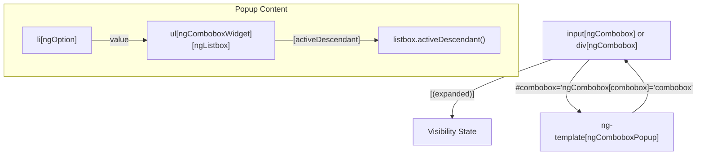
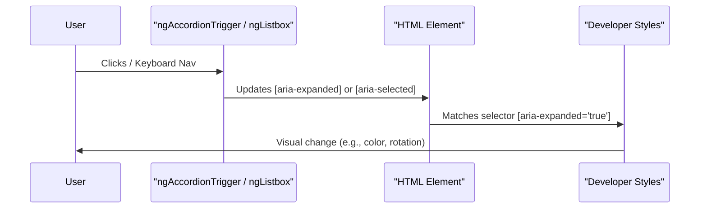

<!-- source: DeepWiki mcp.deepwiki.com · repo angular/skills · page 8.1 Aria Patterns: Accordion, Listbox, Combobox, and Select · fetched 2026-10-27 -->

# Aria Patterns: Accordion, Listbox, Combobox, and Select

<details>
<summary>Relevant source files</summary>

The following files were used as context for generating this wiki page:

- [angular-developer/references/angular-aria.md](angular-developer/references/angular-aria.md)

</details>


Angular Aria (`@angular/aria`) provides a suite of headless directives that implement WAI-ARIA design patterns. These directives manage the complex logic of accessibility—such as keyboard navigation, ARIA attribute synchronization, and focus management—while leaving the HTML structure and CSS styling to the developer.

Sources: [angular-developer/references/angular-aria.md:1-5]()

## 1. Accordion Pattern

The Accordion pattern is used to organize related content into expandable and collapsible sections. It is particularly effective for reducing vertical scrolling in content-heavy views like FAQs or multi-step forms.

### Directives and Components
- **`ngAccordionGroup`**: The parent container that manages the state of the panels.
- **`ngAccordionTrigger`**: The clickable element (usually a button) that toggles a specific panel.
- **`ngAccordionPanel`**: The container for the expandable content.
- **`ngAccordionContent`**: A directive used on an `<ng-template>` to enable lazy loading of the panel's content.

### Data Flow and Interaction
The `ngAccordionGroup` can restrict expansion behavior using the `[multiExpandable]` input. When set to `false`, only one panel can be open at a time. The `ngAccordionTrigger` is linked to a panel via the `[panel]` input, referencing a template variable assigned to the `ngAccordionPanel` instance.

### Implementation Example

```html
<div ngAccordionGroup [multiExpandable]="false">
  <div class="accordion-item">
    <!-- Trigger linked to panel1 -->
    <button ngAccordionTrigger [panel]="panel1" class="accordion-header">
      Section 1
      <span class="icon">▼</span>
    </button>
    
    <!-- Panel exported as ngAccordionPanel -->
    <div ngAccordionPanel #panel1="ngAccordionPanel" class="accordion-panel">
      <!-- Content only instantiated when panel is expanded -->
      <ng-template ngAccordionContent>
        <p>Lazy loaded content here.</p>
      </ng-template>
    </div>
  </div>
</div>
```

Sources: [angular-developer/references/angular-aria.md:22-58]()

---

## 2. Listbox Pattern

The Listbox pattern provides a foundational directive for selectable lists. Unlike a Select/Combobox, the Listbox is typically visible on the page rather than hidden behind a dropdown trigger.

### Key Directives
- **`ngListbox`**: The container directive. It supports `orientation` ("horizontal" or "vertical") and `[multi]` for multiple selection.
- **`ngOption`**: The individual selectable items within the list.

### Binding and Selection
Selection is managed via two-way binding on the `[(value)]` input of the `ngListbox`. The directives automatically handle `aria-selected` and `aria-multiselectable` attributes. Focus management is handled via roving tabindex or `activedescendant`.

### Implementation Example

```html
<ul ngListbox [(value)]="selectedItems" [multi]="true" orientation="vertical">
  <li ngOption value="apple" class="option">Apple</li>
  <li ngOption value="banana" class="option">Banana</li>
  <li ngOption value="cherry" class="option">Cherry</li>
</ul>
```

Sources: [angular-developer/references/angular-aria.md:77-105]()

---

## 3. Combobox and Select Patterns

These patterns combine the `ngCombobox` directive with an `ngListbox` inside a popup. The distinction between them is primarily the trigger element:
1.  **Combobox (Autocomplete)**: Applied to an `<input>`.
2.  **Select**: Applied to a focusable wrapper like a `<div>` or `<button>`.

### Components and Logic
- **`ngCombobox`**: Applied to the trigger element. It manages the `[(expanded)]` state and `[(value)]` of the search string or selection.
- **`ngComboboxPopup`**: A directive on an `<ng-template>` that defines the overlay content. It must be linked to the combobox instance via the `[combobox]` input.
- **`ngComboboxWidget`**: Applied to the internal listbox to signal it is part of a combobox interaction model.
- **`activeDescendant`**: The `ngListbox` exposes an `activeDescendant()` signal which should be bound to the `[activeDescendant]` input of the widget to ensure screen readers track the highlighted option correctly.

### Entity Relationship Diagram

| Entity | Role | Key API |
| :--- | :--- | :--- |
| `Combobox` | The Trigger | `[(expanded)]`, `[(value)]` |
| `ComboboxPopup` | The Overlay Container | `[combobox]` (reference to trigger) |
| `ComboboxWidget` | The Interaction Bridge | `[activeDescendant]` |
| `Listbox` | The Data Provider | `activeDescendant()` (signal) |

### Code Integration Diagram



### Implementation: Standard Autocomplete

```html
<div>
  <input
    ngCombobox
    #combobox="ngCombobox"
    [(value)]="searchString"
    [(expanded)]="isExpanded"
    placeholder="Search..."
  />

  <ng-template ngComboboxPopup [combobox]="combobox">
    <ul
      ngComboboxWidget
      ngListbox
      #listbox="ngListbox"
      [(value)]="selectedValue"
      [activeDescendant]="listbox.activeDescendant()"
      class="dropdown-menu"
    >
      <li ngOption value="1" label="Option 1">Option 1</li>
      <li ngOption value="2" label="Option 2">Option 2</li>
    </ul>
  </ng-template>
</div>
```

Sources: [angular-developer/references/angular-aria.md:127-192]()

---

## 4. Styling and State Management

Because these directives are headless, they apply ARIA attributes which must be targeted in CSS to provide visual feedback.

### Common CSS Targets

| Attribute | Use Case |
| :--- | :--- |
| `[aria-expanded="true"]` | Rotating icons on Accordion triggers or Comboboxes. |
| `[aria-selected="true"]` | Highlighting selected items in a Listbox or Select. |
| `[aria-disabled="true"]` | Greying out inactive elements. |
| `:focus-visible` | Managing the focus ring for keyboard navigation. |

### Logic vs Styling Separation



Sources: [angular-developer/references/angular-aria.md:7-17](), [angular-developer/references/angular-aria.md:60-73](), [angular-developer/references/angular-aria.md:107-123]()

---

