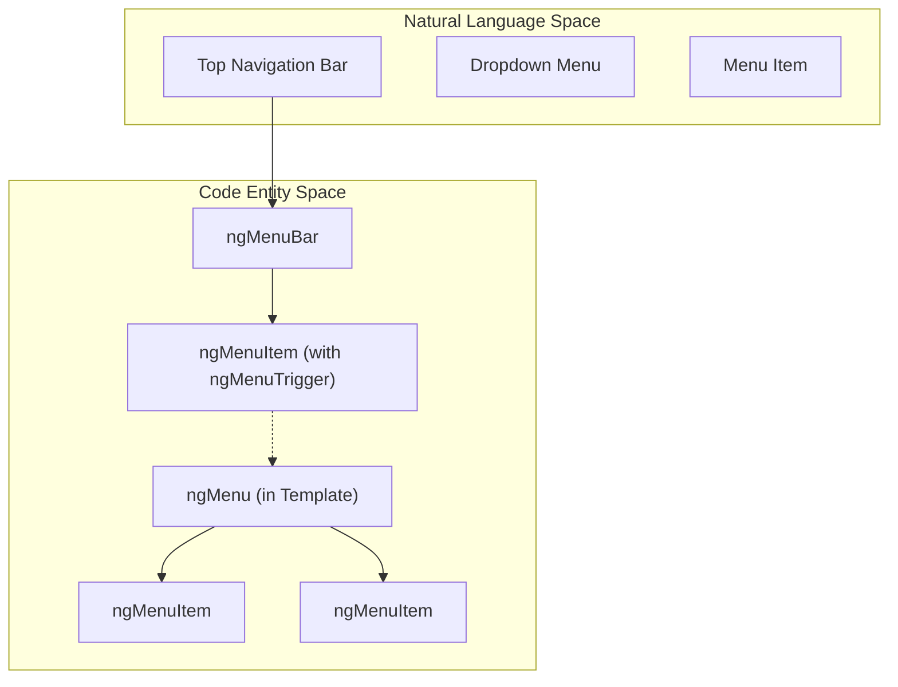
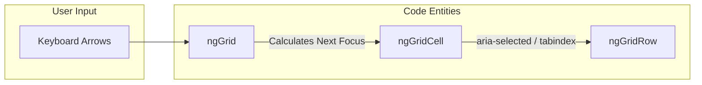

<!-- source: DeepWiki mcp.deepwiki.com · repo angular/skills · page 8.2 Aria Patterns: Menu, Tabs, Toolbar, Tree, and Grid · fetched 2026-10-27 -->

# Aria Patterns: Menu, Tabs, Toolbar, Tree, and Grid

Relevant source files

The following files were used as context for generating this wiki page:

- [angular-developer/references/angular-aria.md](angular-developer/references/angular-aria.md)

Angular Aria (`@angular/aria`) provides a suite of headless directives that implement complex WAI-ARIA patterns. These directives manage the heavy lifting of accessibility—such as keyboard navigation (roving tabindex, 2D grids), ARIA attribute automation, and focus management—leaving the developer responsible for HTML structure and CSS styling [angular-developer/references/angular-aria.md:1-5]().

## 1. Menu and MenuBar

The Menu pattern implements a system of command triggers and popups. It supports nested submenus, keyboard navigation (arrow keys), and automatic ARIA attribute management (e.g., `aria-haspopup`, `aria-expanded`).

### Implementation Details
*   **`ngMenuBar`**: The top-level horizontal container for a set of menus [angular-developer/references/angular-aria.md:214-220]().
*   **`ngMenu`**: A container for menu items, typically placed within a popup or dropdown [angular-developer/references/angular-aria.md:214-220]().
*   **`ngMenuItem`**: An individual command or selection within a menu. It handles the `click` and keyboard `Enter`/`Space` interactions [angular-developer/references/angular-aria.md:214-220]().
*   **`ngMenuTrigger`**: A directive applied to a button or item that opens a submenu [angular-developer/references/angular-aria.md:214-220]().

### Menu Structure and Data Flow
The following diagram illustrates the relationship between the trigger and the menu content.

**Diagram: Menu Component Hierarchy**

**Sources:** [angular-developer/references/angular-aria.md:214-230]()

---

## 2. Tabs

The Tabs pattern organizes content into separate panels where only one panel is visible at a time. The implementation uses a "tab list" to control the display of "tab panels."

### Key Directives
*   **`ngTabs`**: The root directive managing the state of the active tab [angular-developer/references/angular-aria.md:235-245]().
*   **`ngTabList`**: The container for the tab triggers. It handles horizontal/vertical keyboard navigation [angular-developer/references/angular-aria.md:235-245]().
*   **`ngTab`**: The trigger element. When activated, it signals the `ngTabs` controller to switch the active panel [angular-developer/references/angular-aria.md:235-245]().
*   **`ngTabPanel`**: The container for the content associated with a specific tab [angular-developer/references/angular-aria.md:235-245]().

### Keyboard Navigation
Angular Aria automatically manages the `tabindex`. Only the active `ngTab` is focusable (roving tabindex), allowing users to navigate between tabs using arrow keys without tabbing through every single item [angular-developer/references/angular-aria.md:108-123]().

**Sources:** [angular-developer/references/angular-aria.md:235-255]()

---

## 3. Toolbar

The Toolbar pattern provides a container for grouping a set of controls, such as buttons, checkboxes, or dropdowns.

### Implementation
*   **`ngToolbar`**: The main container directive. It manages focus among its children, ensuring the toolbar itself acts as a single stop in the page's tab order [angular-developer/references/angular-aria.md:260-270]().
*   **`ngToolbarWidget`**: Applied to interactive elements inside the toolbar to include them in the toolbar's keyboard navigation managed by the `ngToolbar` [angular-developer/references/angular-aria.md:260-270]().

**Sources:** [angular-developer/references/angular-aria.md:260-275]()

---

## 4. Tree

The Tree pattern represents a hierarchical list where items can be expanded or collapsed to reveal nested levels.

### Core Directives
*   **`ngTree`**: The root container for the hierarchical structure [angular-developer/references/angular-aria.md:280-290]().
*   **`ngTreeItem`**: A leaf node or a branch node in the tree [angular-developer/references/angular-aria.md:280-290]().
*   **`ngTreeItemGroup`**: A container for nested `ngTreeItem` elements, typically toggled by a parent item [angular-developer/references/angular-aria.md:280-290]().

**Sources:** [angular-developer/references/angular-aria.md:280-300]()

---

## 5. Grid

The Grid pattern is used for tabular data or layouts where 2D keyboard navigation (up, down, left, right) is required. This is distinct from a simple HTML table as it manages active cell focus.

### Structure
*   **`ngGrid`**: The main container for the grid structure [angular-developer/references/angular-aria.md:310-320]().
*   **`ngGridRow`**: Defines a row within the grid [angular-developer/references/angular-aria.md:310-320]().
*   **`ngGridCell`**: Defines an individual cell. The `ngGrid` directive manages the roving tabindex across these cells to allow 2D navigation [angular-developer/references/angular-aria.md:310-320]().

### 2D Navigation Logic
The `ngGrid` directive tracks the current coordinates (row, column) and intercepts arrow key events to move the `tabindex="0"` to the appropriate `ngGridCell` [angular-developer/references/angular-aria.md:108-123]().

**Diagram: Grid Interaction Model**

**Sources:** [angular-developer/references/angular-aria.md:310-330]()

---

## Summary of Styling Attributes

Since these directives are headless, developers must style states using ARIA attributes [angular-developer/references/angular-aria.md:7-17]().

| Attribute | Typical Usage |
| :--- | :--- |
| `[aria-expanded="true"]` | Applied to `ngAccordionTrigger`, `ngMenuTrigger`, or `ngTreeItem` when open [angular-developer/references/angular-aria.md:13](). |
| `[aria-selected="true"]` | Applied to `ngTab`, `ngOption`, or `ngGridCell` when active [angular-developer/references/angular-aria.md:14](). |
| `[aria-disabled="true"]` | Applied to any directive when the interaction is disabled [angular-developer/references/angular-aria.md:15](). |
| `:focus-visible` | Used to style the element currently holding focus via roving tabindex [angular-developer/references/angular-aria.md:120-123](). |

**Sources:** [angular-developer/references/angular-aria.md:7-17](), [angular-developer/references/angular-aria.md:108-123]()

---

