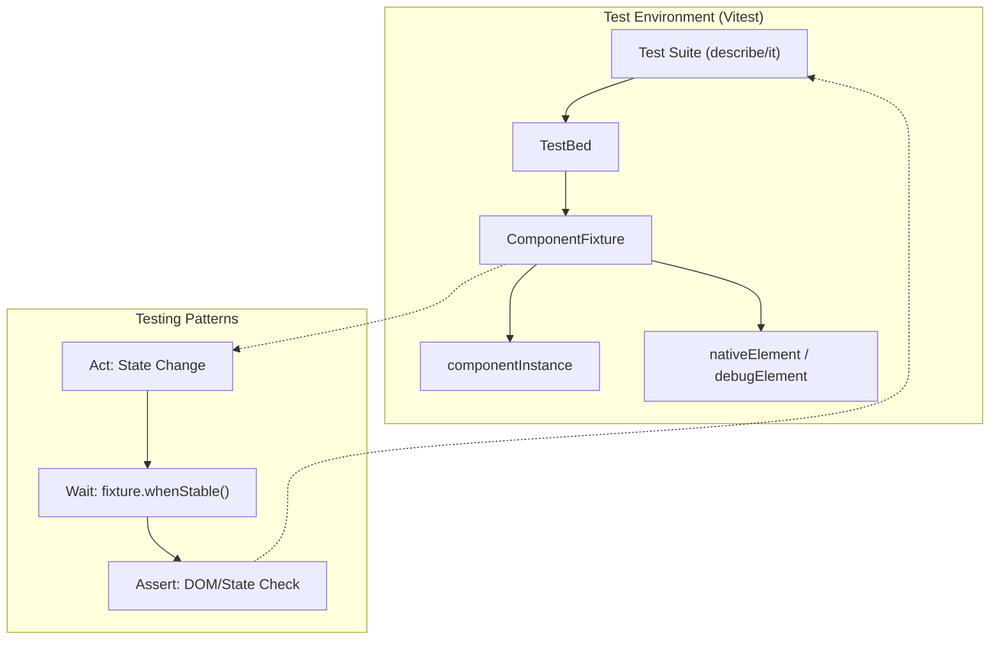
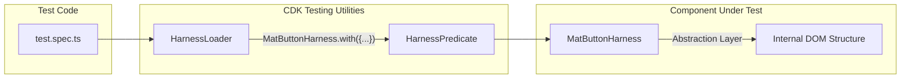

<!-- source: DeepWiki mcp.deepwiki.com · repo angular/skills · page 9 Testing · fetched 2026-10-27 -->

# Testing

Relevant source files

The following files were used as context for generating this wiki page:

- [angular-developer/references/component-harnesses.md](angular-developer/references/component-harnesses.md)
- [angular-developer/references/hierarchical-injectors.md](angular-developer/references/hierarchical-injectors.md)
- [angular-developer/references/testing-fundamentals.md](angular-developer/references/testing-fundamentals.md)

This page provides an overview of the testing strategy for the Angular Skills repository. The codebase emphasizes a modern, **zoneless** testing approach using **Vitest** as the primary test runner. The strategy spans from low-level unit tests of logic and components to high-level End-to-End (E2E) testing, with a strong focus on stable abstractions like Component Harnesses.

### Testing Architecture Overview

The testing strategy is built on four main pillars:
1.  **Unit Testing Fundamentals**: Utilizing `TestBed` and the "Act, Wait, Assert" pattern to handle asynchronous state updates without Zone.js.
2.  **Component Harnesses**: Using the `@angular/cdk/testing` API to create robust tests that interact with components as a user would, rather than targeting internal DOM structures.
3.  **Router Testing**: Validating navigation flows and route-dependent logic using specialized testing harnesses.
4.  **End-to-End Testing**: Validating the full application lifecycle against a live development server.

### Core Testing Workflow

The following diagram illustrates the relationship between the test environment, the Angular framework utilities, and the component under test.

**Angular Testing Environment Flow**

Sources: [angular-developer/references/testing-fundamentals.md:3-16](), [angular-developer/references/testing-fundamentals.md:57-63]()

---

### Unit Testing Fundamentals
Unit tests in this repository are designed for a **zoneless** environment. This means that state changes do not automatically trigger change detection in the same way they do in legacy apps. Developers must follow the **Act, Wait, Assert** pattern:
*   **Act**: Perform an action like `component.title.set('New Title')` [angular-developer/references/testing-fundamentals.md:46-46]().
*   **Wait**: Call `await fixture.whenStable()` to allow the framework to process scheduled updates [angular-developer/references/testing-fundamentals.md:49-49]().
*   **Assert**: Verify the DOM or state [angular-developer/references/testing-fundamentals.md:52-52]().

`TestBed` is used to configure the testing module and provide necessary services or mocks [angular-developer/references/testing-fundamentals.md:59-59]().

For details, see [Unit Testing Fundamentals](#9.1).

---

### Component Harnesses and Router Testing
Component Harnesses provide a "user-centric" API for tests. Instead of querying for CSS classes (e.g., `.mat-button`), tests use a `HarnessLoader` to find a `MatButtonHarness` [angular-developer/references/component-harnesses.md:17-47](). This makes tests resilient to internal template refactors.

**Harness Interaction Model**

Sources: [angular-developer/references/component-harnesses.md:3-9](), [angular-developer/references/component-harnesses.md:49-57]()

Router testing utilizes the `RouterTestingHarness` to simulate navigation and verify that the correct components are loaded and that guards or resolvers behave as expected.

For details, see [Component Harnesses and Router Testing](#9.2).

---

### Dependency Injection in Tests
Testing often requires overriding the **Hierarchical Injector** tree. Tests use `TestBed.configureTestingModule` to provide mocks for services. Understanding whether a service is in the `EnvironmentInjector` (singleton) or `ElementInjector` (component-scoped) is critical for proper mocking [angular-developer/references/hierarchical-injectors.md:5-16]().

| Injector Type | Scoped Via | Testing Impact |
| :--- | :--- | :--- |
| **EnvironmentInjector** | `providedIn: 'root'` | Mocked globally in `TestBed`. |
| **ElementInjector** | `providers: [...]` in `@Component` | Must be mocked at the component level in `TestBed.overrideComponent`. |

Sources: [angular-developer/references/hierarchical-injectors.md:5-16](), [angular-developer/references/testing-fundamentals.md:59-59]()

---

### End-to-End Testing
E2E tests verify the application as a whole. Because Component Harnesses are platform-agnostic, the same harnesses used in unit tests can often be shared with E2E tests to maintain consistency across the testing pyramid [angular-developer/references/component-harnesses.md:9-9]().

For details, see [End-to-End Testing](#9.3).

---

