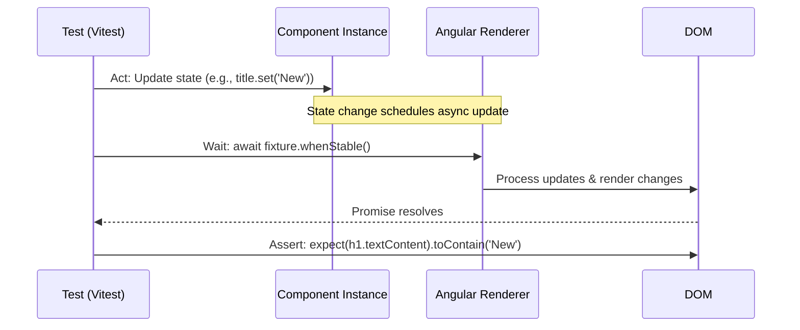
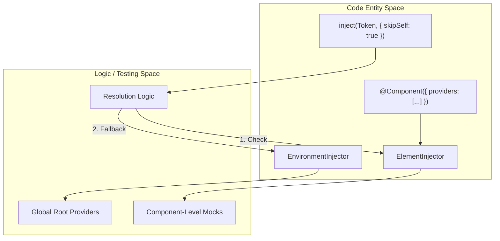

<!-- source: DeepWiki mcp.deepwiki.com · repo angular/skills · page 9.1 Unit Testing Fundamentals · fetched 2026-10-27 -->

# Unit Testing Fundamentals

<details>
<summary>Relevant source files</summary>

The following files were used as context for generating this wiki page:

- [angular-developer/references/hierarchical-injectors.md](angular-developer/references/hierarchical-injectors.md)
- [angular-developer/references/testing-fundamentals.md](angular-developer/references/testing-fundamentals.md)

</details>


This page covers the core principles and implementation details for unit testing in this repository. The testing strategy leverages **Vitest** as the test runner and follows a modern, **zoneless** approach that prioritizes asynchronous consistency.

## Core Philosophy: Zoneless Act-Wait-Assert

Modern Angular applications in this repository operate without Zone.js. In a zoneless environment, state changes (such as updating a signal or a property) schedule DOM updates asynchronously. Traditional manual change detection calls are replaced by a structured asynchronous pattern.

### The Act-Wait-Assert Pattern
To ensure tests accurately reflect the rendered state of a component, developers must follow these three steps:

1.  **Act**: Perform an action that triggers a state change, such as setting a component input, updating a signal, or simulating a user event [angular-developer/references/testing-fundamentals.md:12-12]().
2.  **Wait**: Use `await fixture.whenStable()` to allow the Angular framework to process the scheduled microtasks and complete the rendering cycle [angular-developer/references/testing-fundamentals.md:13-13]().
3.  **Assert**: Verify the resulting state in the DOM or the component instance [angular-developer/references/testing-fundamentals.md:14-14]().

**Rule**: Do **NOT** use `fixture.detectChanges()` to manually trigger updates in this codebase [angular-developer/references/testing-fundamentals.md:9-9]().

### Data Flow in Zoneless Tests

The following diagram illustrates the interaction between the test execution and the Angular rendering cycle:

**Diagram: Zoneless Test Lifecycle**

*Sources: [angular-developer/references/testing-fundamentals.md:5-15](), [angular-developer/references/testing-fundamentals.md:44-54]()*

---

## TestBed and ComponentFixture

`TestBed` is the primary utility for configuring the testing environment and creating the component under test.

### TestBed.configureTestingModule()
Used within `beforeEach` blocks to set up a test-specific module. This includes declaring the component, providing necessary services, and importing required modules [angular-developer/references/testing-fundamentals.md:59-59]().

### ComponentFixture
When `TestBed.createComponent()` is called, it returns a `ComponentFixture` object, which provides a handle on the component and its environment [angular-developer/references/testing-fundamentals.md:60-60]().

| Property | Description |
| :--- | :--- |
| `fixture.componentInstance` | Access to the TypeScript class instance of the component [angular-developer/references/testing-fundamentals.md:61-61](). |
| `fixture.nativeElement` | Access to the root HTML element of the component [angular-developer/references/testing-fundamentals.md:62-62](). |
| `fixture.debugElement` | A platform-agnostic wrapper around `nativeElement` for querying (e.g., using `By.css`) [angular-developer/references/testing-fundamentals.md:63-63](). |

*Sources: [angular-developer/references/testing-fundamentals.md:57-63]()*

---

## Service Mocking and Hierarchical Injection

Testing often requires mocking services to isolate the component logic. Angular's hierarchical injector system dictates how these mocks are resolved.

### Resolution Rules
Angular resolves dependencies in two phases:
1.  **ElementInjector**: Searches from the requesting component up through the DOM parent tree [angular-developer/references/hierarchical-injectors.md:14-14]().
2.  **EnvironmentInjector**: If not found in the DOM tree, searches the global injector tree (configured via `providedIn: 'root'`) [angular-developer/references/hierarchical-injectors.md:15-15]().

### Resolution Modifiers in Tests
When testing components that rely on specific injection behaviors, the `inject()` function modifiers can be verified or utilized:

*   `optional`: Returns `null` if the provider is missing [angular-developer/references/hierarchical-injectors.md:22-22]().
*   `self`: Limits the search to the component's own `providers` array [angular-developer/references/hierarchical-injectors.md:23-23]().
*   `skipSelf`: Starts searching at the parent injector [angular-developer/references/hierarchical-injectors.md:24-24]().

### Mocking Strategies
Mocks are typically provided in the `TestBed.configureTestingModule` call:

```ts
TestBed.configureTestingModule({
  providers: [
    { provide: DataService, useValue: { getData: () => of('mock data') } }
  ]
});
```

**Diagram: Dependency Resolution Mapping**
This diagram bridges the conceptual injector hierarchy to the code entities used in testing and implementation.


*Sources: [angular-developer/references/hierarchical-injectors.md:5-26](), [angular-developer/references/testing-fundamentals.md:59-59]()*

---

## Implementation Example: Testing Async Updates

The following implementation demonstrates the integration of `TestBed`, `ComponentFixture`, and the `whenStable()` utility to test a signal-based component.

```ts
describe('MyComponent', () => {
  let component: MyComponent;
  let fixture: ComponentFixture<MyComponent>;

  beforeEach(() => {
    // Configure the test module
    TestBed.configureTestingModule({});
    // Create the fixture and instance
    fixture = TestBed.createComponent(MyComponent);
    component = fixture.componentInstance;
  });

  it('should update the UI when a signal changes', async () => {
    // ACT: Update a signal property
    component.title.set('Updated Title');

    // WAIT: Wait for the zoneless async render cycle
    await fixture.whenStable();

    // ASSERT: Check the DOM for the updated value
    const h1 = fixture.nativeElement.querySelector('h1');
    expect(h1.textContent).toContain('Updated Title');
  });
});
```
*Sources: [angular-developer/references/testing-fundamentals.md:18-55]()*

### Summary of Testing Utilities

| Utility | Purpose | Code Reference |
| :--- | :--- | :--- |
| `TestBed` | Configures the injection environment and creates components. | [testing-fundamentals.md:59]() |
| `whenStable()` | Returns a promise that resolves when the zoneless change detection is complete. | [testing-fundamentals.md:13]() |
| `inject()` | Used within tests to retrieve instances from the injector. | [hierarchical-injectors.md:20]() |
| `skipSelf` / `self` | Modifiers to control injector traversal during tests. | [hierarchical-injectors.md:23-24]() |

*Sources: [angular-developer/references/testing-fundamentals.md:1-63](), [angular-developer/references/hierarchical-injectors.md:1-43]()*

---

