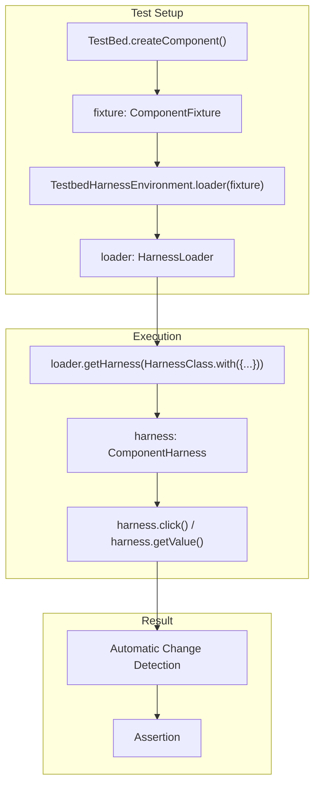
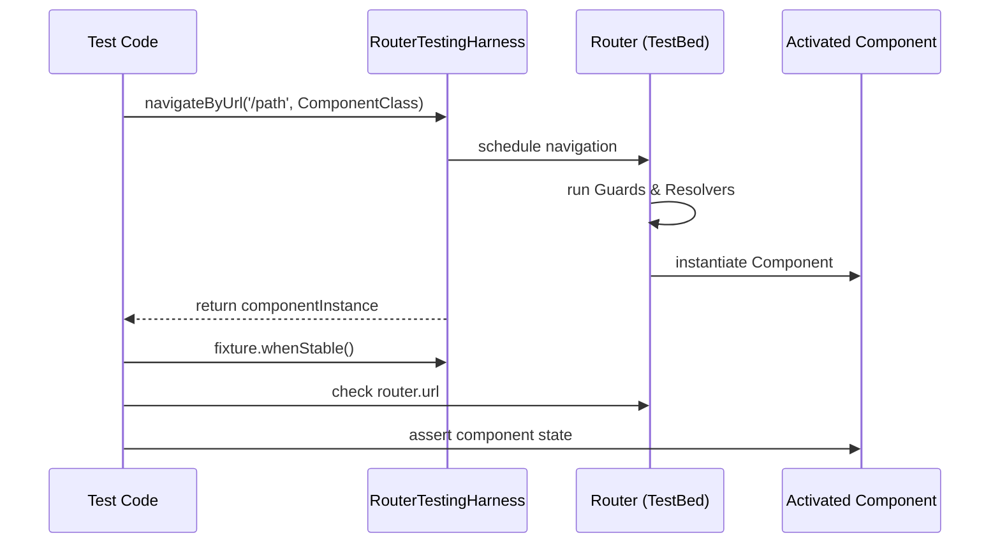

<!-- source: DeepWiki mcp.deepwiki.com · repo angular/skills · page 9.2 Component Harnesses and Router Testing · fetched 2026-10-27 -->

# Component Harnesses and Router Testing

Relevant source files

The following files were used as context for generating this wiki page:

- [angular-developer/references/component-harnesses.md](angular-developer/references/component-harnesses.md)
- [angular-developer/references/router-testing.md](angular-developer/references/router-testing.md)

Testing in modern Angular applications prioritizes stability and user-centric interactions. Component Harnesses provide an abstraction layer that decouples tests from internal DOM structures, while the `RouterTestingHarness` offers a specialized environment for validating navigation logic, guards, and resolvers without mocking the router.

## Component Harnesses

Component harnesses (from `@angular/cdk/testing`) are the standard, preferred method for interacting with components in tests [angular-developer/references/component-harnesses.md:1-3](). They provide a robust API that insulates tests from changes to a component's internal HTML or CSS classes, describing interactions from a user's perspective (e.g., `button.click()`) rather than DOM queries [angular-developer/references/component-harnesses.md:5-9]().

### Key Entities and Data Flow

The testing environment uses a `HarnessLoader` to locate and instantiate harnesses within a `ComponentFixture`.

| Entity | Role |
| :--- | :--- |
| `HarnessLoader` | Used to find and create harness instances within a specific DOM scope [angular-developer/references/component-harnesses.md:51-52](). |
| `TestbedHarnessEnvironment` | The entry point for unit tests to create a `HarnessLoader` from a `ComponentFixture` [angular-developer/references/component-harnesses.md:15-20](). |
| `HarnessPredicate` | Created via `HarnessClass.with({...})` to filter components based on properties like text or state [angular-developer/references/component-harnesses.md:55-56](). |

**Component Harness Interaction Flow**

Sources: [angular-developer/references/component-harnesses.md:19-57]()

### Implementation Example
To interact with a button, the test uses `MatButtonHarness` to find the element by its visible text, ensuring that even if the internal `` or class names change, the test remains valid [angular-developer/references/component-harnesses.md:36-45]().

Sources: [angular-developer/references/component-harnesses.md:17-47]()

---

## Router Testing

The `RouterTestingHarness` is the primary tool for testing routing scenarios. It avoids the anti-pattern of mocking the `Router` service, ensuring that actual route configurations, guards, and resolvers are executed during the test [angular-developer/references/router-testing.md:1-5]().

### Router Testing Architecture

The harness manages the navigation lifecycle, providing access to the activated component instances and the underlying `Router` state.

**Router Harness Navigation Flow**

Sources: [angular-developer/references/router-testing.md:52-88]()

### Key Functions and Methods

*   **`provideRouter([...])`**: Configures the `TestBed` with specific routes required for the test [angular-developer/references/router-testing.md:28-32]().
*   **`RouterTestingHarness.create()`**: Asynchronously initializes the harness environment [angular-developer/references/router-testing.md:36-37]().
*   **`harness.navigateByUrl(url, Component)`**: Triggers navigation and returns the instance of the component associated with the new route [angular-developer/references/router-testing.md:55-79]().
*   **`harness.routeDebugElement`**: Provides access to the `componentInstance` of the currently activated route after navigation has occurred [angular-developer/references/router-testing.md:69-70]().

### Testing Navigation and Guards
When testing navigation triggered by component logic (e.g., a button click inside the component), it is essential to call `await harness.fixture.whenStable()` to allow the asynchronous routing cycle to complete before asserting against the `Router.url` or the new component's state [angular-developer/references/router-testing.md:61-66]().

Sources: [angular-developer/references/router-testing.md:13-39](), [angular-developer/references/router-testing.md:52-81](), [angular-developer/references/router-testing.md:85-88]()

---

