# Page: Overview

# Overview

<details>
<summary>Relevant source files</summary>

The following files were used as context for generating this wiki page:

- [BUILD_INFO](BUILD_INFO)
- [README.md](README.md)
- [angular-developer/SKILL.md](angular-developer/SKILL.md)
- [angular-developer/references/http-client.md](angular-developer/references/http-client.md)
- [angular-new-app/SKILL.md](angular-new-app/SKILL.md)

</details>


The **Angular Skills** repository is a comprehensive collection of architectural guidelines, best practices, and automated instructions designed for technical users and **agentic coding tools** (such as Gemini CLI, Cursor, or Antigravity). These skills enable agents to generate idiomatic Angular code, scaffold modern projects, and manage complex application state using the latest framework features (v19+).

For information on how to add these skills to your environment, see the [README.md:10-18]().

### Core Capabilities
*   **Architectural Guidance**: Standards for reactivity, dependency injection, and routing.
*   **Modern Scaffolding**: Automated project creation using `ng new` with AI-optimized configurations.
*   **Best Practices**: Implementation of Signal-based reactivity, Signal Forms, and headless accessibility patterns.
*   **Tooling Integration**: Built-in support for the Angular CLI and MCP (Model Context Protocol) servers.

Sources: [README.md:1-9](), [angular-developer/SKILL.md:2-8]()

---

## Skill Architecture

The repository is organized into two primary skill sets that bridge natural language requirements to specific code entities and CLI commands.

### Skill Mapping: Natural Language to Code Entities

The following diagram illustrates how user intent maps to the underlying Angular primitives and services defined in this repository.

**Diagram: User Intent to Angular Entity Mapping**
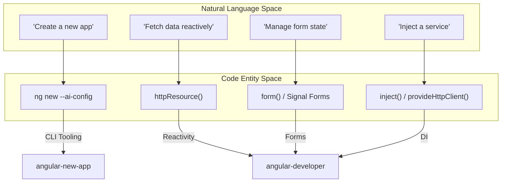
Sources: [angular-developer/SKILL.md:2-8](), [angular-new-app/SKILL.md:27-31](), [angular-developer/references/http-client.md:92-98]()

---

## Primary Skills

### 1.1 angular-developer Skill
The `angular-developer` skill is the primary engine for code generation and architectural decision-making. It covers the full lifecycle of component development, reactivity management, and testing. It enforces the "Intent over Role" naming philosophy and prioritizes Signal-based APIs over legacy RxJS patterns where appropriate.

**Key Responsibilities:**
*   **Reactivity**: Implementing `signal()`, `computed()`, and `resource()` [angular-developer/SKILL.md:58-63]().
*   **HTTP**: Configuring `provideHttpClient` and utilizing `httpResource` for eager data fetching [angular-developer/references/http-client.md:87-108]().
*   **Dependency Injection**: Managing `inject()` contexts and hierarchical injectors [angular-developer/SKILL.md:82-90]().

For details, see [angular-developer Skill](#1.1).

### 1.2 angular-new-app Skill
The `angular-new-app` skill focuses on the initial scaffolding and environment setup. It ensures that new projects are created with the correct CLI flags and AI-specific configurations to maximize the effectiveness of coding agents.

**Key Responsibilities:**
*   **Prerequisite Checks**: Verifying `ng` installation via `which` or `gcm` [angular-new-app/SKILL.md:17-24]().
*   **Project Scaffolding**: Executing `npx ng new` with `--ai-config` to load agent-specific context [angular-new-app/SKILL.md:27-31]().
*   **Feature Integration**: Automated setup of Tailwind CSS via `ng add tailwindcss` [angular-new-app/SKILL.md:60-60]().

For details, see [angular-new-app Skill](#1.2).

---

## System Integration

The skills interact with the local environment and external tools through a defined execution flow.

**Diagram: Skill Execution Flow**
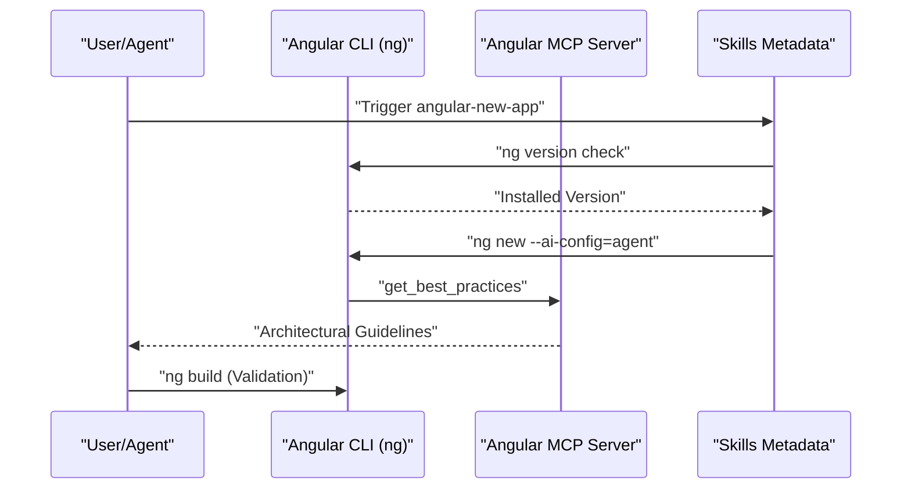
Sources: [angular-new-app/SKILL.md:25-33](), [angular-developer/SKILL.md:16-17](), [README.md:10-18]()

---

## Reference Topics Summary

| Domain | Modern Approach (v19+) | Reference Source |
| :--- | :--- | :--- |
| **State** | Signals (`signal`, `computed`, `linkedSignal`) | `signals-overview.md` |
| **Data Fetching** | `httpResource` and `resource` | `http-client.md` |
| **Forms** | Signal Forms (v22+) | `signal-forms.md` |
| **Naming** | Intent over Role (suffixless files) | `naming-conventions.md` |
| **DI** | `inject()` function | `di-fundamentals.md` |
| **Tooling** | MCP Server (`ng mcp`) | `SKILL.md` |

Sources: [angular-developer/SKILL.md:44-101](), [angular-developer/references/http-client.md:87-90]()

---

# Page: angular-developer Skill

# angular-developer Skill

<details>
<summary>Relevant source files</summary>

The following files were used as context for generating this wiki page:

- [README.md](README.md)
- [angular-developer/SKILL.md](angular-developer/SKILL.md)
- [angular-developer/references/http-client.md](angular-developer/references/http-client.md)

</details>


The `angular-developer` skill is a specialized agentic capability designed to generate idiomatic Angular code and provide architectural guidance aligned with modern best practices (Angular v19+). It serves as the primary intelligence layer for creating components, services, and HTTP communication, while ensuring compliance with the latest reactivity models, form strategies, and accessibility standards [angular-developer/SKILL.md:1-8]().

## Activation and Purpose

The skill is activated when an agentic tool (such as Gemini CLI or Antigravity) encounters tasks related to [angular-developer/SKILL.md:3-8]():
*   **Project Initialization**: Scaffolding new applications or workspaces.
*   **Code Generation**: Creating components, services, directives, pipes, or routes.
*   **Reactivity**: Implementing state management using Signals, `linkedSignal`, `resource`, or `httpResource`.
*   **Forms**: Implementing Signal Forms (v22+) or legacy Reactive/Template-driven forms.
*   **Infrastructure**: Configuring Dependency Injection, Routing, SSR, or Testing.
*   **Compliance**: Applying naming conventions ("Intent over Role") and accessibility (ARIA) patterns.

## Project Creation Decision Logic

When tasked with creating a new Angular project, the `angular-developer` skill follows a strict hierarchical decision tree to determine the execution environment and versioning strategy.

### Execution Rules for `ng new`

The system prioritizes user intent, then local environment capabilities, and finally falls back to the latest stable release [angular-developer/SKILL.md:25-43]().

| Condition | Action | Command |
| :--- | :--- | :--- |
| **Explicit Version Requested** | Bypass local install; use `npx` | `npx @angular/cli@<version> new <name>` |
| **No Version Specified & CLI Installed** | Use existing local/global installation | `ng new <name>` |
| **No Version Specified & CLI Missing** | Fetch and execute latest via `npx` | `npx @angular/cli@latest new <name>` |

### System Flow: Project Initialization
The following diagram illustrates the internal logic used by the skill to bridge the Natural Language request for a "new project" to the specific CLI execution [angular-developer/SKILL.md:25-43]().

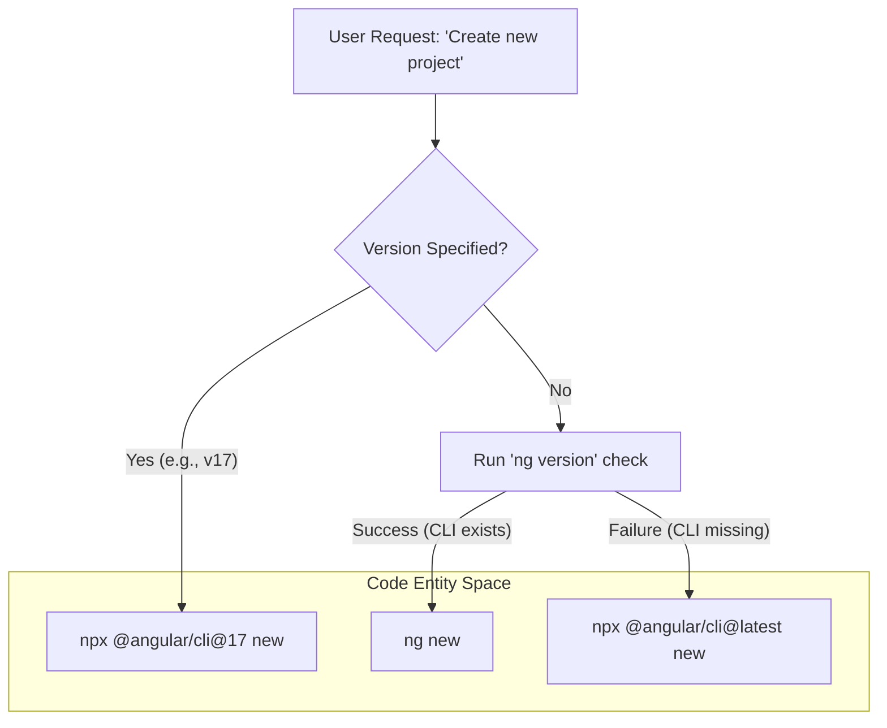
**Sources:** [angular-developer/SKILL.md:25-43]()

## Reference Topic Map

The `angular-developer` skill acts as a router to specific domain documentation. It organizes its knowledge base into the following reference domains:

### 1. Component Architecture
Focuses on modern component anatomy and the shift toward signal-based inputs and outputs.
*   **Key Files**: `references/components.md`, `references/inputs.md`, `references/outputs.md`, `references/host-elements.md` [angular-developer/SKILL.md:48-51]().
*   **Core Primitives**: `@Component`, `input()`, `output()`, `model()`.

### 2. Reactivity & Data
Covers the signal-based reactivity system introduced in v17+ and refined in v19+.
*   **Key Files**: `references/signals-overview.md`, `references/linked-signal.md`, `references/resource.md`, `references/effects.md` [angular-developer/SKILL.md:60-63]().
*   **Core Primitives**: `signal()`, `computed()`, `linkedSignal()`, `resource()`.

### 3. HTTP & Connectivity
Defines how to interact with backends using both traditional Observables and new Signal-native resources.
*   **Key Files**: `references/http-client.md` [angular-developer/SKILL.md:69]().
*   **Core Primitives**: `HttpClient`, `httpResource()`, `provideHttpClient()`.

### 4. Dependency Injection (DI)
Detailed rules for the `inject()` function and hierarchical injector resolution.
*   **Key Files**: `references/di-fundamentals.md`, `references/creating-services.md`, `references/defining-providers.md`, `references/injection-context.md`, `references/hierarchical-injectors.md` [angular-developer/SKILL.md:86-90]().

### 5. Specialized Domains
*   **Forms**: Defaulting to **Signal Forms** for v22+ projects [angular-developer/SKILL.md:23, 75]().
*   **Aria**: Implementing accessible patterns via `@angular/aria` [angular-developer/SKILL.md:98-101]().
*   **Naming**: Applying "Intent over Role" conventions (e.g., `user-profile.ts` instead of `user-profile.component.ts`) [angular-developer/SKILL.md:52]().

## Data Flow: HTTP Communication
This diagram bridges the Natural Language requirement "fetch data" to the `HttpClient` and `httpResource` implementations [angular-developer/references/http-client.md:24-108]().

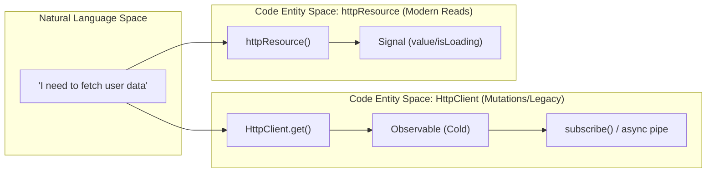
**Sources:** [angular-developer/references/http-client.md:24-108]()

## Implementation Guidelines
The skill follows these non-negotiable technical constraints:
1.  **Version Awareness**: Always analyze the project's Angular version before suggesting features (e.g., checking if `Signal Forms` is available in v22+) [angular-developer/SKILL.md:12, 75]().
2.  **CLI Consistency**: Use Angular CLI for all scaffolding to ensure consistent directory structures [angular-developer/SKILL.md:14]().
3.  **Verification**: After generating code, the skill is instructed to run `ng build` to validate the output [angular-developer/SKILL.md:16]().
4.  **Service Encapsulation**: Backend calls must be encapsulated in injectable services using the `inject()` function, not directly in components [angular-developer/references/http-client.md:26-34]().

**Sources:** [angular-developer/SKILL.md:1-101](), [README.md:1-34](), [angular-developer/references/http-client.md:1-108]()

---

# Page: angular-new-app Skill

# angular-new-app Skill

<details>
<summary>Relevant source files</summary>

The following files were used as context for generating this wiki page:

- [angular-developer/references/cli.md](angular-developer/references/cli.md)
- [angular-developer/references/injection-context.md](angular-developer/references/injection-context.md)
- [angular-new-app/SKILL.md](angular-new-app/SKILL.md)

</details>


The `angular-new-app` skill provides a standardized workflow for creating and configuring modern Angular applications. It emphasizes the use of the Angular CLI for all scaffolding tasks to ensure adherence to framework best practices, including specific configurations for AI-assisted development environments and modern styling utilities like Tailwind CSS.

## Application Scaffolding Workflow

Creating a new application follows a strict sequence to ensure the environment is correctly configured before any code is generated.

### 1. Prerequisite Verification
Before initiating a project, the system must verify the presence of the Angular CLI (`ng`). The verification method depends on the operating system:
*   **\*nix systems**: `which ng` [angular-new-app/SKILL.md:18-18]()
*   **Windows systems**: `where ng` (or `gcm ng` in PowerShell) [angular-new-app/SKILL.md:19-19]()

If the CLI is missing, the user is prompted to install it globally via `npm install -g @angular/cli` [angular-new-app/SKILL.md:21-23]().

### 2. The `ng new` Command
Applications are created using `npx ng new <app-name>` with specific flags to ensure a non-interactive, AI-optimized setup.

| Flag | Purpose | Recommended Values |
| :--- | :--- | :--- |
| `--interactive` | Disables prompts for automated environments | `false` |
| `--ai-config` | Injects AI-specific context/rules into the workspace | `agent`, `gemini`, `claude`, `copilot`, `cursor`, `jetbrains`, `windsurf` |
| `--style` | Sets the stylesheet format | `scss`, `css`, `less` |
| `--routing` | Generates a routing module configuration | Boolean |
| `--ssr` | Enables Server-Side Rendering | Boolean |
| `--prefix` | Sets the component selector prefix | User-defined string |

**Sources:** [angular-new-app/SKILL.md:27-41]()

### 3. AI Configuration Integration
The `--ai-config` flag is critical for modern development. When set (e.g., `--ai-config=gemini`), the system loads the resulting configuration into memory to ensure all subsequent code generation aligns with modern Angular best practices [angular-new-app/SKILL.md:29-33]().

## Code Generation & Modification

Once the workspace is scaffolded, all new entities should be generated via `ng generate` (or `ng g`) rather than manual file creation. This ensures that metadata is correctly registered and files are placed in the appropriate directory structure [angular-developer/references/cli.md:21-24]().

### Standard Generation Commands

| Entity | CLI Command |
| :--- | :--- |
| **Component** | `npx ng generate component <name>` |
| **Service** | `npx ng generate service <name>` |
| **Pipe** | `npx ng generate pipe <name>` |
| **Directive** | `npx ng generate directive <name>` |
| **Guard** | `npx ng generate guard <name>` |
| **Interceptor** | `npx ng generate interceptor <name>` |
| **Resolver** | `npx ng generate resolver <name>` |
| **Environments** | `ng g environments` |

**Sources:** [angular-new-app/SKILL.md:44-55](), [angular-developer/references/cli.md:25-32]()

### Modern Best Practices
*   **Tailwind CSS**: Integration is handled via `npx ng add tailwindcss`, which configures the workspace for Tailwind v4 [angular-new-app/SKILL.md:60-60]().
*   **Best Practices Tooling**: The Angular CLI includes an MCP (Model Context Protocol) server. Agents should utilize `npx ng mcp` and the `get_best_practices` tool to retrieve up-to-date framework recommendations [angular-new-app/SKILL.md:62-62]().

## System Flow: Natural Language to CLI Execution

The following diagram illustrates how user intent for a "new app" is translated into specific code entities and CLI commands.

**Natural Language to Workspace Entity Mapping**
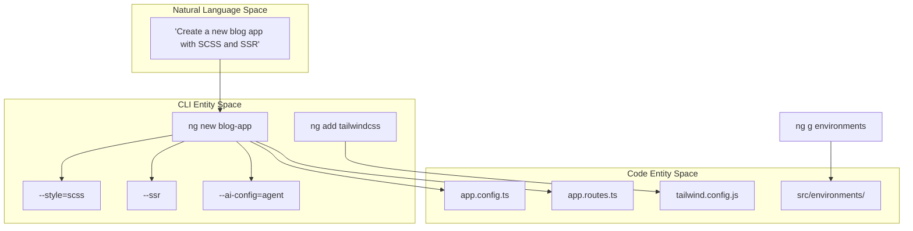
**Sources:** [angular-new-app/SKILL.md:27-39](), [angular-developer/references/cli.md:32-32](), [angular-new-app/SKILL.md:60-60]()

## Dependency Management

The skill distinguishes between standard `npm` installs and Angular-specific integrations.

*   **`ng add`**: This command MUST be used for Angular libraries (e.g., `@angular/material`, `tailwindcss`). It performs both the package installation and the necessary schematic updates to `angular.json` and root providers [angular-developer/references/cli.md:5-13]().
*   **`ng update`**: Used to migrate the application and its dependencies, automatically running code migrations to keep the project current with the latest Angular version [angular-developer/references/cli.md:15-19]().

## Execution Context and Lifecycle

The lifecycle of a new application project involves scaffolding, verification, and iterative generation.

**Project Initiation Lifecycle**
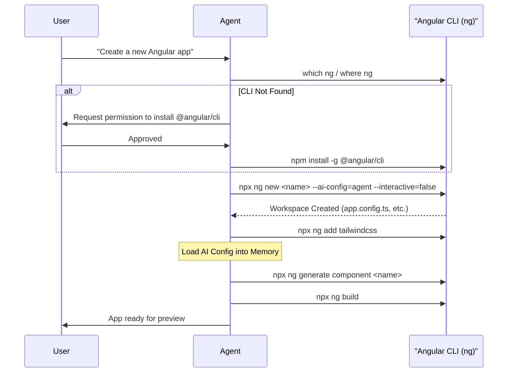
**Sources:** [angular-new-app/SKILL.md:17-33](), [angular-new-app/SKILL.md:42-42](), [angular-new-app/SKILL.md:60-60]()

## Build and Test Commands

*   **Development**: `ng serve` starts the local server with HMR (Hot Module Replacement) [angular-developer/references/cli.md:38-41]().
*   **Production**: `ng build` uses the `@angular/build:application` (esbuild-based) builder, enabling AOT (Ahead-of-Time) compilation and minification by default [angular-developer/references/cli.md:64-70]().
*   **Testing**: `ng test` for unit tests and `ng e2e` for end-to-end testing [angular-developer/references/cli.md:73-77]().

**Sources:** [angular-developer/references/cli.md:38-77]()

---

# Page: Components and Templates

# Components and Templates

<details>
<summary>Relevant source files</summary>

The following files were used as context for generating this wiki page:

- [angular-developer/references/components.md](angular-developer/references/components.md)
- [angular-developer/references/inputs.md](angular-developer/references/inputs.md)
- [angular-developer/references/outputs.md](angular-developer/references/outputs.md)

</details>


Angular component architecture in modern versions (v19+) focuses on a declarative, signal-based approach to building user interfaces. Components serve as the primary building blocks, encapsulating logic, templates, and styles into reusable units that form a hierarchical tree structure.

## Component Architecture

Every Angular component consists of a TypeScript class decorated with `@Component`, which defines its metadata and behavior [angular-developer/references/components.md:3-10](). By default, modern Angular components are **standalone**, meaning they manage their own dependencies via an `imports` array rather than requiring an `NgModule` [angular-developer/references/components.md:36-40, 133-134]().

### Visualizing Component Structure

The following diagram illustrates the relationship between the TypeScript class, the metadata, and the rendered DOM (Host Element).

**Component Entity Mapping**
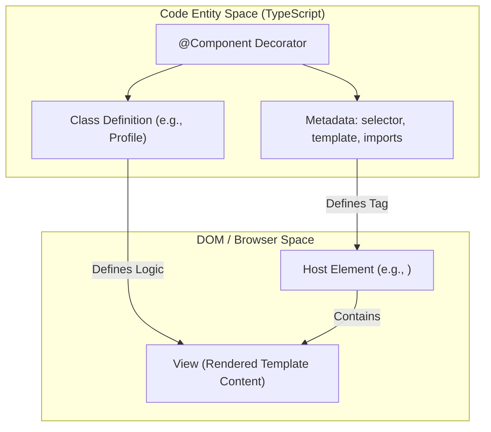
Sources: [angular-developer/references/components.md:3-27, 131-132]()

## Core Concepts

### Component Anatomy and Template Syntax
Angular uses a specialized HTML-based template syntax. This includes modern built-in control flow blocks like `@if`, `@for`, and `@switch` for conditional rendering and iteration [angular-developer/references/components.md:71-128](). It also supports modern developer experience features like self-closing tags for custom components [angular-developer/references/components.md:51-67]().

For details, see [Component Anatomy and Template Syntax](#2.1).

### Data Flow: Inputs and Outputs
Modern Angular emphasizes **Signal-based reactivity**. Data flows into components via `input()` and `input.required()` signals [angular-developer/references/inputs.md:5-26](). Communication back to parents is handled via the `output()` function [angular-developer/references/outputs.md:5-27](). Two-way synchronization is facilitated by the `model()` API [angular-developer/references/inputs.md:54-70]().

For details, see [Inputs, Outputs, and Two-Way Binding](#2.2).

### Host Elements and Styling
Every component is associated with a **Host Element** in the DOM, defined by its `selector` [angular-developer/references/components.md:31, 131](). Styling is encapsulated by default, ensuring that CSS defined within a component does not leak to the rest of the application [angular-developer/references/components.md:16-20, 34-35]().

For details, see [Host Elements and Component Styling](#2.3).

### Naming Conventions
Modern Angular (v20+) follows an **"Intent over Role"** philosophy. This involves moving away from mandatory `Component` suffixes in class names and filenames (e.g., `profile.ts` instead of `profile.component.ts`) to create cleaner, more readable directory structures [angular-developer/references/components.md:135]().

For details, see [Naming Conventions](#2.4).

## Data Communication Summary

The following table summarizes the modern vs. legacy APIs for component communication:

| Feature | Modern API (v19+) | Legacy API |
| :--- | :--- | :--- |
| **Input** | `input()` / `input.required()` | `@Input()` |
| **Output** | `output()` | `@Output()` / `EventEmitter` |
| **Two-Way** | `model()` | `@Input()` + `@Output()` |
| **Logic** | Signals / `computed()` | Plain properties / `ngOnChanges` |

Sources: [angular-developer/references/inputs.md:5-93](), [angular-developer/references/outputs.md:5-79]()

**Data Flow Directionality**
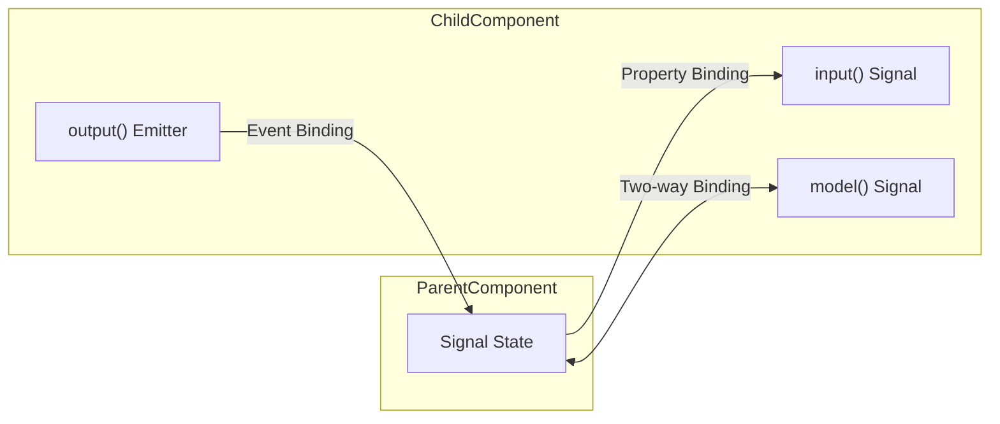
Sources: [angular-developer/references/inputs.md:7-9, 72-80](), [angular-developer/references/outputs.md:29-35]()

---

# Page: Component Anatomy and Template Syntax

# Component Anatomy and Template Syntax

<details>
<summary>Relevant source files</summary>

The following files were used as context for generating this wiki page:

- [angular-developer/references/components.md](angular-developer/references/components.md)
- [angular-developer/references/naming-conventions.md](angular-developer/references/naming-conventions.md)

</details>


This page provides a technical deep dive into the structure and definition of Angular components. It covers the `@Component` decorator, metadata configuration, modern template syntax including built-in control flow, and the component tree model.

## Component Anatomy

Angular components are the fundamental building blocks of an application, consisting of a TypeScript class that defines behavior, an HTML template for the UI, and CSS for styling [angular-developer/references/components.md:1-4]().

### The @Component Decorator
The `@Component` decorator defines the metadata for the class, instructing Angular how to instantiate the component and render its view [angular-developer/references/components.md:7-21]().

| Metadata Option | Description |
| :--- | :--- |
| `selector` | The CSS selector that identifies this component in templates [angular-developer/references/components.md:31](). |
| `template` | Inline HTML template (preferred for small templates) [angular-developer/references/components.md:32](). |
| `templateUrl` | Path to an external HTML file [angular-developer/references/components.md:33](). |
| `styles` | Inline CSS styles [angular-developer/references/components.md:34](). |
| `styleUrl` / `styleUrls` | Path(s) to external CSS file(s) [angular-developer/references/components.md:35](). |
| `imports` | Array of components, directives, or pipes used within the template [angular-developer/references/components.md:36](). |

### Standalone Components
In modern Angular (v19+), components are standalone by default [angular-developer/references/components.md:133](). This means they manage their own dependencies via the `imports` array rather than being declared in an `NgModule`.

### Naming Conventions
Following the "Intent over Role" philosophy, modern components drop the `.component.ts` suffix in filenames and the `Component` suffix in class names [angular-developer/references/naming-conventions.md:10]().

*   **File**: `product-list.ts` [angular-developer/references/naming-conventions.md:21]()
*   **Class**: `export class ProductList { ... }` [angular-developer/references/naming-conventions.md:22]()

**Sources:**
- [angular-developer/references/components.md:1-37]()
- [angular-developer/references/components.md:133-135]()
- [angular-developer/references/naming-conventions.md:10-22]()

---

## Component Tree and Data Flow

Angular applications are structured as a tree of components. Each component hosts a "View" (the DOM rendered by its template) inside a "Host Element" (the DOM element matching its selector) [angular-developer/references/components.md:129-134]().

### Natural Language to Code Entity Space: Component Composition

This diagram maps the conceptual "Component Tree" to the specific code entities required to implement it.

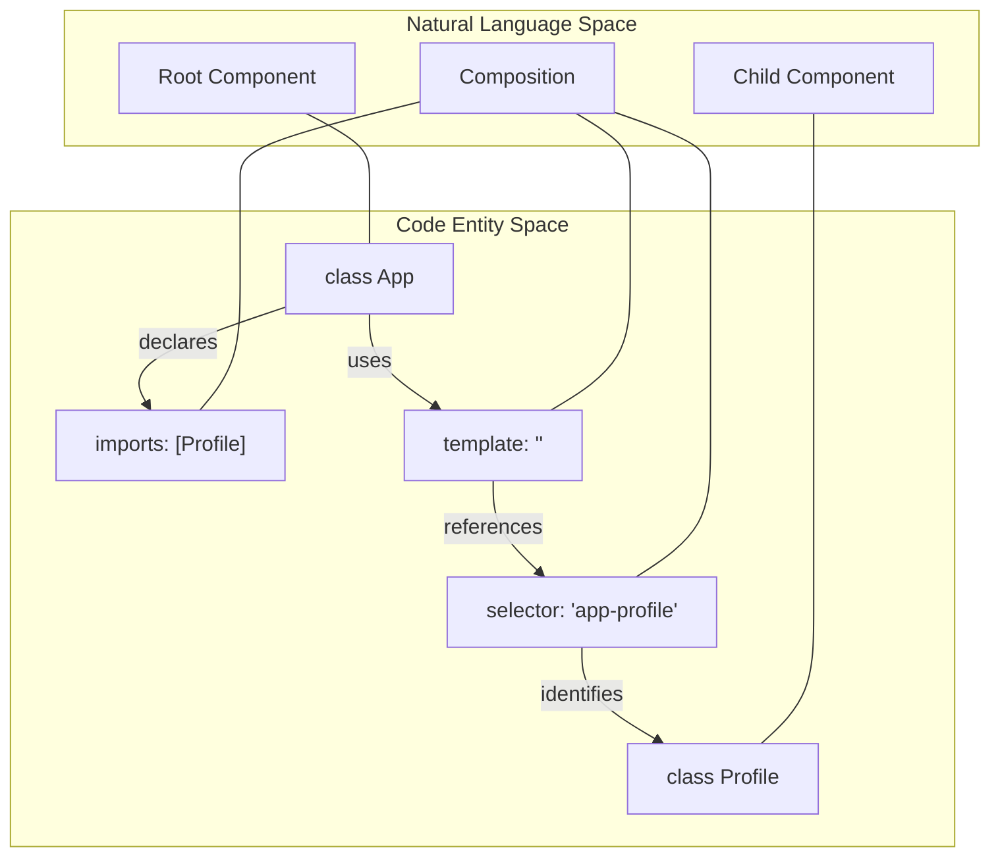

**Sources:**
- [angular-developer/references/components.md:42-49]()
- [angular-developer/references/components.md:129-134]()

---

## Template Syntax

Modern Angular templates support self-closing tags and a dedicated syntax for control flow.

### Self-Closing Tags
Angular supports self-closing tags for custom components. This is the preferred style when a component does not contain projected content [angular-developer/references/components.md:51-61]().

*   **Preferred**: `<app-profile />` [angular-developer/references/components.md:59]()
*   **Avoid**: `<app-profile></app-profile>` [angular-developer/references/components.md:64]()

### Built-in Control Flow
Angular provides optimized blocks for conditional rendering, loops, and switches.

#### 1. Conditional Rendering (`@if`)
Used for conditional branching. It supports `@else if` and `@else` blocks, as well as result aliasing using the `as` keyword [angular-developer/references/components.md:73-93]().

```html
@if (user.settings(); as settings) {
  <p>Theme: {{ settings.theme }}</p>
} @else {
  <p>No settings found.</p>
}
```

#### 2. Loops (`@for`)
Iterates over collections. The `track` expression is **mandatory** for DOM reuse and performance [angular-developer/references/components.md:95-98]().

| Variable | Description |
| :--- | :--- |
| `$index` | Index of the current row [angular-developer/references/components.md:109](). |
| `$count` | Total length of the collection [angular-developer/references/components.md:109](). |
| `$first` / `$last` | Boolean indicating if the item is the first or last [angular-developer/references/components.md:109](). |
| `$even` / `$odd` | Boolean indicating if the index is even or odd [angular-developer/references/components.md:109](). |

#### 3. Switching Content (`@switch`)
Renders content based on strict equality (`===`). It features no fallthrough behavior [angular-developer/references/components.md:111-114](). Developers can use `@default never;` to enforce exhaustive type checking at compile time [angular-developer/references/components.md:122-127]().

### Natural Language to Code Entity Space: Control Flow

This diagram bridges the logic of "Conditional Logic" to the specific Angular Template Blocks.

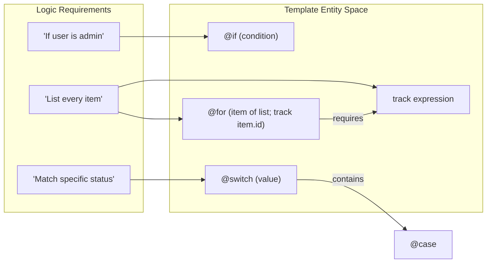

**Sources:**
- [angular-developer/references/components.md:69-128]()

---

# Page: Inputs, Outputs, and Two-Way Binding

# Inputs, Outputs, and Two-Way Binding

<details>
<summary>Relevant source files</summary>

The following files were used as context for generating this wiki page:

- [angular-developer/references/inputs.md](angular-developer/references/inputs.md)
- [angular-developer/references/outputs.md](angular-developer/references/outputs.md)

</details>


This page covers the mechanisms for data flow between Angular components. It focuses on the modern signal-based APIs introduced for reactive data flow, while maintaining support for legacy decorator-based patterns.

## Signal-based Inputs

Inputs allow data to flow from a parent component to a child component. In modern Angular (v19+), inputs are defined using the `input()` function, which returns an `InputSignal` [angular-developer/references/inputs.md:3-7](). These signals are reactive, meaning they can be used in `computed()` values or `effect()` blocks within the component [angular-developer/references/inputs.md:23-24]().

### Declaration and Types

There are two primary ways to declare signal inputs:
1.  **Optional Inputs**: Created using `input(defaultValue)`. If the parent does not provide a value, the `defaultValue` is used [angular-developer/references/inputs.md:17-18]().
2.  **Required Inputs**: Created using `input.required<T>()`. These enforce that the parent must provide a value, resulting in build-time errors if omitted [angular-developer/references/inputs.md:20-21, 99-99]().

### Configuration: Aliases and Transforms

The `input` function accepts a configuration object to modify how the input behaves:

*   **Alias**: Allows the template property name to differ from the class property name [angular-developer/references/inputs.md:38-38, 46-47]().
*   **Transform**: A function that modifies the incoming value before it is stored in the signal. Angular provides built-in helpers like `booleanAttribute` and `numberAttribute` [angular-developer/references/inputs.md:39-39, 49-51]().

### Data Flow: Signal Inputs

The following diagram illustrates the flow of data from a parent template into a signal-based input.

**Signal Input Data Flow**
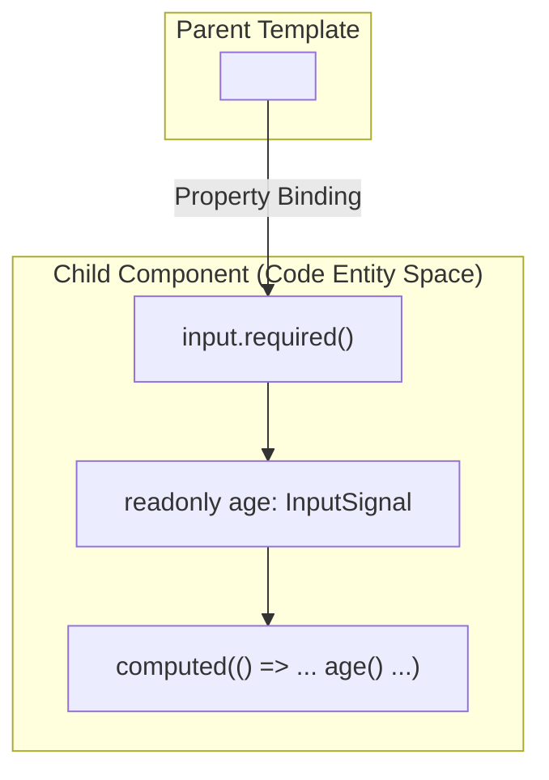
Sources: [angular-developer/references/inputs.md:9-26](), [angular-developer/references/inputs.md:30-32]()

---

## Two-Way Binding with `model()`

The `model()` API creates a specialized signal that supports two-way data binding. Unlike standard `input()`, which is read-only for the child component, a `model()` signal can be updated by the child using the `.update()` or `.set()` methods [angular-developer/references/inputs.md:54-68]().

When a child component updates a `model()`, the change is propagated back to the parent's bound property or signal [angular-developer/references/inputs.md:72-80]().

**Two-Way Binding Flow**
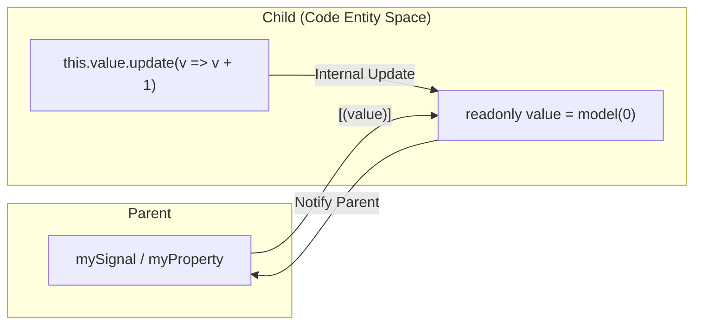
Sources: [angular-developer/references/inputs.md:58-80]()

---

## Signal-based Outputs

Outputs allow child components to emit custom events that parents can listen to. The modern API uses the `output()` function, which returns an `OutputEmitterRef` [angular-developer/references/outputs.md:3-7]().

### Implementation
*   **Emission**: Use the `.emit(value)` method to trigger the event [angular-developer/references/outputs.md:23-25]().
*   **Template Binding**: Parents bind to these using parentheses `()` and access the payload via the `$event` variable [angular-developer/references/outputs.md:29-35]().
*   **Programmatic Subscription**: For dynamically created components, outputs can be subscribed to via the `subscribe()` method on the emitter [angular-developer/references/outputs.md:50-63]().

### Configuration
Like inputs, outputs support an `alias` via a configuration object [angular-developer/references/outputs.md:37-48]().

**Output Event Propagation**
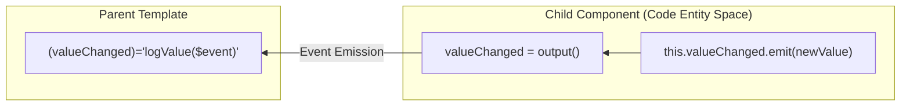
Sources: [angular-developer/references/outputs.md:9-35]()

---

## Legacy Decorator Patterns

While signal-based APIs are recommended, Angular continues to support decorator-based inputs and outputs for backward compatibility.

| Feature | Legacy API (@Input / @Output) | Modern API (input / output) |
| :--- | :--- | :--- |
| **Input Declaration** | `@Input() prop = value` [angular-developer/references/inputs.md:91]() | `prop = input(value)` [angular-developer/references/inputs.md:18]() |
| **Required Input** | `@Input({ required: true })` [angular-developer/references/inputs.md:91]() | `input.required()` [angular-developer/references/inputs.md:21]() |
| **Output Declaration** | `@Output() event = new EventEmitter()` [angular-developer/references/outputs.md:74]() | `event = output()` [angular-developer/references/outputs.md:18]() |
| **Reactivity** | Manual `ngOnChanges` or setters | Automatic via Signals [angular-developer/references/inputs.md:23-24]() |

Sources: [angular-developer/references/inputs.md:82-94](), [angular-developer/references/outputs.md:65-79]()

---

## Best Practices

*   **Prefer Signals**: Use `input()` and `output()` over decorators for better type safety and integration with Angular's reactive runtime [angular-developer/references/inputs.md:98-98, 83-83]().
*   **Naming**: Use `camelCase` for both inputs and outputs. Avoid prefixing outputs with `on` (e.g., use `valueChanged`, not `onValueChanged`) [angular-developer/references/outputs.md:84-84]().
*   **Avoid DOM Collisions**: Do not use names that conflict with standard HTML attributes or events like `id`, `title`, `click`, or `submit` [angular-developer/references/inputs.md:101-101, 86-86]().
*   **Pure Transforms**: Ensure that functions passed to the `transform` option of an input are pure and statically analyzable [angular-developer/references/inputs.md:100-100]().
*   **Bubbling**: Note that Angular custom events (outputs) do **not** bubble up the DOM tree like native browser events [angular-developer/references/outputs.md:85-85]().

Sources: [angular-developer/references/inputs.md:96-101](), [angular-developer/references/outputs.md:81-86]()

---

# Page: Host Elements and Component Styling

# Host Elements and Component Styling

<details>
<summary>Relevant source files</summary>

The following files were used as context for generating this wiki page:

- [angular-developer/references/component-styling.md](angular-developer/references/component-styling.md)
- [angular-developer/references/define-routes.md](angular-developer/references/define-routes.md)
- [angular-developer/references/host-elements.md](angular-developer/references/host-elements.md)
- [angular-developer/references/tailwind-css.md](angular-developer/references/tailwind-css.md)

</details>


This page details the mechanisms for managing a component's relationship with its DOM host, the strategies for style encapsulation, and the integration of modern CSS frameworks like Tailwind CSS.

## Host Element Bindings

The **host element** is the DOM element that matches a component's selector. Angular allows components to manage their own host element's attributes, classes, and event listeners directly within the `@Component` decorator using the `host` property [angular-developer/references/host-elements.md:1-10]().

### Host Property Configuration
The `host` property is the modern, preferred approach for defining host bindings, replacing legacy decorators like `@HostBinding` and `@HostListener` [angular-developer/references/host-elements.md:7-9]().

| Binding Type | Syntax Example | Description |
| :--- | :--- | :--- |
| **Static Attribute** | `'role': 'slider'` | Sets a fixed attribute on the host [angular-developer/references/host-elements.md:13](). |
| **Attribute Binding** | `'[attr.aria-valuenow]': 'value'` | Binds an attribute to a component property [angular-developer/references/host-elements.md:14](). |
| **Class Binding** | `'[class.active]': 'isActive()'` | Conditionally applies a CSS class based on a signal or property [angular-developer/references/host-elements.md:15](). |
| **Style Binding** | `'[style.color]': 'color()'` | Binds a CSS style property to a value [angular-developer/references/host-elements.md:16](). |
| **Property Binding** | `'[tabIndex]': 'disabled ? -1 : 0'` | Binds directly to the DOM element's property [angular-developer/references/host-elements.md:17](). |
| **Event Binding** | `'(keydown)': 'onKeyDown($event)'` | Listens for DOM events on the host element [angular-developer/references/host-elements.md:18](). |

### Host Attribute Injection
For static attributes required at initialization, Angular provides `HostAttributeToken`. This allows the component to `inject` values passed to the host element via the template [angular-developer/references/host-elements.md:59-62]().

```ts
// Definition
export class AppButton {
  type = inject(new HostAttributeToken('type')); // Reads 'type' from host [angular-developer/references/host-elements.md:72]()
}

// Usage
// <app-btn type="primary">Click Me</app-btn> [angular-developer/references/host-elements.md:79]()
```

### Binding Collision Resolution
When both the component's host configuration and the consumer's template attempt to bind to the same property, Angular follows these resolution rules [angular-developer/references/host-elements.md:51-58]():
1. **Static vs. Static**: The consumer (instance) binding wins.
2. **Static vs. Dynamic**: The dynamic binding wins.
3. **Dynamic vs. Dynamic**: The component's internal host binding wins.

**Sources:** [angular-developer/references/host-elements.md:1-80]()

---

## Component Styling and Encapsulation

Angular components encapsulate styles to prevent them from leaking into the global scope or affecting other components.

### Defining Styles
Styles can be defined inline using the `styles` property or via external files using `styleUrl` [angular-developer/references/component-styling.md:5-22]().

### View Encapsulation Strategies
The `encapsulation` metadata property determines how Angular scopes the component's CSS [angular-developer/references/component-styling.md:24-34]().

| Mode | Behavior |
| :--- | :--- |
| `Emulated` (Default) | Scopes styles using unique HTML attributes (e.g., `_ngcontent-c1`). Global styles can still leak in [angular-developer/references/component-styling.md:30](). |
| `ShadowDom` | Uses native browser Shadow DOM for total isolation [angular-developer/references/component-styling.md:31](). |
| `None` | Disables encapsulation; styles become global [angular-developer/references/component-styling.md:32](). |
| `ExperimentalIsolatedShadowDom` | Guarantees only the component's styles apply [angular-developer/references/component-styling.md:33](). |

### Component Styling Flow
The following diagram illustrates how the `@Component` metadata interacts with the DOM and CSS selectors.

**Styling and Host Interaction**
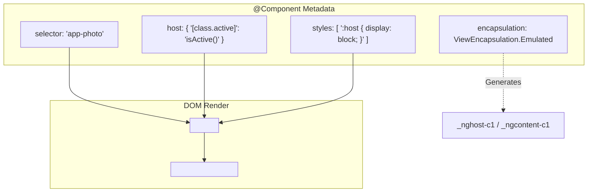
**Sources:** [angular-developer/references/component-styling.md:1-58](), [angular-developer/references/host-elements.md:1-20]()

### Special Selectors
*   `:host`: Targets the component's host element [angular-developer/references/component-styling.md:49-58]().
*   `:host-context(.theme-dark)`: Applies styles if an ancestor matches the selector [angular-developer/references/component-styling.md:60-68]().
*   `::ng-deep`: Forcefully disables encapsulation for a specific rule. **Discouraged** and kept only for legacy compatibility [angular-developer/references/component-styling.md:71-74]().

**Sources:** [angular-developer/references/component-styling.md:1-91]()

---

## Tailwind CSS Integration (v4)

Modern Angular projects utilize **Tailwind CSS v4**, which shifts configuration from JavaScript (`tailwind.config.js`) to CSS variables and PostCSS [angular-developer/references/tailwind-css.md:1-6]().

### Configuration Architecture
Tailwind v4 integration relies on the `@tailwindcss/postcss` plugin rather than a standalone configuration file [angular-developer/references/tailwind-css.md:21-45]().

**Tailwind v4 Data Flow**
```mermaid
graph LR
    subgraph Configuration_Files ["Configuration"]
        POSTCSS[".postcssrc.json"]
        GLOBAL_CSS["styles.css"]
    end

    subgraph Build_Process ["Angular Build Pipeline"]
        TAILWIND_PLUGIN["@tailwindcss/postcss"]
        CSS_VARS["CSS Theme Variables"]
    end

    subgraph Components ["Component Templates"]
        HTML_CLASSES["class='text-3xl font-bold'"]
    end

    POSTCSS --> TAILWIND_PLUGIN
    GLOBAL_CSS -->|@import 'tailwindcss'| TAILWIND_PLUGIN
    TAILWIND_PLUGIN --> CSS_VARS
    CSS_VARS --> HTML_CLASSES
```

### Key Implementation Steps
1.  **Automated Setup**: Run `ng add tailwindcss` to handle installation and configuration automatically [angular-developer/references/tailwind-css.md:7-13]().
2.  **PostCSS Setup**: Ensure `.postcssrc.json` contains the `@tailwindcss/postcss` plugin [angular-developer/references/tailwind-css.md:35-43]().
3.  **Import**: Use `@import 'tailwindcss';` in the global `styles.css` file [angular-developer/references/tailwind-css.md:47-55]().
4.  **Avoid v3 Patterns**: Do not use `@tailwind base;` directives or create a `tailwind.config.js` file, as these are incompatible with the v4 workflow [angular-developer/references/tailwind-css.md:65-69]().

**Sources:** [angular-developer/references/tailwind-css.md:1-69]()

---

# Page: Naming Conventions

# Naming Conventions

<details>
<summary>Relevant source files</summary>

The following files were used as context for generating this wiki page:

- [angular-developer/references/naming-conventions.md](angular-developer/references/naming-conventions.md)

</details>


This section documents the Angular v20+ **"Intent over Role"** naming philosophy. Modern Angular development prioritizes the domain purpose of a file over its technical implementation details (suffixes). This approach reduces boilerplate and leverages directory structure and IDE capabilities for context.

## Core Principles

The primary shift in Angular v20+ is the transition from role-based suffixes (e.g., `.component.ts`) to intent-based naming (e.g., `product-list.ts`). However, this transition must be managed carefully to ensure consistency within existing codebases.

*   **Prioritize Existing Conventions**: Before generating new files, developers must inspect `angular.json` and existing project files. Suffixless naming should not be forced on projects relying on standard suffixes [angular-developer/references/naming-conventions.md:9-9]().
*   **Intent-Based Naming**: In modern projects, filenames and TypeScript classes drop functional extensions like `Component`, `Service`, or `Directive`. Names should reflect the business purpose, such as `auth-data.ts` (Class: `AuthData`) instead of `auth.service.ts` [angular-developer/references/naming-conventions.md:10-11]().
*   **Folder as Context**: The technical role of a file is inferred from its location (e.g., `core/`, `features/`, `shared/`) rather than its name [angular-developer/references/naming-conventions.md:12-12]().
*   **Interface Exception**: Data models and interfaces retain the `.model.ts` suffix to clearly distinguish type contracts from executable logic [angular-developer/references/naming-conventions.md:13-13]().

### Intent vs. Role Mapping

The following diagram illustrates the shift from the traditional "Role" naming to the modern "Intent" naming for a hypothetical Authentication module.

**Natural Language to Code Entity Space: Auth Module Mapping**
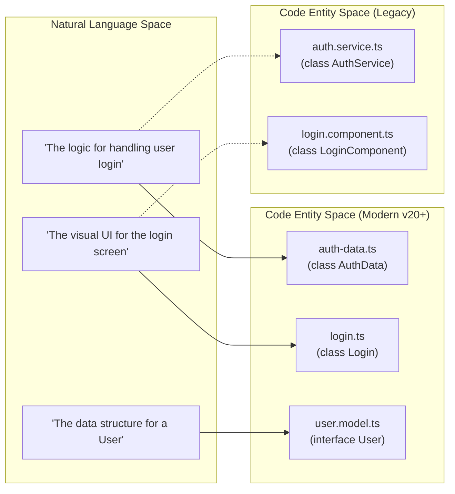
Sources: [angular-developer/references/naming-conventions.md:33-38](), [angular-developer/references/naming-conventions.md:73-74]()

---

## Recommended Project Structure

The directory structure provides the necessary context that was previously provided by file suffixes.

### 1. Core Directory (Application Foundation)
Contains singleton services, global state, and system-wide models [angular-developer/references/naming-conventions.md:31-31]().
*   **Services**: Use domain-purpose suffixes like `-data`, `-store`, or `-api` (e.g., `user-data-client.ts` for `class UserDataClient`) [angular-developer/references/naming-conventions.md:36-36]().
*   **Models**: Use `[domain].model.ts` (e.g., `user.model.ts` for `interface User`) [angular-developer/references/naming-conventions.md:37-38]().

### 2. Features Directory (Domain Logic)
Organized by feature-specific folders containing components, local services, and routes [angular-developer/references/naming-conventions.md:42-42]().
*   **Main Component**: Named after the route or feature (e.g., `features/profile/profile.ts` for `class Profile`) [angular-developer/references/naming-conventions.md:45-45]().
*   **Sub-Components**: Named by functional role (e.g., `project-card.ts` for `class ProjectCard`) [angular-developer/references/naming-conventions.md:48-48]().

### 3. Shared Directory (UI Toolkit)
Houses presentational elements and helpers with no business logic [angular-developer/references/naming-conventions.md:54-54]().
*   **Components**: e.g., `shared/components/spinner/spinner.ts` (Class: `Spinner`) [angular-developer/references/naming-conventions.md:58-58]().
*   **Directives**: e.g., `highlight.ts` (Class: `Highlight`) [angular-developer/references/naming-conventions.md:63-63]().

**File System Organization Diagram**
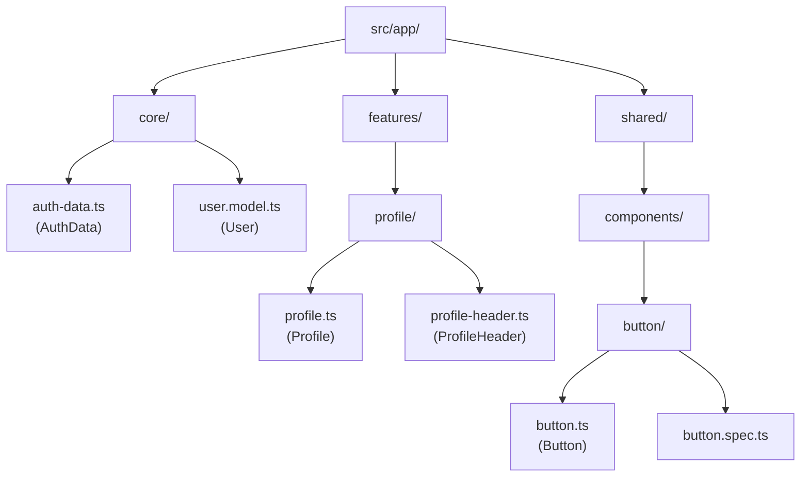
Sources: [angular-developer/references/naming-conventions.md:29-64]()

---

## Coexistence and Conflict Resolution

Transitioning to suffixless naming introduces the risk of namespace collisions. The following rules must be followed to maintain code health.

### Identifier Matching & Consistency
*   **Kebab-case**: Use hyphens for filenames (e.g., `product-list.ts`) [angular-developer/references/naming-conventions.md:21-21]().
*   **Unified Filenames**: If using split files, the base name must be identical across `.ts`, `.html`, and `.css` [angular-developer/references/naming-conventions.md:23-26]().
*   **Tests**: Always use the `.spec.ts` suffix [angular-developer/references/naming-conventions.md:27-27]().

### Avoiding Namespace Collisions
Without suffixes, `user.ts` (a component) and `user.model.ts` (an interface) might both attempt to declare the identifier `User`.
*   **Rule**: Use more specific, intent-based names for classes (e.g., `UserProfile` or `UserDetail`) while keeping the simple domain name for the interface (`User`) [angular-developer/references/naming-conventions.md:73-74]().

### Determination Logic
When determining which style to use, follow this priority:
1.  **Inspect Adjacent Files**: Check if neighboring files use `.component.ts` or `.ts` [angular-developer/references/naming-conventions.md:70-70]().
2.  **Check angular.json**: Look for custom schematic options [angular-developer/references/naming-conventions.md:71-71]().
3.  **Default to Legacy**: If the environment is ambiguous, use the traditional role suffix style (`.component.ts`) as it is the safest default [angular-developer/references/naming-conventions.md:72-72]().

**Decision Flow: Choosing a Naming Convention**
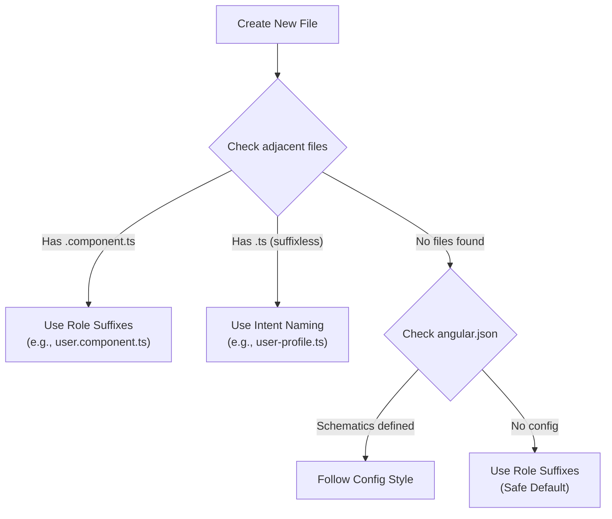
Sources: [angular-developer/references/naming-conventions.md:69-72]()

---
**Sources:**
*   [angular-developer/references/naming-conventions.md:1-76]()

---

# Page: Reactivity and State Management

# Reactivity and State Management

<details>
<summary>Relevant source files</summary>

The following files were used as context for generating this wiki page:

- [angular-developer/references/effects.md](angular-developer/references/effects.md)
- [angular-developer/references/signals-overview.md](angular-developer/references/signals-overview.md)

</details>


Angular's reactivity system is built on **Signals**, a primitive that tracks state and notifies consumers when values change. This system provides fine-grained reactivity, allowing Angular to update only the specific parts of the DOM or state tree that are affected by a change, without relying on heavy zone-based change detection.

### Core Reactivity Model

The reactivity system consists of producers (Signals) and consumers (Templates, Effects, Computations). When a signal is read within a **reactive context**, Angular automatically establishes a dependency relationship.

| Primitive | Purpose | Writable? |
| :--- | :--- | :--- |
| `signal()` | Primary state storage. | Yes |
| `computed()` | Derived, memoized state. | No |
| `linkedSignal()` | Derived state that remains manually writable. | Yes |
| `resource()` | Async state (e.g., HTTP data). | Local mutation supported |
| `effect()` | Side effects for non-signal APIs. | N/A |

### Reactivity Flow and Code Mapping

The following diagram illustrates how state flows from a source `signal` through derivations to the UI or external side effects, mapping these concepts to their specific code entities.

**State Propagation Diagram**
```mermaid
graph TD
    subgraph ["Source State"]
        A["signal()"]
    end

    subgraph ["Derivations"]
        B["computed()"]
        C["linkedSignal()"]
    end

    subgraph ["Consumers"]
        D["Component Template"]
        E["effect()"]
        F["afterRenderEffect()"]
    end

    A --> B
    A --> C
    A --> D
    A --> E
    B --> D
    C --> D
    B --> E
    E --> G["External APIs (localStorage)"]
    F --> H["DOM Manipulation (Canvas/3rd Party)"]
```
Sources: [angular-developer/references/signals-overview.md:1-62](), [angular-developer/references/effects.md:1-13]()

---

### Signals and Computed State
Signals are the foundation of modern Angular. A `signal()` acts as a wrapper around a value [angular-developer/references/signals-overview.md:3-5](). To derive new information from existing signals, `computed()` creates a read-only signal that is lazily evaluated and memoized [angular-developer/references/signals-overview.md:35-41]().

**Key Concepts:**
*   **Reactive Contexts:** Environments like templates or `effect` callbacks where signal reads are tracked [angular-developer/references/signals-overview.md:52-62]().
*   **Untracked Reads:** Using `untracked()` to read a signal value without creating a dependency [angular-developer/references/signals-overview.md:63-66]().
*   **Read-only Exposure:** The `asReadonly()` pattern for services to prevent external state mutation [angular-developer/references/signals-overview.md:25-33]().

For details, see [Signals and Computed State](#3.1).

### linkedSignal and Derived Writable State
While `computed()` is strictly read-only, `linkedSignal()` allows for state that is "linked" to a source signal but can still be manually updated by the user [angular-developer/references/effects.md:15-17](). This is ideal for scenarios like a "Reset to Default" feature or form fields that initialize based on a selection.

For details, see [linkedSignal and Derived Writable State](#3.2).

### Async Reactivity with resource and httpResource
Angular provides `resource()` and `httpResource()` to bring asynchronous operations into the signal world. These primitives manage the lifecycle of an async request, providing signals for `value`, `isLoading`, and `error`.

*   **resource()**: A generic primitive for any async loader [angular-developer/references/effects.md:15-17]().
*   **httpResource()**: A specialized version for HTTP requests that handles automatic cancellation and signal-native data fetching.

For details, see [Async Reactivity with resource and httpResource](#3.3).

### Effects and Side Effects
Effects are used to synchronize signal state with imperative APIs, such as logging, `localStorage`, or 3rd-party libraries [angular-developer/references/effects.md:5-13](). 

**Important Distinctions:**
*   **effect()**: Runs asynchronously during change detection, typically before DOM updates [angular-developer/references/effects.md:20-22]().
*   **afterRenderEffect()**: Specifically designed for DOM manipulation, divided into phases (`earlyRead`, `write`, `read`) to prevent layout thrashing [angular-developer/references/effects.md:43-53]().

**Side Effect Execution Context**
```mermaid
graph LR
    subgraph ["Injection Context (Constructor/Field)"]
        direction TB
        Init["Initialize effect()"]
    end

    subgraph ["Execution Pipeline"]
        direction TB
        CD["Change Detection"]
        Eff["effect() callback"]
        DOM["DOM Update"]
        ARE["afterRenderEffect()"]
    end

    Init -.-> Eff
    CD --> Eff
    Eff --> DOM
    DOM --> ARE
```
Sources: [angular-developer/references/effects.md:29-32](), [angular-developer/references/effects.md:43-47](), [angular-developer/references/effects.md:76-82]()

For details, see [Effects and Side Effects](#3.4).

---

# Page: Signals and Computed State

# Signals and Computed State

<details>
<summary>Relevant source files</summary>

The following files were used as context for generating this wiki page:

- [angular-developer/references/creating-services.md](angular-developer/references/creating-services.md)
- [angular-developer/references/signals-overview.md](angular-developer/references/signals-overview.md)

</details>


Signals are the foundation of reactivity in modern Angular applications. A **signal** is a wrapper around a value that notifies interested consumers when that value changes, enabling fine-grained reactivity and efficient change detection [angular-developer/references/signals-overview.md:1-4]().

## Writable Signals

A writable signal is created using the `signal()` function. It provides a synchronous API to get and set values [angular-developer/references/signals-overview.md:5-13]().

| Method | Description | Example |
| :--- | :--- | :--- |
| `getter()` | Reads the current value. Always requires calling the function. | `count()` |
| `set(value)` | Replaces the signal value with a new one. | `count.set(5)` |
| `update(fn)` | Updates the value based on the previous state. | `count.update(v => v + 1)` |
| `asReadonly()` | Returns a read-only version of the signal. | `this.count.asReadonly()` |

### Read-Only Signal Pattern
When managing state within a service, it is a best practice to keep the writable signal `private` and expose a read-only version publicly. This prevents external components from mutating internal service state directly [angular-developer/references/creating-services.md:13-24]().

```ts
// Service implementation
@Service()
export class DataStore {
  private readonly _data = signal<string[]>([]);
  
  // Public read-only exposure
  readonly data = this._data.asReadonly();

  addItem(item: string) {
    this._data.update(items => [...items, item]);
  }
}
```
Sources: [angular-developer/references/creating-services.md:15-29](), [angular-developer/references/signals-overview.md:25-33]()

---

## Computed Signals

`computed()` creates a read-only signal that derives its value from other signals. Computed signals are lazily evaluated and memoized [angular-developer/references/signals-overview.md:35-41]().

### Characteristics
*   **Lazy Evaluation**: The derivation function only runs when the signal is explicitly read [angular-developer/references/signals-overview.md:39-39]().
*   **Memoization**: The result is cached. Recalculation only occurs if one of the signals read during the last execution has changed [angular-developer/references/signals-overview.md:40-40]().
*   **Dynamic Dependencies**: Angular tracks only the signals actually accessed during the function execution. If a signal is inside an `if` block that isn't reached, it is not tracked as a dependency [angular-developer/references/signals-overview.md:41-41]().

### Logic Flow: Signal Value Propagation
The following diagram illustrates how state flows from a writable source through a computed derivation to a consumer (like a component template).

**Data Flow: Writable to Computed**
```mermaid
graph TD
    subgraph "Service Layer"
        A["Writable Signal: _count"] -- "1. .set() / .update()" --> B["Dependency Tracking"]
        B --> C["Computed Signal: doubleCount"]
    end
    
    subgraph "Consumer Layer"
        C -- "2. Notify Change" --> D["Component Template"]
        D -- "3. Pull Value (Getter)" --> C
        C -- "4. Recalculate if Dirty" --> A
    end
```
Sources: [angular-developer/references/signals-overview.md:43-50](), [angular-developer/references/creating-services.md:70-85]()

---

## Reactive Contexts

A **reactive context** is a runtime environment where Angular monitors signal reads to establish dependencies [angular-developer/references/signals-overview.md:52-54]().

### Automatic Contexts
Angular automatically establishes a reactive context when executing:
*   `computed()` derivation functions [angular-developer/references/signals-overview.md:58-58]().
*   `effect()` callbacks [angular-developer/references/signals-overview.md:59-59]().
*   `linkedSignal()` computations [angular-developer/references/signals-overview.md:60-60]().
*   Component templates during view updates [angular-developer/references/signals-overview.md:61-61]().

### Untracked Reads
To read a signal inside a reactive context without establishing a dependency, use the `untracked()` function. This prevents the context (e.g., an effect) from re-running when that specific signal changes [angular-developer/references/signals-overview.md:63-66]().

```ts
effect(() => {
  // Only triggers when currentUser() changes
  console.log(`User: ${currentUser()}, Logged at: ${untracked(timer)}`);
});
```
Sources: [angular-developer/references/signals-overview.md:67-75]()

---

## Async Boundaries

Reactivity is strictly **synchronous**. The reactive context is lost once an asynchronous boundary (like `await`, `setTimeout`, or a Promise) is crossed. Signals read after an `await` will not be tracked as dependencies [angular-developer/references/signals-overview.md:77-79]().

**Entity Mapping: Async Signal Handling**
This diagram maps the natural language concept of "Async Boundaries" to the required code structure for maintaining reactivity.

```mermaid
graph LR
    subgraph "Code Entity Space"
        E["effect() callback"]
        S["signal() read"]
        A["await someAsyncFunc()"]
    end

    subgraph "Reactivity Status"
        Active["Context: TRACKING"]
        Inactive["Context: LOST"]
    end

    E --> S
    S --> Active
    Active --> A
    A --> Inactive
    Inactive -.-> S2["signal() read (ignored)"]
```

### Correct Implementation Pattern
Always capture signal values into local variables before entering an asynchronous block [angular-developer/references/signals-overview.md:88-94]().

| Pattern | Code Example | Result |
| :--- | :--- | :--- |
| **Incorrect** | `effect(async () => { await fn(); console.log(sig()); });` | `sig()` is **not** tracked. |
| **Correct** | `effect(async () => { const val = sig(); await fn(); console.log(val); });` | `sig()` **is** tracked. |

Sources: [angular-developer/references/signals-overview.md:81-94]()

---

# Page: linkedSignal and Derived Writable State

# linkedSignal and Derived Writable State

<details>
<summary>Relevant source files</summary>

The following files were used as context for generating this wiki page:

- [angular-developer/references/linked-signal.md](angular-developer/references/linked-signal.md)

</details>


The `linkedSignal` function is a reactive primitive used to create writable state that is intrinsically linked to a source signal. It provides a mechanism for state that requires a default value derived from another signal while remaining independently modifiable by the user. When the source signal changes, the `linkedSignal` automatically resets or recomputes its value based on a provided computation function.

Sources: [angular-developer/references/linked-signal.md:1-5]()

## Core Mechanics and Implementation

`linkedSignal` bridges the gap between `computed()` (which is read-only) and `signal()` (which is standalone writable state). It tracks a source signal and executes a computation whenever that source changes, effectively "resetting" the local state. However, unlike a computed signal, it exposes `.set()` and `.update()` methods for manual overrides.

### Basic Shorthand Syntax
When the reset logic only depends on the current value of the source, a simple computation function can be passed. The signal will re-evaluate this function whenever any signal read inside it changes.

```ts
// Example: Selecting a default from a dynamic list
protected readonly options = signal(['A', 'B', 'C']);
protected readonly selection = linkedSignal(() => this.options()[0]);

// The user can override the selection
this.selection.set('B'); 

// If options changes to ['D', 'E'], selection automatically resets to 'D'
```
Sources: [angular-developer/references/linked-signal.md:7-27]()

### Advanced Object Syntax
For more complex synchronization—such as preserving a user's manual selection if it remains valid after a source change—`linkedSignal` accepts a configuration object with `source` and `computation` properties. The `computation` function receives:
1.  **newSource**: The current value of the source signal.
2.  **previous**: An object containing `source` (the previous value of the source) and `value` (the previous value of the `linkedSignal` itself).

Sources: [angular-developer/references/linked-signal.md:29-53]()

## Data Flow: Source Synchronization

The following diagram illustrates how state flows from a source signal through the `linkedSignal` logic, and how manual updates interact with this flow.

**Diagram: linkedSignal State Synchronization Flow**
```mermaid
graph TD
    subgraph "Source Space"
        SourceSignal["Source Signal (e.g., options)"]
    end

    subgraph "linkedSignal Logic"
        SourceSignal -->|Change Detected| ComputationFn["computation(source, previous)"]
        ComputationFn -->|Result| InternalValue["Internal Writable State"]
    end

    subgraph "User Interaction"
        ManualUpdate["Manual .set() / .update()"] -->|Override| InternalValue
    end

    InternalValue -->|Read| Consumer["Template / Effect / Computed"]
```
Sources: [angular-developer/references/linked-signal.md:3-5](), [angular-developer/references/linked-signal.md:33-34]()

## Comparison of Reactive Primitives

Choosing the correct primitive is critical for maintaining a clean reactive graph and avoiding anti-patterns like state synchronization inside effects.

| Primitive | Writable | Reset Logic | Primary Use Case |
| :--- | :--- | :--- | :--- |
| `computed()` | No | Automatic | **Strictly** derived state that should never be manually changed. |
| `linkedSignal()` | Yes | Automatic (on source change) | State derived from a source that **must** allow user overrides. |
| `signal()` | Yes | Manual | Independent state with no automatic dependency on other signals. |

### The Effect Anti-Pattern
It is considered an anti-pattern to use `effect()` to synchronize one signal to another (e.g., calling `signal.set()` inside an `effect` that reads another signal). This often leads to unnecessary change detection cycles or infinite loops. `linkedSignal` replaces this pattern by providing a declarative way to handle dependent writable state.

Sources: [angular-developer/references/linked-signal.md:55-59]()

## Code Entity Mapping

This diagram maps the conceptual "Dependent State" to the specific TypeScript entities and parameters used in the `angular/core` implementation.

**Diagram: Entity Mapping for linkedSignal**
```mermaid
classDiagram
    class linkedSignal {
        <<Function>>
        +source: Signal
        +computation(newSource, previous): T
    }

    class WritableSignal {
        <<Interface>>
        +set(value: T)
        +update(fn: (v: T) => T)
        +asReadonly()
    }

    linkedSignal ..> WritableSignal : "Returns"
    
    note for linkedSignal "Source: angular-developer/references/linked-signal.md:44-51"
    note for WritableSignal "Source: angular-developer/references/linked-signal.md:22-25"
```
Sources: [angular-developer/references/linked-signal.md:20-25](), [angular-developer/references/linked-signal.md:44-51]()

---

# Page: Async Reactivity with resource and httpResource

# Async Reactivity with resource and httpResource

<details>
<summary>Relevant source files</summary>

The following files were used as context for generating this wiki page:

- [README.md](README.md)
- [angular-developer/references/http-client.md](angular-developer/references/http-client.md)
- [angular-developer/references/resource.md](angular-developer/references/resource.md)

</details>


The `resource()` API and its specialized variant `httpResource()` incorporate asynchronous data fetching into Angular's signal-based reactivity system. These APIs bridge the gap between reactive signal dependencies and async operations (like `fetch` or `HttpClient` calls), exposing the status and result as synchronous signals.

## The resource API

The `resource()` function creates a `Resource` object that executes an async loader function whenever its reactive dependencies change. It is designed to replace complex `switchMap` logic or manual `effect` + `fetch` patterns.

### Core Configuration
A resource is defined by two primary properties:
1.  **`params`**: A reactive computation (similar to `computed`). When any signal read inside `params` changes, the resource triggers a re-fetch [angular-developer/references/resource.md:9-9]().
2.  **`loader`**: An async function that performs the actual data fetching. It receives the current `params` and an `abortSignal` [angular-developer/references/resource.md:10-10]().

### Implementation Example
```ts
import { Component, resource, signal, computed } from '@angular/core';

@Component({...})
export class UserProfile {
  protected readonly userId = signal('123');

  protected readonly userResource = resource({
    // Reactively tracking userId
    params: () => ({ id: this.userId() }),

    // Executes whenever params change
    loader: async ({ params, abortSignal }) => {
      const response = await fetch(`/api/users/${params.id}`, { signal: abortSignal });
      if (!response.ok) throw new Error('Network error');
      return response.json();
    }
  });
}
```
Sources: [angular-developer/references/resource.md:12-29]()

### Lifecycle and Aborting
If the `params` signal updates while a previous `loader` execution is still in progress, the `Resource` automatically attempts to cancel the outstanding request using the provided `abortSignal` [angular-developer/references/resource.md:44-44](). Developers should always pass this `abortSignal` to their async calls (e.g., `fetch`) to prevent race conditions and unnecessary network traffic [angular-developer/references/resource.md:44-44]().

### Resource Status Signals
The `Resource` object exposes several signals to track the state of the async operation:

| Signal | Description |
| :--- | :--- |
| `value()` | The resolved data or `undefined`. |
| `hasValue()` | A type-guard boolean; `true` if a value is present. |
| `isLoading()` | Boolean indicating if the loader is currently active. |
| `error()` | The error thrown by the loader, if any. |
| `status()` | String constant: `'idle'`, `'loading'`, `'resolved'`, `'error'`, `'reloading'`, or `'local'`. |

Sources: [angular-developer/references/resource.md:56-62]()

### Local Mutation and Reloading
*   **`.reload()`**: Forces the loader to re-run even if `params` have not changed [angular-developer/references/resource.md:48-52]().
*   **Local Mutation**: The `value` signal can be updated directly (e.g., for optimistic UI updates). Doing so changes the resource `status()` to `'local'` [angular-developer/references/resource.md:66-70]().

---

## The httpResource API

`httpResource` is a specialized wrapper around `resource` that leverages the Angular `HttpClient` stack [angular-developer/references/resource.md:74-74](). It allows async data to participate in dependency injection, functional interceptors, and Angular's security features (like XSRF protection) [angular-developer/references/http-client.md:3-3]().

### Usage Pattern
```ts
import { httpResource } from '@angular/common/http';
import { input } from '@angular/core';

export class UserProfile {
  readonly userId = input.required<string>();
  
  // Eagerly fetches when userId changes
  readonly user = httpResource(() => `/api/users/${this.userId()}`);
}
```
Sources: [angular-developer/references/http-client.md:92-98]()

### Key Differences from HttpClient Observables
Unlike the standard `HttpClient` which returns "cold" Observables, `httpResource` is eager and signal-native.

| Feature | `HttpClient` (Observable) | `httpResource` (Signal) |
| :--- | :--- | :--- |
| **Execution** | Cold (requires subscription) [angular-developer/references/http-client.md:44-44]() | Eager (executes on dependency change) [angular-developer/references/http-client.md:101-101]() |
| **Cancellation** | Manual unsubscription or `switchMap` | Automatic on dependency change [angular-developer/references/http-client.md:102-102]() |
| **State** | Must be managed manually or via `async` pipe | Built-in `isLoading`, `hasValue`, `error` signals [angular-developer/references/resource.md:56-62]() |
| **Best Use Case** | Mutations (POST, PUT, DELETE) [angular-developer/references/http-client.md:104-104]() | Data Reads (GET) [angular-developer/references/http-client.md:104-104]() |

### Specialized Fetching and Metadata
*   **Non-JSON Responses**: Use `httpResource.text`, `httpResource.blob`, or `httpResource.arrayBuffer` [angular-developer/references/http-client.md:106-106]().
*   **Validation**: The `parse` option allows for runtime schema validation or transformation of the response [angular-developer/references/http-client.md:107-107]().
*   **Metadata**: Access `headers()`, `statusCode()`, and `progress()` signals directly from the resource [angular-developer/references/http-client.md:108-108]().

---

## Data Flow and Entity Mapping

### Resource Data Flow
This diagram illustrates how a change in a reactive dependency triggers the resource lifecycle.

**Resource Lifecycle Flow**
```mermaid
graph TD
    subgraph "Reactive State"
        A["Source Signal (e.g., userId)"]
    end

    subgraph "Resource API Entity"
        B["params() computation"]
        C["loader(params, abortSignal)"]
        D["Resource Object"]
    end

    subgraph "Status Signals"
        E["value()"]
        F["isLoading()"]
        G["status()"]
    end

    A -- "triggers" --> B
    B -- "provides args to" --> C
    C -- "updates" --> D
    D -- "exposes" --> E
    D -- "exposes" --> F
    D -- "exposes" --> G
    
    C -- "on re-run" --> H["abortSignal.abort()"]
```
Sources: [angular-developer/references/resource.md:7-30](), [angular-developer/references/resource.md:44-44]()

### Code Entity Space: httpResource vs HttpClient
This diagram maps the relationship between the high-level `httpResource` API and the underlying `HttpClient` infrastructure.

**HTTP Reactivity Mapping**
```mermaid
graph LR
    subgraph "Application Code"
        HR["httpResource()"]
        HC["HttpClient"]
    end

    subgraph "Angular Core/Common"
        R["Resource API"]
        HI["HttpInterceptor"]
        HB["HttpBackend (Fetch)"]
    end

    HR -- "wraps" --> R
    HR -- "uses" --> HC
    HC -- "runs through" --> HI
    HI -- "dispatches to" --> HB
    
    style HR stroke-width:2px
    style HC stroke-width:2px
```
Sources: [angular-developer/references/resource.md:74](), [angular-developer/references/http-client.md:3-3](), [angular-developer/references/http-client.md:65-67]()

---

# Page: Effects and Side Effects

# Effects and Side Effects

<details>
<summary>Relevant source files</summary>

The following files were used as context for generating this wiki page:

- [angular-developer/references/effects.md](angular-developer/references/effects.md)

</details>


In Angular, an **effect** is an operation that runs whenever one or more signal values it tracks change [angular-developer/references/effects.md:3-3](). Effects are the primary mechanism for integrating the reactive signal system with imperative APIs and the browser DOM.

## The `effect()` API

The `effect()` function creates a side effect that executes asynchronously during the change detection process [angular-developer/references/effects.md:20-20](). An effect always runs at least once upon initialization [angular-developer/references/effects.md:20-20]().

### Injection Context Requirement
Effects must be created within an **injection context**, such as a component constructor, a field initializer, or via `runInInjectionContext` [angular-developer/references/effects.md:29-31]().

### Cleanup Logic
The `effect` function provides an `onCleanup` callback. This is used to perform manual cleanup (e.g., clearing timeouts or unsubscribing from external events) before the next execution of the effect or when the containing context is destroyed [angular-developer/references/effects.md:31-37]().

```ts
// Example of effect with cleanup
effect((onCleanup) => {
  const currentCount = this.count();
  const timer = setTimeout(() => console.log('Action for', currentCount), 1000);

  onCleanup(() => clearTimeout(timer)); // Runs before next execution [angular-developer/references/effects.md:37-37]
});
```

### Valid Use Cases
Effects should be reserved for syncing signal state to **non-signal APIs** [angular-developer/references/effects.md:7-7]():
*   **Analytics**: Logging data to external services [angular-developer/references/effects.md:11-11]().
*   **Storage**: Syncing state to `localStorage` or `sessionStorage` [angular-developer/references/effects.md:12-12]().
*   **Manual Rendering**: Custom drawing to a `<canvas>` or initializing 3rd-party charting libraries [angular-developer/references/effects.md:13-13]().

### CRITICAL RULE: State Synchronization Anti-Pattern
**Do not use effects to propagate state.** Using `.set()` or `.update()` on a signal inside an effect to keep it in sync with another signal is a significant anti-pattern [angular-developer/references/effects.md:15-16](). This leads to:
1.  `ExpressionChangedAfterItHasBeenChecked` errors.
2.  Infinite loops.
3.  Difficult-to-debug data flows.

**Solution:** Always use `computed()` or `linkedSignal()` for state derivation [angular-developer/references/effects.md:16-16]().

### Data Flow: Signal to Side Effect
The following diagram illustrates how the `effect` scheduler reacts to signal changes without feeding back into the reactive graph.

**Effect Execution Flow**
```mermaid
graph TD
    subgraph "Reactive Graph"
        S["signal()"] --> C["computed()"]
    end

    subgraph "Side Effect Context"
        E["effect()"]
    end

    subgraph "External Systems"
        API["Non-Signal API (Console, Storage)"]
    end

    S -- "Triggers" --> E
    C -- "Triggers" --> E
    E -- "Syncs State To" --> API
    
    style E stroke-dasharray: 5 5
```
Sources: [angular-developer/references/effects.md:3-7](), [angular-developer/references/effects.md:15-16]()

## DOM Manipulation with `afterRenderEffect`

Standard `effect()` calls run **before** Angular updates the DOM [angular-developer/references/effects.md:45-45](). When you need to inspect or modify the DOM after it has been rendered (e.g., measuring an element's size for a chart), use `afterRenderEffect` [angular-developer/references/effects.md:45-47]().

### Render Phases
To prevent **layout thrashing** (repeatedly reading and writing to the DOM, causing multiple reflows), `afterRenderEffect` organizes operations into specific phases [angular-developer/references/effects.md:49-51]().

| Phase | Description | Rule |
| :--- | :--- | :--- |
| `earlyRead` | First phase for reading DOM layout. | Use for `getBoundingClientRect()`. |
| `write` | Phase for modifying the DOM. | **Never read** from the DOM here. |
| `mixedReadWrite` | Legacy/Emergency phase. | Avoid if possible. |
| `read` | Final phase for reading. | **Never write** to the DOM here. |

### Implementation Example
`afterRenderEffect` only executes on the client and is ignored during Server-Side Rendering (SSR) [angular-developer/references/effects.md:83-83]().

```ts
afterRenderEffect({
  earlyRead: () => {
    // Read phase [angular-developer/references/effects.md:63-65]
    return this.canvas().nativeElement.getBoundingClientRect().width;
  },
  write: (width) => {
    // Write phase receives the signal from earlyRead [angular-developer/references/effects.md:67-70]
    setupChart(this.canvas().nativeElement, width());
  }
});
```

### Entity Mapping: Rendering Pipeline
This diagram maps the code entities to the DOM rendering lifecycle.

**DOM Interaction via afterRenderEffect**
```mermaid
sequenceDiagram
    participant S as "signal()"
    participant ARE as "afterRenderEffect()"
    participant DOM as "Browser DOM"

    S->>ARE: Value Change Notification
    Note over ARE: Change Detection Completes
    rect rgb(240, 240, 240)
        ARE->>DOM: earlyRead() (e.g. getBoundingClientRect)
        DOM-->>ARE: Layout Data
        ARE->>DOM: write(data) (e.g. canvas.draw)
        Note right of DOM: No Layout Thrashing
    end
```
Sources: [angular-developer/references/effects.md:43-52](), [angular-developer/references/effects.md:61-74]()

## Summary of Differences

| Feature | `effect()` | `afterRenderEffect()` |
| :--- | :--- | :--- |
| **Timing** | Before DOM update [angular-developer/references/effects.md:45-45]() | After DOM update [angular-developer/references/effects.md:47-47]() |
| **Primary Use** | Non-DOM APIs (Logging, Storage) [angular-developer/references/effects.md:9-13]() | DOM Integration (Canvas, 3rd party UI) [angular-developer/references/effects.md:45-45]() |
| **SSR Support** | Yes | No (Client only) [angular-developer/references/effects.md:83-83]() |
| **Phased Execution**| No | Yes (`earlyRead`, `write`, etc.) [angular-developer/references/effects.md:76-81]() |

Sources: [angular-developer/references/effects.md:1-83]()

---

# Page: Dependency Injection

# Dependency Injection

<details>
<summary>Relevant source files</summary>

The following files were used as context for generating this wiki page:

- [angular-developer/references/creating-services.md](angular-developer/references/creating-services.md)
- [angular-developer/references/di-fundamentals.md](angular-developer/references/di-fundamentals.md)

</details>


Dependency Injection (DI) is the core design pattern in Angular used to organize, share, and manage code across an application. It allows you to "inject" features—such as services, configurations, or tokens—into components and other services, enhancing maintainability and testability [angular-developer/references/di-fundamentals.md:1-4]().

The system operates on two primary actions:
1.  **Providing**: Making values (objects, functions, or primitives) available to the DI system [angular-developer/references/di-fundamentals.md:9]().
2.  **Injecting**: Requesting those values from the system, typically via the `inject()` function [angular-developer/references/di-fundamentals.md:10,43-45]().

### DI Architecture Overview

The following diagram illustrates the relationship between the DI system, the `inject()` function, and the code entities that consume dependencies.

**DI System Interaction Map**
```mermaid
graph TD
    subgraph "DI System (The Injector Tree)"
        Root["Root Injector (Singletons)"]
        CompInj["Component-Level Injector"]
    end

    subgraph "Code Entity Space"
        ServiceA["@Service() Class"]
        CompA["@Component() Class"]
        GuardA["Functional Route Guard"]
    end

    ServiceA -- "provides" --> Root
    CompA -- "inject(ServiceA)" --> CompInj
    CompInj -- "look up" --> Root
    GuardA -- "inject(ServiceA)" --> Root
    
    style ServiceA stroke-dasharray: 5 5
    style CompA stroke-dasharray: 5 5
    style GuardA stroke-dasharray: 5 5
```
Sources: [angular-developer/references/di-fundamentals.md:5-12](), [angular-developer/references/creating-services.md:31-37]()

---

### Core Concepts

#### 1. Services and DI Fundamentals
Services are TypeScript classes decorated with `@Service()`. They are the primary vehicle for sharing business logic, data fetching, and state management [angular-developer/references/creating-services.md:1-3](). By default, services are singletons available throughout the entire application, which enables efficient tree-shaking [angular-developer/references/creating-services.md:31-37]().

For details, see [DI Fundamentals and Services](#4.1).

#### 2. Providing Dependencies and Tokens
While `@Service()` handles most use cases automatically, Angular allows for manual control over how dependencies are created and scoped. This includes using `useClass`, `useValue`, and `useFactory` providers, as well as `InjectionToken` for non-class dependencies like configuration objects [angular-developer/references/creating-services.md:88-93]().

For details, see [Defining Providers and Injection Tokens](#4.2).

#### 3. Injection Context and Hierarchical Injectors
The `inject()` function is not available everywhere; it must be called within an **Injection Context**. This includes class field initializers, constructor bodies, and specific functional APIs like route guards [angular-developer/references/di-fundamentals.md:71-81](). Angular resolves these dependencies through a hierarchical tree of injectors, starting from the local element up to the root environment [angular-developer/references/creating-services.md:88-91]().

For details, see [Injection Context and Hierarchical Injectors](#4.3).

---

### Code Entity Mapping

This diagram maps the natural language concepts of DI to the specific code symbols used in the Angular framework.

**Entity Mapping: Natural Language to Code**
```mermaid
graph LR
    subgraph "Natural Language Concept"
        Srv["Singleton Service"]
        Cons["Dependency Consumer"]
        Ctx["Valid Placement"]
        Manual["Custom Provider"]
    end

    subgraph "Code Entity Space"
        Srv --> ServiceDec["@Service()"]
        Cons --> InjectFn["inject()"]
        Ctx --> FieldInit["Class Field Initializer"]
        Ctx --> GuardFn["ResolveFn / CanActivateFn"]
        Manual --> ProvidersArr["providers: [ { provide: T, useValue: V } ]"]
    end
```
Sources: [angular-developer/references/di-fundamentals.md:43-52](), [angular-developer/references/di-fundamentals.md:71-81](), [angular-developer/references/creating-services.md:15-19](), [angular-developer/references/creating-services.md:88-93]()

### Summary Table of DI Usage

| Feature | Code Symbol | Primary Use Case |
| :--- | :--- | :--- |
| **Service Creation** | `@Service()` | Reusable business logic and state [angular-developer/references/creating-services.md:18-19]() |
| **Dependency Access** | `inject()` | Accessing services in components or guards [angular-developer/references/di-fundamentals.md:43-45]() |
| **State Exposure** | `.asReadonly()` | Exposing signals from services safely [angular-developer/references/creating-services.md:20-23]() |
| **Isolation** | `providers: []` | Component-specific service instances [angular-developer/references/creating-services.md:91]() |
| **Reactive Logic** | `computed()` | Deriving state from multiple injected services [angular-developer/references/creating-services.md:70-72]() |

Sources: [angular-developer/references/creating-services.md:1-93](), [angular-developer/references/di-fundamentals.md:1-116]()

---

# Page: DI Fundamentals and Services

# DI Fundamentals and Services

<details>
<summary>Relevant source files</summary>

The following files were used as context for generating this wiki page:

- [angular-developer/references/creating-services.md](angular-developer/references/creating-services.md)
- [angular-developer/references/di-fundamentals.md](angular-developer/references/di-fundamentals.md)

</details>


Dependency Injection (DI) is a core design pattern in Angular used to organize and share code across an application. It allows for the "injection" of features into different parts of the system, which improves maintainability, scalability, and testability [angular-developer/references/di-fundamentals.md:1-3]().

## The Service Pattern

A **service** is a TypeScript class decorated with `@Service()` that typically handles data fetching, business logic, or state management [angular-developer/references/creating-services.md:3-5](), [angular-developer/references/di-fundamentals.md:16-17]().

### The @Service() Decorator
Using the `@Service()` decorator is the recommended approach for creating services in modern Angular. By default, it provides the following benefits:
*   **Singleton Instance**: Angular creates a single instance for the entire application [angular-developer/references/creating-services.md:35]().
*   **Automatic Provisioning**: The service is available everywhere without needing to be listed in manual `providers` arrays [angular-developer/references/creating-services.md:36]().
*   **Tree-shaking**: The service is only included in the final production bundle if it is actually injected somewhere in the code [angular-developer/references/creating-services.md:37]().

### Creating a Service
Services can be generated via the CLI using `ng generate service <name>` [angular-developer/references/creating-services.md:7-11]().

```ts
import {Service, signal} from '@angular/core';

@Service()
export class AnalyticsLogger {
  private readonly events = signal<string[]>([]);

  // Expose state as a read-only signal
  readonly history = this.events.asReadonly();

  trackEvent(category: string, value: string) {
    this.events.update(prev => [...prev, `${category}: ${value}`]);
    console.log('Event logged:', {category, value});
  }
}
```
*Sources: [angular-developer/references/creating-services.md:13-29](), [angular-developer/references/di-fundamentals.md:22-31]()*

## Injecting Dependencies

Angular uses the `inject()` function to request dependencies from the DI system [angular-developer/references/di-fundamentals.md:43-45]().

### The inject() Function
The `inject()` function retrieves an instance of a service or any other provided token [angular-developer/references/di-fundamentals.md:47-48](). While it can be used in constructors, the recommended pattern is to use **class field initializers** [angular-developer/references/di-fundamentals.md:59-60](), [angular-developer/references/di-fundamentals.md:77]().

### Injection Context
The `inject()` function must be called within an **Injection Context**. Valid contexts include:
1.  **Class field initializers** [angular-developer/references/di-fundamentals.md:89]().
2.  **Constructor bodies** [angular-developer/references/di-fundamentals.md:93]().
3.  **Functional Route Guards and Resolvers** [angular-developer/references/di-fundamentals.md:112-115]().
4.  **Factory functions** used in providers [angular-developer/references/di-fundamentals.md:80]().

### Service Composition and Reactive State
Services can inject other services to compose functionality. By using `computed()`, services can derive reactive state from their dependencies [angular-developer/references/creating-services.md:68-71]().

**Service Composition Flow**
```mermaid
graph TD
    subgraph "Code Entity Space"
        A["CombinedDataStore (@Service)"]
        B["AdvancedDataStore (@Service)"]
        C["inject(AdvancedDataStore)"]
        D["computed()"]
    end

    subgraph "Data Flow"
        B -- "provides data()" --> C
        C -- "reactive dependency" --> D
        D -- "derives allData" --> A
    end
    
    style A stroke-width:2px
    style B stroke-width:2px
```
*Sources: [angular-developer/references/creating-services.md:72-85]()*

## Singleton vs. Component-Scoped Instances

While `@Service()` creates singletons by default, Angular allows for hierarchical scoping.

| Pattern | Configuration | Lifecycle |
| :--- | :--- | :--- |
| **Singleton** | Default `@Service()` | One instance for the entire app. |
| **Component-Scoped** | `@Service({autoProvided: false})` + `@Component({ providers: [MyService] })` | New instance created for each component instance; destroyed with the component. |

*Sources: [angular-developer/references/creating-services.md:31-41](), [angular-developer/references/creating-services.md:87-93]()*

### Dependency Resolution Diagram
This diagram illustrates how a component requests a service and how the DI system resolves the instance based on its scope.

```mermaid
sequenceDiagram
    participant C as "ExampleComponent"
    participant DI as "Angular DI System"
    participant S as "BasicDataStore (@Service)"

    Note over C, S: inject(BasicDataStore)
    C->>DI: Request "BasicDataStore"
    alt is singleton (autoProvided: true)
        DI->>S: Return application-wide instance
    else is scoped (provided in component)
        DI->>S: Create/Return instance for this component branch
    end
    S-->>C: Instance injected into field
```
*Sources: [angular-developer/references/creating-services.md:43-66](), [angular-developer/references/di-fundamentals.md:5-12]()*

## Summary of Key Symbols

| Symbol | Role | Source |
| :--- | :--- | :--- |
| `@Service()` | Decorator to define a class as an injectable service. | [angular-developer/references/creating-services.md:18]() |
| `inject()` | Function used to retrieve a dependency from the current context. | [angular-developer/references/di-fundamentals.md:47]() |
| `autoProvided` | Option in `@Service` to control automatic singleton behavior. | [angular-developer/references/creating-services.md:39]() |
| `asReadonly()` | Signal method used to expose state without allowing external mutation. | [angular-developer/references/creating-services.md:23]() |

**Sources:**
*   [angular-developer/references/creating-services.md:1-93]()
*   [angular-developer/references/di-fundamentals.md:1-116]()

---

# Page: Defining Providers and Injection Tokens

# Defining Providers and Injection Tokens

<details>
<summary>Relevant source files</summary>

The following files were used as context for generating this wiki page:

- [angular-developer/references/cli.md](angular-developer/references/cli.md)
- [angular-developer/references/defining-providers.md](angular-developer/references/defining-providers.md)
- [angular-developer/references/injection-context.md](angular-developer/references/injection-context.md)

</details>


This page explains the mechanisms for defining and configuring dependency providers in Angular. It covers both automatic and manual provision strategies, the use of `InjectionToken` for non-class dependencies, and how to manage provider scoping within the hierarchical injector tree.

## Automatic Provision

The most common and recommended way to provide a service is by using the `providedIn: 'root'` property within the `@Injectable()` decorator. This makes the service available as a global singleton and enables tree-shaking, meaning the service is only included in the final bundle if it is actually injected somewhere in the application [angular-developer/references/defining-providers.md:5-7]().

### InjectionToken

For dependencies that are not classes—such as configuration objects, primitive values, or functions—Angular uses `InjectionToken`. Like services, these tokens can be configured for automatic provision using a factory function [angular-developer/references/defining-providers.md:9-12]().

```ts
import {InjectionToken} from '@angular/core';

export interface AppConfig {
  apiUrl: string;
}

// Defining an automatically provided token
export const APP_CONFIG = new InjectionToken<AppConfig>('app.config', {
  providedIn: 'root',
  factory: () => ({apiUrl: 'https://api.example.com'}),
});
```
*Sources: [angular-developer/references/defining-providers.md:13-24]()*

## Manual Provision

Manual provision is used when a service does not specify `providedIn`, when you need to override a provider for a specific component tree, or when values must be determined at runtime [angular-developer/references/defining-providers.md:26-29]().

### Provider Recipes

Angular supports several recipes for defining how a dependency should be created:

| Recipe | Description | Usage Example |
| :--- | :--- | :--- |
| `useClass` | Instantiates a specific class. Used for swapping implementations (e.g., Mock vs. Real). | `{provide: Logger, useClass: BetterLogger}` |
| `useValue` | Provides a static value or configuration object. | `{provide: API_URL, useValue: 'https://api.com'}` |
| `useFactory` | Executes a function to return a value. Supports dependency injection via `inject()`. | `{provide: Client, useFactory: () => new Client()}` |
| `useExisting` | Creates an alias for an existing token. | `{provide: OldLog, useExisting: NewLog}` |
| `multi: true` | Allows multiple providers for the same token, returning an array of values. | `{provide: HTTP_INT, useClass: AuthInt, multi: true}` |

*Sources: [angular-developer/references/defining-providers.md:31-56]()*

### Implementation Mapping: Providers to Code Entities

The following diagram illustrates how natural language requirements for dependency resolution map to specific provider properties and Angular code entities.

**DI Provider Configuration Mapping**
```mermaid
graph TD
    subgraph "Natural Language Requirements"
        Req1["'I need to swap the Logger for a BetterLogger'"]
        Req2["'I need to provide a static API URL string'"]
        Req3["'I need to build a service using logic and other deps'"]
        Req4["'I need multiple plugins for one plugin-slot'"]
    end

    subgraph "Code Entity Space (Provider Recipes)"
        UC["useClass: BetterLogger"]
        UV["useValue: 'https://api.example.com'"]
        UF["useFactory: (http = inject(HttpClient)) => ..."]
        MU["multi: true"]
    end

    subgraph "Angular DI System"
        Token["provide: InjectionToken | Class"]
        Injector["Injector.get(Token)"]
    end

    Req1 --> UC
    Req2 --> UV
    Req3 --> UF
    Req4 --> MU

    UC --> Token
    UV --> Token
    UF --> Token
    MU --> Token
    Token --> Injector
```
*Sources: [angular-developer/references/defining-providers.md:31-56](), [angular-developer/references/injection-context.md:11-12]()*

## Provider Scoping Strategies

The location where a provider is defined determines its lifetime and visibility within the application [angular-developer/references/defining-providers.md:58-58]().

1.  **Application Bootstrap**: Providers defined in `app.config.ts` (passed to `bootstrapApplication`) are global singletons. Use this for `HttpClient`, logging services, or app-wide configurations [angular-developer/references/defining-providers.md:60-60]().
2.  **Component/Directive**: Providers defined in the `@Component` or `@Directive` `providers` array are isolated to that component and its children. These instances are destroyed when the component is destroyed, making them ideal for component-specific state [angular-developer/references/defining-providers.md:61-61]().
3.  **Route**: Feature-specific services can be provided within the `Routes` array, ensuring they are only instantiated when that specific route branch is active [angular-developer/references/defining-providers.md:62-62]().

## Factory Functions and Injection Context

When using `useFactory`, the factory function is executed within an **injection context**. This allows the use of the `inject()` function to retrieve other dependencies required to construct the value [angular-developer/references/injection-context.md:11-12]().

```ts
{
  provide: ApiClient,
  // ✅ Valid: inject() works inside useFactory
  useFactory: () => {
    const http = inject(HttpClient);
    const config = inject(APP_CONFIG);
    return new ApiClient(http, config);
  }
}
```
*Sources: [angular-developer/references/defining-providers.md:42-46](), [angular-developer/references/injection-context.md:3-12]()*

### Data Flow: Manual Provisioning Process

This diagram shows the flow of data from the provider definition through the injection context into the consuming component.

**Provider Data Flow**
```mermaid
graph LR
    subgraph "Definition Phase"
        Def["Provider Array in @Component"]
        Recipe["useFactory / useValue / useClass"]
    end

    subgraph "Resolution Phase (Injection Context)"
        IC["Injection Context"]
        InjectFunc["inject(Dependency)"]
    end

    subgraph "Consumption Phase"
        Comp["Component Instance"]
        Field["private service = inject(Token)"]
    end

    Def --> Recipe
    Recipe --> IC
    InjectFunc -.->|Resolves dependencies for factory| Recipe
    IC --> Comp
    Comp --> Field
```
*Sources: [angular-developer/references/defining-providers.md:26-56](), [angular-developer/references/injection-context.md:3-12]()*

## Library Pattern: `provide*` Functions

For reusable libraries, it is a best practice to export "provider functions" (e.g., `provideAnalytics`). These functions encapsulate the internal complexity of the provider array and provide a clean, type-safe API for consumers [angular-developer/references/defining-providers.md:64-67]().

```ts
export function provideAnalytics(config: AnalyticsConfig): Provider[] {
  return [
    {provide: ANALYTICS_CONFIG, useValue: config},
    AnalyticsService
  ];
}
```
*Sources: [angular-developer/references/defining-providers.md:69-72]()*

---

# Page: Injection Context and Hierarchical Injectors

# Injection Context and Hierarchical Injectors

<details>
<summary>Relevant source files</summary>

The following files were used as context for generating this wiki page:

- [angular-developer/references/cli.md](angular-developer/references/cli.md)
- [angular-developer/references/hierarchical-injectors.md](angular-developer/references/hierarchical-injectors.md)
- [angular-developer/references/injection-context.md](angular-developer/references/injection-context.md)
- [angular-developer/references/testing-fundamentals.md](angular-developer/references/testing-fundamentals.md)

</details>


Dependency Injection (DI) in Angular is governed by two primary concepts: the **Injection Context**, which determines *where* and *when* dependencies can be requested, and the **Hierarchical Injector Tree**, which determines *how* those dependencies are located and instantiated across the application.

## 1. Injection Context

The `inject()` function is the modern standard for retrieving dependencies in Angular. However, it requires an active "Injection Context" to function. This context provides the necessary reference to the current injector responsible for resolving the requested token.

### Valid Injection Contexts
An injection context is automatically established by the framework in the following locations:

1.  **Field Initializers**: Properties assigned at the class level in classes managed by DI (e.g., `@Component`, `@Service`). [angular-developer/references/injection-context.md:7-9]()
2.  **Constructors**: The standard `constructor` of a DI-managed class. [angular-developer/references/injection-context.md:10-10]()
3.  **Factory Functions**: Functions defined in `useFactory` or as part of an `InjectionToken` configuration. [angular-developer/references/injection-context.md:11-11]()
4.  **Functional APIs**: Modern functional primitives executed by the framework, such as functional Route Guards, Resolvers, and Interceptors. [angular-developer/references/injection-context.md:12-12]()

### Manual Context Management
When code needs to execute outside these standard locations (e.g., inside an event handler or an asynchronous callback), the context must be manually managed or asserted.

| Function | Purpose | Example Usage |
| :--- | :--- | :--- |
| `runInInjectionContext` | Executes a callback function within the context of a specific injector. | `runInInjectionContext(this.injector, () => inject(Router))` [angular-developer/references/injection-context.md:34-49]() |
| `assertInInjectionContext` | Guards a function to ensure it is only called where `inject()` is valid. | `assertInInjectionContext(myFunc);` [angular-developer/references/injection-context.md:54-63]() |

### Context Flow and Entity Mapping
The following diagram maps the conceptual "Injection Context" to the specific code entities that establish or verify it.

**Diagram: Injection Context Entity Map**
```mermaid
graph TD
    subgraph "Injection Context Scope"
        A["inject()"]
    end

    subgraph "Code Entities (Context Providers)"
        B["@Component / @Directive / @Pipe"]
        C["@Service / @Injectable"]
        D["Functional Route Guards / Resolvers"]
        E["useFactory / InjectionToken"]
    end

    subgraph "Manual Utilities"
        F["runInInjectionContext()"]
        G["assertInInjectionContext()"]
    end

    B -->|"Field Initializer / Constructor"| A
    C -->|"Field Initializer / Constructor"| A
    D -->|"Execution Flow"| A
    E -->|"Factory Invocation"| A
    F -.->|"Wraps"| A
    G -.->|"Validates"| A

    style A stroke-width:4px
```
**Sources:** [angular-developer/references/injection-context.md:1-63]()

---

## 2. Hierarchical Injectors

Angular organizes injectors into two distinct, parallel hierarchies. This hierarchy allows for service scoping, where a service can be a global singleton or local to a specific component subtree.

### Injector Types
1.  **EnvironmentInjector**: These injectors are associated with the application environment. The "root" `EnvironmentInjector` holds global singletons configured via `providedIn: 'root'` or `ApplicationConfig.providers`. [angular-developer/references/hierarchical-injectors.md:7-7]()
2.  **ElementInjector**: These are created for every DOM element. They are populated via the `providers` or `viewProviders` arrays in the `@Component` or `@Directive` decorators. [angular-developer/references/hierarchical-injectors.md:8-8]()

### Resolution Rules
When `inject(Token)` is called, Angular follows a specific search algorithm:
1.  **Element Tree**: It traverses upwards through the `ElementInjector` tree starting from the requesting element. [angular-developer/references/hierarchical-injectors.md:14-14]()
2.  **Environment Tree**: If not found in the element tree, it switches to the `EnvironmentInjector` tree, searching from the local environment up to the root. [angular-developer/references/hierarchical-injectors.md:15-15]()
3.  **Error/Optional**: If the token is not found in either hierarchy, Angular throws an error unless the `optional` flag is used. [angular-developer/references/hierarchical-injectors.md:16-16]()

### Resolution Logic Data Flow
The following diagram illustrates the data flow when resolving a dependency across the hierarchies.

**Diagram: Dependency Resolution Flow**
```mermaid
flowchart TD
    Start(["inject(Token) Called"]) --> CheckElement["Search ElementInjector (Current Element)"]
    CheckElement -- "Not Found" --> ParentElement{"Has Parent Element?"}
    ParentElement -- "Yes" --> MoveUpElement["Move to Parent ElementInjector"]
    MoveUpElement --> CheckElement
    
    ParentElement -- "No" --> CheckEnv["Search EnvironmentInjector (Root/Module)"]
    CheckEnv -- "Not Found" --> Optional{"Is {optional: true}?"}
    
    Optional -- "Yes" --> ReturnNull(["Return null"])
    Optional -- "No" --> ThrowError(["Throw NullInjectorError"])
    
    CheckElement -- "Found" --> ReturnInstance(["Return Instance"])
    CheckEnv -- "Found" --> ReturnInstance
```
**Sources:** [angular-developer/references/hierarchical-injectors.md:10-17]()

---

## 3. Resolution Modifiers

The behavior of the hierarchical search can be customized using a metadata object passed as the second argument to `inject()`. [angular-developer/references/hierarchical-injectors.md:20-20]()

| Modifier | Description |
| :--- | :--- |
| `optional` | Returns `null` if the provider is missing instead of throwing an error. [angular-developer/references/hierarchical-injectors.md:22-22]() |
| `self` | Only checks the `ElementInjector` of the current component/directive. [angular-developer/references/hierarchical-injectors.md:23-23]() |
| `skipSelf` | Starts the search at the parent `ElementInjector`, ignoring the current element's providers. [angular-developer/references/hierarchical-injectors.md:24-24]() |
| `host` | Limits the upward search in the `ElementInjector` tree to the host component's boundary. [angular-developer/references/hierarchical-injectors.md:25-25]() |

```ts
// Example usage of modifiers
const parentService = inject(MyService, { skipSelf: true, optional: true });
```
[angular-developer/references/hierarchical-injectors.md:27-36]()

---

## 4. Providers vs ViewProviders

When defining providers at the component level, the choice between `providers` and `viewProviders` affects how dependencies are visible to children.

*   **`providers`**: Visible to the component itself, its internal template, and any **projected content** (children passed via `<ng-content>`). [angular-developer/references/hierarchical-injectors.md:42-42]()
*   **`viewProviders`**: Visible to the component and its internal template, but **hidden** from projected content. This is used to encapsulate internal implementation details. [angular-developer/references/hierarchical-injectors.md:43-43]()

**Sources:**
- [angular-developer/references/injection-context.md:1-63]()
- [angular-developer/references/hierarchical-injectors.md:1-43]()

---

# Page: Routing

# Routing

<details>
<summary>Relevant source files</summary>

The following files were used as context for generating this wiki page:

- [angular-developer/references/component-styling.md](angular-developer/references/component-styling.md)
- [angular-developer/references/define-routes.md](angular-developer/references/define-routes.md)
- [angular-developer/references/navigate-to-routes.md](angular-developer/references/navigate-to-routes.md)

</details>


Angular's router enables navigation by interpreting browser URLs as instructions to transition between views and manage application state. It allows developers to define a hierarchy of routes, handle data fetching before navigation completes, and secure specific paths using guards.

### Core Routing Architecture

The routing system bridges the browser's URL to the application's component tree. The `Router` service manages this mapping using a configuration array of `Routes`.

**Router Entity Mapping**

```mermaid
graph TD
    subgraph "Natural Language Space"
        URL["Browser URL"]
        Config["Route Configuration"]
        Placeholder["View Placeholder"]
        NavAction["Navigation Trigger"]
    end

    subgraph "Code Entity Space"
        URL --- Path["'path' property"]
        Config --- Routes["Routes[]"]
        Placeholder --- Outlet["router-outlet"]
        NavAction --- RLink["RouterLink"]
        NavAction --- RNav["router.navigate()"]
    end

    Routes -->|defines| Path
    Path -->|renders into| Outlet
    RLink -->|updates| URL
    RNav -->|updates| URL
```

Sources: [angular-developer/references/define-routes.md:3-14](), [angular-developer/references/navigate-to-routes.md:5-10](), [angular-developer/references/navigate-to-routes.md:29-33]()

---

### Defining Routes and Loading Strategies
Routes are defined as an array of objects where each entry maps a `path` to a `component`. Angular employs a "first-match wins" strategy, requiring specific paths (like static strings) to be defined before generic ones (like wildcards).

*   **Static and Dynamic Paths**: Paths can be fixed strings or dynamic segments prefixed with colons (e.g., `user/:id`).
*   **Wildcards**: The `**` path acts as a catch-all for undefined routes and must be placed last.
*   **Redirects**: Routes can redirect to other paths using `redirectTo`, which supports both static strings and conditional logic functions.
*   **Loading**: Components can be loaded eagerly or lazily to optimize bundle sizes.

For details, see [Defining Routes and Loading Strategies](#5.1).

Sources: [angular-developer/references/define-routes.md:7-31](), [angular-developer/references/define-routes.md:32-57]()

---

### Navigation, Outlets, and Route Lifecycle
Navigation occurs either declaratively via the `RouterLink` directive in templates or programmatically by injecting the `Router` service.

*   **RouterLink**: Used on anchor tags to handle clicks and apply active classes via `RouterLinkActive`.
*   **Programmatic Navigation**: Uses `router.navigate()` for command-based arrays or `router.navigateByUrl()` for string paths.
*   **Router Outlets**: The `<router-outlet />` serves as the placeholder where the matched component is rendered.
*   **Lifecycle Events**: The router emits events (such as `NavigationStart` or `NavigationEnd`) that allow developers to track the state of a transition.

For details, see [Navigation, Outlets, and Route Lifecycle](#5.2).

**Navigation Flow**

```mermaid
sequenceDiagram
    participant User
    participant RouterLink as "RouterLink / Router"
    participant RouterService as "Router Service"
    participant Outlet as "router-outlet"

    User->>RouterLink: Click / Call navigate()
    RouterLink->>RouterService: Request Transition
    RouterService->>RouterService: Match path in Routes[]
    RouterService->>Outlet: Activate Component
    Outlet->>User: Render View
```

Sources: [angular-developer/references/navigate-to-routes.md:5-24](), [angular-developer/references/navigate-to-routes.md:29-64](), [angular-developer/references/define-routes.md:72-75]()

---

### Route Guards and Data Resolvers
Guards and Resolvers manage the logic that occurs between the request for a route and its final activation.

*   **Guards**: Functional primitives like `CanActivate` or `CanMatch` determine if a user is allowed to navigate to or leave a route based on logic (e.g., authentication).
*   **Resolvers**: The `ResolveFn` allows for pre-fetching data (e.g., from an API) so that the component is initialized with the necessary data already available.

For details, see [Route Guards and Data Resolvers](#5.3).

Sources: [angular-developer/references/define-routes.md:61-65](), [angular-developer/references/define-routes.md:67-70]()

---

### Route Animations and Transitions
Angular integrates with the browser's View Transitions API to provide smooth visual changes when moving between routes. This allows for customized entry and exit effects for components as they are swapped within a `router-outlet`.

For details, see [Route Animations and Transitions](#5.4).

Sources: [angular-developer/references/component-styling.md:24-33]() (Conceptual basis for view isolation).

---

# Page: Defining Routes and Loading Strategies

# Defining Routes and Loading Strategies

<details>
<summary>Relevant source files</summary>

The following files were used as context for generating this wiki page:

- [angular-developer/references/component-styling.md](angular-developer/references/component-styling.md)
- [angular-developer/references/define-routes.md](angular-developer/references/define-routes.md)
- [angular-developer/references/loading-strategies.md](angular-developer/references/loading-strategies.md)

</details>


This page documents the configuration and implementation of the Angular Router. It covers the structure of the `Routes` array, path matching logic, redirection strategies, and the mechanisms for eager versus lazy loading of application resources.

## Basic Configuration

In Angular, routes are defined as an array of objects that map URL paths to specific components. This configuration is registered with the application via `provideRouter` during the bootstrapping phase within the `ApplicationConfig` [angular-developer/references/define-routes.md:7-19]().

### URL Path Types

Angular supports several types of path matching:
*   **Static Paths**: Matches a literal string (e.g., `'admin'`) [angular-developer/references/define-routes.md:24-24]().
*   **Route Parameters**: Dynamic segments identified by a colon prefix (e.g., `'user/:id'`) [angular-developer/references/define-routes.md:25-25]().
*   **Wildcard Paths**: Represented by `**`, these match any URL. They are typically used for "404 Not Found" pages and must be placed at the end of the `Routes` array [angular-developer/references/define-routes.md:26-26]().

### Matching Strategy
Angular employs a **first-match wins** strategy. The router iterates through the `Routes` array and selects the first entry that matches the URL. Consequently, more specific routes must be defined before more general or wildcard routes [angular-developer/references/define-routes.md:28-30]().

### Route Data and Metadata
*   **Static Data**: Metadata can be attached to a route using the `data` property [angular-developer/references/define-routes.md:69-69]().
*   **Page Titles**: The `title` property allows for static or dynamic document titles, which can be managed via `ResolveFn` or a custom `TitleStrategy` [angular-developer/references/define-routes.md:59-65]().

**Sources:**
* [angular-developer/references/define-routes.md:7-30]()
* [angular-developer/references/define-routes.md:59-71]()

---

## Redirection and Conditional Logic

The `redirectTo` property allows the router to navigate from one path to another.

### Static Redirects
A simple string mapping that points a path to a different destination [angular-developer/references/define-routes.md:33-39]().

### Conditional Redirects
For complex logic, `redirectTo` can accept a function. This function receives the route parameters and can return a string based on application state or logic (e.g., time-based redirection) [angular-developer/references/define-routes.md:41-57]().

### Route Redirection Flow
The following diagram illustrates how the Router processes a URL to determine the final destination, including conditional logic.

```mermaid
graph TD
    URL["URL Input"] --> Matcher["Router Matcher"]
    Matcher --> Found{"Match Found?"}
    Found -- "No" --> Wildcard["** (Wildcard)"]
    Found -- "Yes" --> Redirect{"Has redirectTo?"}
    
    Redirect -- "Static String" --> Target["New URL Path"]
    Redirect -- "Function" --> ExecFunc["Execute Redirect Function"]
    ExecFunc --> Target
    Redirect -- "None" --> Load["Activate Component"]

    subgraph "Code Entities"
        Routes["Routes Array"]
        provideRouter["provideRouter()"]
    end
```

**Sources:**
* [angular-developer/references/define-routes.md:33-57]()

---

## Nested and Child Routes

Complex UIs often require nested views. The `children` property allows defining a hierarchy of routes. When a child route is active, its component is rendered inside a `<router-outlet />` located within the parent component's template [angular-developer/references/define-routes.md:72-85]().

### Scoped Dependencies
The `providers` array within a route definition allows developers to scope dependencies to a specific route and all of its descendants [angular-developer/references/define-routes.md:70-70]().

**Sources:**
* [angular-developer/references/define-routes.md:70-85]()

---

## Loading Strategies

Angular provides two primary methods for loading components and route configurations to optimize performance.

### Eager Loading
Components are included in the initial JavaScript bundle. This is recommended for primary landing pages to ensure immediate availability [angular-developer/references/loading-strategies.md:5-15]().

### Lazy Loading
Resources are loaded on demand, creating separate JavaScript chunks and reducing the initial bundle size [angular-developer/references/loading-strategies.md:16-19]().

*   **`loadComponent`**: Used to asynchronously load a standalone component [angular-developer/references/loading-strategies.md:20-29]().
*   **`loadChildren`**: Used to asynchronously load a nested `Routes` configuration [angular-developer/references/loading-strategies.md:31-40]().

### Logic-Driven Loading
Loader functions run within an **injection context**, enabling the use of `inject()` to make runtime decisions about which resource to load (e.g., based on feature flags) [angular-developer/references/loading-strategies.md:44-58]().

### Component Loading Flow
This diagram bridges the natural language concepts of "Eager" and "Lazy" loading to the specific properties used in the `Routes` configuration.

```mermaid
graph LR
    subgraph "Eager Strategy"
        E["'component' property"] --> EB["Bundled in main.js"]
    end

    subgraph "Lazy Strategy"
        L1["'loadComponent'"] --> LB["Dynamic import() -> chunk.js"]
        L2["'loadChildren'"] --> LB
    end

    LB --> IC["Injection Context"]
    IC --> IJ["inject(FeatureFlags)"]
    IJ --> Decision{"Decision Logic"}
    Decision --> Res["Final Component/Route"]
```

### Strategy Comparison

| Strategy | Property | Bundle | Use Case |
| :--- | :--- | :--- | :--- |
| **Eager** | `component` | Initial Payload | Critical landing pages [angular-developer/references/loading-strategies.md:62-62]() |
| **Lazy** | `loadComponent` | Separate Chunk | Feature components [angular-developer/references/loading-strategies.md:63-63]() |
| **Lazy** | `loadChildren` | Separate Chunk | Entire feature modules/routes [angular-developer/references/loading-strategies.md:33-35]() |

**Sources:**
* [angular-developer/references/loading-strategies.md:1-63]()

---

# Page: Navigation, Outlets, and Route Lifecycle

# Navigation, Outlets, and Route Lifecycle

<details>
<summary>Relevant source files</summary>

The following files were used as context for generating this wiki page:

- [angular-developer/references/navigate-to-routes.md](angular-developer/references/navigate-to-routes.md)
- [angular-developer/references/router-lifecycle.md](angular-developer/references/router-lifecycle.md)
- [angular-developer/references/show-routes-with-outlets.md](angular-developer/references/show-routes-with-outlets.md)

</details>


This page covers the mechanisms for navigating between routes, rendering route content via outlets, and monitoring the navigation lifecycle within an Angular application. It details declarative and programmatic navigation, the hierarchy of `RouterOutlet`, and the chronological sequence of events emitted by the `Router` service.

## Navigation Strategies

Angular provides two primary methods for triggering navigation: declarative directives in templates and programmatic service calls in TypeScript.

### Declarative Navigation (`RouterLink`)

The `RouterLink` directive is used on anchor elements to link to routes. It supports absolute paths (starting with `/`) and relative paths (using `../` to ascend levels) [angular-developer/references/navigate-to-routes.md:5-27]().

| Feature | Description |
| :--- | :--- |
| **`routerLink`** | The path or command array to navigate to [angular-developer/references/navigate-to-routes.md:16-17](). |
| **`routerLinkActive`** | A CSS class applied when the link's route is active [angular-developer/references/navigate-to-routes.md:16](). |
| **Absolute Path** | e.g., `/dashboard` navigates from the root [angular-developer/references/navigate-to-routes.md:26](). |
| **Relative Path** | e.g., `['edit']` navigates relative to the current segment [angular-developer/references/navigate-to-routes.md:27](). |

### Programmatic Navigation (`Router`)

For logic-driven navigation, the `Router` service is injected into components or services [angular-developer/references/navigate-to-routes.md:31-38]().

*   **`router.navigate(commands, extras)`**: Navigates using an array of commands. It allows for complex configurations like `queryParams`, `fragment`, and `relativeTo` [angular-developer/references/navigate-to-routes.md:33-52]().
*   **`router.navigateByUrl(url, extras)`**: Navigates using a full string path. Useful for absolute navigation or replacing the current history entry via `replaceUrl: true` [angular-developer/references/navigate-to-routes.md:54-63]().

### Navigation Parameters Diagram

This diagram illustrates how navigation commands translate into URL segments and parameters.

```mermaid
graph TD
    subgraph "Navigation Input Space"
        A["router.navigate(['/user', userId])"] -->|Route Param| B["/user/123"]
        C["queryParams: { q: 'angular' }"] -->|Query Param| D["?q=angular"]
        E["fragment: 'results'"] -->|Fragment| F["#results"]
    end

    subgraph "Code Entities"
        G["RouterLink [routerLink]"]
        H["Router.navigate()"]
        I["Router.navigateByUrl()"]
    end

    B & D & F --> J["Final URL: /user/123?q=angular#results"]
    G -.->|Triggers| J
    H -.->|Triggers| J
    I -.->|Triggers| J
```
**Sources:** [angular-developer/references/navigate-to-routes.md:9-69]()

---

## Router Outlets

The `RouterOutlet` directive acts as a placeholder where Angular renders the component associated with the current URL segment [angular-developer/references/show-routes-with-outlets.md:3-7]().

### Primary and Named Outlets
*   **Primary Outlet**: The default `<router-outlet />` without a name [angular-developer/references/show-routes-with-outlets.md:27-31]().
*   **Named Outlets**: Secondary outlets used for sidebars, popups, or multi-pane layouts. They are targeted by the `name` attribute in the template and the `outlet` property in the route configuration [angular-developer/references/show-routes-with-outlets.md:25-44]().

### Nested Outlets
For child routes, the parent component must provide its own `<router-outlet />` to render its children [angular-developer/references/show-routes-with-outlets.md:15-23]().

### Data Passing with `routerOutletData`
Components rendered inside an outlet can receive contextual data via the `routerOutletData` input. This data is accessed within the routed component using the `ROUTER_OUTLET_DATA` injection token, which returns a `Signal` [angular-developer/references/show-routes-with-outlets.md:58-68]().

### Outlet Events
`RouterOutlet` exposes lifecycle events for the components it manages:
*   `(activate)`: Emitted when a new component is instantiated [angular-developer/references/show-routes-with-outlets.md:50]().
*   `(deactivate)`: Emitted when a component is destroyed [angular-developer/references/show-routes-with-outlets.md:51]().
*   `(attach)` / `(detach)`: Emitted during route reuse via `RouteReuseStrategy` [angular-developer/references/show-routes-with-outlets.md:52]().

**Sources:** [angular-developer/references/show-routes-with-outlets.md:1-68]()

---

## Router Lifecycle Events

The `Router` service provides an `events` observable that tracks the lifecycle of a navigation request [angular-developer/references/router-lifecycle.md:3]().

### Chronological Event Sequence

1.  **`NavigationStart`**: Navigation is triggered [angular-developer/references/router-lifecycle.md:7]().
2.  **`RoutesRecognized`**: The URL is successfully matched to a route configuration [angular-developer/references/router-lifecycle.md:8]().
3.  **`GuardsCheckStart` / `End`**: Evaluation of `canActivate`, `canMatch`, and other guards [angular-developer/references/router-lifecycle.md:9]().
4.  **`ResolveStart` / `End`**: Data fetching via `ResolveFn` occurs here [angular-developer/references/router-lifecycle.md:10]().
5.  **`NavigationEnd`**: Successful completion. The new component is rendered [angular-developer/references/router-lifecycle.md:11]().
6.  **`NavigationCancel` / `Error`**: Termination due to a guard returning `false` or a code error [angular-developer/references/router-lifecycle.md:12-13]().

### Lifecycle Data Flow Diagram

```mermaid
sequenceDiagram
    participant U as User/Code
    participant R as Router Service
    participant G as Guards
    participant Res as Resolvers
    participant O as RouterOutlet

    U->>R: navigate(['/profile'])
    R->>R: Emit NavigationStart
    R->>R: Emit RoutesRecognized
    R->>G: Check canMatch / canActivate
    G-->>R: Emit GuardsCheckEnd (Success)
    R->>Res: Execute ResolveFn
    Res-->>R: Emit ResolveEnd
    R->>O: Instantiate ProfileComponent
    O-->>R: Emit activate event
    R->>R: Emit NavigationEnd
```
**Sources:** [angular-developer/references/router-lifecycle.md:5-13](), [angular-developer/references/show-routes-with-outlets.md:46-55]()

### Debugging Navigation
To log all routing events to the console for debugging, use `withDebugTracing()` during router configuration:
`provideRouter(routes, withDebugTracing())` [angular-developer/references/router-lifecycle.md:33-38]().

**Sources:** [angular-developer/references/router-lifecycle.md:1-45]()

---

# Page: Route Guards and Data Resolvers

# Route Guards and Data Resolvers

<details>
<summary>Relevant source files</summary>

The following files were used as context for generating this wiki page:

- [angular-developer/references/data-resolvers.md](angular-developer/references/data-resolvers.md)
- [angular-developer/references/route-guards.md](angular-developer/references/route-guards.md)

</details>


Route guards and data resolvers are functional primitives used to control navigation flow and pre-fetch necessary data before a component is instantiated. Since Angular 15, these are primarily implemented as functions rather than classes, leveraging the `inject()` function for dependency access.

## Route Guards

Route guards determine whether a navigation request should proceed, be blocked, or be redirected. They are executed during the routing lifecycle before the target component is rendered.

### Guard Types and Execution Flow

| Guard Type | Purpose | Behavior on `false` |
| :--- | :--- | :--- |
| `CanMatch` | Determines if a route should be considered in the matching process. | Router continues to search for other matching routes in the configuration. |
| `CanActivate` | Checks if a user can access the specific route. | Navigation is cancelled. |
| `CanActivateChild` | Checks if a user can access child routes of the current route. | Navigation to any child route is cancelled. |
| `CanDeactivate` | Checks if a user can leave the current route (e.g., unsaved changes). | Navigation is cancelled, user remains on the current page. |

### Functional Implementation

Modern guards are defined using functional types like `CanActivateFn` or `CanMatchFn`. They have access to the `ActivatedRouteSnapshot` and `RouterStateSnapshot` [angular-developer/references/route-guards.md:17-27]().

**Entity Mapping: Navigation Security Flow**
```mermaid
graph TD
    subgraph "Code Entity Space"
        R["Routes Array"]
        G["CanActivateFn / CanMatchFn"]
        RC["RedirectCommand / UrlTree"]
        AS["AuthService (Injected)"]
    end

    subgraph "Natural Language Space"
        Start["User Navigates"]
        Check["Permission Check"]
        Allow["Allow Navigation"]
        Deny["Redirect to Login"]
    end

    Start --> R
    R -- "Executes" --> G
    G -- "inject(AuthService)" --> AS
    AS -- "isLoggedIn()" --> G
    G -- "returns true" --> Allow
    G -- "returns RedirectCommand" --> RC
    RC --> Deny
```
Sources: [angular-developer/references/route-guards.md:7-28]()

### Return Values and Redirection
Guards can return several types of values to control the router:
*   `boolean`: `true` allows navigation; `false` blocks it [angular-developer/references/route-guards.md:46-46]().
*   `UrlTree` or `RedirectCommand`: Blocks current navigation and triggers a new navigation to the provided destination [angular-developer/references/route-guards.md:47-47]().
*   `Observable` or `Promise`: Asynchronous resolution of the above types [angular-developer/references/route-guards.md:48-48]().

### Security Considerations
Client-side guards are intended for User Experience (UX) to prevent users from reaching UI states they are not permitted to see. They are **not** a substitute for server-side authorization. All sensitive data and operations must be protected by server-side checks [angular-developer/references/route-guards.md:50-52]().

---

## Data Resolvers

Data resolvers allow the application to fetch data required by a component before the navigation completes. This ensures the component has immediate access to its data upon initialization, avoiding "empty" UI states.

### ResolveFn Implementation
Resolvers are defined using the `ResolveFn<T>` type. They utilize the `inject()` function to access data services [angular-developer/references/data-resolvers.md:7-15]().

```ts
export const userResolver: ResolveFn<User> = (route, state) => {
  const userService = inject(UserService);
  const id = route.paramMap.get('id')!;
  return userService.getUser(id);
};
```
Sources: [angular-developer/references/data-resolvers.md:9-15]()

### Data Access Patterns

There are two primary ways to consume resolved data within a component:

1.  **Component Input Binding (Modern/Preferred)**: By enabling `withComponentInputBinding()` in the `provideRouter` configuration, resolved data is automatically mapped to component `input()` signals or `@Input()` properties that match the key in the `resolve` configuration [angular-developer/references/data-resolvers.md:41-51]().
2.  **ActivatedRoute (Traditional)**: Accessing the `data` observable from the `ActivatedRoute` service and converting it to a signal using `toSignal` [angular-developer/references/data-resolvers.md:33-39]().

**Entity Mapping: Data Pre-fetching Flow**
```mermaid
graph LR
    subgraph "Configuration"
        PR["provideRouter"]
        WCI["withComponentInputBinding()"]
    end

    subgraph "Route Definition"
        RD["Route Object"]
        RF["ResolveFn"]
    end

    subgraph "Target Component"
        CI["input.required<T>()"]
    end

    PR --> WCI
    RD -- "resolve: { user: RF }" --> RF
    RF -- "fetches data" --> CI
    WCI -- "maps key to input" --> CI
```
Sources: [angular-developer/references/data-resolvers.md:21-29](), [angular-developer/references/data-resolvers.md:41-51]()

### Error Handling in Resolvers
If a resolver fails (e.g., an Observable errors), navigation is blocked [angular-developer/references/data-resolvers.md:55-55](). Developers should handle errors within the resolver using `catchError` to either provide fallback data or redirect the user using a `RedirectCommand` [angular-developer/references/data-resolvers.md:57-64]().

### Best Practices
*   **Lightweight Resolvers**: Only fetch data critical for the initial render. Non-critical data should be fetched within the component using `resource()` or `httpResource()` to avoid delaying navigation [angular-developer/references/data-resolvers.md:68-68]().
*   **Navigation Feedback**: Since the UI remains on the previous page while resolvers execute, it is essential to listen to `Router` events (like `NavigationStart` and `NavigationEnd`) to display a global loading indicator [angular-developer/references/data-resolvers.md:69-69]().

Sources: [angular-developer/references/data-resolvers.md:1-69](), [angular-developer/references/route-guards.md:1-52]()

---

# Page: Route Animations and Transitions

# Route Animations and Transitions

<details>
<summary>Relevant source files</summary>

The following files were used as context for generating this wiki page:

- [angular-developer/references/angular-animations.md](angular-developer/references/angular-animations.md)
- [angular-developer/references/route-animations.md](angular-developer/references/route-animations.md)

</details>


Angular provides modern integration with the browser's **View Transitions API**, allowing for smooth visual transitions between route changes. This mechanism functions as a progressive enhancement, providing high-quality animations in supported browsers while maintaining standard routing functionality in others.

## Enabling View Transitions

To activate route-level animations, the `withViewTransitions()` feature must be added to the `provideRouter` configuration during application bootstrap [angular-developer/references/route-animations.md:7-11]().

### Implementation Example
```ts
import { provideRouter, withViewTransitions } from '@angular/router';
import { routes } from './app.routes';

bootstrapApplication(App, {
  providers: [
    provideRouter(routes, withViewTransitions())
  ],
});
```
*Sources: [angular-developer/references/route-animations.md:9-11]()*

## Data Flow and Execution Logic

The View Transition API follows a specific lifecycle managed by the Angular Router to ensure the DOM is updated correctly between states [angular-developer/references/route-animations.md:15-20]().

### Route Transition Lifecycle
"Router Navigation" -> "Capture Old State": "Browser takes a screenshot of the current DOM."
"Capture Old State" -> "DOM Update": "Router activates the new component and updates the view."
"DOM Update" -> "Capture New State": "Browser takes a screenshot of the new DOM."
"Capture New State" -> "Animation": "Browser executes the transition between the two captured states."

### System Interaction Diagram
The following diagram maps the high-level navigation steps to the underlying View Transitions API concepts.

| Phase | Entity / Action | Code/CSS Identifier |
| :--- | :--- | :--- |
| **Old State** | Snapshot of outgoing route | `::view-transition-old(root)` |
| **New State** | Snapshot of incoming route | `::view-transition-new(root)` |
| **Logic** | Transition configuration | `withViewTransitions()` |
| **Control** | Hook for logic | `onViewTransitionCreated` |

*Sources: [angular-developer/references/route-animations.md:15-20](), [angular-developer/references/route-animations.md:26-35](), [angular-developer/references/route-animations.md:43-51]()*

## Customization with CSS

Animations are customized using CSS pseudo-elements. Because these transitions occur at the document level, styles **must be defined in global CSS files** (e.g., `styles.css`) rather than component-scoped styles to bypass View Encapsulation [angular-developer/references/route-animations.md:24-27](), [angular-developer/references/route-animations.md:53-56]().

### Key Pseudo-elements
*   `::view-transition-old(root)`: Targets the "from" state screenshot [angular-developer/references/route-animations.md:30]().
*   `::view-transition-new(root)`: Targets the "to" state screenshot [angular-developer/references/route-animations.md:33]().

### Example: Cross-fade Transition
```css
::view-transition-old(root) {
  animation: 90ms cubic-bezier(0.4, 0, 1, 1) both fade-out;
}
::view-transition-new(root) {
  animation: 210ms cubic-bezier(0, 0, 0.2, 1) 90ms both fade-in;
}
```
*Sources: [angular-developer/references/route-animations.md:30-36]()*

## Advanced Control

The `withViewTransitions` function accepts an options object containing the `onViewTransitionCreated` callback. This provides access to the `ViewTransition` object and the navigation context (`from` and `to` `ActivatedRouteSnapshot` equivalents) [angular-developer/references/route-animations.md:40-44]().

### Conditional Transitions
You can programmatically skip animations for specific routes by calling `transition.skipTransition()` [angular-developer/references/route-animations.md:46-48]().

```ts
withViewTransitions({
  onViewTransitionCreated: ({transition, from, to}) => {
    // Disable animation when navigating to the settings page
    if (to.url === '/settings') {
      transition.skipTransition();
    }
  },
})
```
*Sources: [angular-developer/references/route-animations.md:43-51]()*

## Comparison with Component Animations

While Route Transitions handle the movement between pages, Angular also supports element-level animations using Native CSS or the Legacy DSL.

| Feature | Route Transitions | Native CSS (`animate.enter`) | Legacy DSL (`@angular/animations`) |
| :--- | :--- | :--- | :--- |
| **Scope** | Between Routes | Inside Components | Inside Components |
| **Tech** | View Transitions API | CSS Classes/Keyframes | Angular Animation DSL |
| **Recommended** | For page changes [5.4] | For @if / @for [1.0] | Deprecated/Legacy [3.0] |

*Sources: [angular-developer/references/route-animations.md:3-5](), [angular-developer/references/angular-animations.md:3-8](), [angular-developer/references/angular-animations.md:127-131]()*

## Best Practices
1.  **Unique Names**: Use the `view-transition-name` CSS property on specific elements (like a shared header or image) to enable "hero" transitions where the element appears to move smoothly from one position to another across routes [angular-developer/references/route-animations.md:56]().
2.  **Global Styles**: Always place transition logic in global stylesheets to ensure the browser can access the pseudo-elements during the transition phase [angular-developer/references/route-animations.md:55-55]().
3.  **Progressive Enhancement**: Do not rely on animations for critical functionality, as the View Transitions API is not available in all browsers [angular-developer/references/route-animations.md:12-13]().

*Sources: [angular-developer/references/route-animations.md:53-56]()*

---

# Page: Forms

# Forms

<details>
<summary>Relevant source files</summary>

The following files were used as context for generating this wiki page:

- [angular-developer/references/reactive-forms.md](angular-developer/references/reactive-forms.md)
- [angular-developer/references/signal-forms.md](angular-developer/references/signal-forms.md)
- [angular-developer/references/template-driven-forms.md](angular-developer/references/template-driven-forms.md)

</details>


Angular provides three distinct strategies for handling user input and form state. While **Signal Forms** is the preferred approach for modern Angular development (v22+), legacy **Reactive Forms** and **Template-Driven Forms** remain supported for existing applications.

## Strategy Selection

Choosing the right form strategy depends on the Angular version and the complexity of the requirements.

| Strategy | Recommended Version | Primary Primitive | Core Philosophy |
| :--- | :--- | :--- | :--- |
| **Signal Forms** | **v22+ (Preferred)** | `signal()`, `form()` | Model-driven, reactive, type-safe, built on Signals. |
| **Reactive Forms** | v2 - v21 | `FormControl`, `FormGroup` | Model-driven, based on RxJS Observables. |
| **Template-Driven Forms** | v2+ | `ngModel` | Template-centric, two-way binding. |

### From Natural Language to Form Entities
The following diagram maps common form requirements to the specific code entities used in the modern Signal Forms approach.

Form Logic to Code Entities
```mermaid
graph TD
    subgraph "Natural Language Requirements"
        R1["'I need to define my data structure'"]
        R2["'I need to validate an email'"]
        R3["'I need to disable a field based on a checkbox'"]
        R4["'I need to show an error if touched'"]
    end

    subgraph "Code Entity Space (Signal Forms)"
        E1["signal({ name: '' })"]
        E2["email(schemaPath.email)"]
        E3["disabled(schemaPath.x, {when: ...})"]
        E4["formField().touched()"]
    end

    R1 --> E1
    R2 --> E2
    R3 --> E3
    R4 --> E4
```
Sources: [angular-developer/references/signal-forms.md:34-69](), [angular-developer/references/signal-forms.md:71-109](), [angular-developer/references/signal-forms.md:111-127](), [angular-developer/references/signal-forms.md:139-156]()

## Signal Forms (Preferred)

Signal Forms provide a type-safe, signal-native way to manage form state. They eliminate the need for `FormControl` or `FormGroup` classes, instead deriving the form structure directly from a source signal model [angular-developer/references/signal-forms.md:34-36]().

Key features include:
*   **Model-Driven Synchronization**: The form structure is defined by a `signal` model passed to the `form()` function [angular-developer/references/signal-forms.md:34-40]().
*   **Strict Null Safety**: Initial values must never be `null` or `undefined`; use empty strings, zeros, or empty arrays instead [angular-developer/references/signal-forms.md:47-64]().
*   **Declarative Rules**: Validation, visibility (`hidden`), and interactivity (`disabled`, `readonly`) are defined via a schema function [angular-developer/references/signal-forms.md:81-109](), [angular-developer/references/signal-forms.md:146-156]().
*   **Automatic Binding**: The `[formField]` directive automatically synchronizes the template with the field's signal state, including its `disabled` and `readonly` status [angular-developer/references/signal-forms.md:160-167]().

For details, see [Signal Forms](#6.1).

Sources: [angular-developer/references/signal-forms.md:1-224]()

## Reactive Forms

Reactive Forms use an explicit, model-driven approach built around RxJS. They provide synchronous access to the data model and are highly testable.

### Reactive Forms Architecture
This diagram illustrates the relationship between the component class and the template in the Reactive Forms strategy.

Reactive Forms Data Flow
```mermaid
graph LR
    subgraph "Component Class"
        FB["NonNullableFormBuilder"]
        FG["FormGroup"]
        FC["FormControl"]
        FB -- "creates" --> FG
        FG -- "contains" --> FC
    end

    subgraph "Template (HTML)"
        DIR1["[formGroup]"]
        DIR2["formControlName"]
    end

    FG <--> DIR1
    FC <--> DIR2
```
Sources: [angular-developer/references/reactive-forms.md:5-12](), [angular-developer/references/reactive-forms.md:27-44](), [angular-developer/references/reactive-forms.md:47-74]()

Key characteristics:
*   **Explicit Control**: Developers manually instantiate `FormControl`, `FormGroup`, and `FormArray` [angular-developer/references/reactive-forms.md:7-12]().
*   **Observables**: State changes can be tracked via the `events` observable or `valueChanges` [angular-developer/references/reactive-forms.md:99-111]().
*   **Predictability**: Value updates are handled via `patchValue()` or `setValue()`, providing strict control over how data enters the model [angular-developer/references/reactive-forms.md:85-97]().

For details, see [Reactive Forms and Template-Driven Forms](#6.2).

Sources: [angular-developer/references/reactive-forms.md:1-118]()

## Template-Driven Forms

Template-driven forms rely on two-way data binding (`[(ngModel)]`) and are primarily managed within the HTML template. They are suitable for simple forms where the overhead of a model-driven approach is not required.

Key characteristics:
*   **Directives-Based**: Logic is defined in the template using `NgModel` and `NgForm` [angular-developer/references/template-driven-forms.md:5-11]().
*   **Implicit State**: Angular automatically manages the underlying `FormGroup` and applies CSS classes like `ng-touched` and `ng-invalid` based on state [angular-developer/references/template-driven-forms.md:63-84]().
*   **Template References**: Control state is accessed in the template via local variables (e.g., `#nameCtrl="ngModel"`) [angular-developer/references/template-driven-forms.md:86-101]().

For details, see [Reactive Forms and Template-Driven Forms](#6.2).

Sources: [angular-developer/references/template-driven-forms.md:1-114]()

---

# Page: Signal Forms

# Signal Forms

<details>
<summary>Relevant source files</summary>

The following files were used as context for generating this wiki page:

- [angular-developer/references/signal-forms.md](angular-developer/references/signal-forms.md)

</details>


Signal Forms represent the recommended approach for handling forms in modern Angular applications (v21+). They provide a reactive, type-safe, and model-driven architecture to manage form state using Angular Signals. Unlike legacy Reactive Forms, Signal Forms derive their structure directly from a Signal-based model, eliminating the need for `FormControl`, `FormGroup`, or `FormBuilder` [angular-developer/references/signal-forms.md:1-5](), [angular-developer/references/signal-forms.md:205-209]().

## Creating a Form

Forms are created using the `form()` API. The structure of the form is derived automatically from the provided Signal model [angular-developer/references/signal-forms.md:34-36]().

### Model Definition Rules
*   **No Nulls/Undefined**: You MUST NOT use `null` or `undefined` as initial values or types for any fields. Use empty strings `''`, zeros `0`, or empty arrays `[]` instead [angular-developer/references/signal-forms.md:5-5](), [angular-developer/references/signal-forms.md:47-57]().
*   **Signal-Based**: The model must be a `WritableSignal` [angular-developer/references/signal-forms.md:48-48]().

### Basic Implementation
```ts
import {Component, signal} from '@angular/core';
import {form, FormField} from '@angular/forms/signals';

@Component({
  imports: [FormField],
  template: `<input [formField]="userForm.name" />`
})
export class Example {
  protected readonly userModel = signal({
    name: '', 
    age: 0,
    address: { street: '' }
  });

  protected readonly userForm = form(this.userModel);
}
```
Sources: [angular-developer/references/signal-forms.md:38-68](), [angular-developer/references/signal-forms.md:163-164]()

## FormField vs. FieldState

A critical distinction in Signal Forms is the difference between the **structural** representation and the **stateful** representation of a field.

| Concept | Access Method | Purpose |
| :--- | :--- | :--- |
| **FormField** | `form.field` | Structural navigation (used for `[formField]` binding). |
| **FieldState** | `form.field()` | Accessing reactive signals (validity, touched, dirty, hidden). |

**Rule**: You must **CALL** a field as a function to access its state signals [angular-developer/references/signal-forms.md:111-115]().

```ts
// Structural access (FormField)
const nameField = userForm.name; 

// State access (FieldState)
const isTouched = userForm.name().touched(); // VALID
const isHidden = userForm.address().hidden(); // VALID
```
Sources: [angular-developer/references/signal-forms.md:111-137]()

## Schema and Validation

The `form()` function accepts an optional schema function as a second argument. This is used to define validators and state rules (disabled, hidden, etc.) [angular-developer/references/signal-forms.md:79-82]().

### Standard Validators
Validators are imported from `@angular/forms/signals` and applied to specific paths in the schema [angular-developer/references/signal-forms.md:73-77]().

*   `required(path, options)`: Marks a field as required. Supports a `when` condition [angular-developer/references/signal-forms.md:83-91]().
*   `email(path, options)`: Validates email format [angular-developer/references/signal-forms.md:96-96]().
*   `min(path, value)` / `max(path, value)`: For numeric validation [angular-developer/references/signal-forms.md:98-100]().
*   `minLength(path, value)` / `maxLength(path, value)`: For strings or arrays [angular-developer/references/signal-forms.md:102-104]().
*   `pattern(path, regex)`: Regex validation [angular-developer/references/signal-forms.md:106-107]().

### State Rules
Control the behavior of fields based on the state of other fields using `valueOf` [angular-developer/references/signal-forms.md:146-156]().

*   `disabled(path, {when})`: Disables the field based on a condition [angular-developer/references/signal-forms.md:148-148]().
*   `hidden(path, {when})`: Marks the field as hidden (it remains in the model) [angular-developer/references/signal-forms.md:150-151]().
*   `readonly(path)`: Sets the field to read-only [angular-developer/references/signal-forms.md:154-154]().

### Custom and Async Validation
*   `validate()`: For custom synchronous logic.
*   `validateHttp()`: For server-side validation.
*   `validateStandardSchema()`: Integration with external schema libraries.
Sources: [angular-developer/references/signal-forms.md:25-28](), [angular-developer/references/signal-forms.md:140-156]()

## Data Flow and Template Binding

The `[formField]` directive synchronizes the DOM element with the Signal model.

### Binding Restrictions
When using `[formField]`, the directive takes control of specific attributes. Setting these manually in the template is **FORBIDDEN** [angular-developer/references/signal-forms.md:169-176]():
*   `value`, `[value]`, `[attr.value]` (except for radio/checkbox identifying values).
*   `min`, `max`, `[attr.min]`, `[attr.max]`.
*   `[disabled]`, `[readonly]`.

### Signal Forms Architecture
The following diagram illustrates the relationship between the Signal Model, the Form API, and the Template.

**Signal Forms Synchronization Flow**
```mermaid
graph TD
    subgraph "Model Space"
        M["WritableSignal (Model)"]
    end

    subgraph "Logic Space (form() API)"
        F["form(model, schema)"]
        S["Schema Definition"]
        V["Validators (required, email, etc.)"]
        R["Rules (disabled, hidden)"]
    end

    subgraph "Template Space"
        D["[formField] Directive"]
        I["Input/Select Element"]
    end

    M <--> F
    F --> S
    S --> V
    S --> R
    F <--> D
    D <--> I
    
    style M stroke-width:2px
    style F stroke-width:2px
    style I stroke-width:2px
```
Sources: [angular-developer/references/signal-forms.md:34-68](), [angular-developer/references/signal-forms.md:158-176]()

## Entity Mapping

The following diagram maps the high-level form concepts to their specific code entities within the `@angular/forms/signals` package.

**Signal Forms Code Entity Map**
```mermaid
graph LR
    subgraph "Code Entities"
        API_FORM["form()"]
        DIR_FF["[formField]"]
        T_FF["FormField (Type)"]
        T_FS["FieldState (Type)"]
        H_SUBMIT["submit()"]
    end

    subgraph "Functionality"
        INIT["Initialization"]
        BIND["Template Binding"]
        NAV["Structural Navigation"]
        REAC["Reactive Signals (valid, touched)"]
        EXEC["Submission Handling"]
    end

    API_FORM --- INIT
    DIR_FF --- BIND
    T_FF --- NAV
    T_FS --- REAC
    H_SUBMIT --- EXEC

    T_FF -- "Called as function ()" --> T_FS
```
Sources: [angular-developer/references/signal-forms.md:9-32](), [angular-developer/references/signal-forms.md:111-127]()

## Summary of Key Functions

| Function | Description |
| :--- | :--- |
| `form(model, schema?)` | Entry point for creating a Signal Form [angular-developer/references/signal-forms.md:13](). |
| `submit(form, callback)` | Helper for handling form submission with validation checks [angular-developer/references/signal-forms.md:15](). |
| `applyEach(path, ...)` | Applies rules to every element in a collection [angular-developer/references/signal-forms.md:23](). |
| `applyWhen(path, condition, ...)` | Conditionally applies rules to a path [angular-developer/references/signal-forms.md:22](). |
| `metadata(path, data)` | Attaches custom metadata to a field [angular-developer/references/signal-forms.md:30](). |

Sources: [angular-developer/references/signal-forms.md:9-32]()

---

# Page: Reactive Forms and Template-Driven Forms

# Reactive Forms and Template-Driven Forms

<details>
<summary>Relevant source files</summary>

The following files were used as context for generating this wiki page:

- [angular-developer/references/reactive-forms.md](angular-developer/references/reactive-forms.md)
- [angular-developer/references/template-driven-forms.md](angular-developer/references/template-driven-forms.md)

</details>


Angular provides two distinct strategies for handling user input through forms: **Reactive Forms** and **Template-Driven Forms**. While both are supported, modern Angular development increasingly favors Reactive Forms for complex logic and Signal Forms for modern, signal-native reactivity.

## Overview of Form Strategies

| Feature | Reactive Forms | Template-Driven Forms |
| :--- | :--- | :--- |
| **Setup** | Explicitly defined in Component class | Implicitly defined in Template |
| **Data Model** | Structured and immutable (via `FormControl`) | Unstructured and mutable (via `[(ngModel)]`) |
| **Predictability** | High (synchronous access) | Low (asynchronous data flow) |
| **Validation** | Functions in TypeScript | Attributes in HTML |
| **Scalability** | High (complex arrays/groups) | Low (simple forms) |

---

## Reactive Forms

Reactive forms provide a model-driven approach to handling form inputs. They are built around observable streams and provide synchronous access to the data model, making them more scalable and testable than template-driven forms [angular-developer/references/reactive-forms.md:3-3]().

### Core Classes
The system is built on four fundamental classes from `@angular/forms`:
*   `FormControl`: Manages the value and validity of an individual input [angular-developer/references/reactive-forms.md:9-9]().
*   `FormGroup`: Manages a group of controls as an object-like structure [angular-developer/references/reactive-forms.md:10-10]().
*   `FormArray`: Manages a numerically indexed array of controls [angular-developer/references/reactive-forms.md:11-11]().
*   `FormBuilder` / `NonNullableFormBuilder`: A service providing factory methods for creating control instances [angular-developer/references/reactive-forms.md:12-12]().

### Data Flow and Implementation
In Reactive Forms, the component class is the source of truth. The template binds to these instances using specific directives.

**Form Model to View Mapping**
```mermaid
graph TD
    subgraph "Component Class (TypeScript)"
        A["NonNullableFormBuilder"] --> B["FormGroup (profileForm)"]
        B --> C["FormControl (firstName)"]
        B --> D["FormGroup (address)"]
        B --> E["FormArray (aliases)"]
    end

    subgraph "Template (HTML)"
        F["form [formGroup]"]
        G["input formControlName='firstName'"]
        H["div formGroupName='address'"]
        I["div formArrayName='aliases'"]
    end

    B -.-> F
    C -.-> G
    D -.-> H
    E -.-> I
```
*Sources: [angular-developer/references/reactive-forms.md:31-39](), [angular-developer/references/reactive-forms.md:58-69]()*

### Implementation Example
To use Reactive Forms, `ReactiveFormsModule` must be imported into the component [angular-developer/references/reactive-forms.md:16-16]().

```ts
// Component implementation
export class ProfileEditor {
  private readonly fb = inject(NonNullableFormBuilder); // [angular-developer/references/reactive-forms.md:28-28]

  protected readonly profileForm = this.fb.group({
    firstName: ['', Validators.required],
    lastName: '',
    address: this.fb.group({
      street: '',
      city: '',
    }),
    aliases: this.fb.array([this.fb.control('')]),
  }); // [angular-developer/references/reactive-forms.md:31-39]
}
```

### Unified Change Events
Starting in Angular v18, all controls provide an `events` observable to track value, status, pristine, touched, reset, and submit events [angular-developer/references/reactive-forms.md:99-101]().

```ts
this.profileForm.events.subscribe((event) => {
  if (event instanceof ValueChangeEvent) {
    console.log('New value:', event.value);
  }
}); // [angular-developer/references/reactive-forms.md:106-110]
```

---

## Template-Driven Forms

Template-driven forms use two-way data binding (`[(ngModel)]`) to update the data model in the component as changes are made in the template and vice versa [angular-developer/references/template-driven-forms.md:3-3](). They rely on directives in the HTML template to manage form state and validation [angular-developer/references/template-driven-forms.md:3-3]().

### Core Directives
*   `NgModel`: Reconciles value changes in the form element with the data model [angular-developer/references/template-driven-forms.md:9-9]().
*   `NgForm`: Automatically creates a top-level `FormGroup` bound to the `<form>` tag [angular-developer/references/template-driven-forms.md:10-10]().
*   `NgModelGroup`: Creates a nested `FormGroup` bound to a DOM element [angular-developer/references/template-driven-forms.md:11-11]().

### Implementation and State
Every element using `[(ngModel)]` **must** have a `name` attribute, which Angular uses to register the control with the parent `NgForm` [angular-developer/references/template-driven-forms.md:39-39]().

**Template-Driven Control Lifecycle**
```mermaid
graph LR
    subgraph "View Layer"
        Input["HTML Input"]
        Ref["#nameCtrl='ngModel'"]
    end

    subgraph "Directives (FormsModule)"
        NGM["NgModel Directive"]
        NGF["NgForm (Top-level)"]
    end

    subgraph "Component Property"
        Prop["user.name"]
    end

    Input <--> NGM
    NGM <--> Prop
    NGM -- "Registers to" --> NGF
    NGM -- "Exports state to" --> Ref
```
*Sources: [angular-developer/references/template-driven-forms.md:9-11](), [angular-developer/references/template-driven-forms.md:46-46]()*

### Validation and CSS Classes
Angular automatically applies CSS classes to controls and forms based on their state:
*   `ng-touched` / `ng-untouched`: Visited status [angular-developer/references/template-driven-forms.md:69-69]().
*   `ng-dirty` / `ng-pristine`: Value changed status [angular-developer/references/template-driven-forms.md:70-70]().
*   `ng-valid` / `ng-invalid`: Validity status [angular-developer/references/template-driven-forms.md:71-71]().

To display error messages, the `ngModel` directive is exported to a template reference variable:
```html
<input type="text" name="name" [(ngModel)]="user.name" #nameCtrl="ngModel" required />

@if (nameCtrl.invalid && (nameCtrl.dirty || nameCtrl.touched)) {
  <div>Name is required.</div>
}
```
*Sources: [angular-developer/references/template-driven-forms.md:91-99]()*

---

## Migration Path to Signal Forms

While Reactive and Template-Driven forms are the legacy standards, **Signal Forms** (introduced in v22+) are the preferred approach for modern Angular applications.

1.  **From Template-Driven**: Replace `[(ngModel)]` with Signal `model()` and the `[formField]` directive.
2.  **From Reactive Forms**: Transition `FormGroup` and `FormControl` instances to the new `form()` API. Signal forms remove the need for `Observable`-based value changes, replacing them with synchronous signal-based state.
3.  **Validation**: Move from attribute-based (Template-Driven) or class-based (Reactive) validators to the unified schema-driven validation in Signal Forms.

For detailed implementation of the modern approach, see **Section 6.1: Signal Forms**.

---

### Sources:
- [angular-developer/references/reactive-forms.md:3-118]()
- [angular-developer/references/template-driven-forms.md:3-114]()

---

# Page: HTTP Communication

# HTTP Communication

<details>
<summary>Relevant source files</summary>

The following files were used as context for generating this wiki page:

- [README.md](README.md)
- [angular-developer/references/http-client.md](angular-developer/references/http-client.md)
- [angular-developer/references/resource.md](angular-developer/references/resource.md)

</details>


Angular provides a robust, integrated layer for backend communication that leverages dependency injection, security features, and modern reactive primitives. The framework offers two primary ways to interact with HTTP services: the traditional `HttpClient` for imperative actions and mutations, and the signal-native `httpResource` for reactive data fetching.

### Core Architecture

The HTTP system is built around a centralized configuration and a pipeline of interceptors. While `HttpClient` is available by default in modern Angular versions, `provideHttpClient` is used to configure specific features like interceptors and XSRF protection [angular-developer/references/http-client.md:7-22]().

Modern HTTP Logic Flow:
```mermaid
graph TD
    subgraph "Component / Service Layer"
        A["httpResource (Read)"] --> C["Request Function"]
        B["HttpClient (Mutation)"] --> D["Observable Method"]
    end

    subgraph "Processing Pipeline"
        C & D --> E["Interceptors (Functional)"]
        E --> F["HttpBackend (Fetch/XHR)"]
    end

    F --> G["External API"]
    G --> F
    F --> E
    E --> H["Signal Status (value, isLoading)"]
    E --> I["Observable Stream"]
```
Sources: [angular-developer/references/http-client.md:24-40](), [angular-developer/references/http-client.md:88-99](), [angular-developer/references/http-client.md:53-72]()

---

### HttpClient and Interceptors
`HttpClient` is the foundation for HTTP communication in Angular. It is primarily used for **mutations** (POST, PUT, PATCH, DELETE) and legacy Observable-based streams [angular-developer/references/http-client.md:104-104]().

*   **Configuration**: Use `provideHttpClient()` to enable features like `withInterceptors()` or `withXsrfConfiguration()` [angular-developer/references/http-client.md:10-15]().
*   **Immutability**: `HttpRequest`, `HttpHeaders`, and `HttpParams` are immutable. Operations like `.set()` return new instances rather than modifying the original [angular-developer/references/http-client.md:48-48]().
*   **Interceptors**: Modern Angular prefers functional interceptors over class-based ones. They allow you to transform outgoing requests and incoming responses globally [angular-developer/references/http-client.md:53-67]().

For details, see [HttpClient and Interceptors](#7.1).

Sources: [angular-developer/references/http-client.md:1-86]()

---

### httpResource for Reactive Data Fetching
`httpResource` is a signal-native wrapper around the HTTP stack, designed specifically for **reads**. It integrates directly with Angular's signal reactivity to fetch data whenever its dependencies change [angular-developer/references/http-client.md:88-91]().

*   **Automatic Cancellation**: When a reactive dependency (like an `input` or `signal`) changes, `httpResource` automatically cancels the pending request and starts a new one [angular-developer/references/http-client.md:102-102]().
*   **Status Tracking**: It exposes the state of the request through synchronous signals: `value()`, `isLoading()`, `hasValue()`, and `error()` [angular-developer/references/resource.md:54-62]().
*   **Specialized Types**: Includes built-in support for various response formats via `httpResource.text`, `httpResource.blob`, and `httpResource.arrayBuffer` [angular-developer/references/http-client.md:106-106]().

For details, see [httpResource for Reactive Data Fetching](#7.2).

Sources: [angular-developer/references/http-client.md:88-108](), [angular-developer/references/resource.md:1-74]()

---

### Code Entity Mapping

The following diagram maps the conceptual HTTP tasks to the specific Angular entities used to implement them.

Mapping Concepts to Code:
```mermaid
graph LR
    subgraph "Conceptual Task"
        T1["Configure HTTP Features"]
        T2["Reactive Data Loading"]
        T3["Data Mutation (POST/PUT)"]
        T4["Auth/Logging Logic"]
        T5["Async State Management"]
    end

    subgraph "Code Entity Space"
        E1["provideHttpClient()"]
        E2["httpResource()"]
        E3["HttpClient.post()"]
        E4["HttpHandlerFn"]
        E5["resource()"]
    end

    T1 --- E1
    T2 --- E2
    T3 --- E3
    T4 --- E4
    T5 --- E5
```
Sources: [angular-developer/references/http-client.md:10-15](), [angular-developer/references/http-client.md:36-38](), [angular-developer/references/http-client.md:65-67](), [angular-developer/references/http-client.md:97-97](), [angular-developer/references/resource.md:19-29]()

---

# Page: HttpClient and Interceptors

# HttpClient and Interceptors

<details>
<summary>Relevant source files</summary>

The following files were used as context for generating this wiki page:

- [README.md](README.md)
- [angular-developer/references/http-client.md](angular-developer/references/http-client.md)

</details>


The `HttpClient` in Angular provides a robust, type-safe API for performing HTTP requests. It integrates deeply with Angular's dependency injection (DI) system, interceptor pipeline, and security features like XSRF protection. In modern Angular (v21+), `HttpClient` is optimized for functional patterns and signal-based reactivity.

## Configuration and Setup

In Angular v21 and later, `HttpClient` is available for injection by default [angular-developer/references/http-client.md:7-7](). The `provideHttpClient()` function is used to configure specific HTTP features or when working with multiple injectors [angular-developer/references/http-client.md:7-15]().

### provideHttpClient Features

| Feature | Description |
| :--- | :--- |
| `withInterceptors([...])` | Registers functional interceptors in the order provided [angular-developer/references/http-client.md:13-13](). |
| `withRequestsMadeViaParent()` | Allows a child injector to add interceptors while still delegating to the parent HTTP chain [angular-developer/references/http-client.md:22-22](). |
| `withXsrfConfiguration(...)` | Customizes cookie and header names for XSRF protection [angular-developer/references/http-client.md:85-85](). |
| `withNoXsrfProtection()` | Disables the default XSRF protection [angular-developer/references/http-client.md:85-85](). |
| `withXhr()` | Configures the `XMLHttpRequest` backend. Required only for upload progress events; should not be used for SSR [angular-developer/references/http-client.md:18-18](). |

**Configuration Logic**
```mermaid
graph TD
    subgraph "App Initialization"
        A["appConfig"] --> B["providers: [provideHttpClient(...)]"]
        B --> C{"Features?"}
        C -- "withInterceptors" --> D["Functional Interceptor Chain"]
        C -- "withRequestsMadeViaParent" --> E["Parent Delegation"]
        C -- "withXhr" --> F["XHR Backend (Uploads)"]
        C -- "Default" --> G["Fetch Backend"]
    end
```
Sources: [angular-developer/references/http-client.md:7-22]()

## The HttpClient Service

Backend communication should be encapsulated in `@Service()` classes rather than components [angular-developer/references/http-client.md:26-26]().

### Request Methods and Observables
`HttpClient` methods (e.g., `get`, `post`, `put`, `patch`, `delete`) return "cold" `Observable`s. No request is dispatched until the `Observable` is subscribed to [angular-developer/references/http-client.md:44-44]().

*   **Mutations:** Always subscribe to `post`, `put`, `patch`, and `delete` requests to ensure they execute [angular-developer/references/http-client.md:45-45]().
*   **Type Safety:** Generic type parameters (e.g., `.get<User>(...)`) are type assertions only; runtime validation is recommended for untrusted data [angular-developer/references/http-client.md:46-46]().
*   **Immutability:** `HttpHeaders` and `HttpParams` are immutable. Methods like `.set()` or `.append()` return a new instance [angular-developer/references/http-client.md:48-48]().

### Fetch Options
Angular supports standard fetch options including `timeout`, `cache`, `priority`, `mode`, `redirect`, `credentials`, `keepalive`, `referrer`, and `integrity` [angular-developer/references/http-client.md:49-49](). Using `withCredentials: true` overrides the `credentials` fetch option [angular-developer/references/http-client.md:49-49]().

Sources: [angular-developer/references/http-client.md:24-52]()

## Functional Interceptors

Interceptors allow developers to inspect and transform HTTP requests and responses globally. Modern Angular prefers functional interceptors over class-based ones [angular-developer/references/http-client.md:55-55]().

### Implementation Pattern
A functional interceptor takes an `HttpRequest` and an `HttpHandlerFn` (the next handler in the chain) [angular-developer/references/http-client.md:65-65]().

```ts
// Example: Auth Interceptor
export function authInterceptor(req: HttpRequest<unknown>, next: HttpHandlerFn) {
  const authToken = inject(AuthService).getToken();
  const newReq = req.clone({
    setHeaders: { Authorization: `Bearer ${authToken}` }
  });
  return next(newReq);
}
```
[angular-developer/references/http-client.md:65-67]()

### Key Interceptor Rules
1.  **Order:** Interceptors execute in the order they are listed in `withInterceptors` [angular-developer/references/http-client.md:74-74]().
2.  **Immutability:** `HttpRequest` and `HttpResponse` objects are immutable. Use `.clone()` to modify them [angular-developer/references/http-client.md:75-75]().
3.  **DI Access:** Functional interceptors can use `inject()` to access services [angular-developer/references/http-client.md:77-77]().
4.  **Metadata:** Use `HttpContextToken` to pass metadata to interceptors that should not be sent to the backend [angular-developer/references/http-client.md:78-78]().

**Interceptor Pipeline Flow**
```mermaid
sequenceDiagram
    participant C as "HttpClient Service"
    participant I1 as "AuthInterceptor"
    participant I2 as "LoggingInterceptor"
    participant B as "HttpBackend (Fetch/XHR)"

    C->>I1: HttpRequest
    Note over I1: req.clone({setHeaders})
    I1->>I2: Modified HttpRequest
    I2->>B: Final HttpRequest
    B-->>I2: HttpResponse
    I2-->>I1: HttpResponse
    I1-->>C: HttpResponse
```
Sources: [angular-developer/references/http-client.md:53-80]()

## Security and XSRF

Angular provides built-in protection against Cross-Site Request Forgery (XSRF).

*   **Automatic Protection:** `provideHttpClient()` enables XSRF protection by default for mutating requests (POST, PUT, etc.) to relative or same-origin URLs [angular-developer/references/http-client.md:84-84]().
*   **Mechanism:** The client reads the `XSRF-TOKEN` cookie and attaches its value to the `X-XSRF-TOKEN` HTTP header [angular-developer/references/http-client.md:84-84]().
*   **XSSI:** `HttpClient` automatically strips the `)]}',\n` prefix from JSON responses to prevent Cross-Site Script Inclusion [angular-developer/references/http-client.md:83-83]().

Sources: [angular-developer/references/http-client.md:81-86]()

## Code Entity Mapping

The following diagram maps the conceptual HTTP flow to the specific code entities provided in the `HttpClient` API.

**HTTP Entity Map**
```mermaid
graph LR
    subgraph "Configuration Space"
        P["provideHttpClient()"] -- "configures" --> B["HttpBackend"]
        P -- "registers" --> FI["HttpHandlerFn (Interceptors)"]
    end

    subgraph "Request Space"
        HC["HttpClient"] -- "creates" --> HR["HttpRequest"]
        HR -- "uses" --> HP["HttpParams"]
        HR -- "uses" --> HH["HttpHeaders"]
    end

    subgraph "Execution Space"
        HC -- "returns" --> OBS["Observable"]
        OBS -- "subscribe()" --> FI
        FI -- "calls" --> B
        B -- "emits" --> HRES["HttpResponse / HttpErrorResponse"]
    end

    style P stroke-width:2px
    style HC stroke-width:2px
    style FI stroke-width:2px
```
Sources: [angular-developer/references/http-client.md:7-80]()

---

# Page: httpResource for Reactive Data Fetching

# httpResource for Reactive Data Fetching

<details>
<summary>Relevant source files</summary>

The following files were used as context for generating this wiki page:

- [README.md](README.md)
- [angular-developer/references/http-client.md](angular-developer/references/http-client.md)
- [angular-developer/references/resource.md](angular-developer/references/resource.md)

</details>


The `httpResource()` function is a signal-native wrapper for Angular's HTTP stack. It bridges the gap between reactive signals and asynchronous HTTP communication, providing a simpler alternative to `HttpClient` observables for data-fetching scenarios. Unlike traditional `HttpClient` methods which return "cold" observables, `httpResource` is eager and automatically manages request lifecycles, cancellations, and status tracking through signals.

## Core Concepts and Data Flow

`httpResource` is built upon the `resource()` API, specialized for the Angular HTTP stack. It integrates with existing HTTP features like interceptors, transfer cache, and security protections while exposing a reactive interface [angular-developer/references/http-client.md:87-91]().

### Request Execution Flow
1.  **Reactive Trigger**: The request function (or params) is tracked by Angular's reactivity system.
2.  **Automatic Cancellation**: If a dependency changes while a request is in flight, the pending request is automatically aborted [angular-developer/references/http-client.md:102-102]().
3.  **Eager Loading**: The request is sent as soon as its reactive dependencies are evaluated, without requiring a manual subscription [angular-developer/references/http-client.md:101-101]().
4.  **Signal Updates**: The resource updates its internal status signals (`value`, `isLoading`, `status`, etc.) as the request progresses [angular-developer/references/resource.md:54-62]().

### Logic to Entity Mapping

| System Concept | Code Entity | Role |
| :--- | :--- | :--- |
| **Reactive Wrapper** | `httpResource()` | Primary function to create a signal-based HTTP resource. |
| **Request Definition** | `request` function | A function that returns a URL string or request options. |
| **Status Tracking** | `status()` | Signal returning `'idle'`, `'loading'`, `'resolved'`, or `'error'`. |
| **Data Access** | `value()` | Signal containing the resolved response body. |
| **Availability Check** | `hasValue()` | Type-guard signal to check if data is ready. |

**Sources:** [angular-developer/references/http-client.md:87-108](), [angular-developer/references/resource.md:54-62]()

## Implementation and Usage

`httpResource` can be initialized with a simple URL string or a more complex configuration object.

### Basic Fetching
```ts
import { httpResource } from '@angular/common/http';
import { input, Component } from '@angular/core';

@Component({...})
export class UserProfile {
  // Input triggers re-fetch automatically when it changes
  readonly userId = input.required<string>();
  
  // Resource defined as a derivation of the input
  readonly user = httpResource(() => `/api/users/${this.userId()}`);
}
```
[angular-developer/references/http-client.md:92-99]()

### Skipping Requests
To prevent a request from being sent (e.g., when a required parameter is missing), return `undefined` from the request function [angular-developer/references/http-client.md:103-103]().

### Specialized Variants
For non-JSON responses, `httpResource` provides specialized methods:
*   `httpResource.text()`: Returns the response as a string.
*   `httpResource.blob()`: Returns the response as a Binary Large Object.
*   `httpResource.arrayBuffer()`: Returns the response as an ArrayBuffer.

[angular-developer/references/http-client.md:106-106]()

## Status and Metadata Signals

The object returned by `httpResource()` provides several signals to inspect the state of the request and the response metadata.

### Data Flow: Request Lifecycle
The following diagram illustrates how the `Resource` status transitions during an HTTP lifecycle.

**HTTP Resource State Transitions**
```mermaid
graph TD
    IDLE["'idle'"] --> LOADING["'loading'"]
    LOADING --> RESOLVED["'resolved'"]
    LOADING --> ERROR["'error'"]
    RESOLVED --> RELOADING["'reloading'"]
    RELOADING --> RESOLVED
    RELOADING --> ERROR
    RESOLVED --> LOCAL["'local'"]
    
    subgraph "Status Signals"
    value["value()"]
    hasValue["hasValue()"]
    isLoading["isLoading()"]
    error["error()"]
    end
```
**Sources:** [angular-developer/references/resource.md:54-63]()

### Available Signals
| Signal | Type | Description |
| :--- | :--- | :--- |
| `value()` | `T \| undefined` | The resolved data. Reading this while in an error state throws an exception [angular-developer/references/http-client.md:105-105](). |
| `hasValue()` | `boolean` | Returns `true` if a value is currently available. Used to guard `value()` reads [angular-developer/references/resource.md:59-59](). |
| `isLoading()` | `boolean` | `true` if a request is currently in flight [angular-developer/references/resource.md:60-60](). |
| `error()` | `any \| undefined` | Contains the error object if the request failed [angular-developer/references/resource.md:61-61](). |
| `headers()` | `HttpHeaders` | Exposes the response headers [angular-developer/references/http-client.md:108-108](). |
| `statusCode()` | `number` | Exposes the HTTP status code of the response [angular-developer/references/http-client.md:108-108](). |

## Advanced Configuration

### Validation and Transformation
The `parse` option allows for runtime schema validation or data transformation before the signal is updated. This is useful for ensuring backend data matches expected types [angular-developer/references/http-client.md:107-107]().

### Progress Tracking
To track download progress, set `reportProgress: true` in the request options. The progress can then be read via the `progress()` signal [angular-developer/references/http-client.md:108-108]().

### Local Mutation
Like standard resources, `httpResource` supports optimistic updates via `value.set()`. This changes the resource status to `'local'` [angular-developer/references/resource.md:64-70]().

## Comparison: httpResource vs HttpClient

While `httpResource` is preferred for reading data reactively, `HttpClient` remains the standard for mutations.

| Feature | `httpResource` | `HttpClient` (Observable) |
| :--- | :--- | :--- |
| **Primary Use Case** | Data fetching (Reads) [angular-developer/references/http-client.md:104-104]() | Mutations (POST, PUT, DELETE) [angular-developer/references/http-client.md:104-104]() |
| **Execution** | Eager (on dependency change) | Cold (on subscription) [angular-developer/references/http-client.md:44-44]() |
| **Cancellation** | Automatic on dependency change | Manual (unsubscription) |
| **State Management** | Built-in status signals | Manual state tracking |
| **Interceptors** | Supported [angular-developer/references/http-client.md:87-91]() | Supported [angular-developer/references/http-client.md:3-3]() |

**Sources:** [angular-developer/references/http-client.md:42-52](), [angular-developer/references/http-client.md:101-108]()

---

# Page: Accessibility with Angular Aria

# Accessibility with Angular Aria

<details>
<summary>Relevant source files</summary>

The following files were used as context for generating this wiki page:

- [angular-developer/references/angular-aria.md](angular-developer/references/angular-aria.md)

</details>


Angular Aria (`@angular/aria`) is a collection of headless, accessible directives that implement common WAI-ARIA patterns. These directives handle complex accessibility logic, including keyboard interactions, ARIA attributes, focus management, and screen reader support, while leaving the HTML structure and CSS styling to the developer [angular-developer/references/angular-aria.md:1-5]().

### Headless Component Philosophy

Unlike traditional component libraries, Angular Aria is **headless**. It provides the behavioral logic via directives but does not include default styles or specific DOM structures. Developers must use CSS to style different states by targeting the ARIA attributes that the directives automatically apply and update [angular-developer/references/angular-aria.md:7-9]().

Common ARIA attributes to target in CSS include:
*   `[aria-expanded="true"]` / `[aria-expanded="false"]` [angular-developer/references/angular-aria.md:13-13]()
*   `[aria-selected="true"]` [angular-developer/references/angular-aria.md:14-14]()
*   `[aria-disabled="true"]` [angular-developer/references/angular-aria.md:15-15]()
*   `[aria-current="page"]` [angular-developer/references/angular-aria.md:16-16]()

### Core Pattern Groups

The library is organized into pattern groups that correspond to standard WAI-ARIA roles.

#### Accordion, Listbox, and Combobox
These patterns manage selection and disclosure. The **Accordion** organizes content into expandable sections using `ngAccordionGroup` and `ngAccordionTrigger` [angular-developer/references/angular-aria.md:22-30](). The **Listbox** provides a foundation for selectable lists via `ngListbox` and `ngOption` [angular-developer/references/angular-aria.md:77-85](). The **Combobox** and **Select** patterns combine these with a popup mechanism (`ngComboboxPopup`) to create autocompletes or dropdown menus [angular-developer/references/angular-aria.md:127-142]().

For details on implementation, inputs, and two-way binding for these patterns, see **[Aria Patterns: Accordion, Listbox, Combobox, and Select](#8.1)**.

#### Menus, Tabs, and Navigation
These patterns handle complex navigation structures. The **Menu** pattern implements hierarchical command menus, while **Tabs** manages content switching via a tab list. **Toolbar**, **Tree**, and **Grid** directives provide specialized keyboard navigation, such as roving tabindex for single-dimensional lists and 2D navigation for grids.

For details on keyboard navigation, roving tabindex, and layout directives, see **[Aria Patterns: Menu, Tabs, Toolbar, Tree, and Grid](#8.2)**.

### System Architecture Diagrams

The following diagrams illustrate how the headless directives bridge the gap between standard HTML elements and the complex ARIA state management required for accessibility.

#### Component to Directive Mapping
This diagram shows how developers apply `@angular/aria` directives to standard HTML tags to transform them into accessible widgets.

| Directive Name | Target Element | Primary Role |
| :--- | :--- | :--- |
| `ngAccordionGroup` | `div` / `section` | Container for panels [angular-developer/references/angular-aria.md:45-45]() |
| `ngAccordionTrigger` | `button` | Toggles panel visibility [angular-developer/references/angular-aria.md:47-47]() |
| `ngListbox` | `ul` / `div` | Manages selection state [angular-developer/references/angular-aria.md:101-101]() |
| `ngCombobox` | `input` / `div` | Trigger for a popup [angular-developer/references/angular-aria.md:147-148]() |

**Directive Integration Flow**
```mermaid
graph TD
    subgraph "Natural Language Space"
        UserIntent["'Create a searchable dropdown'"]
    end

    subgraph "Code Entity Space"
        InputTag["HTML <input>"]
        ComboboxDir["ngCombobox [angular-developer/references/angular-aria.md:148-148]"]
        PopupTemplate["ng-template ngComboboxPopup [angular-developer/references/angular-aria.md:156-156]"]
        WidgetDir["ngComboboxWidget [angular-developer/references/angular-aria.md:158-158]"]
        ListboxDir["ngListbox [angular-developer/references/angular-aria.md:159-159]"]
    end

    UserIntent --> InputTag
    InputTag -- "Decorated with" --> ComboboxDir
    ComboboxDir -- "Controls" --> PopupTemplate
    PopupTemplate -- "Contains" --> WidgetDir
    WidgetDir -- "Wraps" --> ListboxDir
```
Sources: [angular-developer/references/angular-aria.md:145-169]()

**State Synchronization Flow**
This diagram demonstrates how internal directive logic updates DOM attributes for Screen Readers.

```mermaid
graph LR
    subgraph "Internal Logic (@angular/aria)"
        SelectionState["Signal: selectedValue()"]
        ExpandedState["Signal: expanded()"]
    end

    subgraph "DOM (Code Entity Space)"
        TriggerAttr["[aria-expanded] [angular-developer/references/angular-aria.md:64-64]"]
        OptionAttr["[aria-selected] [angular-developer/references/angular-aria.md:115-115]"]
        DescendantAttr["[aria-activedescendant] [angular-developer/references/angular-aria.md:162-162]"]
    end

    ExpandedState -- "Syncs to" --> TriggerAttr
    SelectionState -- "Syncs to" --> OptionAttr
    SelectionState -- "Determines" --> DescendantAttr
```
Sources: [angular-developer/references/angular-aria.md:108-108](), [angular-developer/references/angular-aria.md:162-162]()

### Styling Strategy

Because the directives are headless, styling is entirely decoupled from logic. Developers should use attribute selectors in CSS to ensure styles stay in sync with the accessibility state.

```css
/* Example: Styling an Accordion Trigger based on ARIA state */
.accordion-header[aria-expanded='true'] .icon {
  transform: rotate(180deg);
}

/* Example: Styling a Listbox Option based on ARIA selection */
.option[aria-selected='true'] {
  background: #e0f7fa;
  font-weight: bold;
}
```
Sources: [angular-developer/references/angular-aria.md:64-66](), [angular-developer/references/angular-aria.md:115-118]()

---

**Sources:**
- [angular-developer/references/angular-aria.md:1-213]()

---

# Page: Aria Patterns: Accordion, Listbox, Combobox, and Select

# Aria Patterns: Accordion, Listbox, Combobox, and Select

<details>
<summary>Relevant source files</summary>

The following files were used as context for generating this wiki page:

- [angular-developer/references/angular-aria.md](angular-developer/references/angular-aria.md)

</details>


Angular Aria (`@angular/aria`) provides a suite of headless directives that implement WAI-ARIA design patterns. These directives manage the complex logic of accessibility—such as keyboard navigation, ARIA attribute synchronization, and focus management—while leaving the HTML structure and CSS styling to the developer.

Sources: [angular-developer/references/angular-aria.md:1-5]()

## 1. Accordion Pattern

The Accordion pattern is used to organize related content into expandable and collapsible sections. It is particularly effective for reducing vertical scrolling in content-heavy views like FAQs or multi-step forms.

### Directives and Components
- **`ngAccordionGroup`**: The parent container that manages the state of the panels.
- **`ngAccordionTrigger`**: The clickable element (usually a button) that toggles a specific panel.
- **`ngAccordionPanel`**: The container for the expandable content.
- **`ngAccordionContent`**: A directive used on an `<ng-template>` to enable lazy loading of the panel's content.

### Data Flow and Interaction
The `ngAccordionGroup` can restrict expansion behavior using the `[multiExpandable]` input. When set to `false`, only one panel can be open at a time. The `ngAccordionTrigger` is linked to a panel via the `[panel]` input, referencing a template variable assigned to the `ngAccordionPanel` instance.

### Implementation Example

```html
<div ngAccordionGroup [multiExpandable]="false">
  <div class="accordion-item">
    <!-- Trigger linked to panel1 -->
    <button ngAccordionTrigger [panel]="panel1" class="accordion-header">
      Section 1
      <span class="icon">▼</span>
    </button>
    
    <!-- Panel exported as ngAccordionPanel -->
    <div ngAccordionPanel #panel1="ngAccordionPanel" class="accordion-panel">
      <!-- Content only instantiated when panel is expanded -->
      <ng-template ngAccordionContent>
        <p>Lazy loaded content here.</p>
      </ng-template>
    </div>
  </div>
</div>
```

Sources: [angular-developer/references/angular-aria.md:22-58]()

---

## 2. Listbox Pattern

The Listbox pattern provides a foundational directive for selectable lists. Unlike a Select/Combobox, the Listbox is typically visible on the page rather than hidden behind a dropdown trigger.

### Key Directives
- **`ngListbox`**: The container directive. It supports `orientation` ("horizontal" or "vertical") and `[multi]` for multiple selection.
- **`ngOption`**: The individual selectable items within the list.

### Binding and Selection
Selection is managed via two-way binding on the `[(value)]` input of the `ngListbox`. The directives automatically handle `aria-selected` and `aria-multiselectable` attributes. Focus management is handled via roving tabindex or `activedescendant`.

### Implementation Example

```html
<ul ngListbox [(value)]="selectedItems" [multi]="true" orientation="vertical">
  <li ngOption value="apple" class="option">Apple</li>
  <li ngOption value="banana" class="option">Banana</li>
  <li ngOption value="cherry" class="option">Cherry</li>
</ul>
```

Sources: [angular-developer/references/angular-aria.md:77-105]()

---

## 3. Combobox and Select Patterns

These patterns combine the `ngCombobox` directive with an `ngListbox` inside a popup. The distinction between them is primarily the trigger element:
1.  **Combobox (Autocomplete)**: Applied to an `<input>`.
2.  **Select**: Applied to a focusable wrapper like a `<div>` or `<button>`.

### Components and Logic
- **`ngCombobox`**: Applied to the trigger element. It manages the `[(expanded)]` state and `[(value)]` of the search string or selection.
- **`ngComboboxPopup`**: A directive on an `<ng-template>` that defines the overlay content. It must be linked to the combobox instance via the `[combobox]` input.
- **`ngComboboxWidget`**: Applied to the internal listbox to signal it is part of a combobox interaction model.
- **`activeDescendant`**: The `ngListbox` exposes an `activeDescendant()` signal which should be bound to the `[activeDescendant]` input of the widget to ensure screen readers track the highlighted option correctly.

### Entity Relationship Diagram

| Entity | Role | Key API |
| :--- | :--- | :--- |
| `Combobox` | The Trigger | `[(expanded)]`, `[(value)]` |
| `ComboboxPopup` | The Overlay Container | `[combobox]` (reference to trigger) |
| `ComboboxWidget` | The Interaction Bridge | `[activeDescendant]` |
| `Listbox` | The Data Provider | `activeDescendant()` (signal) |

### Code Integration Diagram

```mermaid
graph TD
    Trigger["input[ngCombobox] or div[ngCombobox]"] -- "[(expanded)]" --> State["Visibility State"]
    Trigger -- "#combobox='ngCombobox'" --> Popup["ng-template[ngComboboxPopup]"]
    Popup -- "[combobox]='combobox'" --> Trigger
    
    subgraph "Popup Content"
        Widget["ul[ngComboboxWidget][ngListbox]"]
        Widget -- "[activeDescendant]" --> ActiveSignal["listbox.activeDescendant()"]
        Option["li[ngOption]"] -- "value" --> Widget
    end
```

### Implementation: Standard Autocomplete

```html
<div>
  <input
    ngCombobox
    #combobox="ngCombobox"
    [(value)]="searchString"
    [(expanded)]="isExpanded"
    placeholder="Search..."
  />

  <ng-template ngComboboxPopup [combobox]="combobox">
    <ul
      ngComboboxWidget
      ngListbox
      #listbox="ngListbox"
      [(value)]="selectedValue"
      [activeDescendant]="listbox.activeDescendant()"
      class="dropdown-menu"
    >
      <li ngOption value="1" label="Option 1">Option 1</li>
      <li ngOption value="2" label="Option 2">Option 2</li>
    </ul>
  </ng-template>
</div>
```

Sources: [angular-developer/references/angular-aria.md:127-192]()

---

## 4. Styling and State Management

Because these directives are headless, they apply ARIA attributes which must be targeted in CSS to provide visual feedback.

### Common CSS Targets

| Attribute | Use Case |
| :--- | :--- |
| `[aria-expanded="true"]` | Rotating icons on Accordion triggers or Comboboxes. |
| `[aria-selected="true"]` | Highlighting selected items in a Listbox or Select. |
| `[aria-disabled="true"]` | Greying out inactive elements. |
| `:focus-visible` | Managing the focus ring for keyboard navigation. |

### Logic vs Styling Separation

```mermaid
sequenceDiagram
    participant User
    participant Directive as "ngAccordionTrigger / ngListbox"
    participant DOM as "HTML Element"
    participant CSS as "Developer Styles"

    User->>Directive: Clicks / Keyboard Nav
    Directive->>DOM: Updates [aria-expanded] or [aria-selected]
    DOM->>CSS: Matches selector [aria-expanded='true']
    CSS->>User: Visual change (e.g., color, rotation)
```

Sources: [angular-developer/references/angular-aria.md:7-17](), [angular-developer/references/angular-aria.md:60-73](), [angular-developer/references/angular-aria.md:107-123]()

---

# Page: Aria Patterns: Menu, Tabs, Toolbar, Tree, and Grid

# Aria Patterns: Menu, Tabs, Toolbar, Tree, and Grid

<details>
<summary>Relevant source files</summary>

The following files were used as context for generating this wiki page:

- [angular-developer/references/angular-aria.md](angular-developer/references/angular-aria.md)

</details>


Angular Aria (`@angular/aria`) provides a suite of headless directives that implement complex WAI-ARIA patterns. These directives manage the heavy lifting of accessibility—such as keyboard navigation (roving tabindex, 2D grids), ARIA attribute automation, and focus management—leaving the developer responsible for HTML structure and CSS styling [angular-developer/references/angular-aria.md:1-5]().

## 1. Menu and MenuBar

The Menu pattern implements a system of command triggers and popups. It supports nested submenus, keyboard navigation (arrow keys), and automatic ARIA attribute management (e.g., `aria-haspopup`, `aria-expanded`).

### Implementation Details
*   **`ngMenuBar`**: The top-level horizontal container for a set of menus [angular-developer/references/angular-aria.md:214-220]().
*   **`ngMenu`**: A container for menu items, typically placed within a popup or dropdown [angular-developer/references/angular-aria.md:214-220]().
*   **`ngMenuItem`**: An individual command or selection within a menu. It handles the `click` and keyboard `Enter`/`Space` interactions [angular-developer/references/angular-aria.md:214-220]().
*   **`ngMenuTrigger`**: A directive applied to a button or item that opens a submenu [angular-developer/references/angular-aria.md:214-220]().

### Menu Structure and Data Flow
The following diagram illustrates the relationship between the trigger and the menu content.

**Diagram: Menu Component Hierarchy**
```mermaid
graph TD
    subgraph "Natural Language Space"
    A["Top Navigation Bar"]
    B["Dropdown Menu"]
    C["Menu Item"]
    end

    subgraph "Code Entity Space"
    A --> D["ngMenuBar"]
    D --> E["ngMenuItem (with ngMenuTrigger)"]
    E -.-> F["ngMenu (in Template)"]
    F --> G["ngMenuItem"]
    F --> H["ngMenuItem"]
    end
```

**Sources:** [angular-developer/references/angular-aria.md:214-230]()

---

## 2. Tabs

The Tabs pattern organizes content into separate panels where only one panel is visible at a time. The implementation uses a "tab list" to control the display of "tab panels."

### Key Directives
*   **`ngTabs`**: The root directive managing the state of the active tab [angular-developer/references/angular-aria.md:235-245]().
*   **`ngTabList`**: The container for the tab triggers. It handles horizontal/vertical keyboard navigation [angular-developer/references/angular-aria.md:235-245]().
*   **`ngTab`**: The trigger element. When activated, it signals the `ngTabs` controller to switch the active panel [angular-developer/references/angular-aria.md:235-245]().
*   **`ngTabPanel`**: The container for the content associated with a specific tab [angular-developer/references/angular-aria.md:235-245]().

### Keyboard Navigation
Angular Aria automatically manages the `tabindex`. Only the active `ngTab` is focusable (roving tabindex), allowing users to navigate between tabs using arrow keys without tabbing through every single item [angular-developer/references/angular-aria.md:108-123]().

**Sources:** [angular-developer/references/angular-aria.md:235-255]()

---

## 3. Toolbar

The Toolbar pattern provides a container for grouping a set of controls, such as buttons, checkboxes, or dropdowns.

### Implementation
*   **`ngToolbar`**: The main container directive. It manages focus among its children, ensuring the toolbar itself acts as a single stop in the page's tab order [angular-developer/references/angular-aria.md:260-270]().
*   **`ngToolbarWidget`**: Applied to interactive elements inside the toolbar to include them in the toolbar's keyboard navigation managed by the `ngToolbar` [angular-developer/references/angular-aria.md:260-270]().

**Sources:** [angular-developer/references/angular-aria.md:260-275]()

---

## 4. Tree

The Tree pattern represents a hierarchical list where items can be expanded or collapsed to reveal nested levels.

### Core Directives
*   **`ngTree`**: The root container for the hierarchical structure [angular-developer/references/angular-aria.md:280-290]().
*   **`ngTreeItem`**: A leaf node or a branch node in the tree [angular-developer/references/angular-aria.md:280-290]().
*   **`ngTreeItemGroup`**: A container for nested `ngTreeItem` elements, typically toggled by a parent item [angular-developer/references/angular-aria.md:280-290]().

**Sources:** [angular-developer/references/angular-aria.md:280-300]()

---

## 5. Grid

The Grid pattern is used for tabular data or layouts where 2D keyboard navigation (up, down, left, right) is required. This is distinct from a simple HTML table as it manages active cell focus.

### Structure
*   **`ngGrid`**: The main container for the grid structure [angular-developer/references/angular-aria.md:310-320]().
*   **`ngGridRow`**: Defines a row within the grid [angular-developer/references/angular-aria.md:310-320]().
*   **`ngGridCell`**: Defines an individual cell. The `ngGrid` directive manages the roving tabindex across these cells to allow 2D navigation [angular-developer/references/angular-aria.md:310-320]().

### 2D Navigation Logic
The `ngGrid` directive tracks the current coordinates (row, column) and intercepts arrow key events to move the `tabindex="0"` to the appropriate `ngGridCell` [angular-developer/references/angular-aria.md:108-123]().

**Diagram: Grid Interaction Model**
```mermaid
graph LR
    subgraph "User Input"
    K["Keyboard Arrows"]
    end

    subgraph "Code Entities"
    G["ngGrid"]
    R["ngGridRow"]
    C["ngGridCell"]
    end

    K --> G
    G -- "Calculates Next Focus" --> C
    C -- "aria-selected / tabindex" --> R
```

**Sources:** [angular-developer/references/angular-aria.md:310-330]()

---

## Summary of Styling Attributes

Since these directives are headless, developers must style states using ARIA attributes [angular-developer/references/angular-aria.md:7-17]().

| Attribute | Typical Usage |
| :--- | :--- |
| `[aria-expanded="true"]` | Applied to `ngAccordionTrigger`, `ngMenuTrigger`, or `ngTreeItem` when open [angular-developer/references/angular-aria.md:13](). |
| `[aria-selected="true"]` | Applied to `ngTab`, `ngOption`, or `ngGridCell` when active [angular-developer/references/angular-aria.md:14](). |
| `[aria-disabled="true"]` | Applied to any directive when the interaction is disabled [angular-developer/references/angular-aria.md:15](). |
| `:focus-visible` | Used to style the element currently holding focus via roving tabindex [angular-developer/references/angular-aria.md:120-123](). |

**Sources:** [angular-developer/references/angular-aria.md:7-17](), [angular-developer/references/angular-aria.md:108-123]()

---

# Page: Testing

# Testing

<details>
<summary>Relevant source files</summary>

The following files were used as context for generating this wiki page:

- [angular-developer/references/component-harnesses.md](angular-developer/references/component-harnesses.md)
- [angular-developer/references/hierarchical-injectors.md](angular-developer/references/hierarchical-injectors.md)
- [angular-developer/references/testing-fundamentals.md](angular-developer/references/testing-fundamentals.md)

</details>


This page provides an overview of the testing strategy for the Angular Skills repository. The codebase emphasizes a modern, **zoneless** testing approach using **Vitest** as the primary test runner. The strategy spans from low-level unit tests of logic and components to high-level End-to-End (E2E) testing, with a strong focus on stable abstractions like Component Harnesses.

### Testing Architecture Overview

The testing strategy is built on four main pillars:
1.  **Unit Testing Fundamentals**: Utilizing `TestBed` and the "Act, Wait, Assert" pattern to handle asynchronous state updates without Zone.js.
2.  **Component Harnesses**: Using the `@angular/cdk/testing` API to create robust tests that interact with components as a user would, rather than targeting internal DOM structures.
3.  **Router Testing**: Validating navigation flows and route-dependent logic using specialized testing harnesses.
4.  **End-to-End Testing**: Validating the full application lifecycle against a live development server.

### Core Testing Workflow

The following diagram illustrates the relationship between the test environment, the Angular framework utilities, and the component under test.

**Angular Testing Environment Flow**
```mermaid
graph TD
    subgraph "Test Environment (Vitest)"
        A["Test Suite (describe/it)"] --> B["TestBed"]
        B --> C["ComponentFixture"]
        C --> D["componentInstance"]
        C --> E["nativeElement / debugElement"]
    end

    subgraph "Testing Patterns"
        F["Act: State Change"] --> G["Wait: fixture.whenStable()"]
        G --> H["Assert: DOM/State Check"]
    end

    C -.-> F
    H -.-> A
```
Sources: [angular-developer/references/testing-fundamentals.md:3-16](), [angular-developer/references/testing-fundamentals.md:57-63]()

---

### Unit Testing Fundamentals
Unit tests in this repository are designed for a **zoneless** environment. This means that state changes do not automatically trigger change detection in the same way they do in legacy apps. Developers must follow the **Act, Wait, Assert** pattern:
*   **Act**: Perform an action like `component.title.set('New Title')` [angular-developer/references/testing-fundamentals.md:46-46]().
*   **Wait**: Call `await fixture.whenStable()` to allow the framework to process scheduled updates [angular-developer/references/testing-fundamentals.md:49-49]().
*   **Assert**: Verify the DOM or state [angular-developer/references/testing-fundamentals.md:52-52]().

`TestBed` is used to configure the testing module and provide necessary services or mocks [angular-developer/references/testing-fundamentals.md:59-59]().

For details, see [Unit Testing Fundamentals](#9.1).

---

### Component Harnesses and Router Testing
Component Harnesses provide a "user-centric" API for tests. Instead of querying for CSS classes (e.g., `.mat-button`), tests use a `HarnessLoader` to find a `MatButtonHarness` [angular-developer/references/component-harnesses.md:17-47](). This makes tests resilient to internal template refactors.

**Harness Interaction Model**
```mermaid
graph LR
    subgraph "Test Code"
        TC["test.spec.ts"]
    end

    subgraph "CDK Testing Utilities"
        HL["HarnessLoader"]
        HP["HarnessPredicate"]
    end

    subgraph "Component Under Test"
        MBH["MatButtonHarness"]
        DOM["Internal DOM Structure"]
    end

    TC --> HL
    HL -- "MatButtonHarness.with({...})" --> HP
    HP --> MBH
    MBH -- "Abstraction Layer" --> DOM
```
Sources: [angular-developer/references/component-harnesses.md:3-9](), [angular-developer/references/component-harnesses.md:49-57]()

Router testing utilizes the `RouterTestingHarness` to simulate navigation and verify that the correct components are loaded and that guards or resolvers behave as expected.

For details, see [Component Harnesses and Router Testing](#9.2).

---

### Dependency Injection in Tests
Testing often requires overriding the **Hierarchical Injector** tree. Tests use `TestBed.configureTestingModule` to provide mocks for services. Understanding whether a service is in the `EnvironmentInjector` (singleton) or `ElementInjector` (component-scoped) is critical for proper mocking [angular-developer/references/hierarchical-injectors.md:5-16]().

| Injector Type | Scoped Via | Testing Impact |
| :--- | :--- | :--- |
| **EnvironmentInjector** | `providedIn: 'root'` | Mocked globally in `TestBed`. |
| **ElementInjector** | `providers: [...]` in `@Component` | Must be mocked at the component level in `TestBed.overrideComponent`. |

Sources: [angular-developer/references/hierarchical-injectors.md:5-16](), [angular-developer/references/testing-fundamentals.md:59-59]()

---

### End-to-End Testing
E2E tests verify the application as a whole. Because Component Harnesses are platform-agnostic, the same harnesses used in unit tests can often be shared with E2E tests to maintain consistency across the testing pyramid [angular-developer/references/component-harnesses.md:9-9]().

For details, see [End-to-End Testing](#9.3).

---

# Page: Unit Testing Fundamentals

# Unit Testing Fundamentals

<details>
<summary>Relevant source files</summary>

The following files were used as context for generating this wiki page:

- [angular-developer/references/hierarchical-injectors.md](angular-developer/references/hierarchical-injectors.md)
- [angular-developer/references/testing-fundamentals.md](angular-developer/references/testing-fundamentals.md)

</details>


This page covers the core principles and implementation details for unit testing in this repository. The testing strategy leverages **Vitest** as the test runner and follows a modern, **zoneless** approach that prioritizes asynchronous consistency.

## Core Philosophy: Zoneless Act-Wait-Assert

Modern Angular applications in this repository operate without Zone.js. In a zoneless environment, state changes (such as updating a signal or a property) schedule DOM updates asynchronously. Traditional manual change detection calls are replaced by a structured asynchronous pattern.

### The Act-Wait-Assert Pattern
To ensure tests accurately reflect the rendered state of a component, developers must follow these three steps:

1.  **Act**: Perform an action that triggers a state change, such as setting a component input, updating a signal, or simulating a user event [angular-developer/references/testing-fundamentals.md:12-12]().
2.  **Wait**: Use `await fixture.whenStable()` to allow the Angular framework to process the scheduled microtasks and complete the rendering cycle [angular-developer/references/testing-fundamentals.md:13-13]().
3.  **Assert**: Verify the resulting state in the DOM or the component instance [angular-developer/references/testing-fundamentals.md:14-14]().

**Rule**: Do **NOT** use `fixture.detectChanges()` to manually trigger updates in this codebase [angular-developer/references/testing-fundamentals.md:9-9]().

### Data Flow in Zoneless Tests

The following diagram illustrates the interaction between the test execution and the Angular rendering cycle:

**Diagram: Zoneless Test Lifecycle**
```mermaid
sequenceDiagram
    participant T as Test (Vitest)
    participant C as Component Instance
    participant R as Angular Renderer
    participant D as DOM

    T->>C: Act: Update state (e.g., title.set('New'))
    Note over C, R: State change schedules async update
    T->>R: Wait: await fixture.whenStable()
    R->>D: Process updates & render changes
    D-->>T: Promise resolves
    T->>D: Assert: expect(h1.textContent).toContain('New')
```
*Sources: [angular-developer/references/testing-fundamentals.md:5-15](), [angular-developer/references/testing-fundamentals.md:44-54]()*

---

## TestBed and ComponentFixture

`TestBed` is the primary utility for configuring the testing environment and creating the component under test.

### TestBed.configureTestingModule()
Used within `beforeEach` blocks to set up a test-specific module. This includes declaring the component, providing necessary services, and importing required modules [angular-developer/references/testing-fundamentals.md:59-59]().

### ComponentFixture
When `TestBed.createComponent()` is called, it returns a `ComponentFixture` object, which provides a handle on the component and its environment [angular-developer/references/testing-fundamentals.md:60-60]().

| Property | Description |
| :--- | :--- |
| `fixture.componentInstance` | Access to the TypeScript class instance of the component [angular-developer/references/testing-fundamentals.md:61-61](). |
| `fixture.nativeElement` | Access to the root HTML element of the component [angular-developer/references/testing-fundamentals.md:62-62](). |
| `fixture.debugElement` | A platform-agnostic wrapper around `nativeElement` for querying (e.g., using `By.css`) [angular-developer/references/testing-fundamentals.md:63-63](). |

*Sources: [angular-developer/references/testing-fundamentals.md:57-63]()*

---

## Service Mocking and Hierarchical Injection

Testing often requires mocking services to isolate the component logic. Angular's hierarchical injector system dictates how these mocks are resolved.

### Resolution Rules
Angular resolves dependencies in two phases:
1.  **ElementInjector**: Searches from the requesting component up through the DOM parent tree [angular-developer/references/hierarchical-injectors.md:14-14]().
2.  **EnvironmentInjector**: If not found in the DOM tree, searches the global injector tree (configured via `providedIn: 'root'`) [angular-developer/references/hierarchical-injectors.md:15-15]().

### Resolution Modifiers in Tests
When testing components that rely on specific injection behaviors, the `inject()` function modifiers can be verified or utilized:

*   `optional`: Returns `null` if the provider is missing [angular-developer/references/hierarchical-injectors.md:22-22]().
*   `self`: Limits the search to the component's own `providers` array [angular-developer/references/hierarchical-injectors.md:23-23]().
*   `skipSelf`: Starts searching at the parent injector [angular-developer/references/hierarchical-injectors.md:24-24]().

### Mocking Strategies
Mocks are typically provided in the `TestBed.configureTestingModule` call:

```ts
TestBed.configureTestingModule({
  providers: [
    { provide: DataService, useValue: { getData: () => of('mock data') } }
  ]
});
```

**Diagram: Dependency Resolution Mapping**
This diagram bridges the conceptual injector hierarchy to the code entities used in testing and implementation.

```mermaid
graph TD
    subgraph "Code Entity Space"
        E_INJ["EnvironmentInjector"]
        EL_INJ["ElementInjector"]
        COMP["@Component({ providers: [...] })"]
        MODS["inject(Token, { skipSelf: true })"]
    end

    subgraph "Logic / Testing Space"
        ROOT["Global Root Providers"]
        LOCAL["Component-Level Mocks"]
        RES["Resolution Logic"]
    end

    COMP --> EL_INJ
    E_INJ --> ROOT
    EL_INJ --> LOCAL
    MODS --> RES
    RES -- "1. Check" --> EL_INJ
    RES -- "2. Fallback" --> E_INJ
```
*Sources: [angular-developer/references/hierarchical-injectors.md:5-26](), [angular-developer/references/testing-fundamentals.md:59-59]()*

---

## Implementation Example: Testing Async Updates

The following implementation demonstrates the integration of `TestBed`, `ComponentFixture`, and the `whenStable()` utility to test a signal-based component.

```ts
describe('MyComponent', () => {
  let component: MyComponent;
  let fixture: ComponentFixture<MyComponent>;

  beforeEach(() => {
    // Configure the test module
    TestBed.configureTestingModule({});
    // Create the fixture and instance
    fixture = TestBed.createComponent(MyComponent);
    component = fixture.componentInstance;
  });

  it('should update the UI when a signal changes', async () => {
    // ACT: Update a signal property
    component.title.set('Updated Title');

    // WAIT: Wait for the zoneless async render cycle
    await fixture.whenStable();

    // ASSERT: Check the DOM for the updated value
    const h1 = fixture.nativeElement.querySelector('h1');
    expect(h1.textContent).toContain('Updated Title');
  });
});
```
*Sources: [angular-developer/references/testing-fundamentals.md:18-55]()*

### Summary of Testing Utilities

| Utility | Purpose | Code Reference |
| :--- | :--- | :--- |
| `TestBed` | Configures the injection environment and creates components. | [testing-fundamentals.md:59]() |
| `whenStable()` | Returns a promise that resolves when the zoneless change detection is complete. | [testing-fundamentals.md:13]() |
| `inject()` | Used within tests to retrieve instances from the injector. | [hierarchical-injectors.md:20]() |
| `skipSelf` / `self` | Modifiers to control injector traversal during tests. | [hierarchical-injectors.md:23-24]() |

*Sources: [angular-developer/references/testing-fundamentals.md:1-63](), [angular-developer/references/hierarchical-injectors.md:1-43]()*

---

# Page: Component Harnesses and Router Testing

# Component Harnesses and Router Testing

<details>
<summary>Relevant source files</summary>

The following files were used as context for generating this wiki page:

- [angular-developer/references/component-harnesses.md](angular-developer/references/component-harnesses.md)
- [angular-developer/references/router-testing.md](angular-developer/references/router-testing.md)

</details>


Testing in modern Angular applications prioritizes stability and user-centric interactions. Component Harnesses provide an abstraction layer that decouples tests from internal DOM structures, while the `RouterTestingHarness` offers a specialized environment for validating navigation logic, guards, and resolvers without mocking the router.

## Component Harnesses

Component harnesses (from `@angular/cdk/testing`) are the standard, preferred method for interacting with components in tests [angular-developer/references/component-harnesses.md:1-3](). They provide a robust API that insulates tests from changes to a component's internal HTML or CSS classes, describing interactions from a user's perspective (e.g., `button.click()`) rather than DOM queries [angular-developer/references/component-harnesses.md:5-9]().

### Key Entities and Data Flow

The testing environment uses a `HarnessLoader` to locate and instantiate harnesses within a `ComponentFixture`.

| Entity | Role |
| :--- | :--- |
| `HarnessLoader` | Used to find and create harness instances within a specific DOM scope [angular-developer/references/component-harnesses.md:51-52](). |
| `TestbedHarnessEnvironment` | The entry point for unit tests to create a `HarnessLoader` from a `ComponentFixture` [angular-developer/references/component-harnesses.md:15-20](). |
| `HarnessPredicate` | Created via `HarnessClass.with({...})` to filter components based on properties like text or state [angular-developer/references/component-harnesses.md:55-56](). |

**Component Harness Interaction Flow**

```mermaid
graph TD
    subgraph "Test Setup"
        A["TestBed.createComponent()"] --> B["fixture: ComponentFixture"]
        B --> C["TestbedHarnessEnvironment.loader(fixture)"]
        C --> D["loader: HarnessLoader"]
    end

    subgraph "Execution"
        D --> E["loader.getHarness(HarnessClass.with({...}))"]
        E --> F["harness: ComponentHarness"]
        F --> G["harness.click() / harness.getValue()"]
    end

    subgraph "Result"
        G --> H["Automatic Change Detection"]
        H --> I["Assertion"]
    end
```
Sources: [angular-developer/references/component-harnesses.md:19-57]()

### Implementation Example
To interact with a button, the test uses `MatButtonHarness` to find the element by its visible text, ensuring that even if the internal `<span>` or class names change, the test remains valid [angular-developer/references/component-harnesses.md:36-45]().

Sources: [angular-developer/references/component-harnesses.md:17-47]()

---

## Router Testing

The `RouterTestingHarness` is the primary tool for testing routing scenarios. It avoids the anti-pattern of mocking the `Router` service, ensuring that actual route configurations, guards, and resolvers are executed during the test [angular-developer/references/router-testing.md:1-5]().

### Router Testing Architecture

The harness manages the navigation lifecycle, providing access to the activated component instances and the underlying `Router` state.

**Router Harness Navigation Flow**

```mermaid
sequenceDiagram
    participant T as Test Code
    participant H as RouterTestingHarness
    participant R as Router (TestBed)
    participant C as Activated Component

    T->>H: navigateByUrl('/path', ComponentClass)
    H->>R: schedule navigation
    R->>R: run Guards & Resolvers
    R->>C: instantiate Component
    H-->>T: return componentInstance
    T->>H: fixture.whenStable()
    T->>R: check router.url
    T->>C: assert component state
```
Sources: [angular-developer/references/router-testing.md:52-88]()

### Key Functions and Methods

*   **`provideRouter([...])`**: Configures the `TestBed` with specific routes required for the test [angular-developer/references/router-testing.md:28-32]().
*   **`RouterTestingHarness.create()`**: Asynchronously initializes the harness environment [angular-developer/references/router-testing.md:36-37]().
*   **`harness.navigateByUrl(url, Component)`**: Triggers navigation and returns the instance of the component associated with the new route [angular-developer/references/router-testing.md:55-79]().
*   **`harness.routeDebugElement`**: Provides access to the `componentInstance` of the currently activated route after navigation has occurred [angular-developer/references/router-testing.md:69-70]().

### Testing Navigation and Guards
When testing navigation triggered by component logic (e.g., a button click inside the component), it is essential to call `await harness.fixture.whenStable()` to allow the asynchronous routing cycle to complete before asserting against the `Router.url` or the new component's state [angular-developer/references/router-testing.md:61-66]().

Sources: [angular-developer/references/router-testing.md:13-39](), [angular-developer/references/router-testing.md:52-81](), [angular-developer/references/router-testing.md:85-88]()

---

# Page: End-to-End Testing

# End-to-End Testing

<details>
<summary>Relevant source files</summary>

The following files were used as context for generating this wiki page:

- [angular-developer/references/e2e-testing.md](angular-developer/references/e2e-testing.md)

</details>


End-to-End (E2E) testing in Angular focuses on verifying the entire application workflow by running tests against a live version of the application. Unlike unit tests that isolate components, E2E tests simulate real user interactions in a browser environment to ensure that all integrated parts—frontend, backend, and routing—function correctly together.

## E2E Framework Integration

Angular does not mandate a specific E2E tool but provides official schematics for popular industry-standard frameworks. Integration is handled via the `ng add` command, which configures the workspace, adds necessary dependencies, and creates the required configuration files (e.g., `playwright.config.ts` or `cypress.config.ts`).

### Supported Tooling

The following frameworks are officially supported via schematics:

| Framework | Installation Command | Description |
| :--- | :--- | :--- |
| **Playwright** | `ng add playwright-ng-schematics` | Modern, fast, and reliable E2E testing for modern web apps. |
| **Cypress** | `ng add @cypress/schematic` | All-in-one testing framework with a rich visual debugger. |
| **Nightwatch** | `ng add @nightwatch/schematics` | Integrated E2E testing solution based on Node.js and W3C WebDriver. |
| **WebdriverIO** | `ng add @wdio/schematics` | Extensible testing framework for browser and mobile automation. |
| **Puppeteer** | `ng add @puppeteer/ng-schematics` | High-level API to control Chrome or Chromium over the DevTools Protocol. |

> [!IMPORTANT]
> These setup guidelines should only be used if no E2E framework is currently configured in the workspace or if a migration/new setup is explicitly requested [angular-developer/references/e2e-testing.md:3-5]().

**Sources:**
- [angular-developer/references/e2e-testing.md:8-29]()

## Execution Model

Once a framework is integrated, tests are executed using the Angular CLI's unified `e2e` command. This command typically triggers a build of the application, starts a local development server, and سپس runs the test suite against that server.

### The `ng e2e` Command

The command structure follows the standard Angular CLI pattern:

```shell
ng e2e [project] [options]
```

This command maps to the `e2e` target defined in the `angular.json` workspace configuration file. Depending on the chosen schematic, this target will invoke the specific runner (e.g., Playwright or Cypress) with the appropriate base URL of the dev server [angular-developer/references/e2e-testing.md:31-35]().

### Custom and Enterprise Runners

For tools that do not have an official Angular schematic (such as Selenium, TestCafe, or Katalon Studio), execution should be managed via standard `package.json` scripts rather than the `ng e2e` delegate [angular-developer/references/e2e-testing.md:37-39]().

**Sources:**
- [angular-developer/references/e2e-testing.md:31-39]()

## Code-to-System Mapping

The following diagram illustrates how the Natural Language request for testing maps to the underlying Angular CLI commands and the specific schematics that implement the E2E infrastructure.

### E2E Setup and Execution Flow

"E2E Setup and Execution Flow"
```mermaid
graph TD
    subgraph "Natural Language Space"
        A["'Add Playwright testing'"]
        B["'Run all E2E tests'"]
    end

    subgraph "Code Entity Space (CLI & Schematics)"
        A --> C["ng add playwright-ng-schematics"]
        B --> D["ng e2e"]
        
        C --> E["playwright.config.ts"]
        C --> F["package.json scripts"]
        
        D --> G["angular.json: architect/e2e"]
        G --> H["Dev Server (ng serve)"]
        G --> I["Test Runner (Playwright/Cypress)"]
    end
```

**Sources:**
- [angular-developer/references/e2e-testing.md:8-13]()
- [angular-developer/references/e2e-testing.md:31-35]()

### Testing Framework Selection Logic

The repository follows a specific decision path for E2E configuration based on the project's current state.

"E2E Framework Selection Logic"
```mermaid
graph TD
    Start["Start E2E Task"] --> CheckExisting{"Framework Configured?"}
    CheckExisting -- "Yes" --> RunTests["ng e2e"]
    CheckExisting -- "No" --> UserChoice{"User Requested Tool?"}
    
    UserChoice -- "Playwright" --> InstallPW["ng add playwright-ng-schematics"]
    UserChoice -- "Cypress" --> InstallCY["ng add @cypress/schematic"]
    UserChoice -- "None Specified" --> Default["Recommend Playwright/Cypress"]

    InstallPW --> RunTests
    InstallCY --> RunTests
```

**Sources:**
- [angular-developer/references/e2e-testing.md:3-5]()
- [angular-developer/references/e2e-testing.md:8-29]()

---

# Page: Tooling and Configuration

# Tooling and Configuration

<details>
<summary>Relevant source files</summary>

The following files were used as context for generating this wiki page:

- [angular-developer/references/cli.md](angular-developer/references/cli.md)
- [angular-developer/references/injection-context.md](angular-developer/references/injection-context.md)
- [angular-developer/references/mcp.md](angular-developer/references/mcp.md)
- [angular-developer/references/migrations.md](angular-developer/references/migrations.md)

</details>


The Angular ecosystem provides a robust suite of tools designed to automate project management, code generation, and modernization. This section covers the primary interfaces for interacting with an Angular workspace, including the Angular CLI, automated migration schematics, and the Model Context Protocol (MCP) server for AI-driven development.

## Angular CLI

The Angular CLI (`ng`) is the primary tool for managing the application lifecycle. It handles everything from project initialization and dependency management to local development and production builds. 

### Key CLI Operations
*   **Dependency Management**: Always use `ng add` for Angular libraries to ensure initialization schematics are executed [angular-developer/references/cli.md:7-13]().
*   **Code Generation**: Use `ng generate` to scaffold components, services, guards, and environment files according to standard patterns [angular-developer/references/cli.md:21-32]().
*   **Build System**: Modern Angular utilizes the `@angular/build:application` builder, which is based on `esbuild` for high-performance AOT compilation [angular-developer/references/cli.md:64-70]().
*   **Dev Server**: `ng serve` provides a local environment with Hot Module Replacement (HMR) and configurable backend API proxying via `proxy.conf.json` [angular-developer/references/cli.md:38-60]().

For detailed command references and workspace configuration, see **[Angular CLI](#10.1)**.

---

## Automated Migrations

Angular provides official schematics to modernize existing codebases. These tools automate the transition from legacy patterns (like `NgModules` or `@Input()`) to modern APIs (like Standalone components and Signals).

| Feature to Modernize | Schematic Command |
| :--- | :--- |
| **Control Flow** | `ng generate @angular/core:control-flow` |
| **Signal Inputs** | `ng generate @angular/core:signal-input-migration` |
| **Signal Queries** | `ng generate @angular/core:signal-queries-migration` |
| **`inject()` Function** | `ng generate @angular/core:inject` |

The transition to **Standalone** components is a specialized three-phase workflow involving component conversion, `NgModule` removal, and finally, updating the bootstrap logic [angular-developer/references/migrations.md:24-30]().

For migration workflows and full schematic lists, see **[Automated Migrations](#10.2)**.

Sources: [angular-developer/references/migrations.md:10-30]()

---

## Angular MCP Server

The Model Context Protocol (MCP) server enables AI assistants to interact directly with the Angular CLI. This allows agents to analyze projects, search documentation, and execute migrations within a structured context.

### AI-to-CLI Integration
AI agents access the workspace through a set of defined tools:
*   `list_projects`: Reads `angular.json` to identify workspace structure [angular-developer/references/mcp.md:16-16]().
*   `onpush_zoneless_migration`: Provides plans for migrating to zoneless change detection [angular-developer/references/mcp.md:17-17]().
*   `devserver.start`: Manages the lifecycle of the development server for the agent [angular-developer/references/mcp.md:12-12]().

### Configuration Mapping
The MCP server is activated via `npx @angular/cli mcp` and can be configured for various IDEs and CLI tools.

**Tool-to-Entity Mapping**
```mermaid
graph TD
    subgraph "Natural Language Space (AI Agent)"
        A["'List all projects in my workspace'"]
        B["'Start the dev server'"]
        C["'How do I use signals?'"]
    end

    subgraph "Code Entity Space (MCP Server)"
        A --> D["list_projects"]
        B --> E["devserver.start"]
        C --> F["search_documentation"]
        
        D -.-> G["angular.json"]
        E -.-> H["ng serve"]
        F -.-> I["https://angular.dev"]
    end
```
Sources: [angular-developer/references/mcp.md:1-20]()

For configuration steps for Cursor, VS Code, and Gemini, see **[Angular MCP Server](#10.3)**.

---

## Environment Configuration and Rendering

Angular supports flexible configuration strategies for different deployment targets and rendering requirements.

### Configuration Strategies
*   **Build-time**: Using `ng generate environments` to create file replacements in `angular.json` [angular-developer/references/cli.md:32-32]().
*   **Runtime**: Utilizing `provideAppInitializer` to fetch configuration before the application starts.
*   **Injection Context**: Managing configuration access via the `inject()` function within a valid context [angular-developer/references/injection-context.md:1-13]().

### Rendering Overview
Angular supports multiple rendering strategies depending on performance and SEO needs:
1.  **Client-Side Rendering (CSR)**: Standard SPA behavior.
2.  **Server-Side Rendering (SSR)**: Dynamic HTML generation per request.
3.  **Static Site Generation (SSG)**: Pre-rendering routes at build time.

**Environment Injection Workflow**
```mermaid
graph TD
    subgraph "Configuration Entities"
        Env["environment.ts"]
        Token["InjectionToken"]
        AppInit["provideAppInitializer"]
    end

    subgraph "Injection Contexts"
        Init["Field Initializer"]
        Const["Constructor"]
        Func["Functional API"]
    end

    Env --> Token
    Token --> Init
    Token --> Const
    AppInit --> Func
```
Sources: [angular-developer/references/injection-context.md:1-13](), [angular-developer/references/cli.md:32-32]()

For details on setting up environments and choosing a rendering strategy, see **[Environment Configuration and Rendering Strategies](#10.4)**.

---

# Page: Angular CLI

# Angular CLI

<details>
<summary>Relevant source files</summary>

The following files were used as context for generating this wiki page:

- [angular-developer/references/cli.md](angular-developer/references/cli.md)
- [angular-developer/references/injection-context.md](angular-developer/references/injection-context.md)

</details>


The Angular CLI (`ng`) is the primary command-line interface for managing the lifecycle of an Angular application, from initialization and development to testing and deployment. It ensures that workspace modifications adhere to Angular standards and automatically handles complex configuration updates that manual file editing might miss.

## 1. Dependency Management and `ng add`

For Angular-specific libraries, `ng add` is the mandatory alternative to `npm install`. While `npm install` only downloads the package, `ng add` executes initialization schematics that automate the integration process, such as updating `angular.json`, configuring root providers, and scaffolding initial files [angular-developer/references/cli.md:7-13]().

### Common `ng add` Targets
| Library | Purpose |
| :--- | :--- |
| `@angular/material` | Adds Angular Material components, themes, and typography. |
| `tailwindcss` | Configures Tailwind CSS post-processors and `tailwind.config.js`. |
| `@angular/fire` | Integrates Firebase SDKs and configures environment variables. |

To keep the workspace up to date, `ng update` is used to upgrade `@angular/core` and `@angular/cli`. This command is critical because it triggers automated code migrations to align the codebase with new framework versions [angular-developer/references/cli.md:15-19]().

## 2. Code Generation (`ng generate`)

The `ng generate` (or `ng g`) command is the standard for scaffolding new entities. It ensures that files follow the project's naming conventions and are correctly registered in the application's dependency graph.

### Core Generators
| Target | Command | Implementation Details |
| :--- | :--- | :--- |
| **Component** | `ng g c <name>` | Scaffolds a standalone component. Supports `--inline-style` (`-s`) and `--inline-template` (`-t`) [angular-developer/references/cli.md:27-27](). |
| **Service** | `ng g s <name>` | Creates a class decorated with `@Injectable` (often referred to as `@Service` in internal documentation) [angular-developer/references/cli.md:28-28](). |
| **Guard** | `ng g g <name>` | Generates a **functional** route guard (e.g., `CanActivateFn`) [angular-developer/references/cli.md:31-31](). |
| **Pipe** | `ng g p <name>` | Creates a custom data transformation pipe [angular-developer/references/cli.md:30-30](). |
| **Environments** | `ng g environments` | Scaffolds the `src/environments/` directory and updates `angular.json` with file replacement configurations [angular-developer/references/cli.md:32-32](). |

*Note: The CLI does not provide a generator for route definitions. These must be manually added to the `Routes` array, typically found in `app.routes.ts` [angular-developer/references/cli.md:34-34]().*

## 3. Development Server and Proxy Configuration

The `ng serve` command launches a local development server. Modern versions of the CLI support **Hot Module Replacement (HMR)** by default, allowing for instant UI updates without a full browser refresh [angular-developer/references/cli.md:38-42]().

### Backend API Proxying
To resolve Cross-Origin Resource Sharing (CORS) issues during development, the CLI can proxy requests to a backend server via a `proxy.conf.json` file.

**Proxy Data Flow and Configuration**
1. **Definition**: Create `src/proxy.conf.json` to map local paths to remote targets [angular-developer/references/cli.md:48-53]().
2. **Registration**: Reference the file in `angular.json` under the `serve` target options [angular-developer/references/cli.md:54-60]().

### CLI Development Workflow
```mermaid
graph TD
    subgraph "Local Environment"
        A["Developer"] -->|"ng serve"| B["Angular Dev Server"]
        B -->|"HMR"| C["Browser"]
    end
    subgraph "Proxy Logic"
        B -->|"Matches /api/**"| D["proxy.conf.json"]
        D -->|"Redirect"| E["Local Backend (e.g. :3000)"]
    end
    
    style B stroke-width:2px
    style D stroke-width:2px
```
**Sources:** [angular-developer/references/cli.md:38-60]()

## 4. Build and Deployment

### The Build Pipeline
Angular uses the `@angular/build:application` builder, which is based on **esbuild**. Running `ng build` defaults to the `production` configuration, which enforces several optimizations:
*   **Ahead-of-Time (AOT) Compilation**: Translates templates and components into efficient JavaScript before the browser downloads them [angular-developer/references/cli.md:70-70]().
*   **Tree-shaking**: Removes unused code from the final bundle.
*   **Minification**: Reduces file size for production delivery.

Custom build targets (e.g., `staging`) defined in `angular.json` can be invoked using the `--configuration` flag [angular-developer/references/cli.md:71-71]().

### Deployment
Deployment is a two-step process in the CLI:
1.  **Add Builder**: Install a deployment-specific package (e.g., `ng add @angular/fire` or `ng add @azure/ng-deploy`) [angular-developer/references/cli.md:83-84]().
2.  **Execute**: Run `ng deploy` to trigger the build and upload the artifacts to the hosting provider [angular-developer/references/cli.md:85-85]().

## 5. Workspace Configuration: `angular.json`

The `angular.json` file is the central manifest for the workspace. It defines the project structure, build targets, and tool configurations.

### Key Configuration Entities
| Entity | Code Identifier | Description |
| :--- | :--- | :--- |
| **Builder** | `builder` | Specifies the engine used for a target (e.g., `@angular/build:application`) [angular-developer/references/cli.md:57-57](). |
| **File Replacements** | `fileReplacements` | Swaps files (like `environment.ts`) based on the active configuration [angular-developer/references/cli.md:32-32](). |
| **Proxy Config** | `proxyConfig` | Path to the JSON file handling API redirection [angular-developer/references/cli.md:58-58](). |

### Workspace Entity Mapping
The following diagram maps CLI commands to the underlying `angular.json` targets they execute.

```mermaid
graph LR
    subgraph "CLI Commands"
        CMD_BUILD["ng build"]
        CMD_SERVE["ng serve"]
        CMD_TEST["ng test"]
        CMD_DEPLOY["ng deploy"]
    end

    subgraph "angular.json Project Targets"
        TARGET_BUILD["architect.build"]
        TARGET_SERVE["architect.serve"]
        TARGET_TEST["architect.test"]
        TARGET_DEPLOY["architect.deploy"]
    end

    subgraph "Builders (Code Entities)"
        ESBUILD["@angular/build:application"]
        DEV_SERVER["@angular/build:dev-server"]
        VITEST["@angular-devkit/build-angular:vitest"]
    end

    CMD_BUILD --> TARGET_BUILD
    TARGET_BUILD --> ESBUILD
    
    CMD_SERVE --> TARGET_SERVE
    TARGET_SERVE --> DEV_SERVER
    
    CMD_TEST --> TARGET_TEST
    TARGET_TEST --> VITEST

    CMD_DEPLOY --> TARGET_DEPLOY
```
**Sources:** [angular-developer/references/cli.md:54-75](), [angular-developer/references/cli.md:80-86]()

## 6. Testing Integration

The CLI provides a unified interface for different testing layers:
*   **Unit Tests**: `ng test` executes the configured runner. The project supports modern runners like Vitest or traditional ones like Karma [angular-developer/references/cli.md:75-75]().
*   **End-to-End (E2E)**: `ng e2e` manages integration tests. If no framework is present, the CLI facilitates the installation of Cypress, Playwright, or Puppeteer [angular-developer/references/cli.md:76-76]().

**Sources:**
- [angular-developer/references/cli.md:1-86]()
- [angular-developer/references/injection-context.md:1-63]()

---

# Page: Automated Migrations

# Automated Migrations

<details>
<summary>Relevant source files</summary>

The following files were used as context for generating this wiki page:

- [angular-developer/references/mcp.md](angular-developer/references/mcp.md)
- [angular-developer/references/migrations.md](angular-developer/references/migrations.md)

</details>


Angular provides a suite of automated schematics within the `@angular/core` package to facilitate code modernization. These tools leverage the Angular CLI's schematic engine to perform complex AST (Abstract Syntax Tree) transformations, ensuring that migrations to modern features like Signals, Control Flow, and Standalone components are handled with higher precision than manual refactoring [angular-developer/references/migrations.md:1-4]().

## Discovery and Execution

To identify all available modernization schematics for the currently installed version of the framework, use the help flag with the core schematic collection:

`ng generate @angular/core: --help` [angular-developer/references/migrations.md:7-8]()

### Scoping Migrations
Migrations can be scoped to specific areas of a workspace to manage large-scale refactors incrementally:
*   `--project <name>`: Limits the migration to a specific application or library defined in `angular.json` [angular-developer/references/migrations.md:12]().
*   `--path <dir>`: Limits the transformation to a specific directory [angular-developer/references/migrations.md:12]().

## Modernization Schematics Reference

The following table maps legacy Angular features to their modern equivalents and the corresponding schematic command:

| Feature to Modernize | Command to Execute | Description |
| :--- | :--- | :--- |
| **Built-in Control Flow** | `ng generate @angular/core:control-flow` | Converts `*ngIf`, `*ngFor`, and `*ngSwitch` to `@if`, `@for`, and `@switch` blocks [angular-developer/references/migrations.md:16](). |
| **Signal-based Inputs** | `ng generate @angular/core:signal-input-migration` | Converts `@Input()` properties to `input()` signals [angular-developer/references/migrations.md:17](). |
| **Signal Queries** | `ng generate @angular/core:signal-queries-migration` | Converts `@ViewChild`, `@ViewChildren`, `@ContentChild`, and `@ContentChildren` to signal-based queries [angular-developer/references/migrations.md:18](). |
| **Functional Outputs** | `ng generate @angular/core:output-migration` | Migrates `@Output()` EventEmitter properties to the new `output()` API [angular-developer/references/migrations.md:19](). |
| **`inject()` Function** | `ng generate @angular/core:inject` | Converts constructor-based dependency injection to the `inject()` function pattern [angular-developer/references/migrations.md:20](). |
| **Self-Closing Tags** | `ng generate @angular/core:self-closing-tag` | Updates templates to use self-closing syntax for components where applicable [angular-developer/references/migrations.md:21](). |
| **Standalone** | `ng generate @angular/core:standalone` | Multi-phase migration to remove `NgModules` [angular-developer/references/migrations.md:22](). |

**Sources:**
* [angular-developer/references/migrations.md:7-22]()

## Standalone Migration Workflow

The migration from `NgModule`-based architecture to Standalone components is a complex, non-atomic operation. It must be executed in three discrete phases, with verification steps between each to ensure application stability [angular-developer/references/migrations.md:24-26]().

### Three-Phase Execution Plan

1.  **Phase 1: Component Conversion**
    *   **Action**: Run `ng generate @angular/core:standalone` and select **Convert all components, directives, and pipes to standalone**.
    *   **Result**: Adds `standalone: true` to decorators and populates the `imports` array of components with their dependencies [angular-developer/references/migrations.md:28]().
2.  **Phase 2: Module Cleanup**
    *   **Verification**: Run `ng build` to ensure the conversion was successful.
    *   **Action**: Run the schematic again and select **Remove unnecessary NgModule classes**.
    *   **Result**: Deletes `NgModule` files that no longer serve as containers for components or providers [angular-developer/references/migrations.md:29]().
3.  **Phase 3: Bootstrap Update**
    *   **Verification**: Run `ng build`.
    *   **Action**: Run the schematic a final time and select **Bootstrap the project using standalone APIs**.
    *   **Result**: Updates `main.ts` to use `bootstrapApplication` instead of `platformBrowserDynamic().bootstrapModule()` [angular-developer/references/migrations.md:30]().

### Standalone Migration Data Flow

```mermaid
graph TD
    subgraph "Phase 1: Component Conversion"
        P1_START["ng generate @angular/core:standalone"] --> P1_OPT["Option: Convert components/directives/pipes"]
        P1_OPT --> P1_AST["Update @Component metadata"]
        P1_AST --> P1_IMP["Populate 'imports' arrays"]
    end

    subgraph "Verification 1"
        V1["ng build"]
    end

    subgraph "Phase 2: Module Removal"
        P2_START["ng generate @angular/core:standalone"] --> P2_OPT["Option: Remove unnecessary NgModules"]
        P2_OPT --> P2_DEL["Delete redundant Module files"]
    end

    subgraph "Verification 2"
        V2["ng build"]
    end

    subgraph "Phase 3: Bootstrap Modernization"
        P3_START["ng generate @angular/core:standalone"] --> P3_OPT["Option: Bootstrap using standalone APIs"]
        P3_OPT --> P3_MAIN["Update main.ts to bootstrapApplication"]
    end

    P1_IMP --> V1
    V1 --> P2_START
    P2_DEL --> V2
    V2 --> P3_START
```

**Sources:**
* [angular-developer/references/migrations.md:24-30]()

## AI-Assisted Migrations (MCP)

For complex refactoring tasks, the Angular CLI Model Context Protocol (MCP) server provides tools that allow AI agents to assist in the migration process. Specifically, the `onpush_zoneless_migration` tool helps prepare a codebase for zoneless reactivity, which often follows the modernization of inputs and queries [angular-developer/references/mcp.md:1-17]().

### Migration Tool Mapping

The following diagram bridges the high-level migration goals to the specific CLI and MCP tools used to execute them.

```mermaid
graph LR
    subgraph "Modernization Goal"
        G_CF["Control Flow"]
        G_SIG["Signals"]
        G_SA["Standalone"]
        G_ZL["Zoneless"]
    end

    subgraph "Code Entities & Tools"
        T_CF["@angular/core:control-flow"]
        T_SI["@angular/core:signal-input-migration"]
        T_SQ["@angular/core:signal-queries-migration"]
        T_SA["@angular/core:standalone"]
        T_MCP["onpush_zoneless_migration (MCP Tool)"]
    end

    G_CF --> T_CF
    G_SIG --> T_SI
    G_SIG --> T_SQ
    G_SA --> T_SA
    G_ZL --> T_MCP
```

**Sources:**
* [angular-developer/references/migrations.md:14-22]()
* [angular-developer/references/mcp.md:17-17]()

---

# Page: Angular MCP Server

# Angular MCP Server

<details>
<summary>Relevant source files</summary>

The following files were used as context for generating this wiki page:

- [angular-developer/references/mcp.md](angular-developer/references/mcp.md)
- [angular-developer/references/migrations.md](angular-developer/references/migrations.md)

</details>


The Angular CLI includes a Model Context Protocol (MCP) server that enables AI assistants—such as Cursor, Gemini CLI, JetBrains AI, and others—to interact directly with the Angular CLI [angular-developer/references/mcp.md:1-3](). By exposing a standardized set of tools, the MCP server allows AI agents to perform project analysis, execute builds, manage development servers, and guide developers through modernizing their codebases [angular-developer/references/mcp.md:3-7]().

## Available Tools

The MCP server provides a suite of tools that bridge the gap between natural language requests and CLI execution. These tools are categorized by their function, ranging from documentation search to active project modification [angular-developer/references/mcp.md:9-19]().

| Tool Name | Description |
| :--- | :--- |
| `ai_tutor` | Launches an interactive AI-powered Angular tutor [angular-developer/references/mcp.md:11](). |
| `devserver.start` | Asynchronously starts a development server via `ng serve` and returns immediately [angular-developer/references/mcp.md:12](). |
| `devserver.stop` | Terminates the running development server [angular-developer/references/mcp.md:13](). |
| `devserver.wait_for_build` | Returns logs from the most recent build in an active development server [angular-developer/references/mcp.md:14](). |
| `get_best_practices` | Retrieves the Angular Best Practices Guide, essential for standalone components and typed forms [angular-developer/references/mcp.md:15](). |
| `list_projects` | Lists all applications and libraries in the workspace by parsing `angular.json` [angular-developer/references/mcp.md:16](). |
| `onpush_zoneless_migration` | Analyzes code to provide a migration plan for `OnPush` change detection, a prerequisite for zoneless Angular [angular-developer/references/mcp.md:17](). |
| `run_target` | Executes a specific configured target within the workspace [angular-developer/references/mcp.md:18](). |
| `search_documentation` | Performs a search against the official documentation at `https://angular.dev` [angular-developer/references/mcp.md:19](). |

### Data Flow: Natural Language to CLI Execution
The following diagram illustrates how a user request through an IDE is translated into CLI actions via the MCP server.

**MCP Tool Resolution Flow**
```mermaid
graph TD
    subgraph "Natural Language Space"
        User["User: 'Start the app and show me build logs'"]
        IDE["IDE (Cursor/VS Code)"]
    end

    subgraph "MCP Server (npx @angular/cli mcp)"
        Server["MCP Server Instance"]
        ToolMap["Tool Registry"]
    end

    subgraph "Code Entity Space (CLI)"
        Start["devserver.start"]
        Wait["devserver.wait_for_build"]
        AngularJSON["angular.json"]
        NG["ng serve / ng run"]
    end

    User --> IDE
    IDE -- "JSON-RPC" --> Server
    Server --> ToolMap
    ToolMap -- "executes" --> Start
    ToolMap -- "executes" --> Wait
    Start -- "reads" --> AngularJSON
    Wait -- "captures" --> NG
```
**Sources:** [angular-developer/references/mcp.md:1-19]()

## Configuration

To activate the MCP server, the host environment must be configured to execute `npx @angular/cli mcp` [angular-developer/references/mcp.md:23](). Configuration is typically handled via a JSON file in the project root or global settings.

### IDE and CLI Setup

The configuration format varies slightly depending on the tool being used:

*   **Antigravity IDE**: Uses `.antigravity/mcp.json` [angular-developer/references/mcp.md:27-38]().
*   **Gemini CLI**: Uses `.gemini/settings.json` [angular-developer/references/mcp.md:42-53]().
*   **Cursor**: Uses `.cursor/mcp.json` (local or global) [angular-developer/references/mcp.md:57-68]().
*   **VS Code**: Uses `.vscode/mcp.json` [angular-developer/references/mcp.md:72-83]().

### Command Options

The MCP server behavior can be restricted using flags passed in the `args` array [angular-developer/references/mcp.md:85-87]():

*   `--read-only`: Registers only tools that do not modify the project files [angular-developer/references/mcp.md:89]().
*   `--local-only`: Disables tools that require an internet connection (e.g., `search_documentation`) [angular-developer/references/mcp.md:90]().

**Sources:** [angular-developer/references/mcp.md:21-96]()

## Integration with Migrations

The MCP server facilitates modernizing Angular applications by providing a gateway to automated schematics. While the `onpush_zoneless_migration` is a specific MCP tool, the server also enables agents to execute standard `@angular/core` migrations via the `run_target` or general CLI interaction [angular-developer/references/migrations.md:1-5]().

### Automated Schematic Mapping
The following diagram maps high-level modernization goals to the specific schematics executed by the CLI, which the MCP server can orchestrate.

**Migration Mapping**
```mermaid
graph LR
    subgraph "Natural Language Goal"
        Goal1["'Modernize my inputs'"]
        Goal2["'Move to standalone'"]
        Goal3["'Use the new control flow'"]
    end

    subgraph "Angular CLI Schematics"
        S1["@angular/core:signal-input-migration"]
        S2["@angular/core:standalone"]
        S3["@angular/core:control-flow"]
    end

    Goal1 --> S1
    Goal2 --> S2
    Goal3 --> S3
```
**Sources:** [angular-developer/references/migrations.md:10-22]()

### Standalone Migration Workflow
When the MCP server or an AI agent triggers a standalone migration, it must follow a strict three-phase sequence to ensure project stability [angular-developer/references/migrations.md:24-27]():

1.  **Phase 1**: Convert components, directives, and pipes to standalone [angular-developer/references/migrations.md:28]().
2.  **Phase 2**: Remove unnecessary `NgModule` classes [angular-developer/references/migrations.md:29]().
3.  **Phase 3**: Bootstrap the project using standalone APIs [angular-developer/references/migrations.md:30]().

**Sources:** [angular-developer/references/migrations.md:24-30]()

---

# Page: Environment Configuration and Rendering Strategies

# Environment Configuration and Rendering Strategies

<details>
<summary>Relevant source files</summary>

The following files were used as context for generating this wiki page:

- [angular-developer/references/environment-configuration.md](angular-developer/references/environment-configuration.md)
- [angular-developer/references/rendering-strategies.md](angular-developer/references/rendering-strategies.md)

</details>


This page documents the strategies for managing application configuration across different environments and selecting the appropriate rendering model (CSR, SSR, or SSG) to balance SEO, performance, and deployment flexibility.

## Environment Configuration Strategies

Angular supports two primary methods for managing configuration: **Build-time** (static) and **Runtime** (dynamic).

### Build-Time Configuration
Build-time configuration uses file replacement to swap configuration values during the `ng build` process [angular-developer/references/environment-configuration.md:14-16]().

1.  **Generation**: Use `ng generate environments` to create the standard environment file structure [angular-developer/references/environment-configuration.md:23-27]().
2.  **File Structure**:
    *   `src/environments/environment.ts`: Default/Production values [angular-developer/references/environment-configuration.md:31-36]().
    *   `src/environments/environment.development.ts`: Development-specific overrides [angular-developer/references/environment-configuration.md:38-43]().
3.  **Usage**: Components and services import the base `environment.ts` file. The CLI replaces this file with the environment-specific version based on the build target [angular-developer/references/environment-configuration.md:45-53]().
4.  **Dev Mode**: Instead of a manual `production` flag, use the `isDevMode()` function from `@angular/core` to check the current execution mode [angular-developer/references/environment-configuration.md:55-55]().

> [!WARNING]
> **Security Warning**: Environment files are bundled into the client-side JavaScript. Never store sensitive secrets, API keys, or credentials in these files as they are publicly accessible [angular-developer/references/environment-configuration.md:18-21]().

### Runtime Configuration
Runtime configuration allows a single build artifact to be deployed across multiple environments by loading a configuration file (typically JSON) at application startup [angular-developer/references/environment-configuration.md:61-68]().

#### Implementation: AppConfigService
To implement runtime config, create a service that fetches a JSON file from the `assets` folder:

| Entity | Role |
| :--- | :--- |
| `AppConfigService` | Manages the loading and retrieval of runtime settings [angular-developer/references/environment-configuration.md:90-91](). |
| `loadConfig()` | Method using `HttpClient` to fetch `assets/config.json` [angular-developer/references/environment-configuration.md:96-102](). |
| `provideAppInitializer` | DI provider that ensures `loadConfig()` completes before the app renders [angular-developer/references/environment-configuration.md:113-119](). |

**Configuration Data Flow**
The following diagram illustrates how runtime configuration is resolved before the UI is initialized.

```mermaid
graph TD
    subgraph "Initialization Phase"
        A["provideAppInitializer"] --> B["AppConfigService.loadConfig()"]
        B --> C["HttpClient.get('/assets/config.json')"]
        C --> D["tap() -> update private config state"]
    end
    
    subgraph "Application Phase"
        D --> E["App Initialization Complete"]
        E --> F["Components inject AppConfigService"]
        F --> G["Access environment-specific apiUrl"]
    end
```
**Sources:** [angular-developer/references/environment-configuration.md:90-119]()

### Strategy Comparison

| Criteria | Build-time | Runtime |
| :--- | :--- | :--- |
| **Change without rebuild** | No | Yes |
| **Startup performance** | Faster | Slight delay (due to HTTP fetch) |
| **Complexity** | Low | Moderate |
| **Deployment flexibility** | Limited (Build per env) | High (Single artifact) |

**Sources:** [angular-developer/references/environment-configuration.md:129-137]()

---

## Rendering Strategies

Angular allows developers to choose how and where the application is rendered to optimize for specific requirements like SEO and Initial Load Time.

### Rendering Models

1.  **Client-Side Rendering (CSR)**: The default strategy. The browser downloads a minimal HTML file and the JavaScript bundle, which then renders the UI [angular-developer/references/rendering-strategies.md:5-7]().
    *   *Best for*: Internal dashboards and high-interactivity tools [angular-developer/references/rendering-strategies.md:9-9]().
2.  **Static Site Generation (SSG / Prerendering)**: Content is rendered into static HTML at build time [angular-developer/references/rendering-strategies.md:13-15]().
    *   *Best for*: Marketing sites, blogs, and documentation [angular-developer/references/rendering-strategies.md:17-17]().
3.  **Server-Side Rendering (SSR)**: The server renders the initial request into HTML. Subsequent navigations are handled client-side [angular-developer/references/rendering-strategies.md:21-23]().
    *   *Best for*: E-commerce and personalized dynamic content requiring SEO [angular-developer/references/rendering-strategies.md:25-25]().

### Hydration and Interactivity
When using SSR or SSG, **Hydration** is the process of restoring interactivity to the server-rendered HTML [angular-developer/references/rendering-strategies.md:29-31]().

*   **Full Hydration**: The entire application is bootstrapped at once [angular-developer/references/rendering-strategies.md:33-33]().
*   **Incremental Hydration**: Specific parts of the UI become interactive as needed, often utilizing `@defer` blocks [angular-developer/references/rendering-strategies.md:34-34]().
*   **Event Replay**: Angular captures user events (like clicks) that occur before hydration is complete and replays them once the app is interactive [angular-developer/references/rendering-strategies.md:35-35]().

### Strategy Decision Matrix

| Requirement | Recommended Strategy |
| :--- | :--- |
| SEO + Static Content | **SSG** |
| SEO + Dynamic Content | **SSR** |
| No SEO + High Interactivity | **CSR** |
| Mixed Requirements | **Hybrid (Route-based)** |

**Sources:** [angular-developer/references/rendering-strategies.md:37-44]()

### Rendering Strategy Mapping
The following diagram maps high-level requirements to the technical implementation strategies available in the codebase.

```mermaid
graph TD
    REQ_SEO["High SEO Requirement"] -->|Static Data| SSG["Static Site Generation (Build-time)"]
    REQ_SEO -->|Dynamic Data| SSR["Server-Side Rendering (Node.js)"]
    
    REQ_PERF["Initial Visibility Speed"] --> SSG
    REQ_PERF --> SSR
    
    REQ_COST["Low Server Cost"] --> CSR["Client-Side Rendering (Default)"]
    REQ_COST --> SSG
    
    SSR --> HYD["Hydration Process"]
    SSG --> HYD
    
    HYD -->|Event Replay| ER["User Interaction Buffer"]
    HYD -->|@defer| IH["Incremental Hydration"]
```
**Sources:** [angular-developer/references/rendering-strategies.md:1-44]()

---

# Page: Pipes and Animations

# Pipes and Animations

<details>
<summary>Relevant source files</summary>

The following files were used as context for generating this wiki page:

- [angular-developer/references/angular-animations.md](angular-developer/references/angular-animations.md)
- [angular-developer/references/pipes.md](angular-developer/references/pipes.md)

</details>


This section provides a high-level overview of how to transform data within templates and how to handle element transitions and animations in Angular. It covers the declarative use of pipes for formatting and the modern approach to animations using native CSS integrations.

For detailed implementation guides, see the following child pages:
*   **[Pipes](#11.1)**: Covers the `@Pipe` decorator, built-in pipes, and the logic-extraction pattern for service reuse.
*   **[Animations](#11.2)**: Covers modern `animate.enter`/`leave` triggers and the legacy Animations DSL.

---

## Pipes

Pipes are declarative operators used within Angular templates to transform data for display. They are commonly used for formatting dates, currencies, and strings without modifying the underlying data in the component class [angular-developer/references/pipes.md:1-5]().

### Core Concepts
*   **Template Usage**: Pipes are applied using the `|` operator within interpolations or bindings [angular-developer/references/pipes.md:16-19]().
*   **Built-in Pipes**: Angular provides standard pipes such as `DatePipe`, `CurrencyPipe`, `DecimalPipe`, and `PercentPipe` [angular-developer/references/pipes.md:11, 72-77]().
*   **Pure vs. Impure**: By default, pipes are "pure," meaning they only re-evaluate when their input primitive or reference changes. "Impure" pipes (marked `pure: false`) run on every change detection cycle [angular-developer/references/pipes.md:132-143]().
*   **Service Integration**: Pipes should not be injected into services. Instead, logic should be extracted into standalone functions or locale-aware formatting functions like `formatDate` or `formatNumber` [angular-developer/references/pipes.md:27-33, 68-79]().

### Pipe Architecture
The following diagram illustrates how template-based pipes relate to the underlying transformation logic used in services.

**Data Transformation Flow**
```mermaid
graph TD
    subgraph "Template Space"
        T["Template Binding: {{ value | myPipe }}"]
    end

    subgraph "Code Entity Space"
        P["@Pipe: MyPipe"]
        F["Logic: myTransformFunction()"]
        S["Service: MyService"]
    end

    T --> P
    P -- "delegates to" --> F
    S -- "imports directly" --> F
```
Sources: [angular-developer/references/pipes.md:31-66]()

For details, see [Pipes](#11.1).

---

## Animations

Angular supports animating elements as they enter the DOM, leave the DOM, or change state. The recommended approach for modern applications (v20.2+) is leveraging native CSS animations via specific Angular triggers [angular-developer/references/angular-animations.md:1-9]().

### Animation Strategies
1.  **Native CSS (Recommended)**: Uses `animate.enter` and `animate.leave` attributes to apply CSS classes or keyframes when elements are added or removed by directives like `@if` or `@for` [angular-developer/references/angular-animations.md:10-22]().
2.  **Legacy DSL**: The `@angular/animations` package provides a TypeScript-based DSL (`trigger`, `state`, `transition`, `animate`) for complex orchestration, primarily used in older projects or specific complex use cases [angular-developer/references/angular-animations.md:127-156]().
3.  **Programmatic Control**: Developers can hook into animation events via `(animate.enter)` and `(animate.leave)` to integrate with third-party libraries like GSAP [angular-developer/references/angular-animations.md:53-61]().

### Animation Trigger Mapping
This diagram maps template-level animation triggers to the underlying CSS and event handling mechanisms.

**Animation System Mapping**
```mermaid
graph LR
    subgraph "Natural Language Space"
        "Entering Element"
        "Leaving Element"
        "State Change"
    end

    subgraph "Code Entity Space"
        AE["animate.enter"]
        AL["animate.leave"]
        AC["(animate.leave) Event"]
        TR["trigger() DSL"]
    end

    "Entering Element" --> AE
    "Leaving Element" --> AL
    "Leaving Element" --> AC
    "State Change" --> TR
```
Sources: [angular-developer/references/angular-animations.md:10-12, 57-61, 148-152]()

For details, see [Animations](#11.2).

---

# Page: Pipes

# Pipes

<details>
<summary>Relevant source files</summary>

The following files were used as context for generating this wiki page:

- [angular-developer/references/pipes.md](angular-developer/references/pipes.md)

</details>


Pipes are declarative operators used within Angular templates to transform data for display using the `|` symbol. They allow developers to keep transformation logic separate from component class logic, ensuring templates remain clean and readable.

### Using Pipes in Templates

To use a pipe, the pipe class must be imported and added to the component's `imports` array (for standalone components). In the template, the pipe is applied to an expression followed by optional arguments separated by colons.

| Feature | Description |
| :--- | :--- |
| **Operator** | `|` (pipe operator) |
| **Arguments** | Passed via `:`, e.g., `value | date:'short'` |
| **Chaining** | Multiple pipes can be chained: `value | pipe1 | pipe2` |

**Sources:** [angular-developer/references/pipes.md:3-25]()

---

### Custom Pipe Implementation

Custom pipes are defined using the `@Pipe` decorator and must implement the `PipeTransform` interface. The `transform` method receives the value to be transformed as the first argument, followed by any optional parameters.

#### Implementation Requirements
*   **Decorator**: `@Pipe({ name: 'myPipeName' })`. The `name` should use `camelCase` without hyphens [angular-developer/references/pipes.md:121-129]().
*   **Interface**: `PipeTransform`.
*   **Method**: `transform(value: any, ...args: any[]): any`.
*   **Naming Convention**: The class name should be the PascalCase version of the name suffixed with `Pipe` (e.g., `TruncatePipe`) [angular-developer/references/pipes.md:130-130]().

#### Logic Extraction Pattern
A best practice for reusability is to extract the transformation logic into a standalone function. The pipe then delegates to this function, allowing services or other TypeScript files to import the logic directly without involving the Angular Pipe mechanism.

**Entity Association: Custom Pipe Structure**

```mermaid
graph TD
    subgraph "Natural Language Space"
        A["Data Transformation Logic"]
        B["Template Usage"]
    end

    subgraph "Code Entity Space"
        C["Standalone Function: toKebabCase()"]
        D["@Pipe Class: KebabCasePipe"]
        E["Interface: PipeTransform"]
        F["Decorator Property: name: 'kebabCase'"]
    end

    A --> C
    C --> D
    D -- "implements" --> E
    D -- "defines" --> F
    B --> F
```
**Sources:** [angular-developer/references/pipes.md:31-53](), [angular-developer/references/pipes.md:116-130]()

---

### Built-in Pipes and Standalone Functions

Angular provides several built-in pipes for common tasks like formatting dates, numbers, and currencies. These pipes are locale-aware and rely on the `LOCALE_ID` token.

#### Mapping Pipes to Standalone Functions
For use-cases outside of templates (e.g., inside a Service), Angular exports standalone formatting functions from `@angular/common`. **Pipes should never be injected via Dependency Injection** [angular-developer/references/pipes.md:29-29]().

| Pipe Class | Standalone Function | Purpose |
| :--- | :--- | :--- |
| `DatePipe` | `formatDate` | Formats date objects/strings based on locale. |
| `CurrencyPipe` | `formatCurrency` | Formats numbers as currency. |
| `DecimalPipe` | `formatNumber` | Formats numbers with specific decimal representations. |
| `PercentPipe` | `formatPercent` | Formats numbers as percentages. |

**Sources:** [angular-developer/references/pipes.md:68-77]()

#### Locale-Aware Formatting in Services
To use these functions in a service, inject the `LOCALE_ID` token to ensure the formatting matches the application's current locale configuration.

**Data Flow: Locale-Aware Formatting in Services**

```mermaid
flowchart LR
    subgraph "DI Context"
        L["LOCALE_ID Token"]
    end

    subgraph "Service: PriceService"
        S["inject(LOCALE_ID)"]
        F["formatNumber(value, locale, '1.0-0')"]
    end

    subgraph "Angular Common"
        FN["formatNumber function"]
    end

    L --> S
    S --> F
    FN -.-> F
```
**Sources:** [angular-developer/references/pipes.md:81-93]()

---

### Pure vs. Impure Pipes

Angular categorizes pipes into two types based on their execution behavior during change detection.

#### Pure Pipes (Default)
*   **Behavior**: Angular executes a pure pipe only when it detects a pure change to the input value. A pure change is a change to a primitive input value (String, Number, Boolean, Symbol) or a changed object reference (Date, Array, Function, Object).
*   **Performance**: Highly efficient; if the reference doesn't change, the pipe isn't re-executed.

#### Impure Pipes
*   **Behavior**: Defined by setting `pure: false` in the `@Pipe` metadata [angular-developer/references/pipes.md:137-137]().
*   **Execution**: Runs on every change detection cycle, even if the inputs haven't changed.
*   **Use Case**: Necessary when the pipe needs to detect internal mutations within an array or object (e.g., adding an item to an array without changing the array's reference) [angular-developer/references/pipes.md:132-134]().
*   **Warning**: Use sparingly as they can significantly degrade performance [angular-developer/references/pipes.md:145]().

**Sources:** [angular-developer/references/pipes.md:132-145]()

---

# Page: Animations

# Animations

<details>
<summary>Relevant source files</summary>

The following files were used as context for generating this wiki page:

- [angular-developer/references/angular-animations.md](angular-developer/references/angular-animations.md)
- [angular-developer/references/route-animations.md](angular-developer/references/route-animations.md)

</details>


Angular provides multiple strategies for animating elements, ranging from native CSS-based approaches to a specialized Domain Specific Language (DSL). The recommended approach depends on the Angular version and the complexity of the required transitions.

## Overview of Animation Strategies

| Strategy | Recommended Version | Description |
| :--- | :--- | :--- |
| **Native CSS (`animate.enter`/`leave`)** | v20.2+ | Uses CSS classes and standard animations for DOM entry/exit. |
| **View Transitions API** | Modern Browsers | Progressive enhancement for route-level transitions. |
| **Angular Animations DSL** | Legacy / Pre-v20.2 | A metadata-driven DSL (`trigger`, `state`, `transition`). |
| **Standard CSS Binding** | All Versions | Toggling classes to trigger CSS transitions/keyframes. |

**Important:** Do not mix the legacy Animations DSL and `animate.enter`/`leave` within the same component [angular-developer/references/angular-animations.md:131-131]().

---

## Native CSS Animations (Recommended)

For applications on **Angular v20.2 and above**, native CSS animations are the preferred method for handling elements entering or leaving the DOM [angular-developer/references/angular-animations.md:3-6]().

### `animate.enter` and `animate.leave`

These attributes apply specific CSS classes during the lifecycle of an element's presence in the DOM. Angular automatically removes the "enter" classes once the animation finishes. For "leave" animations, Angular delays the removal of the element from the DOM until the animation is complete [angular-developer/references/angular-animations.md:10-12]().

#### Implementation Example
In the template, attributes are applied to elements within control flow blocks:

```html
@if (isShown()) {
<div class="container" animate.enter="fade-in-class" animate.leave="fade-out-class">
  <p>Content</p>
</div>
}
```
[angular-developer/references/angular-animations.md:16-22]()

### Programmatic Control and Event Binding

Developers can bind to `(animate.enter)` and `(animate.leave)` events to integrate with JavaScript libraries like GSAP or to perform cleanup tasks [angular-developer/references/angular-animations.md:53-60]().

**Critical Requirement:** When using event bindings for leave animations, you **must** call `event.animationComplete()` to signal to Angular that it is safe to remove the element from the DOM [angular-developer/references/angular-animations.md:68-69]().

```ts
import { AnimationCallbackEvent } from '@angular/core';

onLeave(event: AnimationCallbackEvent) {
  // Custom logic (e.g., GSAP timeline)
  event.animationComplete(); // Required for DOM removal
}
```
[angular-developer/references/angular-animations.md:64-71]()

**Sources:**
- [angular-developer/references/angular-animations.md:3-22]()
- [angular-developer/references/angular-animations.md:53-71]()

---

## Route Transition Animations

Angular Router supports the browser's **View Transitions API**, providing a mechanism for smooth visual changes during navigation [angular-developer/references/route-animations.md:1-3]().

### Enabling View Transitions
To enable this feature, add `withViewTransitions()` to the `provideRouter` configuration in the application bootstrap [angular-developer/references/route-animations.md:5-11]().

### Customization via CSS
Because view transitions involve pseudo-elements that exist outside the component tree, styles must be defined in **global CSS files** (e.g., `styles.css`) rather than component-scoped styles [angular-developer/references/route-animations.md:22-24]().

**Data Flow: View Transition Lifecycle**
1. **Screenshot Old State**: Browser captures the current route view.
2. **DOM Update**: Router activates the new component.
3. **Screenshot New State**: Browser captures the destination route view.
4. **Transition**: Browser animates between screenshots using `::view-transition-old()` and `::view-transition-new()` pseudo-elements.

[angular-developer/references/route-animations.md:15-36]()

### Advanced Route Control
The `onViewTransitionCreated` callback allows for conditional skipping of animations based on the navigation source or destination [angular-developer/references/route-animations.md:38-51]().

**Sources:**
- [angular-developer/references/route-animations.md:1-51]()

---

## Legacy Animations DSL

For projects pre-dating v20.2 or those with significant existing animation codebases, the `@angular/animations` package provides a metadata-driven DSL [angular-developer/references/angular-animations.md:127-129]().

### Setup
The animation system must be initialized in the `bootstrapApplication` providers using `provideAnimationsAsync()` [angular-developer/references/angular-animations.md:133-139]().

### Code Entity Mapping: DSL to Template

The following diagram bridges the DSL configuration in the component decorator to its usage in the HTML template.

**Animation DSL Association**
```mermaid
graph TD
    subgraph "Code Entity Space: @Component Metadata"
        TRIGGER["trigger('openClose', [...])"]
        STATE_A["state('open', style({...}))"]
        STATE_B["state('closed', style({...}))"]
        TRANS["transition('open <=> closed', [animate('0.5s')])"]
    end

    subgraph "Natural Language / Template Space"
        BINDING["[@openClose]"]
        EXPR["isOpen() ? 'open' : 'closed'"]
    end

    TRIGGER --> BINDING
    STATE_A --> EXPR
    STATE_B --> EXPR
    TRANS --> BINDING
```
[angular-developer/references/angular-animations.md:143-160]()

### Key Functions
- `trigger()`: Defines the name of the animation for template binding.
- `state()`: Defines sets of styles associated with a specific state name.
- `transition()`: Defines the timing and sequence when moving between states.
- `animate()`: Specifies the duration and easing of the transition.

[angular-developer/references/angular-animations.md:143-153]()

**Sources:**
- [angular-developer/references/angular-animations.md:127-160]()

---

## Advanced CSS Techniques

Standard CSS features are often sufficient for complex UI behaviors without requiring Angular-specific libraries.

### Auto-Height Animations
Using `grid-template-rows` with `0fr` and `1fr` allows for smooth transitions to "auto" height, which is traditionally difficult with standard `height` properties [angular-developer/references/angular-animations.md:95-111]().

### Staggering and Parallelism
- **Staggering**: Achieved by applying varying `animation-delay` or `transition-delay` values to items in a list [angular-developer/references/angular-animations.md:115-115]().
- **Parallel Animations**: Multiple animations can be defined in a single `animation` shorthand property (e.g., `animation: rotate 3s, fade-in 2s;`) [angular-developer/references/angular-animations.md:116-116]().

### System Entity Mapping: CSS Animation Logic

The following diagram maps Angular's attribute directives to the underlying CSS and Browser API behavior.

**CSS Animation Data Flow**
```mermaid
graph LR
    subgraph "Angular Logic"
        IF["@if (condition)"]
        ATTR["animate.enter='enter-animation'"]
    end

    subgraph "Browser / CSS Engine"
        CSS_CLASS[".enter-animation"]
        KEYFRAMES["@keyframes slide-fade"]
        DOM_NODE["Element inserted into DOM"]
    end

    IF -- "Triggers" --> DOM_NODE
    DOM_NODE -- "Applies Class" --> ATTR
    ATTR -- "Matches" --> CSS_CLASS
    CSS_CLASS -- "Executes" --> KEYFRAMES
```
[angular-developer/references/angular-animations.md:8-48]()

**Sources:**
- [angular-developer/references/angular-animations.md:73-125]()

---

# Page: Glossary

# Glossary

<details>
<summary>Relevant source files</summary>

The following files were used as context for generating this wiki page:

- [README.md](README.md)
- [angular-developer/SKILL.md](angular-developer/SKILL.md)
- [angular-developer/references/angular-aria.md](angular-developer/references/angular-aria.md)
- [angular-developer/references/cli.md](angular-developer/references/cli.md)
- [angular-developer/references/creating-services.md](angular-developer/references/creating-services.md)
- [angular-developer/references/di-fundamentals.md](angular-developer/references/di-fundamentals.md)
- [angular-developer/references/environment-configuration.md](angular-developer/references/environment-configuration.md)
- [angular-developer/references/hierarchical-injectors.md](angular-developer/references/hierarchical-injectors.md)
- [angular-developer/references/http-client.md](angular-developer/references/http-client.md)
- [angular-developer/references/injection-context.md](angular-developer/references/injection-context.md)
- [angular-developer/references/mcp.md](angular-developer/references/mcp.md)
- [angular-developer/references/migrations.md](angular-developer/references/migrations.md)
- [angular-developer/references/pipes.md](angular-developer/references/pipes.md)
- [angular-developer/references/rendering-strategies.md](angular-developer/references/rendering-strategies.md)
- [angular-developer/references/signal-forms.md](angular-developer/references/signal-forms.md)
- [angular-developer/references/testing-fundamentals.md](angular-developer/references/testing-fundamentals.md)

</details>


This page provides definitions for codebase-specific terms, Angular-specific jargon, and domain concepts used throughout the Angular Skills repository. It is intended to bridge the gap between natural language requirements and the technical implementation details found in the `angular-developer` and `angular-new-app` skills.

## Core Reactivity Terms

Angular v19+ emphasizes a signal-based reactivity model. Understanding these primitives is essential for state management and data flow.

| Term | Definition | Implementation Detail |
| :--- | :--- | :--- |
| **Signal** | A wrapper around a value that notifies consumers when it changes. | Created via `signal()` [angular-developer/references/signals-overview.md:60-60](). |
| **Computed Signal** | A reactive value derived from other signals. | Created via `computed()` [angular-developer/references/signals-overview.md:60-60](). |
| **linkedSignal** | A writable signal that automatically resets or updates its value when a source signal changes. | Used for dependent writable state [angular-developer/references/linked-signal.md:59](). |
| **Resource** | An API for fetching asynchronous data (like HTTP) directly into a reactive signal state. | Created via `resource()` or `httpResource()` [angular-developer/references/resource.md:62-62](). |
| **Effect** | A reactive function that runs whenever the signals it reads change. | Created via `effect()` or `afterRenderEffect()` [angular-developer/references/effects.md:63-63](). |

### Reactivity Data Flow
The following diagram illustrates how state flows from a source `signal` through derivations to the UI.

**Signal Data Flow Architecture**
```mermaid
graph TD
    subgraph "State Space"
        S["signal()"]
    end

    subgraph "Derivation Space"
        C["computed()"]
        LS["linkedSignal()"]
    end

    subgraph "Async Space"
        HR["httpResource()"]
    end

    subgraph "Side Effect Space"
        E["effect()"]
        ARE["afterRenderEffect()"]
    end

    S --> C
    S --> LS
    S --> E
    HR --> C
    C --> E
    E --> ARE
```
Sources: [angular-developer/references/signals-overview.md:60-60](), [angular-developer/references/linked-signal.md:59](), [angular-developer/references/resource.md:62-62](), [angular-developer/references/effects.md:63-63]()

---

## Dependency Injection (DI) Concepts

Angular uses a hierarchical DI system to share logic and data.

*   **Injection Context**: A specific runtime environment where `inject()` can be called. This includes class field initializers and constructors [angular-developer/references/di-fundamentals.md:71-81]().
*   **Provider**: An instruction to the DI system on how to obtain a value for a dependency [angular-developer/references/defining-providers.md:72]().
*   **Singleton**: A service instance shared across the entire application, typically defined using `@Service()` or `providedIn: 'root'` [angular-developer/references/creating-services.md:31-38]().
*   **Tree-shaking**: A build-time process that removes unused services from the final bundle [angular-developer/references/creating-services.md:37-37]().

### DI Entity Mapping
This diagram maps the natural language concepts of "Sharing Logic" to the specific code entities in the DI system.

**Natural Language to Code Entity: Dependency Injection**
```mermaid
graph LR
    subgraph "Natural Language Concepts"
        Share["'Share logic across app'"]
        Local["'Component-specific state'"]
        Token["'Configuration value'"]
    end

    subgraph "Code Entities"
        Svc["@Service() class"]
        Prov["providers: [MyService]"]
        IT["InjectionToken"]
        Inj["inject(Token)"]
    end

    Share -.-> Svc
    Local -.-> Prov
    Token -.-> IT
    IT -.-> Inj
    Svc -.-> Inj
```
Sources: [angular-developer/references/di-fundamentals.md:1-30](), [angular-developer/references/creating-services.md:1-45](), [angular-developer/references/defining-providers.md:72]()

---

## Forms and Validation

The repository distinguishes between three form strategies, with a strong preference for **Signal Forms** in modern projects.

*   **Signal Forms**: A model-driven approach where form state is managed by signals. It uses the `form()` function and `[formField]` directive [angular-developer/references/signal-forms.md:3-36]().
*   **FormField**: The structural representation of a form or field in Signal Forms [angular-developer/references/signal-forms.md:111-127]().
*   **FieldState**: The actual reactive state (value, touched, valid) accessed by calling a `FormField` as a function [angular-developer/references/signal-forms.md:115-125]().
*   **Validators**: Functions like `required`, `email`, or `minLength` used within a form schema to enforce data integrity [angular-developer/references/signal-forms.md:72-109]().

### Signal Forms Implementation
**Signal Forms Data Binding**
```mermaid
graph TD
    subgraph "Model"
        M["userModel = signal({...})"]
    end

    subgraph "Logic"
        F["userForm = form(userModel, schema)"]
        V["required(schemaPath.name)"]
    end

    subgraph "Template"
        D["input [formField]='userForm.name'"]
    end

    M --> F
    F --> V
    F -- "binds to" --> D
```
Sources: [angular-developer/references/signal-forms.md:34-69](), [angular-developer/references/signal-forms.md:158-167]()

---

## Tooling and Infrastructure

*   **MCP (Model Context Protocol)**: A protocol that allows AI agents to interact with the Angular CLI to run builds, tests, and migrations [angular-developer/references/mcp.md:1-5]().
*   **Schematics**: Automated code generation and transformation scripts used by `ng generate` and `ng update` [angular-developer/references/cli.md:21-33]().
*   **Zoneless**: A mode of operation in Angular where change detection is triggered by signals rather than `Zone.js` monkey-patching [angular-developer/references/testing-fundamentals.md:5-15]().
*   **Headless Components**: Components (like those in `@angular/aria`) that provide logic and accessibility attributes but no default styling, requiring the developer to provide CSS [angular-developer/references/angular-aria.md:1-9]().

### MCP Tooling Map
**Natural Language to Code Entity: AI Agent Tools**
```mermaid
graph LR
    subgraph "Agent Task"
        Analyze["'Analyze my project'"]
        Build["'Run a build'"]
        Migrate["'Make it OnPush'"]
    end

    subgraph "MCP Tool Name"
        LP["list_projects"]
        RT["run_target"]
        OPM["onpush_zoneless_migration"]
    end

    Analyze --> LP
    Build --> RT
    Migrate --> OPM
```
Sources: [angular-developer/references/mcp.md:5-20]()

---

## Abbreviations and Short-hands

| Abbreviation | Full Term | Context |
| :--- | :--- | :--- |
| **AOT** | Ahead-of-Time | Compilation phase that happens during `ng build` [angular-developer/references/cli.md:70-70](). |
| **CSR** | Client-Side Rendering | Standard Angular rendering in the browser [angular-developer/references/rendering-strategies.md]() |
| **SSR** | Server-Side Rendering | Rendering Angular on the server for SEO and performance [angular-developer/SKILL.md:3-3](). |
| **HMR** | Hot Module Replacement | Updating code in a running `ng serve` session without a full reload [angular-developer/references/cli.md:38-42](). |
| **XSRF** | Cross-Site Request Forgery | Security protection configured in `provideHttpClient` [angular-developer/references/http-client.md:82-86](). |

Sources: [angular-developer/references/cli.md:70-70](), [angular-developer/SKILL.md:3-3](), [angular-developer/references/http-client.md:82-86]()