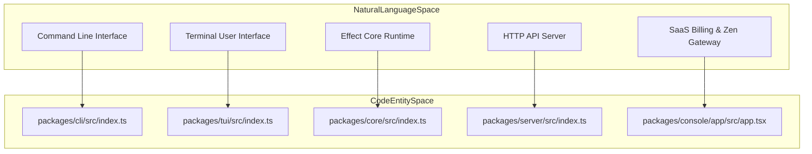
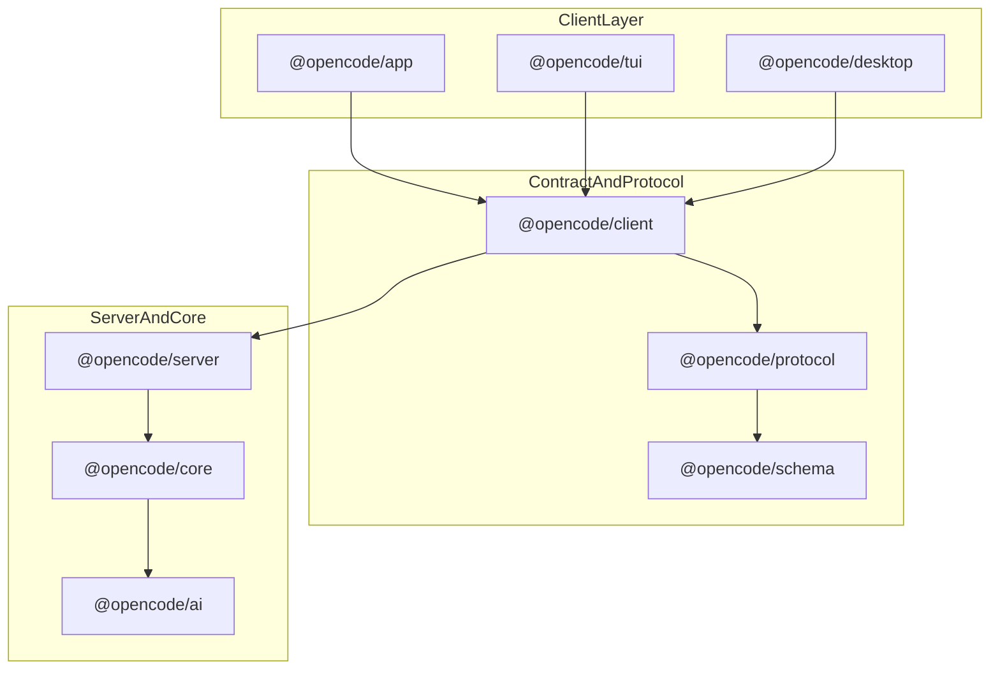

<!-- source: DeepWiki mcp.deepwiki.com · repo anomalyco/opencode · page 1.1 Repository Structure & Packages · fetched 2026-10-27 -->

# Repository Structure & Packages

Relevant source files

The following files were used as context for generating this wiki page:

- [bun.lock](bun.lock)
- [package.json](package.json)
- [packages/app/package.json](packages/app/package.json)
- [packages/cli/package.json](packages/cli/package.json)
- [packages/console/app/package.json](packages/console/app/package.json)
- [packages/core/package.json](packages/core/package.json)
- [packages/desktop/package.json](packages/desktop/package.json)
- [packages/function/package.json](packages/function/package.json)
- [packages/plugin/package.json](packages/plugin/package.json)
- [packages/server/package.json](packages/server/package.json)
- [packages/tui/package.json](packages/tui/package.json)
- [packages/ui/package.json](packages/ui/package.json)
- [packages/util/package.json](packages/util/package.json)
- [packages/web/package.json](packages/web/package.json)
- [sdks/vscode/package.json](sdks/vscode/package.json)

This document provides a detailed technical overview of the OpenCode monorepo organization. OpenCode uses Bun workspaces and a modular package architecture to coordinate core runtimes, SDKs, AI provider bindings, CLI utilities, user interfaces, and server components.

For runtime behavior and architectural patterns, see **1.2 Architecture Overview**.

Sources: [package.json:38-45](), [bun.lock:1-29]()

---

## Workspace Organization & Dependency Management

OpenCode is managed as a single Bun monorepo workspace. Root dependency pinning and workspace resolution rules are declared in `package.json` under `workspaces` and locked via `bun.lock` [bun.lock:1-29](), [package.json:38-45](). The monorepo layout partitions code into `packages/` for library and application code, `services/` for hosted auxiliary microservices, `sdks/` for platform integrations, and auxiliary directories like `infra/`, `patches/`, `specs/`, `salesforce/`, and `script/` [package.json:38-45]().

Workspace dependencies leverage the `"workspace:*"` protocol to ensure internal packages resolve sibling packages directly from source trees during development. Shared third-party dependencies use pinned catalog entries [package.json:46-116]().

Sources: [bun.lock:1-29](), [package.json:38-116]()

---

## The `packages/` Monorepo Subsystems

The `packages/` directory contains numerous modular packages supporting the OpenCode ecosystem. They are structured into several functional subsystems:

### AI & Core Runtime Packages
- **`packages/ai`**: Effect and promise-based LLM client abstraction layer managing network transports, structured message schemas, and provider error normalization [bun.lock:34-45]().
- **`packages/core`**: The Effect-based core runtime powering session lifecycles (`Session.Service`), configuration discovery, file operations, permissions, and tool execution engines [packages/core/package.json:1-139]().
- **`packages/util`**: Common utility functions, shared error types, logging helpers, and async primitives utilized across packages [packages/util/package.json:1-74]().

Sources: [bun.lock:34-45](), [packages/core/package.json:1-139](), [packages/util/package.json:1-74]()

### API, Protocol & Client Packages
- **`packages/schema`**: Canonical domain data types and Zod runtime validation schemas [package.json:98]().
- **`packages/protocol`**: Effect `HttpApi` groups defining REST and streaming API contracts between server and clients.
- **`packages/server`**: The Hono and Effect-based HTTP server process managing session routes, file sync, pseudo-terminal processes, and SSE event streaming.
- **`packages/client`**: Generated Effect and Promise-based clients paired with SolidJS reactive data stores for interacting with `@opencode/server` [package.json:120]().
- **`packages/httpapi-codegen`**: Code generator utility for turning protocol definitions into typed client and server bindings.

Sources: [package.json:98](), [package.json:120](), [packages/plugin/package.json:30-38]()

### CLI, Terminal & UI Packages
- **`packages/cli`**: Binary entrypoint (`bin/opencode.cjs`) and command registry for daemon management, terminal pairing, and service orchestration [bun.lock:113-119]().
- **`packages/tui`**: Terminal user interface built with SolidJS and `@opentui` runtimes [bun.lock:120-134]().
- **`packages/theme`**: TUI theme schema definitions, v1-to-v2 theme migrations, and keybinding management.
- **`packages/ui`**: Shared SolidJS design system components, Tailwind CSS styling tokens, and accessible interactive primitives [packages/ui/package.json:1-113]().
- **`packages/session-ui`**: Timeline projection components, tool execution renderers, and markdown viewers used by both web and TUI clients.
- **`packages/app`**: Shared frontend application shell containing the router, prompt composer, workspaces, and view states [packages/app/package.json:1-93]().
- **`packages/desktop`**: Electron application wrapper providing main/preload/renderer process coordination, native OS menus, and PTY daemon supervision [packages/desktop/package.json:1-69]().
- **`packages/storybook`**: Component documentation, story fixtures, and visual regression test harnesses.

Sources: [bun.lock:56-134](), [packages/ui/package.json:1-113](), [packages/desktop/package.json:1-69](), [packages/app/package.json:1-93]()

### Extensions, Plugins & Sandboxing Packages
- **`packages/plugin`**: Plugin host architecture providing promise and Effect APIs for writing external extensions [packages/plugin/package.json:1-71]().
- **`packages/plugin-browser`**: Browser automation extension packages for UI test and agent interaction capabilities.
- **`packages/plugins/figma`**: Figma integration plugin package for design-to-code workflows.
- **`packages/codemode`**: Sandboxed JavaScript interpreter runtime providing secure stdlib execution environments for tool calling [packages/core/package.json:111]().
- **`packages/gui-extensions`**: Graphical extensions for terminal panels, SSH sessions, WSL integrations, LaTeX rendering, and Mermaid diagram generation.
- **`packages/latex` & `packages/merman`**: Document and diagram parsing/rendering modules.
- **`packages/sdk`**: Public JavaScript SDK bindings for embedding OpenCode features.
- **`packages/identity`**: Authentication and identity management protocols.
- **`packages/simulation`**: Testing and simulation harness for automated agent evaluation loops.
- **`packages/http-recorder`**: Cassette-based HTTP traffic recording utility for reliable LLM and API regression tests [bun.lock:50]().

Sources: [bun.lock:50](), [packages/plugin/package.json:1-71](), [packages/core/package.json:111]()

### Cloud, Services & Enterprise Packages
- **`packages/console`**: SaaS Console platform infrastructure, split into `console-app` (SolidStart frontend), `console-core` (Drizzle domain logic and Stripe billing), and `console-resource` [packages/console/app/package.json:1-42]().
- **`packages/stats`**: Usage ingestion and public metrics dashboard workspace (`stats-app`, `stats-core`, `stats-server`).
- **`packages/web`**: Astro-based marketing and technical documentation static site generator [packages/web/package.json:1-42]().
- **`packages/posts`**: Blog and announcement publishing engine.

Sources: [packages/console/app/package.json:1-42](), [packages/web/package.json:1-42]()

---

## Supporting Directories: `services/`, `sdks/`, `infra/`, & Others

Beyond `packages/`, the monorepo contains dedicated directories for microservices, IDE SDKs, deployment definitions, patches, and build scripts:

| Directory   | Purpose & Contents                                                                                     |
|-------------|-------------------------------------------------------------------------------------------------------|
| `services/` | Hosted auxiliary services: `services/www` (next-gen documentation), `services/update` (version check & binary delivery), `services/files` (remote asset hosting), `services/changelog` (release notes service). |
| `sdks/`     | Official editor integration SDKs, including VSCode extension packages (`sdks/vscode`) [sdks/vscode/package.json:1-108](). |
| `infra/`    | SST (Serverless Stack) infrastructure-as-code definitions specifying AWS and Cloudflare resources.    |
| `patches/`  | Local third-party dependency patches (`.patch` files) applied to fix ecosystem compatibility issues [package.json:171-175](). |
| `specs/`    | Architecture specifications and V2 system design documents (`specs/v2/*`).                            |
| `salesforce/`| Salesforce `force-app` integration samples and enterprise connectors.                                 |
| `script/`   | Maintenance tasks, AST-grep custom lint rules, documentation generators, and typecheck profilers [package.json:21-30](). |

Sources: [package.json:21-30](), [package.json:171-175](), [sdks/vscode/package.json:1-108]()

---

## Architecture Mapping Diagrams

### Monorepo Workspace to System Subsystems

Sources: [bun.lock:34-134](), [package.json:38-44]()

---

### Package Dependency Flow

Sources: [bun.lock:34-137](), [packages/desktop/package.json:1-69]()

---

