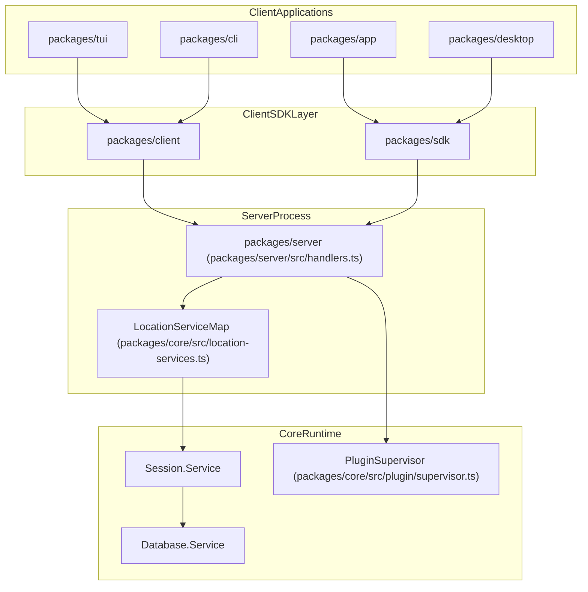
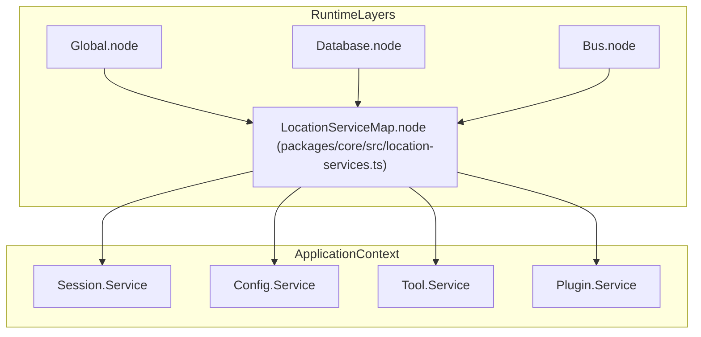
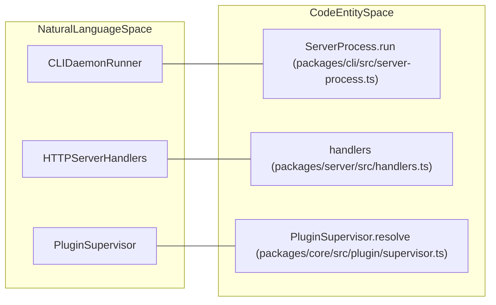
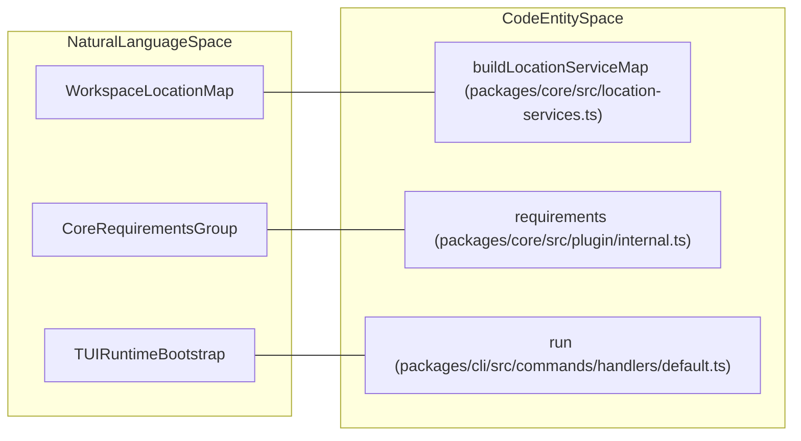

<!-- source: DeepWiki mcp.deepwiki.com · repo anomalyco/opencode · page 1.2 Architecture Overview · fetched 2026-10-27 -->

# Architecture Overview

Relevant source files

The following files were used as context for generating this wiki page:

- [packages/core/src/config/plugin/policy.ts](packages/core/src/config/plugin/policy.ts)
- [packages/core/src/config/variable.ts](packages/core/src/config/variable.ts)
- [packages/core/src/location-services.ts](packages/core/src/location-services.ts)
- [packages/core/src/managed-policy.ts](packages/core/src/managed-policy.ts)
- [packages/core/src/plugin/internal.ts](packages/core/src/plugin/internal.ts)
- [packages/core/src/plugin/sdk.ts](packages/core/src/plugin/sdk.ts)
- [packages/core/src/plugin/supervisor.ts](packages/core/src/plugin/supervisor.ts)
- [packages/core/src/session/move.ts](packages/core/src/session/move.ts)
- [packages/core/src/tool/plugin/mcp-resource.ts](packages/core/src/tool/plugin/mcp-resource.ts)
- [packages/core/src/tool/plugin/opencode.ts](packages/core/src/tool/plugin/opencode.ts)
- [packages/core/test/config/policy.test.ts](packages/core/test/config/policy.test.ts)
- [packages/core/test/fixture/tmpdir.ts](packages/core/test/fixture/tmpdir.ts)
- [packages/core/test/location-layer.test.ts](packages/core/test/location-layer.test.ts)
- [packages/core/test/plugin/fixture.ts](packages/core/test/plugin/fixture.ts)
- [packages/core/test/plugin/supervisor-reload.test.ts](packages/core/test/plugin/supervisor-reload.test.ts)
- [packages/core/test/plugin/supervisor.test.ts](packages/core/test/plugin/supervisor.test.ts)
- [packages/core/test/session-move.test.ts](packages/core/test/session-move.test.ts)
- [packages/core/test/session-remove.test.ts](packages/core/test/session-remove.test.ts)
- [packages/core/test/session-revert.test.ts](packages/core/test/session-revert.test.ts)
- [packages/core/test/tool-opencode.test.ts](packages/core/test/tool-opencode.test.ts)
- [packages/protocol/src/api.ts](packages/protocol/src/api.ts)
- [packages/protocol/src/client.ts](packages/protocol/src/client.ts)
- [packages/schema/src/config/policy.ts](packages/schema/src/config/policy.ts)
- [packages/server/src/handlers.ts](packages/server/src/handlers.ts)
- [packages/server/test/session-instances.test.ts](packages/server/test/session-instances.test.ts)
- [services/www/src/docs/content/cli/acp.mdx](services/www/src/docs/content/cli/acp.mdx)
- [services/www/src/docs/content/config.mdx](services/www/src/docs/content/config.mdx)
- [services/www/src/docs/content/instructions.mdx](services/www/src/docs/content/instructions.mdx)
- [services/www/src/docs/content/mcp-servers.mdx](services/www/src/docs/content/mcp-servers.mdx)
- [services/www/src/docs/content/migrate-v1.mdx](services/www/src/docs/content/migrate-v1.mdx)
- [services/www/src/docs/content/permissions.mdx](services/www/src/docs/content/permissions.mdx)
- [services/www/src/docs/content/policies.mdx](services/www/src/docs/content/policies.mdx)
- [services/www/src/docs/content/tools.mdx](services/www/src/docs/content/tools.mdx)
- [specs/v2/README.md](specs/v2/README.md)
- [specs/v2/provider-policy.md](specs/v2/provider-policy.md)

## Purpose and Scope

This page details the high-level client/server architecture of OpenCode, explaining the CLI daemon and background server process model, the Effect-based core runtime, the protocol and generated client contract, and the multiple UI clients (TUI, Web, Desktop). It also covers `specs/v2` documentation and repository terminology (`CONTEXT.md`, `AGENTS.md`).

Sources:
- [AGENTS.md:1-187]()
- [packages/cli/src/server-process.ts:32-45]()

---

## Client-Server Architecture & Daemon Model

OpenCode operates via a daemonized server process architecture managed through the CLI. When a client application like the Terminal UI (`packages/tui`) starts up, it inspects or spawns a background server process (`packages/server`) via `ServerConnection.resolve` [packages/cli/src/commands/handlers/default.ts:35-52](). 

The background server process is launched by `ServerProcess.run` in `packages/cli/src/server-process.ts`, establishing SQLite database connectivity, persistent PTY channels, file system watchers, and Effect HTTP routing [packages/cli/src/server-process.ts:32-151](), [packages/server/src/handlers.ts:35-67]().

### Client-Server Architecture Diagram

Sources:
- [packages/cli/src/server-process.ts:32-151]()
- [packages/cli/src/commands/handlers/default.ts:35-52]()
- [packages/server/src/handlers.ts:35-67]()
- [packages/core/src/location-services.ts:12-87]()

---

## Effect-Based Core Runtime

The core runtime (`packages/core`) is constructed around Effect services, layers, and dependency injection. Domain services such as `Session.Service`, `Config.Service`, `Tool.Service`, and `Provider.Service` are grouped into composite layers (`LayerNode`) [packages/core/src/plugin/internal.ts:108-158]().

Workspace isolation and multi-location management are coordinated via `LocationServiceMap` and `buildLocationServiceMap`, which dynamically builds and caches instance-bound service graphs per location reference (`Location.Ref`) [packages/core/src/location-services.ts:12-87]().

### Core Services Layer Composition

Sources:
- [packages/core/src/plugin/internal.ts:108-158]()
- [packages/core/src/location-services.ts:12-87]()

---

## Protocol, Client Contract, and UI Clients

Communication between clients and the server adheres to an Effect `HttpApi` specification defined in `packages/protocol`. Canonical data types and schemas reside in `packages/schema`, while `packages/client` generates type-safe consumers for remote procedure calls.

Primary UI clients include:
- **Terminal UI (`packages/tui`)**: Powered by SolidJS and `@opentui`, interacting directly with the server during startup and active session turns [packages/cli/src/commands/handlers/default.ts:96-155]().
- **Shared App (`packages/app`)**: Common frontend shell and virtualized timeline components utilized by web and desktop targets.
- **Desktop (`packages/desktop`)**: Electron wrapper providing persistent PTY daemons, IPC channels, and native application menus.

Sources:
- [packages/protocol/src/api.ts:111-136]()
- [packages/cli/src/commands/handlers/default.ts:96-155]()

---

## Bridging Natural Language Space to Code Entity Space (Part 1: Daemon & Routing)

| Natural Language Concept | Code Entity / Module |
|--------------------------|---------------------|
| CLI Daemon Background Runner | `ServerProcess.run` (`packages/cli/src/server-process.ts`) |
| HTTP Server Handlers & Routes | `handlers` (`packages/server/src/handlers.ts`) |
| Client Background Connection | `ServerConnection.resolve` (`packages/cli/src/commands/handlers/default.ts`) |
| Plugin Supervisor & Lifecycle | `PluginSupervisor` (`packages/core/src/plugin/supervisor.ts`) |

Sources:
- [packages/cli/src/server-process.ts:32-45]()
- [packages/server/src/handlers.ts:35-67]()
- [packages/core/src/plugin/supervisor.ts:19-26]()

---

## Bridging Natural Language Space to Code Entity Space (Part 2: Location & Core Services)

| Natural Language Concept | Code Entity / Module |
|--------------------------|---------------------|
| Workspace Location Map | `buildLocationServiceMap` (`packages/core/src/location-services.ts`) |
| Core Requirements Group | `requirements` (`packages/core/src/plugin/internal.ts`) |
| TUI Runtime Bootstrap | `run` (`packages/cli/src/commands/handlers/default.ts`) |

Sources:
- [packages/core/src/location-services.ts:12-14]()
- [packages/core/src/plugin/internal.ts:163-170]()
- [packages/cli/src/commands/handlers/default.ts:96-98]()

---

