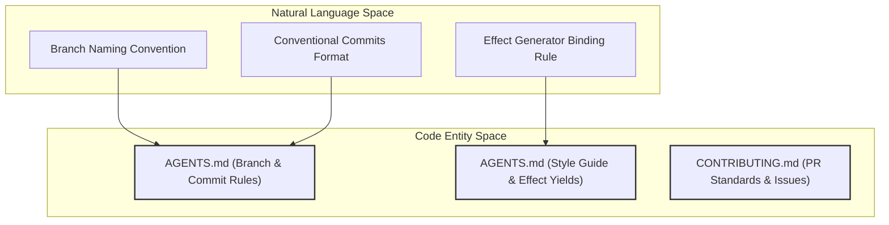
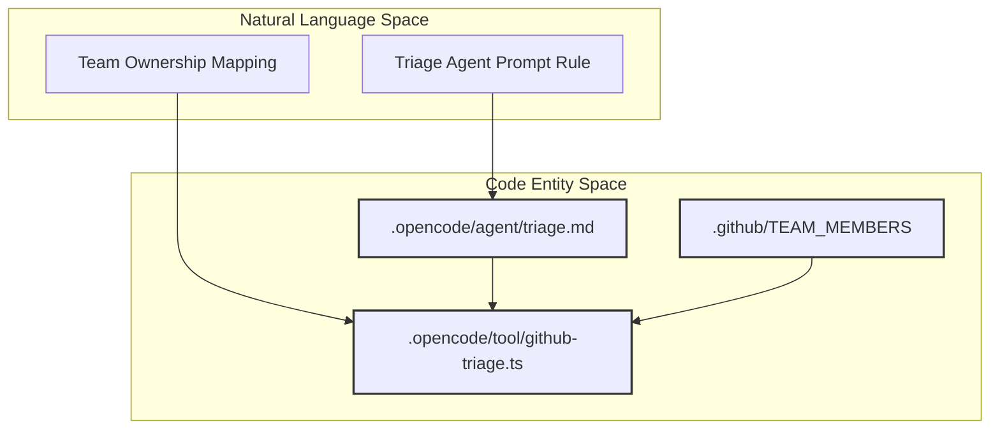
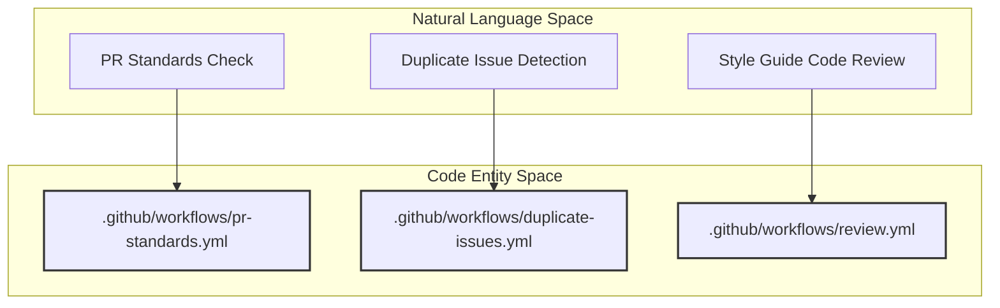

<!-- source: DeepWiki mcp.deepwiki.com · repo anomalyco/opencode · page 1.3 Contributor Guide & Repo Automation · fetched 2026-10-27 -->

# Contributor Guide & Repo Automation

<details>
<summary>Relevant source files</summary>

The following files were used as context for generating this wiki page:

- [.github/ISSUE_TEMPLATE/config.yml](.github/ISSUE_TEMPLATE/config.yml)
- [.github/TEAM_MEMBERS](.github/TEAM_MEMBERS)
- [.github/actions/setup-git-committer/action.yml](.github/actions/setup-git-committer/action.yml)
- [.github/pull_request_template.md](.github/pull_request_template.md)
- [.github/workflows/close-issues.yml](.github/workflows/close-issues.yml)
- [.github/workflows/close-prs.yml](.github/workflows/close-prs.yml)
- [.github/workflows/compliance-close.yml](.github/workflows/compliance-close.yml)
- [.github/workflows/docs-update.yml](.github/workflows/docs-update.yml)
- [.github/workflows/duplicate-issues.yml](.github/workflows/duplicate-issues.yml)
- [.github/workflows/notify-discord.yml](.github/workflows/notify-discord.yml)
- [.github/workflows/pr-management.yml](.github/workflows/pr-management.yml)
- [.github/workflows/pr-standards.yml](.github/workflows/pr-standards.yml)
- [.github/workflows/review.yml](.github/workflows/review.yml)
- [.github/workflows/triage.yml](.github/workflows/triage.yml)
- [.opencode/agent/duplicate-pr.md](.opencode/agent/duplicate-pr.md)
- [.opencode/agent/triage.md](.opencode/agent/triage.md)
- [.opencode/command/issues.md](.opencode/command/issues.md)
- [.opencode/tool/github-pr-search.ts](.opencode/tool/github-pr-search.ts)
- [.opencode/tool/github-triage.ts](.opencode/tool/github-triage.ts)
- [.oxlintrc.json](.oxlintrc.json)
- [.prettierignore](.prettierignore)
- [AGENTS.md](AGENTS.md)
- [CONTRIBUTING.md](CONTRIBUTING.md)
- [packages/console/app/src/routes/download/[channel]/[platform].ts](packages/console/app/src/routes/download/[channel]/[platform].ts)
- [packages/schema/src/skill.ts](packages/schema/src/skill.ts)
- [packages/script/package.json](packages/script/package.json)
- [packages/script/src/index.ts](packages/script/src/index.ts)
- [packages/tui/src/feature-plugins/system/notifications.ts](packages/tui/src/feature-plugins/system/notifications.ts)
- [packages/tui/src/routes/session/composer/context.ts](packages/tui/src/routes/session/composer/context.ts)
- [packages/tui/src/routes/session/composer/index.tsx](packages/tui/src/routes/session/composer/index.tsx)
- [packages/tui/src/routes/session/composer/shell-tab.tsx](packages/tui/src/routes/session/composer/shell-tab.tsx)
- [packages/tui/src/routes/session/composer/subagents-tab.tsx](packages/tui/src/routes/session/composer/subagents-tab.tsx)
- [packages/tui/src/routes/session/composer/terminals-tab.tsx](packages/tui/src/routes/session/composer/terminals-tab.tsx)
- [packages/tui/src/routes/session/form.tsx](packages/tui/src/routes/session/form.tsx)
- [packages/tui/src/routes/session/permission.tsx](packages/tui/src/routes/session/permission.tsx)
- [packages/tui/test/cli/cmd/tui/notifications.test.ts](packages/tui/test/cli/cmd/tui/notifications.test.ts)
- [packages/tui/test/cli/tui/composer-keymap.test.tsx](packages/tui/test/cli/tui/composer-keymap.test.tsx)
- [packages/tui/test/cli/tui/form.test.tsx](packages/tui/test/cli/tui/form.test.tsx)
- [packages/tui/test/component/dialog-shell-output.test.tsx](packages/tui/test/component/dialog-shell-output.test.tsx)
- [packages/web/src/content/docs/skills.mdx](packages/web/src/content/docs/skills.mdx)
- [script/github/close-issues.ts](script/github/close-issues.ts)
- [script/github/close-prs.ts](script/github/close-prs.ts)
- [specs/v2/session.md](specs/v2/session.md)

</details>


## Purpose and Scope
This document covers developer workflows, repository automation, stylistic conventions, and configuration standards for the OpenCode repository. It details the core guidelines in `AGENTS.md` and `CONTRIBUTING.md`, the built-in `.opencode/` agent ecosystem, commands, scripts (`packages/script`), static analysis rules (`.oxlintrc.json`), and automated GitHub workflows (`pr-standards`, `duplicate-issues`, and `review`).

---

## 1. Developer Workflow & Conventions (`AGENTS.md`)

OpenCode development relies on Bun (version 1.3 or newer) as its runtime and package manager `[CONTRIBUTING.md:25-25]()`. Repository contributors follow strict stylistic and structural guardrails to maintain monorepo health across packages like `packages/core`, `packages/cli`, `packages/server`, `packages/protocol`, and `packages/schema`.

### Branch and Commit Standards
- **Branch Naming**: Branch names must be short (at most three words) separated by hyphens. Type prefixes like `feat/` or `fix/` are disallowed `[AGENTS.md:30-32]()`. Examples include `session-recovery`, `fix-scroll-state`, and `regenerate-sdk` `[AGENTS.md:31-31]()`.
- **Commit Messages & PR Titles**: Commits and pull request titles must follow conventional commit formatting: `type(scope): summary` `[AGENTS.md:35-35]`. Valid types are `feat`, `fix`, `docs`, `chore`, `refactor`, and `test` `[AGENTS.md:37-37]()`. Scopes correspond to affected packages or areas (e.g., `core`, `opencode`, `tui`, `app`, `desktop`, `sdk`, `plugin`) `[AGENTS.md:37-37]()`.

### Code Style & Functional Principles
- **Variable Binding in Effect Generators**: When writing Effect generators, developers must bind services to named variables before invoking methods, avoiding nested service yields like `yield* (yield* Foo.Service).bar()` `[AGENTS.md:55-55]()`.
- **Destructuring and Imports**: Avoid unnecessary destructuring; use dot notation to preserve context `[AGENTS.md:70-70]()`. Never alias imports or use star (`*`) imports; import modules by their exported namespace instead `[AGENTS.md:83-86]()`.
- **Live V2 TUI Testing**: Developers run `bun run dev:live [directory]` to test development TUI builds against the currently elected background `opencode` server and live sessions, leveraging `opencode service status` and private credential injection `[AGENTS.md:8-11]()`.


*Diagram 1: Mapping natural language developer conventions to repository documentation specifications.*

**Sources:** `AGENTS.md:1-115`, `CONTRIBUTING.md:1-113`

---

## 2. The `.opencode/` Workspace & Agent Configuration

The repository root houses a local `.opencode/` directory containing agent definitions, custom tools, configuration overrides, and reference pointers used when running OpenCode inside the repository itself.

### Triage Agent & Tooling
Issues are automatically managed or assisted by a local triage agent defined in `[.opencode/agent/triage.md:1-11]()`. The agent delegates assignment actions to the custom tool implementation located at `[.opencode/tool/github-triage.ts:38-60]()`.


*Diagram 2: Association of triage agent specs to local configuration and TypeScript tool implementations.*

- **Team Routing**: The triage tool maps teams (`tui`, `desktop_web`, `core`, `inference`, `windows`) to maintainer handles `[.opencode/tool/github-triage.ts:4-10]()`.
- **GitHub API Integration**: `githubFetch` executes authenticated `POST` requests to assign chosen owners via `https://api.github.com/repos/${owner}/${repo}/issues/${issue}/assignees` `[.opencode/tool/github-triage.ts:22-36]()`.

**Sources:** `[.opencode/agent/triage.md:1-44]`, `[.opencode/tool/github-triage.ts:1-60]`, `[.github/TEAM_MEMBERS]`

---

## 3. Linting, Quality Enforcement & Script Automation

Code quality checks, linter rules (such as `.oxlintrc.json`), and release script calculations are hosted across package scripts and repository validation workflows.

### Packages Scripting (`packages/script`)
The script package runtime (`[packages/script/src/index.ts:1-18]()`) verifies that the active Bun runtime satisfies the version constraint declared in root `package.json`. It dynamically computes channels, preview build numbers from `GITHUB_RUN_NUMBER`, and loads team member lists from `.github/TEAM_MEMBERS` `[packages/script/src/index.ts:20-89]()`.

### Verification Procedures
Contributors verify changes by running tests and typechecks directly inside the affected package workspace rather than the root:
```bash
cd packages/core
bun run test
bun typecheck
```
`[CONTRIBUTING.md:62-70]()`

**Sources:** `[packages/script/src/index.ts:1-90]`, `[CONTRIBUTING.md:1-113]`, `[.oxlintrc.json]`

---

## 4. GitHub Automation Workflows

GitHub Actions automate issue triage, pull request standards compliance, duplicate detection, and code reviews.

### PR Standards Workflow (`pr-standards.yml`)
The `[.github/workflows/pr-standards.yml:1-146]()` action checks pull request titles for conventional commit prefixes and verifies linked closing issues via GitHub's GraphQL API (`closingIssuesReferences`) or body tags (`Closes #123`) `[ .github/workflows/pr-standards.yml:118-145]()`. Non-compliant PRs receive a `needs:title` or `needs:issue` label and an explanatory comment `[ .github/workflows/pr-standards.yml:91-158]()`.

### Duplicate Issues Workflow (`duplicate-issues.yml`)
When a new issue is opened, `.github/workflows/duplicate-issues.yml` executes an OpenCode agent run to check template compliance and search existing issues for duplicates.

### PR Review Workflow (`review.yml`)
Triggered via issue comments starting with `/review` by authorized members, `.github/workflows/review.yml` instructs OpenCode to evaluate PR diffs against repository style guidelines and post inline comments via the `gh` CLI `[.github/workflows/review.yml:1-83]()`.


*Diagram 3: GitHub Actions workflow automation entities mapping to automated validation rules.*

**Sources:** `[.github/workflows/pr-standards.yml:1-172]`, `[.github/workflows/duplicate-issues.yml:1-170]`, `[.github/workflows/review.yml:1-83]`

---

