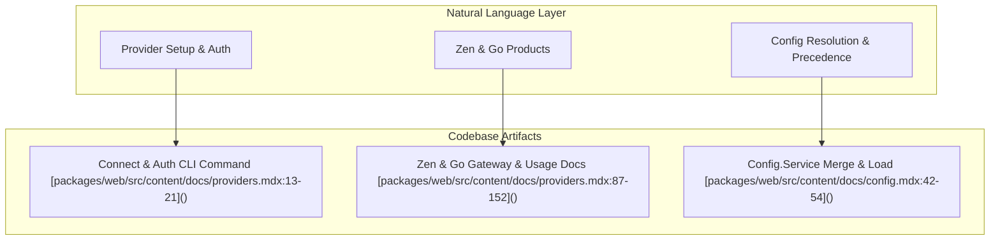

<!-- source: DeepWiki mcp.deepwiki.com · repo anomalyco/opencode · page 10 Reference · fetched 2026-10-27 -->

# Reference

<details>
<summary>Relevant source files</summary>

The following files were used as context for generating this wiki page:

- [packages/web/src/content/docs/ar/providers.mdx](packages/web/src/content/docs/ar/providers.mdx)
- [packages/web/src/content/docs/bs/providers.mdx](packages/web/src/content/docs/bs/providers.mdx)
- [packages/web/src/content/docs/da/providers.mdx](packages/web/src/content/docs/da/providers.mdx)
- [packages/web/src/content/docs/de/providers.mdx](packages/web/src/content/docs/de/providers.mdx)
- [packages/web/src/content/docs/es/providers.mdx](packages/web/src/content/docs/es/providers.mdx)
- [packages/web/src/content/docs/fr/providers.mdx](packages/web/src/content/docs/fr/providers.mdx)
- [packages/web/src/content/docs/it/providers.mdx](packages/web/src/content/docs/it/providers.mdx)
- [packages/web/src/content/docs/ja/providers.mdx](packages/web/src/content/docs/ja/providers.mdx)
- [packages/web/src/content/docs/ko/providers.mdx](packages/web/src/content/docs/ko/providers.mdx)
- [packages/web/src/content/docs/nb/providers.mdx](packages/web/src/content/docs/nb/providers.mdx)
- [packages/web/src/content/docs/pl/providers.mdx](packages/web/src/content/docs/pl/providers.mdx)
- [packages/web/src/content/docs/providers.mdx](packages/web/src/content/docs/providers.mdx)
- [packages/web/src/content/docs/zh-cn/providers.mdx](packages/web/src/content/docs/zh-cn/providers.mdx)
- [packages/web/src/content/docs/zh-tw/providers.mdx](packages/web/src/content/docs/zh-tw/providers.mdx)

</details>


This page provides a high-level quick reference overview of OpenCode's providers, products (Zen and Go), and configuration options. It serves as a parent page linking to detailed child pages that contain comprehensive technical information about each topic.

OpenCode supports a wide variety of AI providers and models, offers managed SaaS product tiers for inference access, and utilizes a layered configuration schema for fine-grained customization and management. This page connects these core reference areas, helping users understand their relationship and where to find further documentation.

For in-depth technical details and full specifications, see the child pages:
- [Providers & Models Reference](#10.1) — Supported LLM providers, authentication methods including OAuth and API keys, model selection and filtering mechanisms, and provider-specific configuration guidance.
- [OpenCode Zen & Go Products](#10.2) — Description of the Zen inference gateway endpoints, curated model catalog and pricing; Go/Go Plus subscription tiers, session header and client compatibility requirements, and rate limits.
- [Configuration Schema Reference](#10.3) — Complete schema and precedence rules for OpenCode configuration files including agents, providers, plugins, tools, permissions, keybinds, TUI/CLI options, and migration from v1 config.

---

## 10.1 Providers & Models Reference

OpenCode integrates the [AI SDK](https://ai-sdk.dev/) and [Models.dev](https://models.dev) to support over 75 LLM providers out of the box, including hosted cloud providers and local model execution [packages/web/src/content/docs/providers.mdx:9-10](). Credentials (API keys or OAuth tokens) are securely saved locally when added via the `/connect` command [packages/web/src/content/docs/providers.mdx:20-21]().

Providers are configured via the `provider` section of `opencode.json` config files, allowing customization such as overriding base URLs for proxying or specifying whitelists/blacklists of models to control which models appear in the `/models` picker [packages/web/src/content/docs/providers.mdx:31-83]().

Popular providers documented with setup guidance include:
- Amazon Bedrock with multiple authentication methods (AWS keys, profiles, bearer tokens), region and endpoint options.
- Anthropic Claude with OAuth and API key authentication flows.
- Several local and proxy-based providers like Atomic Chat.

You can safely add and manage provider API keys with `/connect`, then select models with `/models`.

For full credentials management, configuration options, provider-specific hints, and the list of supported providers, see [Providers & Models Reference](#10.1).

---

## 10.2 OpenCode Zen & Go Products

OpenCode Zen is a curated set of models maintained by the OpenCode team, vetted for quality and compatibility. It is recommended for new users as a reliable starting point and supports usage-based billing [packages/web/src/content/docs/providers.mdx:87-95]().

OpenCode Go offers a low-cost subscription plan that provides reliable access to popular open coding models from the OpenCode team [packages/web/src/content/docs/providers.mdx:123-127](). Go plans include tiers such as Go and Go Plus with defined session header requirements, client compatibility info, and enforced rate limits.

Both Zen and Go are integrated into the TUI `/connect` flow for easy onboarding, and support API key input via the authentication website.

For details on Zen/Go gateway endpoints, pricing models, subscription management, usage limits, and localized documentation, see [OpenCode Zen & Go Products](#10.2).

---

## 10.3 Configuration Schema Reference

OpenCode uses a layered configuration system built around the `opencode.json` schema. Configuration sources include:
- RemoteConfig from well-known URLs
- GlobalConfig stored in user home directories (`~/.config/opencode/opencode.json`)
- ProjectConfig in local working directories (`./opencode.json`)
- `.opencode/` directory for local overrides
- Managed OS-level files
- Configuration loaded and merged by the Config Service runtime

The precedence order allows for flexible overrides of global, project-specific, and local machine settings, providing robust customization [packages/web/src/content/docs/config.mdx:42-54]().

### Configuration Precedence Mapping

```mermaid
graph TD
    subgraph "Natural Language Space"
        UserGlobal["'Global user preferences'"]
        UserProject["'Project-specific config'"]
        UserLocal["'Local machine overrides'"]
    end

    subgraph "Code Entity Space"
        RemoteConfig["RemoteConfig (.well-known/opencode) [packages/web/src/content/docs/config.mdx:64-95]()"]
        GlobalConfig["GlobalConfig (~/.config/opencode/opencode.json) [packages/web/src/content/docs/config.mdx:99-117]()"]
        CustomConfig["OPENCODE_CONFIG env var [packages/web/src/content/docs/config.mdx:125-135]()"]
        ProjectConfig["ProjectConfig (./opencode.json) [packages/web/src/content/docs/config.mdx:109-123]()"]
        DotOpencodeDir["`.opencode/` Directory [packages/web/src/content/docs/config.mdx:138-151]()"]
        ManagedFiles["ManagedFiles (OS-level settings) [packages/web/src/content/docs/config.mdx:153-180]()"]
        ConfigService["Config.Service"]
    end

    UserGlobal --> GlobalConfig
    UserProject --> ProjectConfig
    UserLocal --> DotOpencodeDir
    RemoteConfig --> ConfigService
    GlobalConfig --> ConfigService
    CustomConfig --> ConfigService
    ProjectConfig --> ConfigService
    DotOpencodeDir --> ConfigService
    ManagedFiles --> ConfigService
```

For exhaustive schema definitions covering agents, providers, plugins, tools, permissions, keybinds, and migration strategies from v1 config, see [Configuration Schema Reference](#10.3).

---

## Mapping Natural Language Tasks to Code Entities

The following diagram bridges user-facing concepts to corresponding codebase artifacts for quick orientation:



---

**Sources:**
- packages/web/src/content/docs/providers.mdx  
- packages/web/src/content/docs/config.mdx

---

