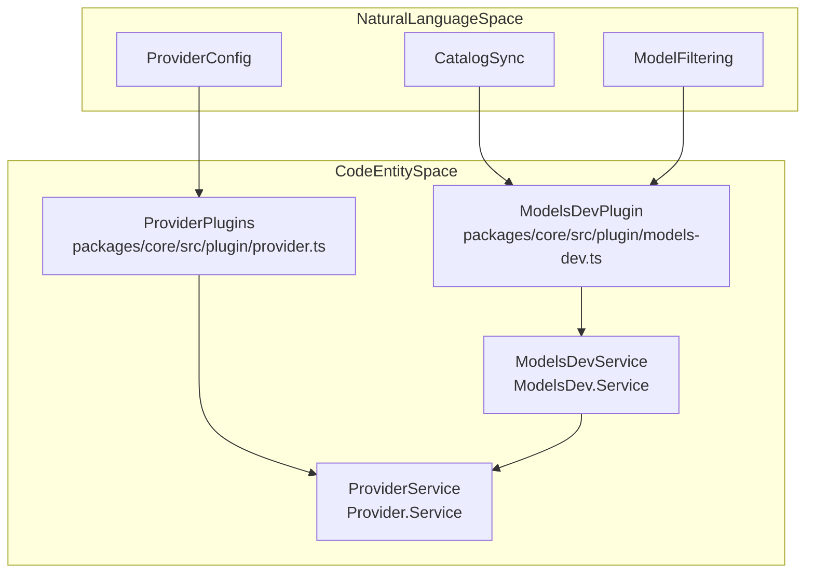
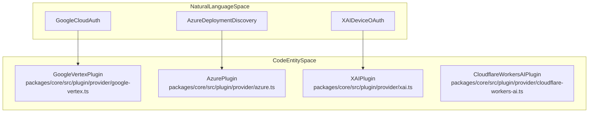
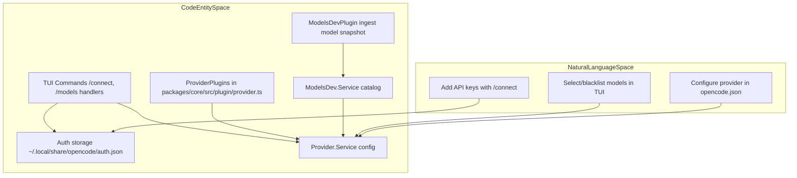
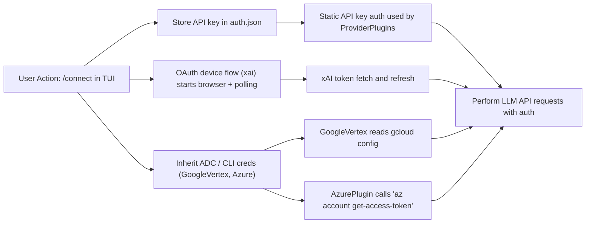

<!-- source: DeepWiki mcp.deepwiki.com · repo anomalyco/opencode · page 10.1 Providers & Models Reference · fetched 2026-10-27 -->

# Providers & Models Reference

<details>
<summary>Relevant source files</summary>

The following files were used as context for generating this wiki page:

- [packages/core/script/update-models-snapshot.ts](packages/core/script/update-models-snapshot.ts)
- [packages/core/src/models-dev/snapshot.txt](packages/core/src/models-dev/snapshot.txt)
- [packages/web/src/content/docs/ar/providers.mdx](packages/web/src/content/docs/ar/providers.mdx)
- [packages/web/src/content/docs/bs/providers.mdx](packages/web/src/content/docs/bs/providers.mdx)
- [packages/web/src/content/docs/da/providers.mdx](packages/web/src/content/docs/da/providers.mdx)
- [packages/web/src/content/docs/de/providers.mdx](packages/web/src/content/docs/de/providers.mdx)
- [packages/web/src/content/docs/es/providers.mdx](packages/web/src/content/docs/es/providers.mdx)
- [packages/web/src/content/docs/fr/providers.mdx](packages/web/src/content/docs/fr/providers.mdx)
- [packages/web/src/content/docs/it/providers.mdx](packages/web/src/content/docs/it/providers.mdx)
- [packages/web/src/content/docs/ja/providers.mdx](packages/web/src/content/docs/ja/providers.mdx)
- [packages/web/src/content/docs/ko/providers.mdx](packages/web/src/content/docs/ko/providers.mdx)
- [packages/web/src/content/docs/nb/providers.mdx](packages/web/src/content/docs/nb/providers.mdx)
- [packages/web/src/content/docs/pl/providers.mdx](packages/web/src/content/docs/pl/providers.mdx)
- [packages/web/src/content/docs/providers.mdx](packages/web/src/content/docs/providers.mdx)
- [packages/web/src/content/docs/zh-cn/providers.mdx](packages/web/src/content/docs/zh-cn/providers.mdx)
- [packages/web/src/content/docs/zh-tw/providers.mdx](packages/web/src/content/docs/zh-tw/providers.mdx)

</details>


This page provides a comprehensive technical reference for OpenCode’s supported LLM providers, authentication methods, model lists, and provider-specific configuration notes. It covers the architecture around provider integration, model catalog synchronization, authentication workflows, configuration options, core provider plugin implementations, and OpenCode’s managed services "Zen" and "Go."

---

## 1. Provider Architecture & Catalog Loading

OpenCode manages its LLM providers and their models via an extensible Effect-based plugin architecture. The provider catalog combines:

- **Static internal provider plugins**: Bundled implementations for each supported LLM provider.
- **Dynamic model snapshots**: Integrated from the community-curated `ModelsDev` catalog.

The `ModelsDevPlugin` service reads this snapshot, merges it with provider plugins, accounts for environment and authentication requirements, and populates the `Provider.Service` model catalog. This architecture enables seamless updating of models and providers.

### Provider Plugin Registration & Loading - Bridging Natural Language and Code



- `ModelsDevPlugin` imports `ModelsDev` snapshots and dynamically contributes models to the global catalog.
- `ProviderPlugins` hold static definitions for providers used by the runtime.
- The `Provider.Service` aggregates all these sources and exposes unified provider/model metadata.

Sources: [packages/core/src/plugin/models-dev.ts:27-76](), [packages/core/src/plugin/provider.ts:35-68]()

---

## 2. Configuration System & Options

Users configure provider and model behavior primarily via the `opencode.json` file's `provider` section. This configuration supplements CLI key management via `/connect`.

### Key Configuration Properties

- **`baseURL`**: Override the default provider API endpoint. Useful for proxies or custom endpoints.
  
  ```json
  {
    "provider": {
      "anthropic": {
        "options": {
          "baseURL": "https://api.anthropic.com/v1"
        }
      }
    }
  }
  ```

- **`blacklist` / `whitelist`**: Control model visibility in the `/models` TUI picker by specifying arrays of model IDs.
  - `blacklist`: Exclude specified models.
  - `whitelist`: Include only specified models.
  - Combination: `whitelist` first filters in, then `blacklist` removes entries.

- **Timeouts**:
  - `settings.headerTimeout`: Max duration (ms) for HTTP headers.
  - `settings.chunkTimeout`: Max wait time (ms) for new streamed response chunks.
  - `settings.timeout`: Max total request duration (ms).

- **`packages`**: Selects the SDK/runtime package used for a provider, e.g., `@opencode/ai/providers/openai-compatible`.

Detailed configuration examples and explanations are documented in the user docs [packages/web/src/content/docs/providers.mdx:25-84]().

Sources: [packages/web/src/content/docs/providers.mdx:25-84](), [services/www/src/docs/content/providers.mdx:134-205]()

---

## 3. Authentication Flows & Credentials

Authentication credentials collected via the TUI `/connect` command are securely stored in `~/.local/share/opencode/auth.json`.

OpenCode supports several authentication methods adapted per provider:

1. **API Keys & Environment Variables**: The common method for many static-key providers, loading credentials either from environment variables or stored auth JSON.

2. **OAuth Device Flow**: For providers like `xai` (SuperGrok subscription), OpenCode facilitates a device OAuth flow utilizing browser confirmation, verification URIs, polling, and token refreshing [packages/core/src/plugin/provider/xai.ts:40-74]().

3. **Application Default Credentials (ADC) & Cloud CLI Integration**: For Google Vertex and Azure, OpenCode uses local SDK credentials or CLI token caches to authenticate:

   - `GoogleVertexPlugin` searches for project/location from:
     - `gcloud` config files (`~/.config/gcloud/configurations/config_default`) and SDK ADC JSON.
     - Environment variables like `GOOGLE_VERTEX_PROJECT` or `GOOGLE_CLOUD_PROJECT`.
   
   - `AzurePlugin` obtains tokens by calling the Azure CLI (`az account get-access-token`) and discovers deployed models through Resource Graph queries [packages/core/src/plugin/provider/google-vertex.ts:17-100](), [packages/core/src/plugin/provider/azure.ts:106-132]().

Sources: [packages/web/src/content/docs/providers.mdx:18-21](), [packages/core/src/plugin/provider/google-vertex.ts:52-100](), [packages/core/src/plugin/provider/azure.ts:106-132](), [packages/core/src/plugin/provider/xai.ts:40-74]()

---

## 4. Core Provider Implementations & Plugins

OpenCode includes multiple provider plugins, each responsible for authentication, model listing, request construction, and response parsing.

### Provider Plugin Lifecycle and Key Implementations



- **`GoogleVertexPlugin`**: Fetches project and location info from various config/environment locations; supports both ADC and environment variable auth [google-vertex.ts:17-153]().
- **`AzurePlugin`**: Integrates Azure CLI for token fetch and uses Azure Resource Graph for model discovery [azure.ts:70-132]().
- **`XAIPlugin`**: Supports Grok model device OAuth flow and configures WebSocket transports automatically [xai.ts:40-107]().
- **`CloudflareWorkersAIPlugin`**: Resolves Cloudflare Account IDs and constructs endpoints accordingly [cloudflare-workers-ai.ts:10-62]().

### Provider-Specific Notes

- **Amazon Bedrock**
  - Requires explicit model catalog access setup.
  - Supports environment variables: `AWS_ACCESS_KEY_ID`, `AWS_SECRET_ACCESS_KEY`, `AWS_PROFILE`, `AWS_BEARER_TOKEN_BEDROCK`.
  - Can be configured via `opencode.json` with `region`, `profile`, and `endpoint` (<alias for `baseURL`>).
  - Supports VPC endpoint configuration.
  - Authentication priority: Bearer token (from `/connect` or env) > AWS credential chain.
  
  Configuration example snippet:

  ```json
  {
    "provider": {
      "amazon-bedrock": {
        "options": {
          "region": "us-east-1",
          "profile": "my-aws-profile",
          "endpoint": "https://bedrock-runtime.us-east-1.vpce-xxxxx.amazonaws.com"
        }
      }
    }
  }
  ```

- **Google Vertex**: Uses ADC and environment variables for project/region determination to drive API calls.

- **Azure**: Uses the Azure CLI token and Resource Graph to locate deployed cognitive service models in user subscriptions.

- **xAI**: Implements a device OAuth flow to enable headless user authentication compatible with SuperGrok and Grok LLMs.

- **Cloudflare Workers AI**: Requires an account ID to build the model endpoint URL and supports custom baseURL overrides.

Sources: [packages/web/src/content/docs/providers.mdx:193-278](), [packages/core/src/plugin/provider/google-vertex.ts:17-153](), [packages/core/src/plugin/provider/azure.ts:70-132](), [packages/core/src/plugin/provider/xai.ts:40-107](), [packages/core/src/plugin/provider/cloudflare-workers-ai.ts:10-62]()

---

## 5. OpenCode Zen & Go Managed Services

OpenCode offers managed SaaS provider options that integrate seamlessly as first-class providers without manual URL or credential setup:

- **OpenCode Zen**: A curated gateway of verified, benchmarked top-tier models maintained by the OpenCode team. Ideal for users seeking a vetted baseline without configuration overhead.

- **OpenCode Go**: A low-cost subscription plan providing stable access to popular open coding models carefully tested for OpenCode compatibility.

Both services can be connected through the TUI `/connect` command and are configured via the same provider config mechanisms:

```txt
/connect
```

- After authentication and API key entry, `/models` lists the recommended models.

This uniform interface makes switching or combining providers straightforward.

Sources: [packages/web/src/content/docs/providers.mdx:87-152]()

---

## 6. Model Catalog Snapshot Highlights

The model catalog loaded from `ModelsDev` includes metadata for providers and models, describing their capabilities and constraints such as:

- Model IDs and names.
- Supported modalities (`text`, `image`, `video`).
- Context and output token limits.
- Reasoning features and options.
- Cost parameters.
- Release and knowledge cutoff dates.
- Some examples:

| Provider/Model ID                      | Name                | Description                                          | Context Tokens Limit | Output Tokens Limit | Modalities         | Reasoning | Open Weights |
|--------------------------------------|---------------------|------------------------------------------------------|----------------------|---------------------|--------------------|-----------|--------------|
| `cloudferro-sherlock/MiniMaxAI/MiniMax-M2.5` | MiniMax-M2.5        | Chat, coding, office, agentic tasks                   | 196,000              | 16,000              | text               | Yes       | Yes          |
| `reflection/Beam-1.0-501B-A23B`      | Beam 1.0 501B A23B  | Sparse mixture-of-experts reasoning for coding       | 1,048,576            | 131,072             | text               | Yes       | Yes          |
| `alibaba-coding-plan-cn/qwen3.7-plus`| Qwen3.7 Plus        | Multimodal Qwen model for long-context agents        | 1,000,000            | 64,000              | text, image, video  | Yes       | No           |

Sources: [packages/core/src/models-dev/snapshot.txt:1]()

---

# Summary Table of Key Provider Config Options

| Option        | Description                                              | Example                              |
|---------------|----------------------------------------------------------|------------------------------------|
| `baseURL`     | Custom endpoint URL for provider API.                    | `"baseURL": "https://api.provider.com/v1"`  |
| `blacklist`   | Array of model IDs to exclude from model picker.          | `"blacklist": ["model1", "model2"]`           |
| `whitelist`   | Array of model IDs to exclusively include.                | `"whitelist": ["modelA"]`                      |
| `region`      | Cloud region code (for cloud providers, e.g., AWS).      | `"region": "us-east-1"`                        |
| `profile`     | Named cloud credentials/profile identifier.              | `"profile": "my-aws-profile"`                   |
| `endpoint`    | Alias for `baseURL` with provider-specific semantics.    | `"endpoint": "https://custom.endpoint"`        |

---

# Diagrams Relating Natural Language Concepts to Code Entities

### Provider Configuration Flow



---

### Authentication Flow Examples



---

# References and Further Reading

- Provider & Model plugin implementations: `packages/core/src/plugin/provider.ts`, `packages/core/src/plugin/models-dev.ts`
- Models catalog snapshot: `packages/core/src/models-dev/snapshot.txt`
- Provider documentation (open-code docs): `packages/web/src/content/docs/providers.mdx`
- Provider plugins:
  - Google Vertex AI: `packages/core/src/plugin/provider/google-vertex.ts`
  - Azure: `packages/core/src/plugin/provider/azure.ts`
  - xAI: `packages/core/src/plugin/provider/xai.ts`
  - Cloudflare Workers AI: `packages/core/src/plugin/provider/cloudflare-workers-ai.ts`

---

# Summary

This reference details all facets of OpenCode’s LLM provider ecosystem:

- Architecture unifying static provider plugins and dynamic model snapshots.
- Flexible provider configuration with URL overrides and model filtering.
- Multiple auth flows including API keys, OAuth device flow, and CLI/SDK integration.
- Provider-specific notes for AWS Bedrock, Google Vertex, Azure, XAI, and others.
- Managed services Zen and Go for curated model access.
- Extensive model metadata from a community snapshot.

This foundation supports easy addition of new providers and seamless user experience for switching, authenticating, and working with a large catalog of high-quality LLM models.

---
Sources:  
[packages/core/src/plugin/models-dev.ts:27-76](), [packages/core/src/plugin/provider.ts:35-68](), [packages/web/src/content/docs/providers.mdx:18-84](), [packages/core/src/plugin/provider/google-vertex.ts:17-153](), [packages/core/src/plugin/provider/azure.ts:70-132](), [packages/core/src/plugin/provider/xai.ts:40-107](), [packages/core/src/plugin/provider/cloudflare-workers-ai.ts:10-62](), [packages/web/src/content/docs/providers.mdx:87-152](), [packages/core/src/models-dev/snapshot.txt:1]()

---

