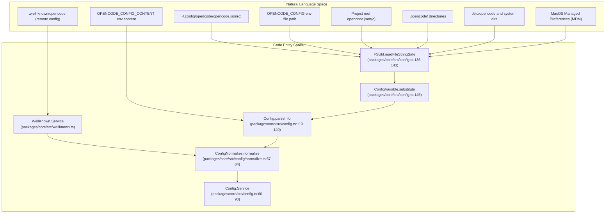
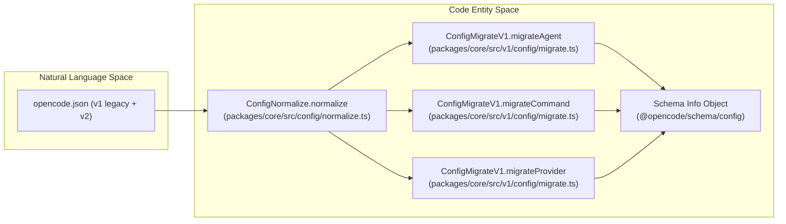
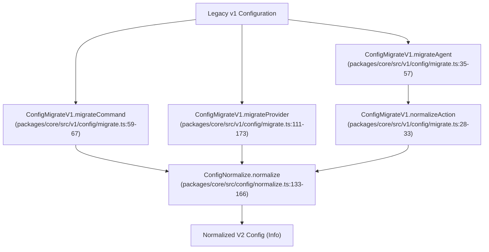
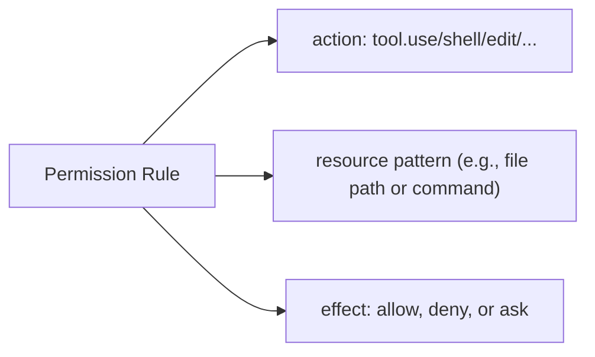

<!-- source: DeepWiki mcp.deepwiki.com · repo anomalyco/opencode · page 10.3 Configuration Schema Reference · fetched 2026-10-27 -->

# Configuration Schema Reference

<details>
<summary>Relevant source files</summary>

The following files were used as context for generating this wiki page:

- [packages/core/src/config.ts](packages/core/src/config.ts)
- [packages/core/src/config/normalize.ts](packages/core/src/config/normalize.ts)
- [packages/core/src/config/plugin/policy.ts](packages/core/src/config/plugin/policy.ts)
- [packages/core/src/managed-policy.ts](packages/core/src/managed-policy.ts)
- [packages/core/src/tool/plugin/mcp-resource.ts](packages/core/src/tool/plugin/mcp-resource.ts)
- [packages/core/src/tool/plugin/opencode.ts](packages/core/src/tool/plugin/opencode.ts)
- [packages/core/src/v1/config/migrate.ts](packages/core/src/v1/config/migrate.ts)
- [packages/core/src/v1/config/provider-options.ts](packages/core/src/v1/config/provider-options.ts)
- [packages/core/src/wellknown.ts](packages/core/src/wellknown.ts)
- [packages/core/src/wellknown/plugin.ts](packages/core/src/wellknown/plugin.ts)
- [packages/core/test/config/config.test.ts](packages/core/test/config/config.test.ts)
- [packages/core/test/config/normalization.test.ts](packages/core/test/config/normalization.test.ts)
- [packages/core/test/config/policy.test.ts](packages/core/test/config/policy.test.ts)
- [packages/core/test/config/provider-options.test.ts](packages/core/test/config/provider-options.test.ts)
- [packages/core/test/fixture/config-nodes.ts](packages/core/test/fixture/config-nodes.ts)
- [packages/core/test/plugin/fixture.ts](packages/core/test/plugin/fixture.ts)
- [packages/core/test/tool-opencode.test.ts](packages/core/test/tool-opencode.test.ts)
- [packages/core/test/wellknown.test.ts](packages/core/test/wellknown.test.ts)
- [packages/schema/src/config/experimental.ts](packages/schema/src/config/experimental.ts)
- [packages/schema/src/config/policy.ts](packages/schema/src/config/policy.ts)
- [services/www/src/docs/content/cli/acp.mdx](services/www/src/docs/content/cli/acp.mdx)
- [services/www/src/docs/content/config.mdx](services/www/src/docs/content/config.mdx)
- [services/www/src/docs/content/instructions.mdx](services/www/src/docs/content/instructions.mdx)
- [services/www/src/docs/content/mcp-servers.mdx](services/www/src/docs/content/mcp-servers.mdx)
- [services/www/src/docs/content/migrate-v1.mdx](services/www/src/docs/content/migrate-v1.mdx)
- [services/www/src/docs/content/permissions.mdx](services/www/src/docs/content/permissions.mdx)
- [services/www/src/docs/content/policies.mdx](services/www/src/docs/content/policies.mdx)
- [services/www/src/docs/content/tools.mdx](services/www/src/docs/content/tools.mdx)
- [specs/v2/README.md](specs/v2/README.md)
- [specs/v2/provider-policy.md](specs/v2/provider-policy.md)

</details>


This page provides a comprehensive technical reference for the OpenCode configuration system. It explicates the schema for primary configuration files such as `opencode.json` (project and global settings), related configuration files like `tui.json` for TUI/CLI settings, and details the migration process from v1 to v2. The explanations cover the hierarchical configuration sources, schema normalization, key classes and functions involved in parsing and normalizing configuration data, and include mermaid diagrams linking user-visible concepts to core code entities.

---

## Configuration Hierarchy & Precedence

OpenCode supports hierarchical configuration loaded from various sources which are merged with well-defined precedence rules. Configuration is additive with override semantics: lower-precedence sources are merged first, then higher precedence sources override conflicting keys.

### Configuration Sources and Loading Order

- **Managed Config:** System-wide admin-controlled configs stored under platform-dependent system directories (e.g. `/etc/opencode`, `/Library/Application Support/opencode`). Highest precedence except managed macOS preferences.
- **MacOS Managed Preferences:** Enforced by MDM policies under domains like `ai.opencode.managed`, taking highest precedence.
- **Remote Config:** Organizational defaults loaded from `.well-known/opencode` manifests, fetched by `WellKnown.Service`.
- **Global Configuration:** User-level settings, typically at `~/.config/opencode/opencode.json(c)`.
- **Custom Config Path:** Optional path specified by the environment variable `OPENCODE_CONFIG`.
- **Project Config:** Project-specific `opencode.json(c)` files found by upward directory scanning and git root detection.
- **`.opencode` Directory:** Local configuration subdirectories for agents, commands, plugins.
- **Inline Config:** Ephemeral overrides passed via environment variable `OPENCODE_CONFIG_CONTENT`.

Each config source is loaded, variables substituted, parsed from JSONC (supporting comments and trailing commas), normalized, then merged respecting the precedence order.



**Key Implementation Details:**

- **Configuration files are parsed using `jsonc-parser`** to allow comments and flexibility in formatting. Errors during parse emit warnings but do not necessarily reject the file outright (`Config.parseInfo`).
- **ConfigVariable substitution** replaces variables (e.g., `${HOME}`) in config file text before parsing (`ConfigVariable.substitute`).
- Diagnosed warnings and unsupported fields are collected during normalization (`ConfigNormalize.normalize`), and relevant logs are emitted (`Effect.logWarning`).
- Configurations from all sources are combined into a single in-memory `Config.Service` interface for runtime consumption.

_Sources:_
- [packages/core/src/config.ts:90-151]()
- [packages/core/src/config/normalize.ts:57-64]()
- [services/www/src/docs/content/config.mdx:28-98]()

---

## Core Configuration Schema & Normalization

### Schema and Canonical Representation

OpenCode’s canonical configuration schema is defined by the `Info` schema type in `@opencode/schema/config`. This schema defines allowable fields, nested structures, and validation.

- The schema describes agents, providers, commands, tools, permissions, keybindings, policies, experiments, and TUI/CLI options.
- Fields from legacy configurations (v1) are tolerated, detected, and migrated transparently.
- The normalization process produces either a normalized config or a rejection with detailed diagnostics.

### Top-Level Supported Fields (Selective Summary)

| Field          | Type                         | Description                                                    |
|----------------|------------------------------|----------------------------------------------------------------|
| `$schema`      | `string`                     | JSON Schema URI for editor validation.                         |
| `model`        | `string`                     | Default AI model to use (format: `provider/model[#variant]`). |
| `default_agent`| `string`                     | ID of the default configured agent.                           |
| `shell`        | `string`                     | Default shell program for shell tools.                        |
| `update`       | `"auto"`, `"notify"`, `"disable"` | Control update checks for CLI/server.                         |
| `permissions`  | Array of permission rules    | Ordered rules for tool permissions, describing `action`, `resource`, and `effect`. |
| `policies`     | Array of policy statements   | Enforced broader security or usage policies.                  |
| `agents`       | Map of agent configurations  | Custom or built-in agents with detailed settings.             |
| `commands`     | Map of commands              | Slash commands callable via the CLI or sessions.              |
| `providers`    | Map of provider definitions  | Authentication and endpoint details for AI service providers. |
| `plugins`      | List of plugins to load      | NPM or local plugins configurable per environment.            |
| `references`   | Map of references            | External workspace or library source references.              |
| `tui`          | TUI / CLI UI settings and keybinds | Terminal UI customization, keymaps, leader keys, timeouts.  |

The normalization merges legacy v1 fields and new v2 fields, preferring valid native v2 config when conflicts arise.



**Key Functions & Classes:**

- `ConfigNormalize.normalize(input: unknown): Result`: Normalizes raw parsed config data to canonical form with diagnostics.
- `ConfigMigrateV1.*`: Functions for migrating legacy configuration structures (agents, commands, providers, permissions).
- `Info` (schema): Defines the entire config structure validated and used at runtime.
- `Config.Service`: Effect-based service encapsulating config access, config entries, and change events.

Sources:
- [packages/core/src/config/normalize.ts:30-167]()
- [packages/core/src/v1/config/migrate.ts:1-178]()

---

## Migration from v1 to v2 Configuration

OpenCode v2 accepts legacy v1 config formats and automatically normalizes them into the modern v2 schema. Migration happens transparently during config loading.

### Important Migration Transformations

- **Permissions:** v1 permissions grouped by tool keys (e.g., `"bash"`, `"write"`, `"task"`) are remapped to the new unified permission action names (e.g., `"shell"`, `"edit"`, `"subagent"`) using `ConfigMigrateV1.normalizeAction()`.

- **Providers:** Deprecated provider IDs such as `"azure-cognitive-services"` are mapped to new IDs like `"azure"`. The older provider configuration options are migrated with adjusted fields and package specs.

- **Agents:** The separate `agent` and `mode` properties in v1 are consolidated into a single `agents` dictionary in v2, with individual agent properties migrated and normalized accordingly.

- **Commands:** v1 command definitions are converted and merged into the v2 `commands` map with up-to-date field names and model selection.

- **Update Policy:** Legacy `autoupdate` and `autoshare` fields map to the new `update` and `share` fields with explicit variant strings (`"auto"`, `"notify"`, `"disable"`).

- **Tools:** The old tool field `"tools"` is represented as explicit permissions in `permissions` array.

### Migration Summary Diagram



**Notes:**

- Migration does not rewrite files but produces in-memory normalized config representations.
- Unsupported or retired fields log warnings via diagnostics but do not block configuration loading.
- Users can opt to update their config files to v2 shape manually or request migration via CLI commands.

Sources:
- [packages/core/src/v1/config/migrate.ts:1-178]()
- [packages/core/src/config/normalize.ts:133-166]()
- [services/www/src/docs/content/migrate-v1.mdx:10-125]()

---

## Agents Configuration

Agents define AI personas or models with tailored instructions, permissions, and behavior modes.

### Agent Fields Overview

- `system`: System prompt or instructions string.
- `model`: AI model reference string (`provider/model[#variant]`).
- `disabled`: Boolean flag to disable the agent.
- `permissions`: An array of permission rules specific to the agent.
- `mode`: `"primary"` or `"subagent"` modes defining agent behavior.

Agents can override global models or permissions, selected explicitly per session or command.

### Agent Migration

Legacy `agent` and `mode` fields are merged to the unified `agents` dictionary with migrations applied per agent.

Sources:
- [packages/core/src/config/normalize.ts:133-166]()
- [services/www/src/docs/content/config.mdx:152-175]()

---

## Providers Configuration

Defines LLM API providers and authentication settings.

### Key Fields

- `package`: The JavaScript package or plugin used to integrate the provider.
- `env`: List of environment variable names to load from process environment.
- `settings`: Provider-specific endpoint or option overrides.
- `headers`: Custom HTTP headers for API calls.
- `body`: Additional request body fields for model calls.
- `models`: Named model entries with overrides or variants.

Providers support OAuth or API key authentication and may define custom API URLs.

### Provider Migration

V1 configurations with deprecated provider IDs or monolithic API URLs are migrated with updated `package` and `settings` fields.

Sources:
- [packages/core/src/v1/config/migrate.ts:111-173]()
- [packages/core/src/config/normalize.ts:104-140]()

---

## Plugins Configuration

Plugins extend OpenCode functionality. Configuration supports:

- Plugin lists as strings (npm package names) or tuples `[name, options]`.
- Options for local path, NPM package, or effect plugins.
- Configuration for plugin activation or custom settings.

Plugins are loaded via the core plugin host.

Sources:
- [services/www/src/docs/content/config.mdx:226-240]()

---

## Tools & Permissions Configuration

### Tools

Tools are atomic operations agents invoke (e.g., `read`, `edit`, `shell`, `webfetch`, `skill`).

### Permissions

Permissions are ordered rules governing access control for tools with three main string fields:

| Field    | Description                                                               |
|----------|---------------------------------------------------------------------------|
| `action` | The tool action name (e.g., `"shell"`, `"edit"`, `"skill"`).               |
| `resource` | Value tested by the rule (e.g., paths, commands, URLs, skill IDs).       |
| `effect` | Behavior allowed (`"allow"`), denied (`"deny"`), or prompt (`"ask"`).      |

Rules apply in order; the last matching rule wins.



### V1 vs V2 Differences

- V1 grouped permissions by tool; V2 unifies them in ordered arrays.
- Actions renamed: `"bash"` → `"shell"`, `"write"`/`"patch"` → `"edit"`, `"task"` → `"subagent"`.
- External directory access is allowed by default; to preserve V1 ask behavior, add an explicit `external_directory` ask rule.

Sources:
- [services/www/src/docs/content/permissions.mdx]()
- [packages/core/src/v1/config/migrate.ts:18-33]()

---

## Keybinds & TUI/CLI Settings

### TUI Keybind Configuration

Stored in `tui.json` or merged configuration files, keybinding configuration allows customizing terminal UI hotkeys. The structure includes:

- `leader`: Leader key, defaulting to `"ctrl+x"`.
- `leader_timeout`: Time in milliseconds to wait after leader key before expecting additional keys.
- Mapping of action names to key combinations, e.g., `"app_exit"`, `"session_new"`.

Example snippet:

```jsonc
{
  "$schema": "https://opencode.ai/tui.json",
  "leader_timeout": 2000,
  "keybinds": {
    "leader": "ctrl+x",
    "app_exit": "ctrl+c,ctrl+d,<leader>q",
    "session_new": "<leader>n",
    "session_list": "<leader>l",
    "agent_list": "<leader>a"
  }
}
```

Platform-specific considerations:

- On Windows, `input_undo` automatically includes `ctrl+z` because POSIX process suspension is not supported.
- Terminal suspend is set to `"none"` on Windows platforms due to lack of support.

Sources:
- [services/www/src/docs/content/config.mdx:125-135]()
- [services/www/src/docs/content/keybinds.mdx:1-192]()

---

## Summary

OpenCode’s configuration system supports a flexible, layered architecture accommodating both legacy v1 and modern v2 schema formats, is fully validated using Effect schemas, supports extensive normalization and migration routines, and allows detailed configuration of agents, providers, plugins, permissions, tools, and UI keybindings. The in-memory representation is exposed via the `Config.Service` Effect context service for use across the core runtime, CLI/TUI, and server.

The combination of canonical JSON schemas, legacy migration, diagnostic logging, and config layering guarantees robust, extensible, and maintainable user and system configuration capabilities.

---

## Sources

- [packages/core/src/config.ts]()
- [packages/core/src/config/normalize.ts]()
- [packages/core/src/v1/config/migrate.ts]()
- [packages/core/test/config/config.test.ts]()
- [services/www/src/docs/content/config.mdx]()
- [services/www/src/docs/content/migrate-v1.mdx]()
- [services/www/src/docs/content/permissions.mdx]()
- [services/www/src/docs/content/keybinds.mdx]()
- [packages/core/src/wellknown.ts]()

---

