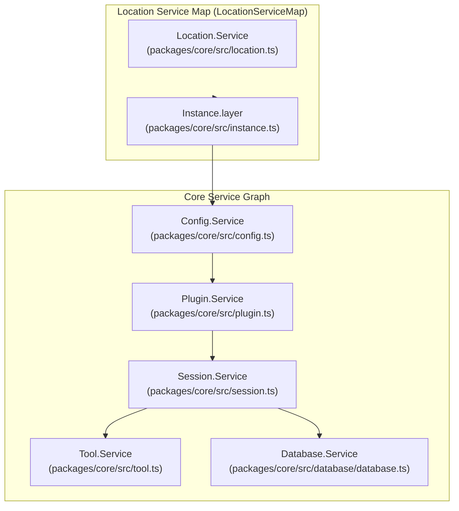
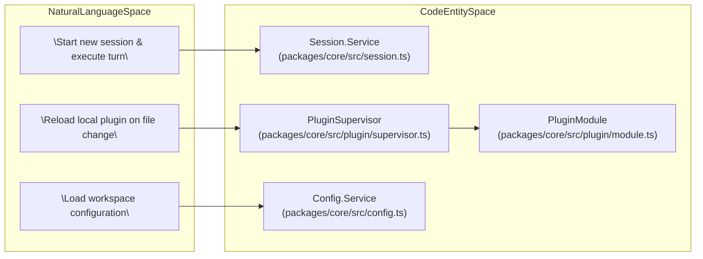

<!-- source: DeepWiki mcp.deepwiki.com · repo anomalyco/opencode · page 2 Core Runtime (packages/core) · fetched 2026-10-27 -->

# Core Runtime (packages/core)

Relevant source files

The following files were used as context for generating this wiki page:

- [packages/core/package.json](packages/core/package.json)
- [packages/core/src/config/variable.ts](packages/core/src/config/variable.ts)
- [packages/core/src/location-services.ts](packages/core/src/location-services.ts)
- [packages/core/src/plugin/internal.ts](packages/core/src/plugin/internal.ts)
- [packages/core/src/plugin/sdk.ts](packages/core/src/plugin/sdk.ts)
- [packages/core/src/plugin/supervisor.ts](packages/core/src/plugin/supervisor.ts)
- [packages/core/src/session/move.ts](packages/core/src/session/move.ts)
- [packages/core/test/fixture/tmpdir.ts](packages/core/test/fixture/tmpdir.ts)
- [packages/core/test/location-layer.test.ts](packages/core/test/location-layer.test.ts)
- [packages/core/test/plugin/supervisor-reload.test.ts](packages/core/test/plugin/supervisor-reload.test.ts)
- [packages/core/test/plugin/supervisor.test.ts](packages/core/test/plugin/supervisor.test.ts)
- [packages/core/test/session-move.test.ts](packages/core/test/session-move.test.ts)
- [packages/core/test/session-remove.test.ts](packages/core/test/session-remove.test.ts)
- [packages/core/test/session-revert.test.ts](packages/core/test/session-revert.test.ts)
- [packages/protocol/src/api.ts](packages/protocol/src/api.ts)
- [packages/protocol/src/client.ts](packages/protocol/src/client.ts)
- [packages/server/src/handlers.ts](packages/server/src/handlers.ts)
- [packages/server/test/session-instances.test.ts](packages/server/test/session-instances.test.ts)

The Core Runtime (`packages/core`) is the foundational Effect-based engine powering OpenCode sessions, tool executions, AI provider integrations, configuration loading, and persistence [packages/core/package.json:1-139](). Built on top of the Effect concurrency and service model, it orchestrates lifecycle management across independent location contexts, supervising plugins [packages/core/src/plugin/supervisor.ts:124-162](), managing filesystem watchers, and coordinating the LLM execution loop.

This page provides a high-level overview of the core runtime subsystems. For deep technical details, follow the links to the individual child pages below.

---

## Architecture & Service Layering

The core runtime uses Effect services and layers (`LayerNode`, `LayerMap`) to instantiate and supervise domain services [packages/core/src/plugin/internal.ts:108-158](), [packages/core/src/location-services.ts:12-87](). Services such as `Session.Service`, `Tool.Service`, `Config.Service`, and `Plugin.Service` are scoped within instance boundaries or globally shared depending on their lifecycle requirements [packages/core/src/plugin/internal.ts:108-158]().

### Core Runtime Service Dependency Diagram

Sources: [packages/core/src/plugin/internal.ts:108-158](), [packages/core/src/location-services.ts:12-87]()

---

## Subsystem Overview

### Session Model & Event Sourcing

Session management governs conversational state, message history, and durable event logs. It handles project context, inbox queues, projectors, message updaters, and session forking or reverting.

For details, see [Session Model & Event Sourcing](#2.1).

### Configuration System

The configuration engine handles schema-driven validation, loading, environment variable overrides (`ConfigVariable.substitute`), normalization, v1 migration rules, and well-known path resolution for project and global settings [packages/core/src/config/variable.ts:25-38]().

For details, see [Configuration System](#2.2).

### Tool System & Permissions

Tools provide capabilities like reading, writing, editing, file patching, searching (`grep`, `glob`), shell execution, web fetching, search, subagents, and skills. Permissions evaluate tool safety and enforce user confirmations.

For details, see [Tool System & Permissions](#2.3).

### Agents, Skills & Commands

Agents define AI personas and execution modes (such as plan mode). Skills discovery parses `SKILL.md` bundles, and command registries map user slash commands and subagent jobs.

For details, see [Agents, Skills & Commands](#2.4).

### Plugin System

The plugin supervisor and host manage internal registries, local plugin loading, npm package integration, and effect/promise APIs with robust supervisor reload strategies [packages/core/src/plugin/supervisor.ts:19-122](), [packages/core/src/plugin/internal.ts:108-158]().

For details, see [Plugin System](#2.5).

### MCP Integration

Model Context Protocol (MCP) clients support external tool servers, OAuth authentication flows, MCP-backed web search, and interactive TUI dialogs.

For details, see [MCP Integration](#2.6).

### Filesystem, Search & Projects

The filesystem service manages file operations, ripgrep binary integration, watchers, and workspace/project location resolution.

For details, see [Filesystem, Search & Projects](#2.7).

### Persistence: Database & Migrations

Persistence is driven by SQLite (supporting Bun, Node, and Workerd drivers) via `drizzle-orm`, with schema migrations, v1 data migration handlers, and KV store utilities [packages/core/package.json:33-76]().

For details, see [Persistence: Database & Migrations](#2.8).

### CodeMode Interpreter

The CodeMode package provides a sandboxed JavaScript interpreter with custom stdlib and dynamic tool schema generation for programmatic agent execution.

For details, see [CodeMode Interpreter](#2.9).

---

## Bridging Natural Language Space & Code Entities

The following diagram associates natural language operations with their corresponding core runtime entities and files.

Sources: [packages/core/src/plugin/supervisor.ts:19-122](), [packages/core/src/plugin/internal.ts:61-62]()

---

