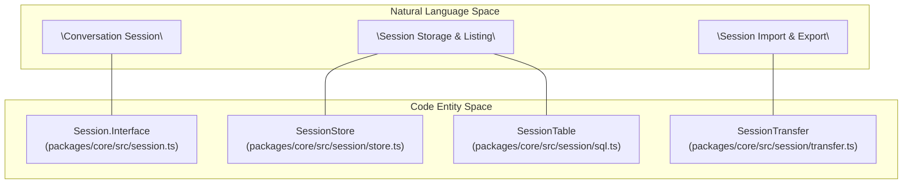
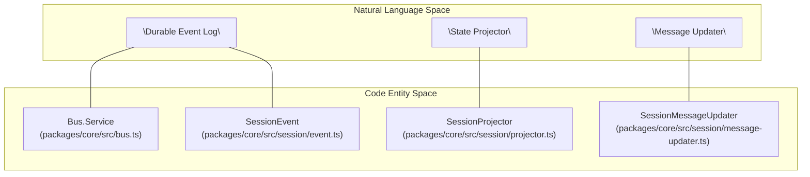

<!-- source: DeepWiki mcp.deepwiki.com · repo anomalyco/opencode · page 2.1 Session Model & Event Sourcing · fetched 2026-10-27 -->

# Session Model & Event Sourcing

Relevant source files

The following files were used as context for generating this wiki page:

- [V2_HTTP_API_AUDIT.md](V2_HTTP_API_AUDIT.md)
- [packages/cli/src/commands/handlers/stats.ts](packages/cli/src/commands/handlers/stats.ts)
- [packages/cli/test/stats.test.ts](packages/cli/test/stats.test.ts)
- [packages/client/src/effect/api/api.ts](packages/client/src/effect/api/api.ts)
- [packages/client/src/effect/generated/client.ts](packages/client/src/effect/generated/client.ts)
- [packages/client/src/promise/generated/client.ts](packages/client/src/promise/generated/client.ts)
- [packages/client/src/promise/generated/types.ts](packages/client/src/promise/generated/types.ts)
- [packages/client/src/solid/data.ts](packages/client/src/solid/data.ts)
- [packages/client/test/effect.test.ts](packages/client/test/effect.test.ts)
- [packages/client/test/promise.test.ts](packages/client/test/promise.test.ts)
- [packages/client/test/solid-data.test.ts](packages/client/test/solid-data.test.ts)
- [packages/core/src/bus.ts](packages/core/src/bus.ts)
- [packages/core/src/event-logger.ts](packages/core/src/event-logger.ts)
- [packages/core/src/session.ts](packages/core/src/session.ts)
- [packages/core/src/session/instructions.ts](packages/core/src/session/instructions.ts)
- [packages/core/src/session/message-updater.ts](packages/core/src/session/message-updater.ts)
- [packages/core/src/session/projector.ts](packages/core/src/session/projector.ts)
- [packages/core/src/session/stats.ts](packages/core/src/session/stats.ts)
- [packages/core/test/bus.test.ts](packages/core/test/bus.test.ts)
- [packages/core/test/session-create.test.ts](packages/core/test/session-create.test.ts)
- [packages/core/test/session-instructions.test.ts](packages/core/test/session-instructions.test.ts)
- [packages/core/test/session-log.test.ts](packages/core/test/session-log.test.ts)
- [packages/core/test/session-projector.test.ts](packages/core/test/session-projector.test.ts)
- [packages/core/test/session-prompt.test.ts](packages/core/test/session-prompt.test.ts)
- [packages/core/test/session-stats.test.ts](packages/core/test/session-stats.test.ts)
- [packages/protocol/openapi.json](packages/protocol/openapi.json)
- [packages/protocol/src/groups/session.ts](packages/protocol/src/groups/session.ts)
- [packages/schema/src/session-event.ts](packages/schema/src/session-event.ts)
- [packages/schema/src/session-message.ts](packages/schema/src/session-message.ts)
- [packages/schema/src/session-stats.ts](packages/schema/src/session-stats.ts)
- [packages/schema/test/event-manifest.test.ts](packages/schema/test/event-manifest.test.ts)
- [packages/server/src/handlers/session.ts](packages/server/src/handlers/session.ts)
- [services/www/openapi.json](services/www/openapi.json)
- [services/www/public/openapi.json](services/www/public/openapi.json)
- [services/www/src/docs/content/models.mdx](services/www/src/docs/content/models.mdx)

## Purpose & Scope

The Session Model & Event Sourcing subsystem manages the lifecycle, persistence, event logs, and state projections of conversation threads in OpenCode. Built around an Effect-based service architecture within `packages/core/src/session.ts`, the system treats sessions as event-sourced aggregates. User inputs, system messages, tool executions, and compactions are captured as durable events and projected into relational SQLite tables via Drizzle ORM.

This page provides a high-level overview of session services, durable event logging, the inbox queueing model, state projectors, message updates, forking, and history management. 

For detailed coverage of specific subsystems, see:
- For the LLM execution loop, model requests, and error mapping, see [Session Runner & LLM Execution Loop](#2.1.1).
- For token budgeting, shrinking, and context compaction, see [Compaction & Context Management](#2.1.2).

Sources:
- [packages/core/src/session.ts:1-70]()

---

## Session Lifecycle & Store

Sessions are isolated conversation threads linked to projects and locations. The `Session.Service` interface defines core operations for creating, listing, viewing, forking, and removing sessions [packages/core/src/session.ts:122-141](). Sessions use descending ULIDs for unique identifiers to guarantee reverse-chronological ordering in UI clients. The underlying store coordinates persistence across queries, filters, and message pagination [packages/core/src/session.ts:81-84]().

### Natural Language to Code Entity Mapping (Sessions)

This diagram maps high-level session concepts to their corresponding Effect services and schema definitions in `packages/core`.

Title: "Session Architecture Entity Mapping"

Sources:
- [packages/core/src/session.ts:81-141]()
- [packages/core/test/session-create.test.ts:105-131]()

---

## Durable Event Sourcing & Projector

OpenCode sessions rely on an event-sourced architecture where state mutations are published to an event bus (`Bus.Service`) and materialized into relational tables by `SessionProjector` [packages/core/src/session/projector.ts:84-113](). 

The session log (`session.log`) replays durable session events after an optional cursor, emitting synchronization markers and supporting real-time event streaming via Server-Sent Events (SSE) [packages/core/src/session.ts:162-171]().

### Natural Language to Code Entity Mapping (Events)

This diagram associates event sourcing concepts with their implementation modules in the core runtime.

Title: "Event Sourcing & Projection Mapping"

Sources:
- [packages/core/src/session.ts:162-171]()
- [packages/core/src/session/projector.ts:37-113]()

---

## Inbox, Queueing & Steering

The session inbox (`SessionInbox`) manages incoming prompts, synthetic inputs, compaction barriers, and moves before they are projected into active conversation history [packages/core/src/session.ts:162-171](). 

Admitted work can be steered, queued, or cancelled through explicit inbox methods (`steerInbox`, `queueInbox`, `cancelInbox`), allowing fine-grained control over execution flow when an agent is busy [packages/core/src/session.ts:162-171]().

Sources:
- [packages/core/src/session.ts:162-171]()
- [packages/protocol/src/groups/session.ts:64-70]()

---

## Message Updater, Forking & Revert

Sessions support branching and historical rollback via forking and diffing:
- **Forking:** `session.fork` duplicates session state and copies messages up to a specific boundary message, deriving a new session record [packages/core/src/session.ts:132-135](), [packages/core/src/session/projector.ts:115-188]().
- **Diffing:** `session.diff` computes structured file diffs across turns or message ranges using snapshot and VCS integrations [packages/core/src/session.ts:153-161]().

Sources:
- [packages/core/src/session.ts:132-161]()
- [packages/core/src/session/projector.ts:115-188]()

---

## Child Pages & Detailed Documentation

- [Session Runner & LLM Execution Loop](#2.1.1) — Covers `SessionRunnerLLM` drain/step loop, model-request construction, retries, error mapping, LLM event publishing, snapshots and git integration.
- [Compaction & Context Management](#2.1.2) — Covers summary vs native compaction, context assembly, instructions discovery, token budgeting and overflow shrinking.

Sources:
- [packages/core/src/session.ts:1-171]()

---

