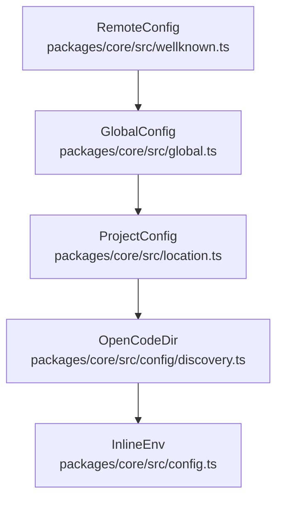
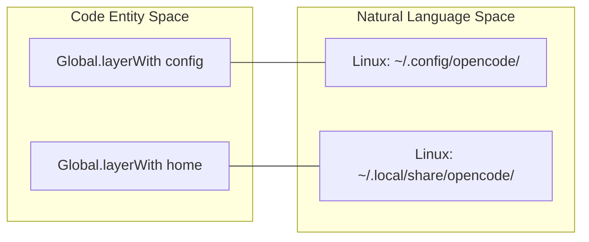
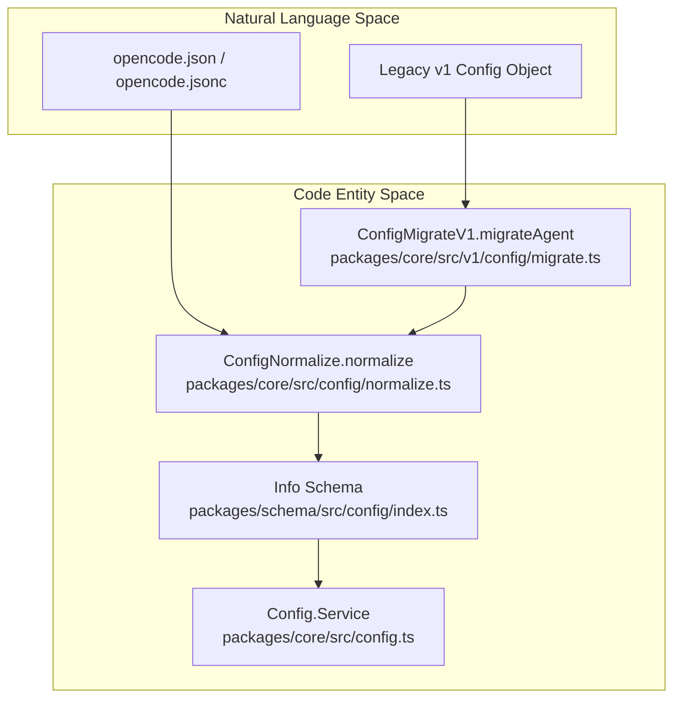
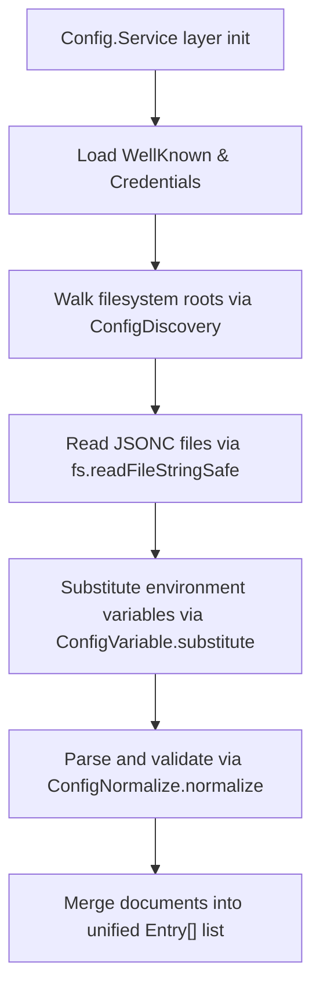

<!-- source: DeepWiki mcp.deepwiki.com · repo anomalyco/opencode · page 2.2 Configuration System · fetched 2026-10-27 -->

# Configuration System

Relevant source files

The following files were used as context for generating this wiki page:

- [packages/core/src/config.ts](packages/core/src/config.ts)
- [packages/core/src/config/normalize.ts](packages/core/src/config/normalize.ts)
- [packages/core/src/config/plugin/policy.ts](packages/core/src/config/plugin/policy.ts)
- [packages/core/src/managed-policy.ts](packages/core/src/managed-policy.ts)
- [packages/core/src/tool/plugin/mcp-resource.ts](packages/core/src/tool/plugin/mcp-resource.ts)
- [packages/core/src/tool/plugin/opencode.ts](packages/core/src/tool/plugin/opencode.ts)
- [packages/core/src/v1/config/migrate.ts](packages/core/src/v1/config/migrate.ts)
- [packages/core/src/v1/config/provider-options.ts](packages/core/src/v1/config/provider-options.ts)
- [packages/core/src/wellknown.ts](packages/core/src/wellknown.ts)
- [packages/core/src/wellknown/plugin.ts](packages/core/src/wellknown/plugin.ts)
- [packages/core/test/config/config.test.ts](packages/core/test/config/config.test.ts)
- [packages/core/test/config/normalization.test.ts](packages/core/test/config/normalization.test.ts)
- [packages/core/test/config/policy.test.ts](packages/core/test/config/policy.test.ts)
- [packages/core/test/config/provider-options.test.ts](packages/core/test/config/provider-options.test.ts)
- [packages/core/test/fixture/config-nodes.ts](packages/core/test/fixture/config-nodes.ts)
- [packages/core/test/plugin/fixture.ts](packages/core/test/plugin/fixture.ts)
- [packages/core/test/tool-opencode.test.ts](packages/core/test/tool-opencode.test.ts)
- [packages/core/test/wellknown.test.ts](packages/core/test/wellknown.test.ts)
- [packages/schema/src/config/experimental.ts](packages/schema/src/config/experimental.ts)
- [packages/schema/src/config/policy.ts](packages/schema/src/config/policy.ts)
- [services/www/src/docs/content/cli/acp.mdx](services/www/src/docs/content/cli/acp.mdx)
- [services/www/src/docs/content/config.mdx](services/www/src/docs/content/config.mdx)
- [services/www/src/docs/content/instructions.mdx](services/www/src/docs/content/instructions.mdx)
- [services/www/src/docs/content/mcp-servers.mdx](services/www/src/docs/content/mcp-servers.mdx)
- [services/www/src/docs/content/migrate-v1.mdx](services/www/src/docs/content/migrate-v1.mdx)
- [services/www/src/docs/content/permissions.mdx](services/www/src/docs/content/permissions.mdx)
- [services/www/src/docs/content/policies.mdx](services/www/src/docs/content/policies.mdx)
- [services/www/src/docs/content/tools.mdx](services/www/src/docs/content/tools.mdx)
- [specs/v2/README.md](specs/v2/README.md)
- [specs/v2/provider-policy.md](specs/v2/provider-policy.md)

The Configuration System in OpenCode manages hierarchical loading, normalization, and merging of settings from various sources, respecting strict precedence rules. It configures AI providers, agents, tools, permissions, plugins, and UI preferences across global, project, inline, and remote scopes. This page covers hierarchical loading, the `opencode.json` schema, v1-to-v2 migration, `.well-known` resolution, directory-based config plugins (agents, commands, skills), and the CLI/TUI configuration services implemented in `packages/core` and `packages/tui`.

---

## Configuration Sources and Precedence

OpenCode supports multiple configuration sources that are merged into a unified runtime configuration. The merging respects a strict order of precedence where settings from sources with higher priority override conflicting keys from lower priority sources, but non-conflicting keys are preserved `[services/www/src/docs/content/config.mdx:78-109]()`.

The precedence order of configuration sources (from lowest to highest priority):

### Precedence Rules Summary Table

| Priority | Source | Description | Key Code Entities & Files |
|---|---|---|---|
| 5 (Highest) | Inline Config | Inline configuration or overrides | `Config.Service` [packages/core/src/config.ts:47-58]() |
| 4 | `.opencode` Directories | Local directories for agents, commands, plugins, and skills | `ConfigDiscovery` [packages/core/src/config/discovery.ts:1-40]() |
| 3 | Project Config | `opencode.json` in project root or VCS root | `Location.Service` [packages/core/src/location.ts:1-39]() |
| 2 | Global Config | User-wide config `~/.config/opencode/opencode.json` | `Global.Service` [packages/util/global.ts:1-40]() |
| 1 (Lowest) | Remote Config | Organizational defaults served via `.well-known/opencode` | `WellKnown.Service` [packages/core/src/wellknown.ts:1-50]() |

**Sources:**  
[packages/core/src/config.ts:47-58](), [packages/core/src/config/discovery.ts:1-40](), [packages/core/src/global.ts:1-40](), [packages/core/src/location.ts:1-39](), [packages/core/src/wellknown.ts:1-50]()

---

## Configuration File Locations

OpenCode maintains configuration files in platform-appropriate standardized paths abstracted via global constants in `@opencode/util/global`.

### Natural Language Space to Code Entity Space: Global Paths

**Sources:**  
[packages/core/src/config.ts:74-74](), [packages/util/global.ts:1-40]()

---

## Configuration Schema and V1 Migration

OpenCode’s configuration system evolves from legacy unstructured V1 configurations to a structured, type-safe schema managed via normalization and migration pipelines `[services/www/src/docs/content/migrate-v1.mdx:45-94]()`.

### Natural Language Space to Code Entity Space: Configuration Pipeline

The migration module `ConfigMigrateV1` transforms legacy permission structures and provider keys into the canonical V2 schema, while `ConfigNormalize` inspects loaded JSONC documents for validity and outputs diagnostic logs [packages/core/src/config/normalize.ts:57-135](), [packages/core/src/v1/config/migrate.ts:35-57]().

**Sources:**  
[packages/core/src/config.ts:104-140](), [packages/core/src/config/normalize.ts:57-135](), [packages/core/src/v1/config/migrate.ts:35-57]()

---

## Configuration Loading & Normalization Implementation

The core loading service `Config.Service` (implemented as an Effect service in `packages/core/src/config.ts`) orchestrates asynchronous layered loading, variable substitution, and parsing [packages/core/src/config.ts:94-170]().

### Data Flow: Config Loading and Parsing Loop

### Key Functions and Modules
- `Config.Service`: Defined as an Effect Context Service providing `.entries()`, `.compatibility()`, and `.changes()` streams [packages/core/src/config.ts:29-45]().
- `parseInfo`: Parses JSONC strings with trailing comma support, runs `ConfigNormalize.normalize()`, and decodes against the schema [packages/core/src/config.ts:110-140]().
- `loadFile`: Reads file contents safely, runs environment variable substitutions via `ConfigVariable.substitute`, and parses them [packages/core/src/config.ts:142-149]().

**Sources:**  
[packages/core/src/config.ts:29-170](), [packages/core/src/config/variable.ts:1-17]()

---

## Wellknown Resolution & Discovery

Remote discovery and well-known configuration resolution occur through `WellKnown.Service` and `ConfigDiscovery` [packages/core/src/wellknown.ts:45-57](). When projects integrate with enterprise registries or hosted endpoints, credentials are automatically injected into header lookup phases to fetch remote overrides [packages/core/src/wellknown.ts:75-103]().

**Sources:**  
[packages/core/src/wellknown.ts:45-103]()

---

## Directory-Based Plugins: Agents, Skills, Commands & Providers

OpenCode supports modular configuration extensions via `.opencode` subdirectories. These directories load declarative resources `[services/www/src/docs/content/config.mdx:38-48]()`:

| Directory | Purpose | Implementation Module |
|---|---|---|
| `agents/` | Markdown/YAML agent definitions | `ConfigAgent` [packages/core/src/v1/config/agent.ts:1-15]() |
| `skills/` | Agent skill augmentations and SKILL.md parsing | `Skill` [packages/core/test/plugin/fixture.ts:33-34]() |
| `commands/` | Custom slash command definitions | `ConfigCommand` [packages/core/src/v1/config/command.ts:1-13]() |
| `providers/` | Custom provider parameter definitions | `ConfigProvider` [packages/core/src/v1/config/provider.ts:1-15]() |

**Sources:**  
[packages/core/src/v1/config/agent.ts:1-15](), [packages/core/src/v1/config/command.ts:1-13](), [packages/core/src/v1/config/provider.ts:1-15](), [packages/core/test/plugin/fixture.ts:33-34]()

---

## CLI & TUI Configuration Service

The TUI and CLI interface with the configuration system through reactive contexts and settings schemas.

- Keybindings and configuration settings are managed via context layers in the TUI application lifecycle `[packages/core/src/config.ts:94-110]()`.
- Dialog configurations expose settings categories for live runtime adjustment.

**Sources:**  
[packages/core/src/config.ts:94-110]()

---

