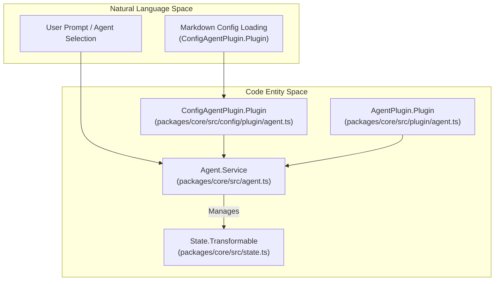
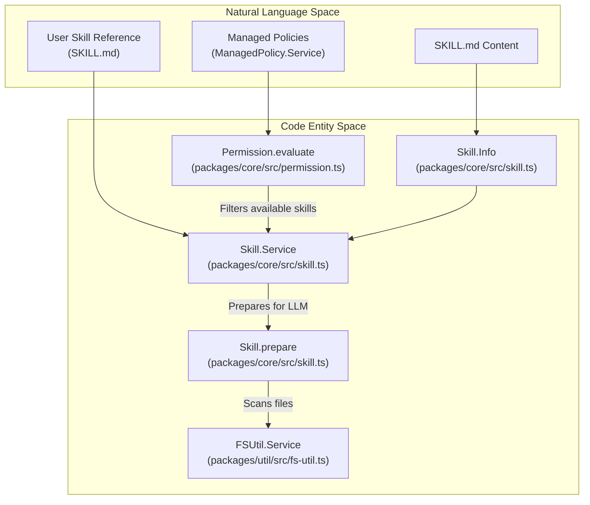
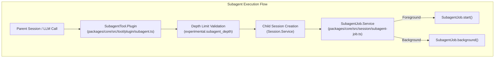

<!-- source: DeepWiki mcp.deepwiki.com · repo anomalyco/opencode · page 2.4 Agents, Skills & Commands · fetched 2026-10-27 -->

# Agents, Skills & Commands

Relevant source files

The following files were used as context for generating this wiki page:

- [packages/core/src/agent.ts](packages/core/src/agent.ts)
- [packages/core/src/config/discovery.ts](packages/core/src/config/discovery.ts)
- [packages/core/src/config/plugin/agent.ts](packages/core/src/config/plugin/agent.ts)
- [packages/core/src/config/plugin/command.ts](packages/core/src/config/plugin/command.ts)
- [packages/core/src/config/plugin/compatibility.ts](packages/core/src/config/plugin/compatibility.ts)
- [packages/core/src/config/plugin/instruction.ts](packages/core/src/config/plugin/instruction.ts)
- [packages/core/src/config/plugin/reference.ts](packages/core/src/config/plugin/reference.ts)
- [packages/core/src/config/plugin/skill-file.ts](packages/core/src/config/plugin/skill-file.ts)
- [packages/core/src/config/plugin/skill-scan.ts](packages/core/src/config/plugin/skill-scan.ts)
- [packages/core/src/config/plugin/skill.ts](packages/core/src/config/plugin/skill.ts)
- [packages/core/src/config/watch.ts](packages/core/src/config/watch.ts)
- [packages/core/src/instruction-discovery.ts](packages/core/src/instruction-discovery.ts)
- [packages/core/src/markdown.d.ts](packages/core/src/markdown.d.ts)
- [packages/core/src/permission/sql.ts](packages/core/src/permission/sql.ts)
- [packages/core/src/plugin/agent.ts](packages/core/src/plugin/agent.ts)
- [packages/core/src/plugin/plan.ts](packages/core/src/plugin/plan.ts)
- [packages/core/src/plugin/skill.ts](packages/core/src/plugin/skill.ts)
- [packages/core/src/session/subagent-job.ts](packages/core/src/session/subagent-job.ts)
- [packages/core/src/skill.ts](packages/core/src/skill.ts)
- [packages/core/src/state.ts](packages/core/src/state.ts)
- [packages/core/src/v1/config/error.ts](packages/core/src/v1/config/error.ts)
- [packages/core/test/agent.test.ts](packages/core/test/agent.test.ts)
- [packages/core/test/config/agent.test.ts](packages/core/test/config/agent.test.ts)
- [packages/core/test/config/command.test.ts](packages/core/test/config/command.test.ts)
- [packages/core/test/config/reload.test.ts](packages/core/test/config/reload.test.ts)
- [packages/core/test/config/skill.test.ts](packages/core/test/config/skill.test.ts)
- [packages/core/test/config/watch.test.ts](packages/core/test/config/watch.test.ts)
- [packages/core/test/instruction-discovery.test.ts](packages/core/test/instruction-discovery.test.ts)
- [packages/core/test/plugin/plan.test.ts](packages/core/test/plugin/plan.test.ts)
- [packages/core/test/plugin/skill.test.ts](packages/core/test/plugin/skill.test.ts)
- [packages/core/test/shared-schema.test.ts](packages/core/test/shared-schema.test.ts)
- [packages/core/test/skill.test.ts](packages/core/test/skill.test.ts)
- [packages/core/test/state.test.ts](packages/core/test/state.test.ts)
- [packages/core/test/subagent-lifetime.test.ts](packages/core/test/subagent-lifetime.test.ts)
- [packages/core/test/util/fs-util.test.ts](packages/core/test/util/fs-util.test.ts)
- [packages/plugin/src/effect/skill.ts](packages/plugin/src/effect/skill.ts)
- [packages/plugin/src/promise/skill.ts](packages/plugin/src/promise/skill.ts)
- [packages/protocol/test/event.test.ts](packages/protocol/test/event.test.ts)
- [packages/schema/src/agent.ts](packages/schema/src/agent.ts)
- [packages/schema/src/event-manifest.ts](packages/schema/src/event-manifest.ts)
- [packages/schema/src/index.ts](packages/schema/src/index.ts)
- [packages/schema/test/agent.test.ts](packages/schema/test/agent.test.ts)
- [packages/tui/src/util/system.ts](packages/tui/src/util/system.ts)
- [packages/util/src/fs-util.ts](packages/util/src/fs-util.ts)
- [packages/util/src/glob.ts](packages/util/src/glob.ts)
- [script/drive/subagent-eviction.md](script/drive/subagent-eviction.md)
- [script/drive/subagent-eviction.ts](script/drive/subagent-eviction.ts)
- [services/www/src/docs/content/skills.mdx](services/www/src/docs/content/skills.mdx)

## Purpose and Scope

This page details the implementation of agents, skills, slash commands, and subagent orchestration within `packages/core`. It covers how `Agent.Service` manages specialized agent behaviors and permissions, how `Skill.Service` discovers and structures `SKILL.md` files, how `Command.Service` resolves and templates slash commands, and how `SubagentJob` supervises nested child sessions and background task lifetimes.

---

## 1. Agent Definitions & Modes

Agents define the operational persona, system prompts, tool permissions, and model configurations for LLM interactions. The core agent system is hosted in `packages/core/src/agent.ts` and initialized via plugins like `packages/core/src/plugin/agent.ts` [76-143]() and `packages/core/src/config/plugin/agent.ts` [34-129]().

### Agent Service & State Management

`Agent.Service` extends `State.Transformable<Editor>` to provide reactive, transacted state management for agent configurations [packages/core/src/agent.ts:40-47](). 

- **`ID` & `Info`**: Agents are identified by `Agent.ID` (defaulting to `"build"` as defined in `Agent.defaultID`) and configured using the `Agent.Info` schema [packages/core/src/agent.ts:9-18]().
- **Modes**: Agents operate in distinct execution modes:
  - `primary`: Interactive top-level agent (e.g., `build`, `general`) capable of accepting direct user prompts.
  - `subagent`: Specialized helper agent (e.g., `explore`) invoked programmatically via the subagent tool or subtask commands. Hidden operational agents (`compaction`, `title`, `summary`) also use primary or internal configurations [packages/core/src/plugin/agent.ts:79-141]().
- **Built-in Agents**:
  - `build`: The default general-purpose primary agent [packages/core/src/plugin/agent.ts:80-85]().
  - `general`: General-purpose subagent for multi-step parallel work [packages/core/src/plugin/agent.ts:87-96]().
  - `explore`: Specialized fast exploration agent restricted to read-only search tools (`grep`, `glob`, `read`, `shell`) [packages/core/src/plugin/agent.ts:98-118]().
  - `compaction`, `title`, `summary`: Hidden system agents utilized for automated context compaction, thread naming, and pull-request style summarization [packages/core/src/plugin/agent.ts:120-140]().

**Diagram: Natural Language Agent Selections Mapped to Agent Service Entities**

Sources:  
- [packages/core/src/agent.ts:40-116]()  
- [packages/core/src/plugin/agent.ts:76-143]()  
- [packages/core/src/config/plugin/agent.ts:34-129]()  
- [packages/core/src/state.ts]()

---

## 2. Skills Discovery & SKILL.md Format

Skills are modular domain instruction sets discovered across project, global, and built-in directories.

### SKILL.md Structure & Parsing

- **Format**: Markdown files named `SKILL.md` containing YAML frontmatter (`name`, `description`) followed by instruction text [packages/core/test/reload.test.ts:82-84]().
- **Model Output Representation**: `Skill.prepare` scans sibling files in the skill directory (up to a sampled limit of 10 files) and formats the instruction payload into `<skill_content>` XML blocks for the LLM context window [packages/core/src/skill.ts:36-68]().

### Skill Service & Permissions

`Skill.Service` manages registered skills through state transforms and integrates with `Permission.Service` to filter out skills prohibited by organizational or project policies [packages/core/src/skill.ts:33-127]().

**Diagram: Natural Language Skill Prompts Mapped to Skill Service Execution**

Sources:  
- [packages/core/src/skill.ts:33-127]()  
- [packages/core/test/skill.test.ts:35-74]()  
- [packages/core/src/skill.ts:36-68]()
- [packages/util/src/fs-util.ts]()

---

## 3. Slash Commands & Command Configuration

Commands map slash inputs or configuration templates to prompt executions, model switches, or subagent tasks.

### Command Plugin & Template Evaluation

`ConfigCommandPlugin.Plugin` registers user and file-based commands into `Command.Service` [packages/core/src/config/plugin/command.ts:23-141]().

- **Templates**: Command templates support argument placeholders (such as `$1`, `$ARGUMENTS`) which are interpolated against user input [packages/core/test/config/command.test.ts:76-93](). The `evaluateTemplate` function handles this interpolation, leveraging services like `Location`, `AppProcess`, and `ShellSelect` [packages/core/src/config/plugin/command.ts:93-97]().
- **Subagent Delegation**: If a command specifies `subagent: true` (or legacy `subtask: true`), executing the command instantiates a child session with the selected agent and model, seeds it with the template text, and starts tracking it via `SubagentJob.Service` [packages/core/src/config/plugin/command.ts:98-122]().

Sources:  
- [packages/core/src/config/plugin/command.ts:23-141]()  
- [packages/core/test/config/command.test.ts:76-140]()  
- [packages/core/src/config/plugin/command.ts:93-97]()

---

## 4. Subagent Jobs and Lifetimes

Subagents execute isolated tasks within child sessions spawned by the `subagent` tool or delegated commands [packages/core/src/tool/plugin/subagent.ts:55-62]().

### Subagent Tool Execution (`SubagentTool`)

`SubagentTool.Plugin` validates execution boundaries before spawning child sessions [packages/core/src/tool/plugin/subagent.ts:64-142]().
- **Depth Limiting**: Recursion depth is tracked up to `experimental.subagent_depth` (defaulting to `1`) to prevent uncontrolled subagent nesting [packages/core/src/tool/plugin/subagent.ts:117-133]().
- **Foreground vs Background**: 
  - Foreground execution awaits subagent completion and returns its final response block [packages/core/src/tool/plugin/subagent.ts:59]().
  - Background execution (`background: true`) immediately returns a running status and queues asynchronous notifications via `SubagentJob.Service` [packages/core/src/tool/plugin/subagent.ts:19-27, 44-47, 121]().

**Diagram: Subagent Tool Invocation and Session Forking**

Sources:  
- [packages/core/src/tool/plugin/subagent.ts:64-142]()  
- [packages/core/test/tool-subagent.test.ts:60-113]()  
- [packages/core/src/session/subagent-job.ts]()

---

## Summary

The agents, skills, and commands subsystem integrates extensible definitions with Effect-managed state stores. `Agent.Service` and its configuration plugins control persona permissions and modes, `Skill.Service` indexes and prepares `SKILL.md` documents, `Command.Service` resolves templated prompt actions, and `SubagentJob` coordinates isolated multi-tier subagent session lifecycles.

Sources:  
- [packages/core/src/agent.ts:40-116]()  
- [packages/core/src/skill.ts:33-127]()  
- [packages/core/src/config/plugin/command.ts:23-141]()  
- [packages/core/src/tool/plugin/subagent.ts:64-142]()

---

