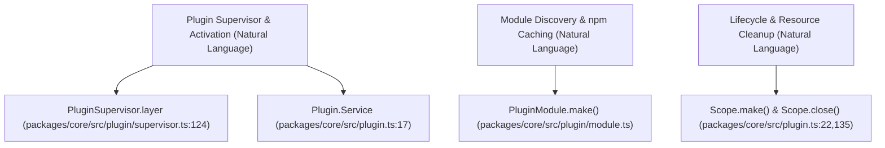
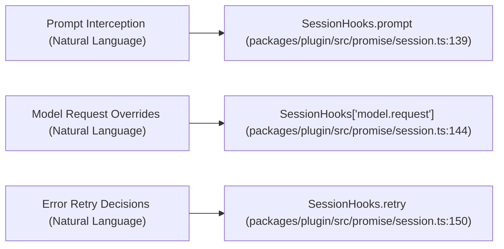

<!-- source: DeepWiki mcp.deepwiki.com · repo anomalyco/opencode · page 2.5 Plugin System · fetched 2026-10-27 -->

# Plugin System

<details>
<summary>Relevant source files</summary>

The following files were used as context for generating this wiki page:

- [packages/cli/src/commands/handlers/plugin/add.ts](packages/cli/src/commands/handlers/plugin/add.ts)
- [packages/core/src/config/variable.ts](packages/core/src/config/variable.ts)
- [packages/core/src/location-services.ts](packages/core/src/location-services.ts)
- [packages/core/src/mcp/oauth.ts](packages/core/src/mcp/oauth.ts)
- [packages/core/src/plugin.ts](packages/core/src/plugin.ts)
- [packages/core/src/plugin/host.ts](packages/core/src/plugin/host.ts)
- [packages/core/src/plugin/internal.ts](packages/core/src/plugin/internal.ts)
- [packages/core/src/plugin/promise.ts](packages/core/src/plugin/promise.ts)
- [packages/core/src/plugin/sdk.ts](packages/core/src/plugin/sdk.ts)
- [packages/core/src/plugin/supervisor.ts](packages/core/src/plugin/supervisor.ts)
- [packages/core/src/session/move.ts](packages/core/src/session/move.ts)
- [packages/core/test/fixture/tmpdir.ts](packages/core/test/fixture/tmpdir.ts)
- [packages/core/test/location-layer.test.ts](packages/core/test/location-layer.test.ts)
- [packages/core/test/mcp-oauth.test.ts](packages/core/test/mcp-oauth.test.ts)
- [packages/core/test/npm.test.ts](packages/core/test/npm.test.ts)
- [packages/core/test/plugin.test.ts](packages/core/test/plugin.test.ts)
- [packages/core/test/plugin/host.ts](packages/core/test/plugin/host.ts)
- [packages/core/test/plugin/promise-tool.test.ts](packages/core/test/plugin/promise-tool.test.ts)
- [packages/core/test/plugin/provider-dynamic.test.ts](packages/core/test/plugin/provider-dynamic.test.ts)
- [packages/core/test/plugin/provider-gitlab.test.ts](packages/core/test/plugin/provider-gitlab.test.ts)
- [packages/core/test/plugin/provider-sap-ai-core.test.ts](packages/core/test/plugin/provider-sap-ai-core.test.ts)
- [packages/core/test/plugin/session-list.test.ts](packages/core/test/plugin/session-list.test.ts)
- [packages/core/test/plugin/supervisor-reload.test.ts](packages/core/test/plugin/supervisor-reload.test.ts)
- [packages/core/test/plugin/supervisor.test.ts](packages/core/test/plugin/supervisor.test.ts)
- [packages/core/test/session-move.test.ts](packages/core/test/session-move.test.ts)
- [packages/core/test/session-remove.test.ts](packages/core/test/session-remove.test.ts)
- [packages/core/test/session-revert.test.ts](packages/core/test/session-revert.test.ts)
- [packages/core/test/shell-retention.test.ts](packages/core/test/shell-retention.test.ts)
- [packages/plugin/src/effect/session.ts](packages/plugin/src/effect/session.ts)
- [packages/plugin/src/promise/adapter.ts](packages/plugin/src/promise/adapter.ts)
- [packages/plugin/src/promise/session.ts](packages/plugin/src/promise/session.ts)
- [packages/protocol/src/api.ts](packages/protocol/src/api.ts)
- [packages/protocol/src/client.ts](packages/protocol/src/client.ts)
- [packages/protocol/src/groups/plugin.ts](packages/protocol/src/groups/plugin.ts)
- [packages/schema/src/plugin.ts](packages/schema/src/plugin.ts)
- [packages/server/src/handlers.ts](packages/server/src/handlers.ts)
- [packages/server/src/handlers/plugin.ts](packages/server/src/handlers/plugin.ts)
- [packages/server/src/handlers/provider.ts](packages/server/src/handlers/provider.ts)
- [packages/server/test/provider.test.ts](packages/server/test/provider.test.ts)
- [packages/server/test/session-instances.test.ts](packages/server/test/session-instances.test.ts)
- [packages/util/src/npm.ts](packages/util/src/npm.ts)
- [patches/@modelcontextprotocol%2Fclient@2.0.0.patch](patches/@modelcontextprotocol%2Fclient@2.0.0.patch)
- [services/www/src/docs/content/build/plugins/effect.mdx](services/www/src/docs/content/build/plugins/effect.mdx)
- [services/www/src/docs/content/build/plugins/index.mdx](services/www/src/docs/content/build/plugins/index.mdx)

</details>


## Purpose and Scope

The Plugin System provides the core supervisory runtime, module loading pipeline, and host registry that enable JavaScript/TypeScript modules to customize, extend, and transform OpenCode's behavior. This page details the implementation of the core plugin supervisor (`PluginSupervisor`), the Effect-backed plugin registry service (`Plugin.Service`), Promise and Effect plugin APIs, local/npm package loading, and plugin documentation/contracts.

Sources: [packages/core/src/plugin.ts:1-300](), [packages/core/src/plugin/supervisor.ts:1-268]()

---

## Core Plugin Host, Supervisor & Internal Registry

OpenCode manages plugins through a supervisory architecture split across `Plugin.Service` (which controls lifecycle scopes, batch activations, and transform hooks) and `PluginSupervisor` (which orchestrates configuration sources, built-in internal plugins, SDK contributions, and instance-bound plugins).

- **`Plugin.Service`**: Implemented in [packages/core/src/plugin.ts:17-300](), this Effect service holds active plugin slots, monitors scopes via `Scope.make()`, isolates transform failures using `State.group()`, and publishes updates to the event bus (`Plugin.Event.Updated`).
- **`PluginSupervisor`**: Implemented in [packages/core/src/plugin/supervisor.ts:124-268](), it coordinates pre/post internal requirements, resolves plugin operations via `ConfigPluginSource.Operation`, and manages reloads when revisions change.
- **Internal Registry**: Located in [packages/core/src/plugin/internal.ts:1-170](), it catalogs all built-in core services (such as `Agent.Service`, `Provider.Service`, `Command.Service`, `Tool.Service`, and `KV.Service`) and default extension plugins (`AgentPlugin`, `CommandPlugin`, `PlanPlugin`, `ModelsDevPlugin`, etc.) into a unified requirements group (`PluginInternal.requirements`).

### Plugin Activation and Supervisor Data Flow

```mermaid
graph TD
  subgraph "Supervisor & Configuration"
    CPS["ConfigPluginSource.Service"]
    PSup["PluginSupervisor.layer"]
    Mod["PluginModule.make()"]
  end

  subgraph "Registry & Host Service"
    PService["Plugin.Service (packages/core/src/plugin.ts)"]
    PHost["PluginHost.make()"]
    KVStore["KV.Service Storage"]
  end

  subgraph "Execution & Scopes"
    ScopeFork["Scope.fork(scope)"]
    PluginEffect["plugin.effect(host + storage)"]
  end

  CPS -->| "operations()" | PSup
  PSup -->| "load(operation)" | Mod
  Mod -->| "Definition" | PSup
  PSup -->| "activate(generations)" | PService
  PService -->| "hold()" | ScopeFork
  ScopeFork --> PluginEffect
  PluginEffect -->| "storage" | KVStore
```

Sources: [packages/core/src/plugin.ts:17-87](), [packages/core/src/plugin/supervisor.ts:124-162](), [packages/core/src/plugin/internal.ts:1-170]()

---

## Promise and Effect Plugin APIs

Plugins interact with OpenCode through two primary API wrappers: the Promise-based API (`@opencode/plugin`) and the Effect-native API (`@opencode/plugin/effect`). Both expose identical domain facades while adapting return types and execution models to the author's preferred paradigm.

- **Promise API**: Exports helper definitions (`Plugin.define`) where `setup(ctx)` receives a client-compatible context and returns an optional cleanup function [services/www/src/docs/content/build/plugins/index.mdx:10-62]().
- **Effect API**: Located under `@opencode/plugin/effect`, it utilizes `Scope` for resource management and returns `Effect.Effect` workflows in `effect(ctx)` [services/www/src/docs/content/build/plugins/effect.mdx:5-30]().
- **Session Hooks**: Detailed in [packages/plugin/src/promise/session.ts:138-151](), session hooks provide interception points for prompts, generation parameters, compactions, titles, HTTP transport requests, web sockets (`experimental.ws.*`), and error retries.

### Plugin API Context Structure

```mermaid
graph LR
  subgraph "Plugin Definition"
    Def["Plugin.define()"]
  end

  subgraph "Context Domains"
    AgentDomain["ctx.agent"]
    ModelDomain["ctx.model"]
    ProviderDomain["ctx.provider"]
    SessionDomain["ctx.session"]
    ToolDomain["ctx.tool"]
    StorageDomain["ctx.storage"]
  end

  Def -->| "setup(ctx) / effect(ctx)" | AgentDomain
  Def -->| "setup(ctx) / effect(ctx)" | ModelDomain
  Def -->| "setup(ctx) / effect(ctx)" | ProviderDomain
  Def -->| "setup(ctx) / effect(ctx)" | SessionDomain
  Def -->| "setup(ctx) / effect(ctx)" | ToolDomain
  Def -->| "setup(ctx) / effect(ctx)" | StorageDomain
```

Sources: [services/www/src/docs/content/build/plugins/index.mdx:10-118](), [services/www/src/docs/content/build/plugins/effect.mdx:5-150](), [packages/plugin/src/promise/session.ts:138-151]()

---

## npm and Local Plugin Loading & Module Resolution

Plugins can be loaded from three distinct sources: built-in internal registrations, local filesystem paths/modules, and remote npm packages managed by Bun.

- **Local Loading**: Local plugin paths specified in `opencode.json(c)` or discovered under `.opencode/plugins/` are resolved and loaded via dynamic imports.
- **npm Resolution**: Handled via utilities in `Npm` service [packages/core/test/npm.test.ts:114-160](), supporting sanitization of specifiers, git repositories (`git+https://`, `github:`), and automated caching.
- **Error Isolation**: Module loading failures are caught [packages/core/src/plugin/supervisor.ts:59-67](), returning descriptive error references without halting healthy plugins or corrupting the active generation.

Sources: [packages/core/src/plugin/supervisor.ts:39-122](), [packages/core/test/npm.test.ts:114-160]()

---

## Plugin Contracts & TUI Integration

Plugins can contribute UI extensions, dialogs, routes, and keybindings to the Terminal UI (TUI) and graphical interfaces through specialized contract definitions.

- **TUI Contracts**: Plugins register custom TUI behaviors via `TuiRouteDefinition` and related helper structures.
- **Transforms**: State mutations (such as `ctx.provider.transform` and `ctx.model.transform`) allow plugins to inject or filter providers and models sequentially during startup [services/www/src/docs/content/build/plugins/index.mdx:120-180]().

Sources: [services/www/src/docs/content/build/plugins/index.mdx:120-225]()

---

## Diagrams Bridging Natural Language to Code Entities

### Diagram 1: Plugin Supervisory Architecture Mapping



Sources: [packages/core/src/plugin.ts:17-136](), [packages/core/src/plugin/supervisor.ts:124-162]()

### Diagram 2: Session Hook Domain Mapping



Sources: [packages/plugin/src/promise/session.ts:138-151]()

---

