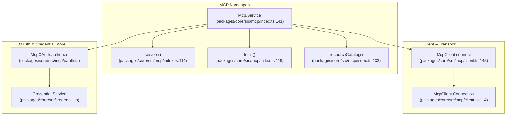
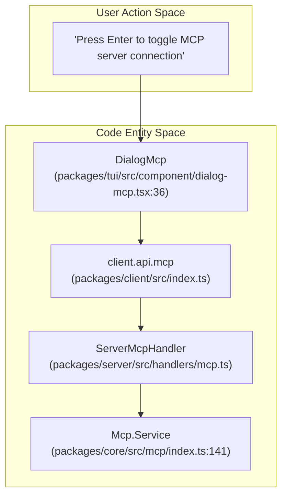

<!-- source: DeepWiki mcp.deepwiki.com · repo anomalyco/opencode · page 2.6 MCP Integration · fetched 2026-10-27 -->

# MCP Integration

<details>
<summary>Relevant source files</summary>

The following files were used as context for generating this wiki page:

- [packages/cli/src/commands/handlers/plugin/add.ts](packages/cli/src/commands/handlers/plugin/add.ts)
- [packages/core/src/integration.ts](packages/core/src/integration.ts)
- [packages/core/src/mcp/client.ts](packages/core/src/mcp/client.ts)
- [packages/core/src/mcp/index.ts](packages/core/src/mcp/index.ts)
- [packages/core/src/mcp/oauth.ts](packages/core/src/mcp/oauth.ts)
- [packages/core/src/mcp/stdio.ts](packages/core/src/mcp/stdio.ts)
- [packages/core/src/tool.ts](packages/core/src/tool.ts)
- [packages/core/src/tool/AGENTS.md](packages/core/src/tool/AGENTS.md)
- [packages/core/src/tool/mcp.ts](packages/core/src/tool/mcp.ts)
- [packages/core/test/bus-session-routing.test.ts](packages/core/test/bus-session-routing.test.ts)
- [packages/core/test/effect/cross-spawn-spawner.test.ts](packages/core/test/effect/cross-spawn-spawner.test.ts)
- [packages/core/test/fixture/environment.ts](packages/core/test/fixture/environment.ts)
- [packages/core/test/fixture/held-stdio.cjs](packages/core/test/fixture/held-stdio.cjs)
- [packages/core/test/fixture/mcp-prompts.ts](packages/core/test/fixture/mcp-prompts.ts)
- [packages/core/test/fixture/mcp.ts](packages/core/test/fixture/mcp.ts)
- [packages/core/test/integration.test.ts](packages/core/test/integration.test.ts)
- [packages/core/test/mcp-oauth.test.ts](packages/core/test/mcp-oauth.test.ts)
- [packages/core/test/mcp.test.ts](packages/core/test/mcp.test.ts)
- [packages/core/test/npm.test.ts](packages/core/test/npm.test.ts)
- [packages/core/test/plugin/provider-dynamic.test.ts](packages/core/test/plugin/provider-dynamic.test.ts)
- [packages/core/test/plugin/provider-gitlab.test.ts](packages/core/test/plugin/provider-gitlab.test.ts)
- [packages/core/test/plugin/provider-sap-ai-core.test.ts](packages/core/test/plugin/provider-sap-ai-core.test.ts)
- [packages/core/test/session-tool-progress.test.ts](packages/core/test/session-tool-progress.test.ts)
- [packages/core/test/shell-retention.test.ts](packages/core/test/shell-retention.test.ts)
- [packages/core/test/tool-registry.test.ts](packages/core/test/tool-registry.test.ts)
- [packages/plugin/src/effect/tool.ts](packages/plugin/src/effect/tool.ts)
- [packages/plugin/src/promise/tool.ts](packages/plugin/src/promise/tool.ts)
- [packages/protocol/src/groups/integration.ts](packages/protocol/src/groups/integration.ts)
- [packages/protocol/src/groups/mcp.ts](packages/protocol/src/groups/mcp.ts)
- [packages/schema/src/integration.ts](packages/schema/src/integration.ts)
- [packages/schema/src/mcp.ts](packages/schema/src/mcp.ts)
- [packages/server/src/handlers/integration.ts](packages/server/src/handlers/integration.ts)
- [packages/server/src/handlers/mcp.ts](packages/server/src/handlers/mcp.ts)
- [packages/util/src/cross-spawn-spawner.ts](packages/util/src/cross-spawn-spawner.ts)
- [packages/util/src/npm.ts](packages/util/src/npm.ts)
- [patches/@modelcontextprotocol%2Fclient@2.0.0.patch](patches/@modelcontextprotocol%2Fclient@2.0.0.patch)

</details>


This page documents how OpenCode connects to Model Context Protocol (MCP) servers, manages server configurations and states, executes OAuth authentication flows, adapts MCP-backed tools, resources, and websearch, and provides interactive management via the TUI MCP dialog.

---

## Overview

The `Mcp` namespace (`packages/core/src/mcp/index.ts`) manages integration with external Model Context Protocol servers, allowing OpenCode agents to access external resources (files, APIs, database schemas) and execute tools exposed via MCP servers. Its responsibilities include:

- Establishing connections to local subprocesses or remote HTTP/SSE endpoints using transports from `@modelcontextprotocol/client` [packages/core/src/mcp/client.ts:6-28]().
- Maintaining per-server connection states (`connected`, `disabled`, `failed`, `needs_auth`, `pending`) to track availability and authentication requirements [packages/core/src/mcp/index.ts:78-89]().
- Converting MCP tool definitions into internal AI tools usable by agents via `McpTool` wrappers [packages/core/src/tool/mcp.ts:1-152]().
- Exposing MCP prompts, resource catalogs, and resources for session-level retrieval [packages/core/src/mcp/index.ts:127-138]().



Sources: [packages/core/src/mcp/index.ts:113-138](), [packages/core/src/mcp/client.ts:114-153](), [packages/core/src/mcp/oauth.ts](), [packages/core/src/tool/mcp.ts:1-152]()

---

## Configuration & Client Connection

MCP servers are defined under the `mcp` configuration schema. Servers fall into two categories:

1.  **Local Servers**: Spawned as child processes via `StdioClientTransport` through the location's `Environment`, executing specified commands in target directories [packages/core/src/mcp/client.ts:143-148]().
2.  **Remote Servers**: Connected over HTTP or Server-Sent Events using `StreamableHTTPClientTransport` [packages/core/src/mcp/client.ts:10](), supporting optional OAuth configuration.

The `McpClient.connect` function initializes the connection, handles version negotiation, registers client capabilities (such as `roots`), and wires up event listeners for tool, prompt, and resource changes [packages/core/src/mcp/client.ts:114-153]().

```mermaid
stateDiagram-v2
  [*] --> "pending" : Connect invoked
  "pending" --> "connected" : Handshake successful
  "pending" --> "failed" : Connection timeout or error
  "pending" --> "needs_auth" : UnauthorizedError / 401
  "needs_auth" --> "connected" : OAuth flow completed
  "connected" --> "failed" : Connection dropped
```

Sources: [packages/core/src/mcp/client.ts:63-80](), [packages/core/src/mcp/client.ts:145-153]()

---

## OAuth Authentication Flows

Remote MCP servers requiring authentication trigger `McpOAuth` flows [packages/core/src/mcp/oauth.ts](). When a connection attempt returns an authorization requirement or `UnauthorizedError`, the server state transitions to `needs_auth`.

-   **`McpOAuth.authorize`**: Manages dynamic client registration, PKCE code verifier generation, authorization URL construction, and loopback callback handling [packages/core/src/mcp/oauth.ts:133-141]().
-   **`Credential.Service`**: Stores access and refresh tokens securely in association with the server's integration ID [packages/core/test/mcp-oauth.test.ts:14-32]().
-   **`Integration.OAuthImplementation`**: Defines the interface for OAuth integrations, including `authorize` and optional `refresh` and `label` methods [packages/core/src/integration.ts:75-81]().

Sources: [packages/core/test/mcp-oauth.test.ts:91-108](), [packages/core/src/mcp/oauth.ts](), [packages/core/src/integration.ts:75-81]()

---

## MCP Tools, Prompts & Resources

Connected MCP servers expose capabilities that are dynamically mapped into OpenCode's runtime systems:

-   **Tools**: Converted via `McpTool` definitions [packages/core/src/mcp/index.ts:36-38]() to execute remote tool calls with argument validation, session scoping, and error handling (`ToolCallError`) [packages/core/src/mcp/index.ts:59-63](). The `McpTool.layer` registers these tools with the `Tool.Service` [packages/core/src/tool/mcp.ts:26-123]().
-   **Prompts**: Retrieved via `Mcp.Interface.prompt` to populate reusable prompt templates [packages/core/src/mcp/index.ts:127-132]().
-   **Resources**: Managed through `resourceCatalog`, `resources`, and `readResource` handlers on `Mcp.Interface` [packages/core/src/mcp/index.ts:133-138]().

Sources: [packages/core/src/mcp/index.ts:36-63](), [packages/core/src/mcp/index.ts:127-138](), [packages/core/src/tool/mcp.ts:26-123]()

---

## TUI MCP Dialog (`DialogMcp`)

The TUI provides an interactive dialog for inspecting, connecting, disconnecting, and troubleshooting MCP servers (`DialogMcp`) [packages/tui/src/component/dialog-mcp.tsx:36-38]().

-   **Status Rendering**: Displays connection status (`connected`, `failed`, `needs_auth`, `disabled`) with specific feedback colors [packages/tui/src/component/dialog-mcp.tsx:20-34]().
-   **Action Triggers**: Pressing enter or action keys toggles server connection states by invoking `client.api.mcp.connect` or `client.api.mcp.disconnect`, or routing auth-gated servers into `DialogIntegration` [packages/tui/src/component/dialog-mcp.tsx:113-132]().
-   **Error Inspection**: Failed servers open `DialogErrorDetails` to view detailed stack traces or configuration paths (`mcp.servers.<name>`) [packages/tui/src/component/dialog-mcp.tsx:163-176]().

Sources: [packages/tui/src/component/dialog-mcp.tsx:36-177]()

---

## Natural Language Space to Code Entity Space Mappings

### MCP Server Connection & Tool Execution Flow

```mermaid
graph LR
  subgraph Natural_Language["Natural Language Space"]
    NL_Query["'Use the jira MCP tool to find issue 123'"]
  end

  subgraph Code_Entity_Space["Code Entity Space"]
    SessionRunner["Session.Service\n(packages/core/src/session.ts)"]
    ToolService["Tool.Service\n(packages/core/src/tool.ts:65)"]
    McpToolLayer["McpTool.layer\n(packages/core/src/tool/mcp.ts:26)"]
    McpInterface["Mcp.Service\n(packages/core/src/mcp/index.ts:141)"]
    McpClientConn["McpClient.Connection\n(packages/core/src/mcp/client.ts:114)"]
  end

  NL_Query --> SessionRunner
  SessionRunner --> ToolService
  ToolService -- Registers MCP tools --> McpToolLayer
  McpToolLayer -- Calls --> McpInterface
  McpInterface -- Manages connection --> McpClientConn
```



Sources: [packages/core/src/mcp/index.ts:113-125](), [packages/core/src/tool.ts:65-65](), [packages/core/src/tool/mcp.ts:26-123](), [packages/core/src/mcp/client.ts:114-114]()

### TUI Dialog Interaction Flow



Sources: [packages/tui/src/component/dialog-mcp.tsx:113-132](), [packages/core/src/mcp/index.ts:141-141](), [packages/server/src/handlers/mcp.ts]()

---

## References

-   MCP Core Service: [packages/core/src/mcp/index.ts]()
-   MCP Client & Transport: [packages/core/src/mcp/client.ts]()
-   MCP OAuth: [packages/core/src/mcp/oauth.ts]()
-   MCP Tool Integration: [packages/core/src/tool/mcp.ts]()
-   TUI MCP Dialog: [packages/tui/src/component/dialog-mcp.tsx]()
-   MCP Tests: [packages/core/test/mcp.test.ts](), [packages/core/test/mcp-oauth.test.ts]()

---

