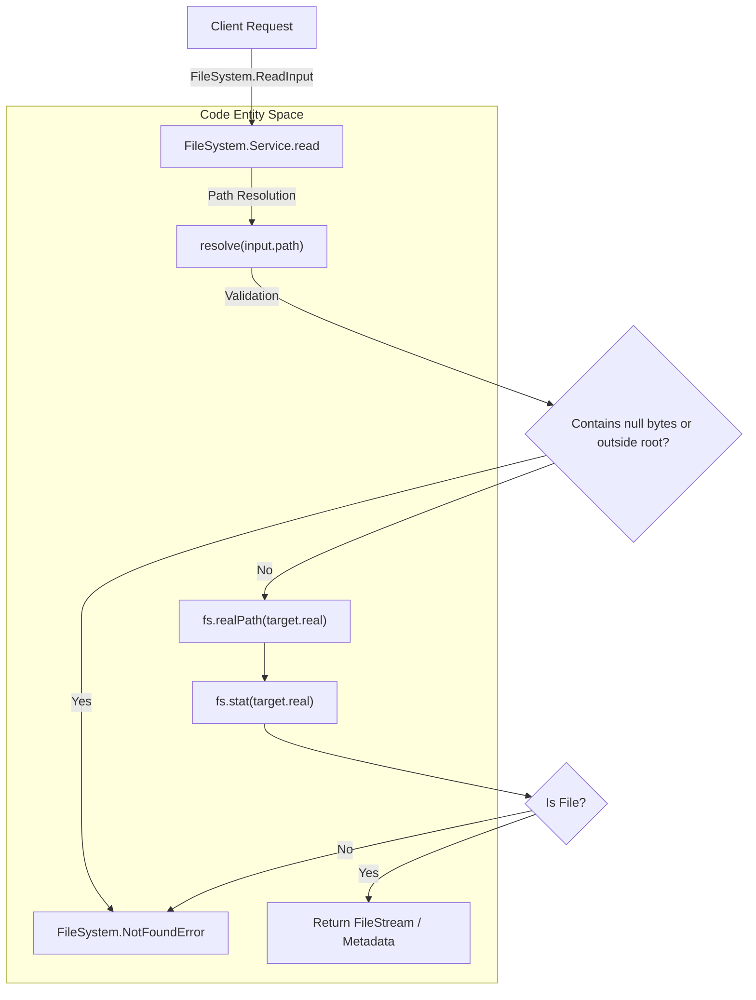
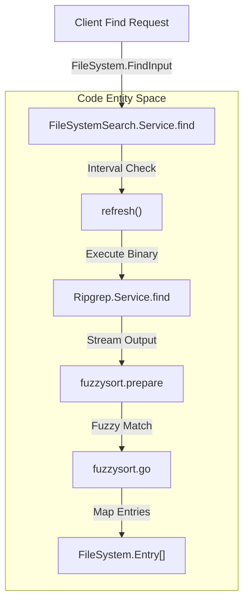
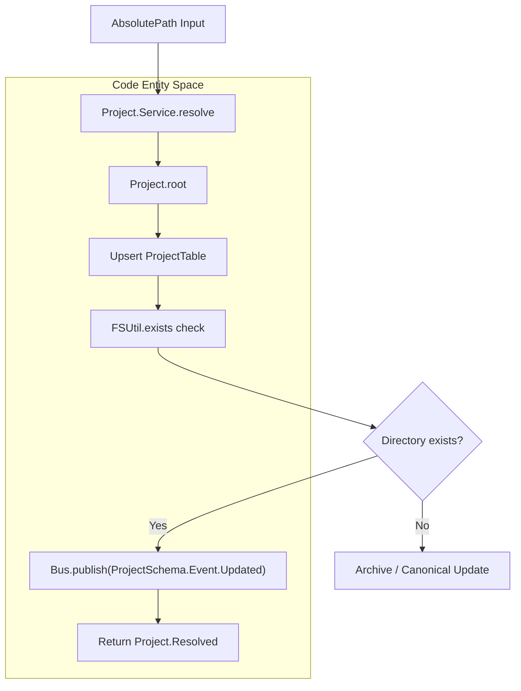

<!-- source: DeepWiki mcp.deepwiki.com · repo anomalyco/opencode · page 2.7 Filesystem, Search & Projects · fetched 2026-10-27 -->

# Filesystem, Search & Projects

Relevant source files

The following files were used as context for generating this wiki page:

- [packages/cli/test/fixture/standalone-owner.ts](packages/cli/test/fixture/standalone-owner.ts)
- [packages/cli/test/standalone.test.ts](packages/cli/test/standalone.test.ts)
- [packages/client/test/solid-pending-status.test.ts](packages/client/test/solid-pending-status.test.ts)
- [packages/core/src/file-retention.ts](packages/core/src/file-retention.ts)
- [packages/core/src/filesystem/location-watcher.ts](packages/core/src/filesystem/location-watcher.ts)
- [packages/core/src/filesystem/search.ts](packages/core/src/filesystem/search.ts)
- [packages/core/src/filesystem/watcher.ts](packages/core/src/filesystem/watcher.ts)
- [packages/core/src/git.ts](packages/core/src/git.ts)
- [packages/core/src/instance.ts](packages/core/src/instance.ts)
- [packages/core/src/location-service-map.ts](packages/core/src/location-service-map.ts)
- [packages/core/src/location.ts](packages/core/src/location.ts)
- [packages/core/src/plugin/instance.ts](packages/core/src/plugin/instance.ts)
- [packages/core/src/project.ts](packages/core/src/project.ts)
- [packages/core/src/project/schema.ts](packages/core/src/project/schema.ts)
- [packages/core/src/project/sql.ts](packages/core/src/project/sql.ts)
- [packages/core/src/ripgrep.ts](packages/core/src/ripgrep.ts)
- [packages/core/src/ripgrep/binary.ts](packages/core/src/ripgrep/binary.ts)
- [packages/core/src/snapshot.ts](packages/core/src/snapshot.ts)
- [packages/core/src/tool-output.ts](packages/core/src/tool-output.ts)
- [packages/core/src/vcs/patch.ts](packages/core/src/vcs/patch.ts)
- [packages/core/test/config/tool-output.test.ts](packages/core/test/config/tool-output.test.ts)
- [packages/core/test/effect/layer-node/node-build.test.ts](packages/core/test/effect/layer-node/node-build.test.ts)
- [packages/core/test/filesystem/search.test.ts](packages/core/test/filesystem/search.test.ts)
- [packages/core/test/filesystem/watcher.test.ts](packages/core/test/filesystem/watcher.test.ts)
- [packages/core/test/git.test.ts](packages/core/test/git.test.ts)
- [packages/core/test/instance-vanilla.test.ts](packages/core/test/instance-vanilla.test.ts)
- [packages/core/test/location.test.ts](packages/core/test/location.test.ts)
- [packages/core/test/project.test.ts](packages/core/test/project.test.ts)
- [packages/core/test/ripgrep.test.ts](packages/core/test/ripgrep.test.ts)
- [packages/core/test/shell-cleanup.test.ts](packages/core/test/shell-cleanup.test.ts)
- [packages/core/test/snapshot.test.ts](packages/core/test/snapshot.test.ts)
- [packages/core/test/tool-output.test.ts](packages/core/test/tool-output.test.ts)
- [packages/core/test/tool-search.test.ts](packages/core/test/tool-search.test.ts)
- [packages/protocol/src/groups/project.ts](packages/protocol/src/groups/project.ts)
- [packages/schema/src/project.ts](packages/schema/src/project.ts)
- [packages/server/src/handlers/project.ts](packages/server/src/handlers/project.ts)
- [packages/session-ui/component-tests/session-message-projection.spec.ts](packages/session-ui/component-tests/session-message-projection.spec.ts)
- [packages/session-ui/src/components/message-file.test.ts](packages/session-ui/src/components/message-file.test.ts)
- [packages/session-ui/src/components/message-file.ts](packages/session-ui/src/components/message-file.ts)
- [packages/storybook/.storybook/main.ts](packages/storybook/.storybook/main.ts)
- [packages/storybook/.storybook/preview.tsx](packages/storybook/.storybook/preview.tsx)
- [packages/storybook/playwright/README.md](packages/storybook/playwright/README.md)
- [packages/storybook/playwright/config.ts](packages/storybook/playwright/config.ts)

This page covers the technical implementation of core file management, text/path search infrastructure, live file watching, and project/location/instance resolution within OpenCode's Effect-based runtime (`packages/core`).

---

## 1. Filesystem Service & Safe Resolution

The filesystem service (`packages/core/src/filesystem.ts`) provides a secure, Effect-based abstraction over host storage operations (`read`, `list`, `find`, and `write`), constraining paths within the active workspace or project directory `[packages/core/src/filesystem.ts:100-107]()`.

At service initialization, `FileSystem.Service` evaluates the canonical root directory using `Location.Service` `[packages/core/src/filesystem.ts:114-115]()`. For workspace-backed locations, host realpath probing is bypassed at boot to prevent blocking on unmounted or virtual environments; otherwise, `fs.realPath` resolves the host path while classifying errors into tagged effects such as `DirectoryNotFoundError` or `DirectoryAccessDeniedError` `[packages/core/src/filesystem.ts:117-140]()`.

Path resolution helper `resolve` verifies that input paths do not contain null bytes (`\u0000`), resolves them relative to the location directory, and checks containment via `FSUtil.contains` before executing realpath validation `[packages/core/src/filesystem.ts:141-154]`.

Diagram: Filesystem Read Flow (Natural Language to Code Entity Space)

Sources: `[packages/core/src/filesystem.ts:13-174]()`

---

## 2. Ripgrep & Fast Search (FileSystemSearch)

OpenCode delegates fast file and pattern searching to `Ripgrep.Service` (`packages/core/src/ripgrep.ts`) and `FileSystemSearch.Service` (`packages/core/src/filesystem/search.ts`). 

### Ripgrep Binary Execution
`Ripgrep.Service` invokes the underlying `ripgrep` binary through `environment.spawner.spawn` `[packages/core/src/ripgrep.ts:120-122]()`. It supports three primary execution modes:
- `find`: Discovers paths matching a wildcard or pattern with entry streaming (`onEntry`) `[packages/core/src/ripgrep.ts:60-61]()`.
- `glob`: Collects file paths matching glob specifications `[packages/core/src/ripgrep.ts:63-70]()`.
- `grep`: Searches file contents returning structured `Match` objects with submatches and absolute offsets `[packages/core/src/ripgrep.ts:72-81]()`.

Stdout streams are line-decoded, parsed, and checked against limits or abort signals `[packages/core/src/ripgrep.ts:128-154]()`.

### FileSystemSearch Layers
`FileSystemSearch` provides two alternative backing layers depending on capability and configuration:
1. `ripgrepLayer`: Maintains an in-memory index using `fuzzysort` prepared entries, refreshed periodically (every 10 seconds) or lazily upon search requests `[packages/core/src/filesystem/search.ts:25-114]()`. It handles home-directory scans by applying protective exclusions (`Protected.names()`) `[packages/core/src/filesystem/search.ts:60-73]()`.
2. `fffLayer`: Integrates the native `Fff` search library (`aiMode: true`, `disableMmapCache: true`) for high-performance indexing when available `[packages/core/src/filesystem/search.ts:116-138]()`.

Diagram: Search Resolution Flow (Natural Language to Code Entity Space)

Sources: `[packages/core/src/filesystem/search.ts:53-114]`, `[packages/core/src/ripgrep.ts:83-162]()`

---

## 3. File Watchers & Native Subscriptions

Live file system updates are managed by `Watcher.Service` (`packages/core/src/filesystem/watcher.ts`), which wraps native file watching bindings (`@parcel/watcher` / Node `fs.watch`) via the `Native` service `[packages/core/src/filesystem/watcher.ts:4-13]()`.

- **Subscription Management**: Subscriptions are pooled and deduplicated using Effect's `RcMap`, matching structural watch inputs (target path, type: `file`, `entries`, or `directory`, and ignore globs) `[packages/core/src/filesystem/watcher.ts:94-127]()`.
- **Event Broadcasting**: Events are published through unbounded Effect `PubSub` queues and transformed into Effect `Stream` instances for consumers `[packages/core/src/filesystem/watcher.ts:97-146]()`.

Sources: `[packages/core/src/filesystem/watcher.ts:1-273]()`

---

## 4. Project, Location & Instance Resolution

OpenCode resolves execution contexts across repositories, workspaces, and working trees using `Project.Service` (`packages/core/src/project.ts`) and `Location.Service` (`packages/core/src/location.ts`).

### Project Resolution & Database Persistence
`Project.Service` maps absolute directories to persistent project records stored in SQLite (`ProjectTable`) `[packages/core/src/project.ts:73-74]()`. 
- `resolve`: Detects project roots (using markers like `.git`, `.hg`), handles worktree relationships, and upserts metadata atomically `[packages/core/src/project.ts:49-58]`, `[packages/core/src/project.ts:117-146]()`.
- `activate`: Throttles project activity updates (at most once per minute) to maintain recency ordering in project listings `[packages/core/src/project.ts:71-72]`, `[packages/core/src/project.ts:60-60]()`.
- `sweep`: Automatically archives projects whose known working directories no longer exist on disk `[packages/core/src/project.ts:75-76]`, `[packages/core/src/project.ts:61-61]()`.

Diagram: Project Resolution Flow

Sources: `[packages/core/src/project.ts:49-146]`, `[packages/core/src/location.ts:1-39]()`

---

## 5. Snapshots & Git Integration

Working tree state and version control metadata are coordinated via `Git.Service` (`packages/core/src/git.ts`) and `Snapshot.Service` (`packages/core/src/snapshot.ts`). Working trees (`WorktreeTable`) link project clones and alternate subdirectories to their owning project identifiers, enabling the system to trace context across branches, worktrees, and isolated sandboxes without redundant repository scans `[packages/core/src/project.ts:148-174]()`.

- **Repository Discovery & Operations**: `Git.Service` provides robust abstractions for repository discovery, cloning, fetching, branch checks, and tree captures `[packages/core/src/git.ts:96-177]()`.
- **Custom Git Configuration**: OpenCode injects an isolated `opencode.gitconfig` file inside `$GIT_DIR` configured with optimized indexes (`version = 4`, `manyFiles = true`, `splitIndex = false`) to accelerate status and diff operations `[packages/core/src/git.ts:21-40]()`.

Sources: `[packages/core/src/git.ts:1-181]`, `[packages/core/src/project.ts:148-174]()`

---

