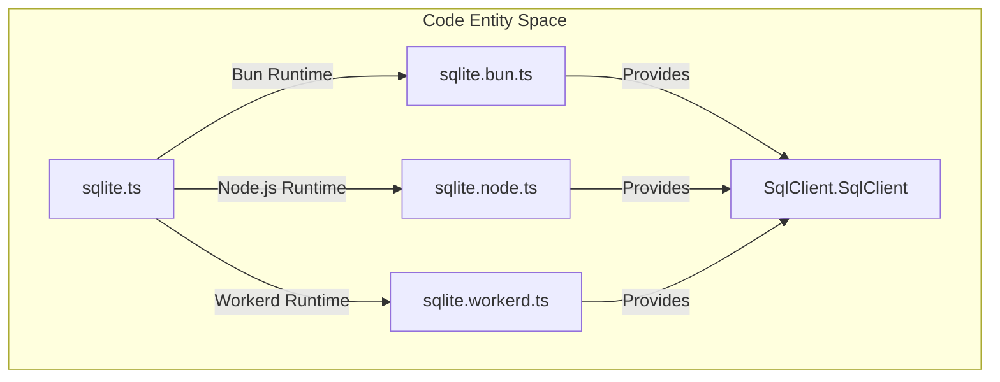
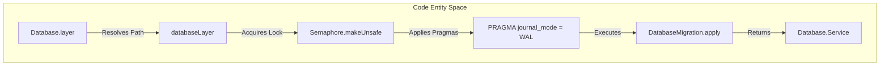
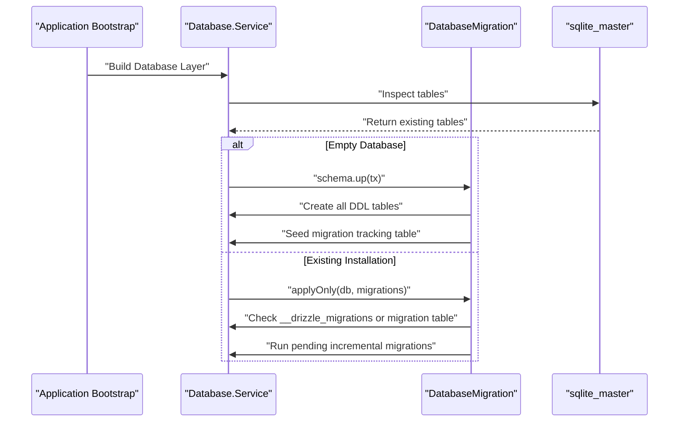

<!-- source: DeepWiki mcp.deepwiki.com · repo anomalyco/opencode · page 2.8 Persistence: Database & Migrations · fetched 2026-10-27 -->

# Persistence: Database & Migrations

Relevant source files

The following files were used as context for generating this wiki page:

- [packages/core/README.md](packages/core/README.md)
- [packages/core/schema.json](packages/core/schema.json)
- [packages/core/script/publish.ts](packages/core/script/publish.ts)
- [packages/core/src/database/database.ts](packages/core/src/database/database.ts)
- [packages/core/src/database/migration.gen.ts](packages/core/src/database/migration.gen.ts)
- [packages/core/src/database/migration.ts](packages/core/src/database/migration.ts)
- [packages/core/src/database/migration/20260805200742_import_legacy_credentials.ts](packages/core/src/database/migration/20260805200742_import_legacy_credentials.ts)
- [packages/core/src/database/schema.gen.ts](packages/core/src/database/schema.gen.ts)
- [packages/core/src/database/sqlite.bun.ts](packages/core/src/database/sqlite.bun.ts)
- [packages/core/src/database/sqlite.node.ts](packages/core/src/database/sqlite.node.ts)
- [packages/core/src/database/sqlite.ts](packages/core/src/database/sqlite.ts)
- [packages/core/src/database/sqlite.workerd.ts](packages/core/src/database/sqlite.workerd.ts)
- [packages/core/src/database/v1-migration.noop.ts](packages/core/src/database/v1-migration.noop.ts)
- [packages/core/src/session/sql.ts](packages/core/src/session/sql.ts)
- [packages/core/test/database-migration.test.ts](packages/core/test/database-migration.test.ts)
- [packages/core/test/database.test.ts](packages/core/test/database.test.ts)
- [packages/core/test/sqlite-workerd.test.ts](packages/core/test/sqlite-workerd.test.ts)

### Purpose and Scope
This section details the persistence layer of OpenCode, implemented using SQLite across multiple JavaScript runtimes (Bun, Node.js, and Cloudflare Workers via Workerd). It covers the Effect-based Drizzle ORM integration, runtime-agnostic database drivers, transactional schema migrations, legacy credential and data upgrade pipelines, and internal key-value storage mechanisms.

---

### 1. SQLite Drivers & Multi-Runtime Abstraction

OpenCode abstracts SQLite access behind a unified Effect `SqlClient` interface, allowing the core runtime to operate seamlessly across different hosting environments:
- **Bun**: Leverages native high-performance bindings via `bun:sqlite` in `[packages/core/src/database/sqlite.bun.ts:1-103]()`.
- **Node.js**: Uses standard Node SQLite bindings (`DatabaseSync`) in `[packages/core/src/database/sqlite.node.ts:1-100]()`.
- **Cloudflare Workerd**: Integrates with Durable Object SQLite storage in `[packages/core/src/database/sqlite.workerd.ts:1-175]()`.

The runtime selector layer in `[packages/core/src/database/sqlite.ts:1-97]()` defines shared helpers like `makeConnection` and `makeClient` to wrap platform-specific execution primitives.

*Figure 1: Multi-runtime driver binding architecture linking platform layers to `SqlClient.SqlClient`.*

Sources:
- `packages/core/src/database/database.ts:1-123` ()
- `packages/core/src/database/sqlite.ts:1-98` ()
- `packages/core/src/database/sqlite.bun.ts:1-104` ()
- `packages/core/src/database/sqlite.node.ts:1-101` ()
- `packages/core/src/database/sqlite.workerd.ts:1-175` ()

---

### 2. Database Service & Pragmas (`Database.Service`)

Database initialization, locking, and connection management are encapsulated by `Database.Service` defined in `[packages/core/src/database/database.ts:26-26]()`. When a database layer is built via `Database.layer` or `Database.layerFromClient`, it applies performance-tuning pragmas and ensures fiber safety via path-keyed semaphores (`[packages/core/src/database/database.ts:33-65]()`).

*Figure 2: Database initialization flow mapping `Database.layer` execution to `Database.Service`.*

Key features of `Database.Service`:
- **Pragma Tuning**: Configures Write-Ahead Logging (`WAL`), normal synchronization, a 5-second busy timeout, and cache sizing where supported (`[packages/core/src/database/database.ts:39-44]()`).
- **File Security**: Restricts database files and sidecar files (`-wal`, `-shm`) to owner-only permissions (`0o600`) on POSIX systems (`[packages/core/src/database/database.ts:83-98]()`).
- **Concurrency Control**: Prevents concurrent migration races using path-keyed mutexes via `lockFor` (`[packages/core/src/database/database.ts:57-65]()`).

Sources:
- `packages/core/src/database/database.ts:1-123` ()

---

### 3. Migrations & Schema Generation

OpenCode manages database schemas through generated TypeScript migration files (`[packages/core/src/database/migration.gen.ts:1-104]()`) and a canonical schema initialization script (`[packages/core/src/database/schema.gen.ts:1-283]()`).

- **Bootstrap vs Incremental**: If the database is completely empty, `DatabaseMigration.apply` runs the complete DDL schema snapshot (`[packages/core/src/database/schema.gen.ts:4-178]()`) and marks all migrations as completed (`[packages/core/src/database/migration.ts:34-46]()`). If legacy Drizzle migration tables (`__drizzle_migrations`) are found, they are automatically imported into the new migration tracking ledger (`[packages/core/src/database/migration.ts:62-105]()`).
- **Foreign Key Handling**: Migrations respect runtime capabilities regarding foreign key toggles, temporarily disabling or deferring them when necessary during structural alterations (`[packages/core/src/database/migration.ts:120-131]()`).

Sources:
- `packages/core/src/database/migration.ts:1-150` ()
- `packages/core/src/database/migration.gen.ts:1-105` ()
- `packages/core/src/database/schema.gen.ts:1-284` ()

---

### 4. Legacy Credential & Data Migration

To transition legacy authentication stores into the v2 schema, OpenCode provides dedicated upgrade migrations such as `20260805200742_import_legacy_credentials` (`[packages/core/src/database/migration/20260805200742_import_legacy_credentials.ts:1-109]()`).

- **Transformation Pipeline**: Reads legacy JSON credential files from the global data directory (`auth.json`), decodes oauth/api/well-known schemas, and inserts them into the normalized `credential` table (`[packages/core/src/database/migration/20260805200742_import_legacy_credentials.ts:46-89]()`).
- **KV Watermarking**: Persists migrated endpoints and well-known source origins into the `kv` table (`[packages/core/src/database/migration/20260805200742_import_legacy_credentials.ts:91-101]()`).

Sources:
- `packages/core/src/database/migration/20260805200742_import_legacy_credentials.ts:1-110` ()

---

### 5. Key-Value (KV) Store & Core Tables

OpenCode maintains a lightweight general-purpose Key-Value store backed by SQLite alongside domain-specific tables (sessions, projects, instructions) defined via Drizzle ORM in `[packages/core/src/session/sql.ts:22-176]()` and `[packages/core/schema.json:1-2077]()`.

- **Schema**: The `kv` table consists of a primary text `key`, a text `value` payload, `time_created`, and `time_updated` timestamps (`[packages/core/src/database/schema.gen.ts:72-78]()`).
- **Session Tables**: Includes `session_v2`, `session_message`, `session_pending`, and `session_inbox` which provide event-sourced durability for conversational turns and tool interactions (`[packages/core/src/session/sql.ts:22-145]()`).

Sources:
- `packages/core/schema.json:1-2078` ()
- `packages/core/src/database/schema.gen.ts:1-284` ()
- `packages/core/src/session/sql.ts:22-177` ()

---

### 6. Effect-Drizzle-Sqlite Helpers & Testing

Database operations are executed via type-safe Drizzle ORM queries wrapped in Effect services (`EffectDrizzleSqlite`).
- **Transactions**: `db.transaction()` wraps transactional operations, automatically rolling back on Effect failure or defect (`[packages/core/src/database/migration.ts:34-46]()`).
- **Testing Helpers**: Test suites utilize in-memory SQLite instances (`:memory:`) via `@effect/sql-sqlite-bun` to execute isolated migration, concurrency, and store tests concurrently (`[packages/core/test/database-migration.test.ts:26-36]()`).

Sources:
- `packages/core/test/database-migration.test.ts:1-154` ()

---

