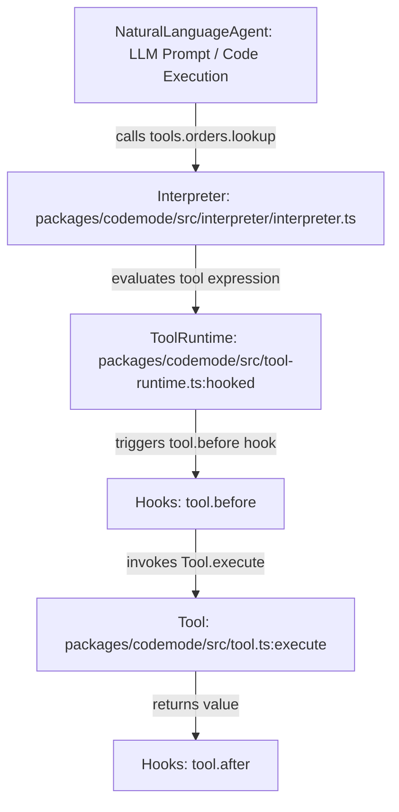
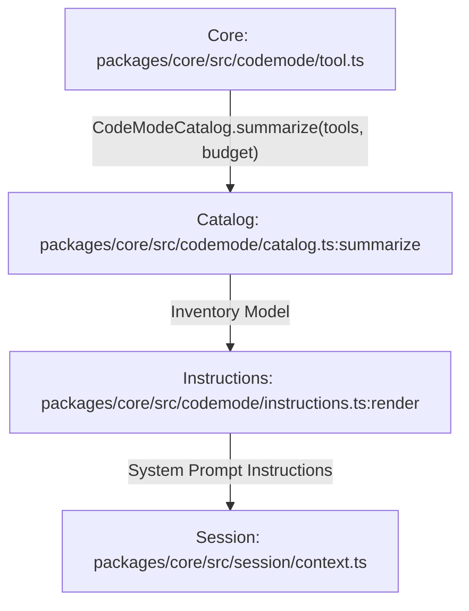

<!-- source: DeepWiki mcp.deepwiki.com · repo anomalyco/opencode · page 2.9 CodeMode Interpreter · fetched 2026-10-27 -->

# CodeMode Interpreter

Relevant source files

The following files were used as context for generating this wiki page:

- [packages/codemode/README.md](packages/codemode/README.md)
- [packages/codemode/interpreter-support.md](packages/codemode/interpreter-support.md)
- [packages/codemode/src/codemode.ts](packages/codemode/src/codemode.ts)
- [packages/codemode/src/data.ts](packages/codemode/src/data.ts)
- [packages/codemode/src/index.ts](packages/codemode/src/index.ts)
- [packages/codemode/src/interpreter/callback.ts](packages/codemode/src/interpreter/callback.ts)
- [packages/codemode/src/interpreter/globals.ts](packages/codemode/src/interpreter/globals.ts)
- [packages/codemode/src/interpreter/interpreter.ts](packages/codemode/src/interpreter/interpreter.ts)
- [packages/codemode/src/interpreter/intrinsics.ts](packages/codemode/src/interpreter/intrinsics.ts)
- [packages/codemode/src/interpreter/model.ts](packages/codemode/src/interpreter/model.ts)
- [packages/codemode/src/interpreter/objects.ts](packages/codemode/src/interpreter/objects.ts)
- [packages/codemode/src/interpreter/promises.ts](packages/codemode/src/interpreter/promises.ts)
- [packages/codemode/src/interpreter/references.ts](packages/codemode/src/interpreter/references.ts)
- [packages/codemode/src/stdlib/array.ts](packages/codemode/src/stdlib/array.ts)
- [packages/codemode/src/stdlib/collections.ts](packages/codemode/src/stdlib/collections.ts)
- [packages/codemode/src/stdlib/console.ts](packages/codemode/src/stdlib/console.ts)
- [packages/codemode/src/stdlib/date.ts](packages/codemode/src/stdlib/date.ts)
- [packages/codemode/src/stdlib/json.ts](packages/codemode/src/stdlib/json.ts)
- [packages/codemode/src/stdlib/math.ts](packages/codemode/src/stdlib/math.ts)
- [packages/codemode/src/stdlib/number.ts](packages/codemode/src/stdlib/number.ts)
- [packages/codemode/src/stdlib/object.ts](packages/codemode/src/stdlib/object.ts)
- [packages/codemode/src/stdlib/regexp.ts](packages/codemode/src/stdlib/regexp.ts)
- [packages/codemode/src/stdlib/string.ts](packages/codemode/src/stdlib/string.ts)
- [packages/codemode/src/stdlib/url.ts](packages/codemode/src/stdlib/url.ts)
- [packages/codemode/src/stdlib/value.ts](packages/codemode/src/stdlib/value.ts)
- [packages/codemode/src/stdlib/web.ts](packages/codemode/src/stdlib/web.ts)
- [packages/codemode/src/tool-runtime.ts](packages/codemode/src/tool-runtime.ts)
- [packages/codemode/src/tool-schema.ts](packages/codemode/src/tool-schema.ts)
- [packages/codemode/src/tool.ts](packages/codemode/src/tool.ts)
- [packages/codemode/test/codemode.test.ts](packages/codemode/test/codemode.test.ts)
- [packages/codemode/test/enumeration.test.ts](packages/codemode/test/enumeration.test.ts)
- [packages/codemode/test/parity.test.ts](packages/codemode/test/parity.test.ts)
- [packages/codemode/test/promise.test.ts](packages/codemode/test/promise.test.ts)
- [packages/codemode/test/signature.test.ts](packages/codemode/test/signature.test.ts)
- [packages/codemode/test/stdlib.test.ts](packages/codemode/test/stdlib.test.ts)
- [packages/codemode/test/test262/README.md](packages/codemode/test/test262/README.md)
- [packages/codemode/test/test262/manifest.json](packages/codemode/test/test262/manifest.json)
- [packages/codemode/test/test262/skipped.txt](packages/codemode/test/test262/skipped.txt)
- [packages/codemode/test/tool-paths.test.ts](packages/codemode/test/tool-paths.test.ts)
- [packages/core/src/codemode/catalog.ts](packages/core/src/codemode/catalog.ts)
- [packages/core/src/codemode/instructions.ts](packages/core/src/codemode/instructions.ts)
- [packages/core/src/codemode/tool.ts](packages/core/src/codemode/tool.ts)
- [packages/core/src/codemode/web.ts](packages/core/src/codemode/web.ts)
- [packages/core/src/session/context.ts](packages/core/src/session/context.ts)
- [packages/core/test/codemode.test.ts](packages/core/test/codemode.test.ts)
- [packages/core/test/codemode/catalog.test.ts](packages/core/test/codemode/catalog.test.ts)
- [packages/core/test/codemode/instructions.test.ts](packages/core/test/codemode/instructions.test.ts)
- [packages/core/test/tool-execute.test.ts](packages/core/test/tool-execute.test.ts)

## Purpose and Scope

The `packages/codemode` package and its core integrations (`packages/core/src/codemode/*`) provide a pure, sandboxed JavaScript-like interpreter designed specifically for AI coding agents. Rather than running arbitrary Node.js or browser code with direct access to system resources, CodeMode restricts execution to a subset of ECMAScript syntax and an explicit standard library. Programs interact with the outside world exclusively through host-provided tools and extensions, bounded by hard resource limits (timeouts, tool call counts, and output sizes).

Sources: `packages/codemode/README.md:1-12`, `packages/codemode/src/codemode.ts:1-165`

---

## Interpreter & Execution Model

CodeMode uses **Acorn** to parse JavaScript code according to the latest syntax allowlist [packages/codemode/interpreter-support.md:17-18](). TypeScript-only syntax or unsupported constructs are rejected at parse time rather than stripped [packages/codemode/interpreter-support.md:17-18]().

### Execution Rules & Host Boundaries
- **Top-level Flow**: Supports top-level `await`, explicit `return`, and REPL-style expressions yielding a result (with bare `undefined` normalized to `null`) [packages/codemode/interpreter-support.md:19-24]().
- **Data Serialization**: The host boundary relies on a serialization protocol similar to `JSON.stringify` / `JSON.parse`, with explicit handling for complex data types [packages/codemode/interpreter-support.md:21-30]().
  - **Promises**: Awaited automatically; rejections fail the program [packages/codemode/interpreter-support.md:26]().
  - **Collections**: `Map`, `Set`, `URL`, `URLSearchParams`, `Headers`, and `Uint8Array` receive live intra-interpreter representations, crossing boundaries as arrays, query strings, or serialized objects [packages/codemode/interpreter-support.md:24-31]().
  - **Prototypes**: Own `__proto__` keys are dropped to prevent prototype pollution during tool input/output merging [packages/codemode/interpreter-support.md:28-29]().
- **Resource Limits**: Configured via `ExecutionLimits`, enforcing wall-clock timeouts (`timeoutMs`), a maximum number of admitted tool calls (`maxToolCalls`), and output size constraints (`maxOutputBytes`) [packages/codemode/src/codemode.ts:22-41]().

| Execution Limit Option | Description | Default |
| :--- | :--- | :--- |
| `timeoutMs` | Wall-clock milliseconds before interruption | None (unlimited) [packages/codemode/src/codemode.ts:24-26]() |
| `maxToolCalls` | Maximum number of tool calls admitted | None (unlimited) [packages/codemode/src/codemode.ts:28-29]() |
| `maxOutputBytes` | Maximum UTF-8 bytes retained from result/logs | None (unlimited) [packages/codemode/src/codemode.ts:30-34]() |

Sources: `packages/codemode/interpreter-support.md:16-46`, `packages/codemode/src/codemode.ts:22-41`

---

## Standard Library & Test262 Parity

CodeMode includes a robust built-in standard library emulating ordinary JavaScript behaviors while maintaining isolation.

- **Supported Built-ins**: `Date`, `RegExp`, `Map`, `Set`, `URL`, `URLSearchParams`, `Math`, `Number`, `JSON`, and `Console` [packages/codemode/README.md:16-17](), [packages/codemode/test/stdlib.test.ts:38-60]().
- **Test262 Parity**: Upstream ECMAScript conformance tests (`test/test262`) run verbatim against the interpreter [packages/codemode/interpreter-support.md:11-13](). Gaps and known non-conformance items are tracked explicitly in `test/test262/skipped.txt` [packages/codemode/interpreter-support.md:11-13](), [packages/codemode/test/test262/skipped.txt:1-5]().

Sources: `packages/codemode/interpreter-support.md:1-14`, `packages/codemode/test/stdlib.test.ts:38-60`, `packages/codemode/test/test262/skipped.txt:1-5`

---

## Tool Runtime & Schema Generation

Tools are declared using `Tool.make` and organized into hierarchical namespaces via `Namespace.make` or nested JavaScript objects [packages/codemode/README.md:55-78](). 

### Tool Invocation and Hooks
Every tool call passes through an Effect-based wrapper (`ToolRuntime.hooked`) that supports execution hooks (`tool.before`, `tool.after`, `extension.before`, `extension.after`) for auditing, permission gating, or metrics tracking [packages/codemode/src/tool-runtime.ts:55-81]().

Title: Tool Invocation Flow from Natural Language Space to Code Entity Space

Sources: `packages/codemode/src/tool-runtime.ts:35-81`, `packages/codemode/README.md:55-128`

### Schema and Signature Generation
`packages/codemode` converts Effect Schemas and raw JSON Schemas into compact TypeScript-like signatures with embedded JSDoc annotations for LLM consumption [packages/codemode/test/signature.test.ts:44-96]().

- `inputTypeScript(...)` renders parameter structures [packages/codemode/src/tool-schema.ts:1-13]()
- `outputTypeScript(...)` renders return types [packages/codemode/src/tool-schema.ts:1-13]()
- `jsonSchemaToTypeScript(...)` translates JSON Schema metadata (descriptions, defaults, constraints) into JSDoc comments [packages/codemode/test/signature.test.ts:72-96]()

Sources: `packages/codemode/src/tool-schema.ts:1-13`, `packages/codemode/test/signature.test.ts:44-96`

---

## Core Integration: Catalog, Instructions & Codemode Tool

The core package (`packages/core`) wraps CodeMode to inject tool definitions into agent prompts and coordinate tool discovery.

Title: Catalog Summarization Flow from Core Registry to LLM Execution Loop

Sources: `packages/core/test/codemode/catalog.test.ts:1-147`, `packages/core/src/codemode/catalog.ts:1-50`, `packages/core/src/codemode/instructions.ts:1-50`

### Catalog Summarization and Budgeting
When an agent has access to hundreds of tools, the catalog would exceed token budgets. `CodeModeCatalog.summarize` calculates costs and prunes non-essential tool definitions while preserving pinned tools and namespace summaries [packages/core/test/codemode/catalog.test.ts:32-86]().

- **Inline Budgeting**: Spends token budgets round-robin across namespaces so every namespace remains discoverable [packages/core/test/codemode/catalog.test.ts:142-147]().
- **Synchronous Search**: When the catalog is partial, instructions advise the agent to use the synchronous `search(...)` built-in function to query tool paths and signatures dynamically inside `execute` [packages/core/test/codemode/catalog.test.ts:128-140]().

Sources: `packages/core/test/codemode/catalog.test.ts:32-147`, `packages/core/src/codemode/catalog.ts:1-50`, `packages/core/src/codemode/instructions.ts:1-50`

---

