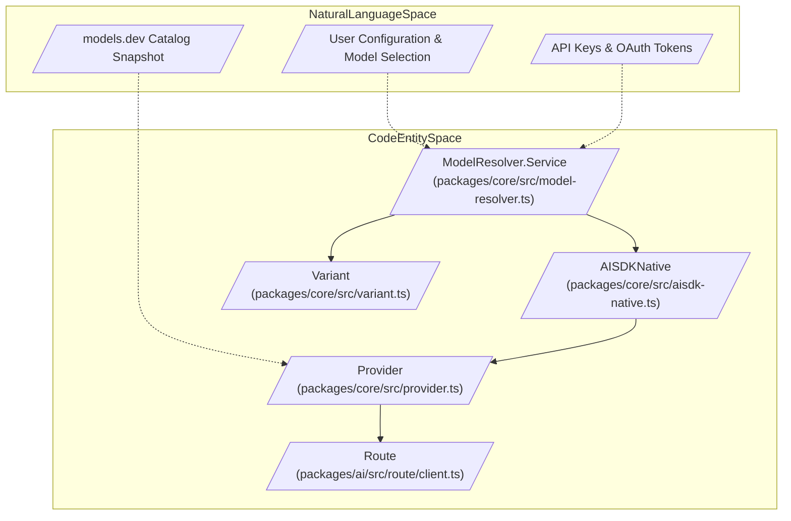
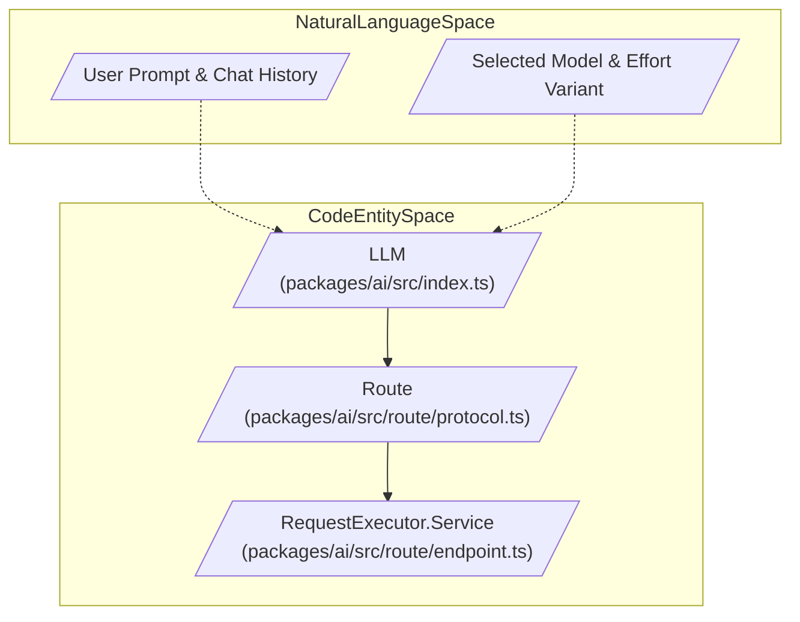

<!-- source: DeepWiki mcp.deepwiki.com · repo anomalyco/opencode · page 3 AI Provider Layer · fetched 2026-10-27 -->

# AI Provider Layer

Relevant source files

The following files were used as context for generating this wiki page:

- [packages/ai/AGENTS.md](packages/ai/AGENTS.md)
- [packages/ai/README.md](packages/ai/README.md)
- [packages/ai/src/experimental/evaluation-client.ts](packages/ai/src/experimental/evaluation-client.ts)
- [packages/ai/src/experimental/evaluation.ts](packages/ai/src/experimental/evaluation.ts)
- [packages/ai/src/experimental/system-one.ts](packages/ai/src/experimental/system-one.ts)
- [packages/ai/src/providers/index.ts](packages/ai/src/providers/index.ts)
- [packages/ai/src/providers/opencode.ts](packages/ai/src/providers/opencode.ts)
- [packages/ai/src/providers/xai.ts](packages/ai/src/providers/xai.ts)
- [packages/ai/src/route/protocol.ts](packages/ai/src/route/protocol.ts)
- [packages/ai/test/evaluation.test.ts](packages/ai/test/evaluation.test.ts)
- [packages/ai/test/evaluation.types.ts](packages/ai/test/evaluation.types.ts)
- [packages/ai/test/exports.test.ts](packages/ai/test/exports.test.ts)
- [packages/ai/test/fixtures/recordings/opencode-evaluation/evaluates-choice-score-and-boolean-questions.json](packages/ai/test/fixtures/recordings/opencode-evaluation/evaluates-choice-score-and-boolean-questions.json)
- [packages/ai/test/provider-package.test.ts](packages/ai/test/provider-package.test.ts)
- [packages/ai/test/provider/evaluation.recorded.test.ts](packages/ai/test/provider/evaluation.recorded.test.ts)

The AI Provider Layer provides a schema-first, Effect-based model and provider abstraction for OpenCode. It normalizes protocol differences across dozens of upstream LLM services while supporting native features such as tool streaming, reasoning effort, prompt caching, and multimodal assets.

For a comprehensive breakdown, see the child pages:
- [packages/ai Library](#3.1)
- [Provider Plugins & Authentication](#3.2)
- [Model Catalog & Resolution](#3.3)

---

## Architecture & Big Picture

The provider layer bridges user intent and configuration (`opencode.json`, model metadata, and authentication credentials) to executable wire protocols and LLM endpoints. 

### Natural Language to Code Entity Mapping: Model Resolution & Provider Routing

Sources: [packages/ai/src/providers/index.ts:1-48](), [packages/ai/README.md:1-24]()

---

## 3.1. packages/ai Library

The `packages/ai` library is a standalone Effect and promise-based LLM client. It supplies schema-first APIs for text, images, video, speech, and transcription [packages/ai/README.md:1-4](). It manages route execution, HTTP/WebSocket transports, error normalization, and testing utilities.

For details, see [packages/ai Library](#3.1).

### Wire Protocols & Provider Packages

Requests are lowered into provider-native payloads via runnable `Route` definitions. Built-in provider packages (`[packages/ai/src/providers/index.ts:1-49]`) cover Amazon Bedrock, Anthropic, Google Vertex, OpenAI, Mistral, Cohere, xAI (`[packages/ai/src/providers/xai.ts:1-121]()`), OpenRouter, Cloudflare AI Gateway, and others.

For details, see [packages/ai Library](#3.1).

---

## 3.2. Provider Plugins & Authentication

Core provider integrations in `packages/core/src/plugin/provider/*` implement connection lifecycles, OAuth/PKCE authorization flows, and API key management for services such as OpenAI/ChatGPT Codex, GitHub Copilot, Azure OpenAI, Google Vertex, xAI, OpenCode Zen, LLM Gateways, and local Ollama instances.

For details, see [Provider Plugins & Authentication](#3.2).

---

## 3.3. Model Catalog & Resolution

Model discovery relies on `models.dev` snapshots and the core `Catalog` service. The `ModelResolver` service resolves model variants, provider policies, and runtime parameters before delegating execution to `packages/ai` routes.

For details, see [Model Catalog & Resolution](#3.3).

---

### Natural Language to Code Entity Mapping: Request Execution & Transport

Sources: [packages/ai/src/route/protocol.ts:1-88](), [packages/ai/src/providers/xai.ts:1-66]()

---

