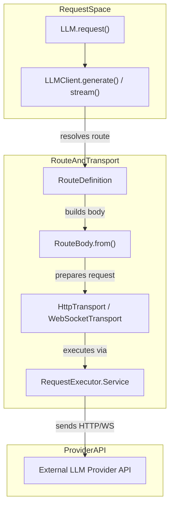
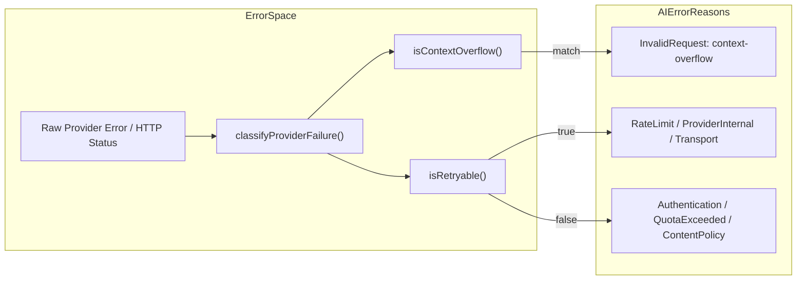
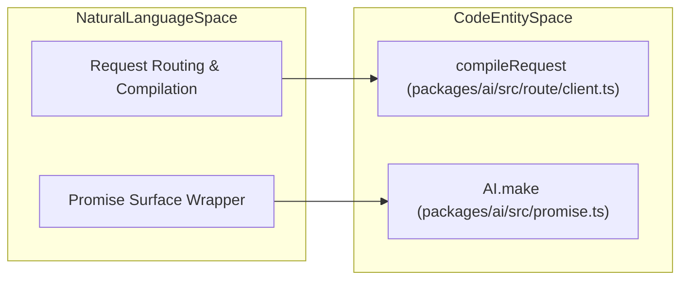
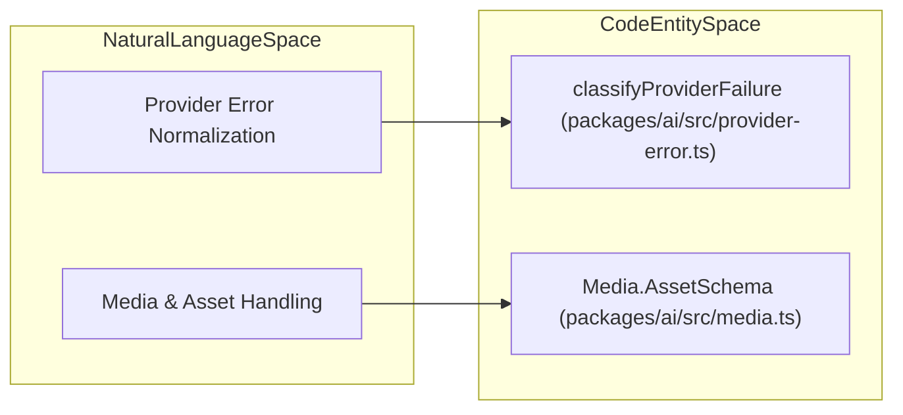

<!-- source: DeepWiki mcp.deepwiki.com · repo anomalyco/opencode · page 3.1 packages/ai Library · fetched 2026-10-27 -->

# packages/ai Library

Relevant source files

The following files were used as context for generating this wiki page:

- [packages/ai/AGENTS.md](packages/ai/AGENTS.md)
- [packages/ai/README.md](packages/ai/README.md)
- [packages/ai/src/experimental/evaluation-client.ts](packages/ai/src/experimental/evaluation-client.ts)
- [packages/ai/src/experimental/evaluation.ts](packages/ai/src/experimental/evaluation.ts)
- [packages/ai/src/experimental/system-one.ts](packages/ai/src/experimental/system-one.ts)
- [packages/ai/src/provider-error.ts](packages/ai/src/provider-error.ts)
- [packages/ai/src/providers/index.ts](packages/ai/src/providers/index.ts)
- [packages/ai/src/providers/opencode.ts](packages/ai/src/providers/opencode.ts)
- [packages/ai/src/providers/xai.ts](packages/ai/src/providers/xai.ts)
- [packages/ai/src/route/executor.ts](packages/ai/src/route/executor.ts)
- [packages/ai/src/route/protocol.ts](packages/ai/src/route/protocol.ts)
- [packages/ai/src/schema/errors.ts](packages/ai/src/schema/errors.ts)
- [packages/ai/src/schema/messages.ts](packages/ai/src/schema/messages.ts)
- [packages/ai/test/evaluation.test.ts](packages/ai/test/evaluation.test.ts)
- [packages/ai/test/evaluation.types.ts](packages/ai/test/evaluation.types.ts)
- [packages/ai/test/executor.test.ts](packages/ai/test/executor.test.ts)
- [packages/ai/test/exports.test.ts](packages/ai/test/exports.test.ts)
- [packages/ai/test/fixtures/recordings/opencode-evaluation/evaluates-choice-score-and-boolean-questions.json](packages/ai/test/fixtures/recordings/opencode-evaluation/evaluates-choice-score-and-boolean-questions.json)
- [packages/ai/test/provider-error.test.ts](packages/ai/test/provider-error.test.ts)
- [packages/ai/test/provider-package.test.ts](packages/ai/test/provider-package.test.ts)
- [packages/ai/test/provider/evaluation.recorded.test.ts](packages/ai/test/provider/evaluation.recorded.test.ts)
- [packages/ai/test/provider/image-detail.test.ts](packages/ai/test/provider/image-detail.test.ts)
- [packages/ai/test/schema.test.ts](packages/ai/test/schema.test.ts)
- [packages/ai/test/tool-runtime.test.ts](packages/ai/test/tool-runtime.test.ts)
- [packages/core/src/aisdk.ts](packages/core/src/aisdk.ts)
- [packages/core/src/generate.ts](packages/core/src/generate.ts)
- [packages/core/src/model-retry.ts](packages/core/src/model-retry.ts)
- [packages/core/src/session/generate.ts](packages/core/src/session/generate.ts)
- [packages/core/src/session/runner/model.ts](packages/core/src/session/runner/model.ts)
- [packages/core/src/session/runner/retry.ts](packages/core/src/session/runner/retry.ts)
- [packages/core/src/session/to-session-error.ts](packages/core/src/session/to-session-error.ts)
- [packages/core/test/aisdk.test.ts](packages/core/test/aisdk.test.ts)
- [packages/core/test/generate.test.ts](packages/core/test/generate.test.ts)
- [packages/core/test/session-error.test.ts](packages/core/test/session-error.test.ts)
- [packages/core/test/session-generate.test.ts](packages/core/test/session-generate.test.ts)
- [packages/core/test/session-runner-retry.test.ts](packages/core/test/session-runner-retry.test.ts)

The `packages/ai` library is a pure Effect-based, schema-first client library designed to provide a consistent, unified interface for interacting with multiple Large Language Model (LLM) providers [packages/ai/AGENTS.md:3-20](). It encapsulates provider protocol implementations, specialized route executors, robust transport layers (HTTP and WebSocket), canonical schemas for messages, options, events, and errors, as well as media handling, provider-error normalization, and testing utilities [packages/ai/src/provider-error.ts:1-116](), [packages/ai/src/route/client.ts:1-85]().

---

## Architecture & Core Components

The library leverages the `effect` ecosystem for composable, effectful computations, typed error channels, and concurrency. Key architectural boundaries include:

- **Canonical Request & Response Models (`LLMRequest`, `LLMResponse`)**: Schema-first normalized representations of model calls encompassing system instructions, messages, tool definitions, generation options, and provider overrides [packages/ai/AGENTS.md:13-20]().
- **Route Executor & Transports**: The `RequestExecutor` and transport implementations (`HttpTransport`, `WebSocketTransport`) handle HTTP/WebSocket execution, streaming framing (such as Server-Sent Events), request timeouts, and middleware injection [packages/ai/src/route/client.ts:1-85](), [packages/ai/src/route/executor.ts:1-142]().
- **Media, Image & Speech Clients**: Unified handling of binary assets (`Media.Asset`), image generation, video, speech, and transcription pipelines through modality-specific namespaces [packages/ai/AGENTS.md:15-18]().
- **Promise & AsyncIterable Compatibility**: Provided via `packages/ai/src/promise.ts` (`AI.make`), exposing a single Promise-based surface for consumers that do not run inside an Effect runtime [packages/ai/AGENTS.md:20]().

### Request Execution Flow

Sources: [packages/ai/AGENTS.md:20](), [packages/ai/src/route/client.ts:35-85]()

---

## Schemas & Canonical Data Models

All core data structures in `packages/ai` are defined using Effect Schema codecs. These schemas serve as the single source of truth for runtime validation, serialization, and type derivation [packages/ai/AGENTS.md:20]().

- **Messages & Content Parts**: Standardized roles (`system`, `user`, `assistant`, `tool`) and content parts (`TextPart`, `MediaPart`, `ToolCallPart`, `ToolResultPart`, `ReasoningPart`) [packages/ai/src/schema/messages.ts:1-189]().
- **Generation & HTTP Options**: Fine-grained configuration parameters including temperature, token limits, reasoning effort, cache hints, and custom HTTP timeout definitions.
- **Unified Events & Usage**: Streamed event types (`LLMEvent`) and normalized token usage tracking, capturing input tokens, cached tokens, reasoning tokens, and visible output tokens.

Sources: [packages/ai/src/schema/messages.ts:1-40](), [packages/ai/AGENTS.md:13-20]()

---

## Provider-Error Normalization & Resilience

The library normalizes heterogeneous provider-side errors into a typed union of `AIError` reasons (`RateLimit`, `Authentication`, `QuotaExceeded`, `ContentPolicy`, `Transport`, `ProviderInternal`, `InvalidRequest`, etc.) [packages/ai/src/provider-error.ts:1-116](). 

- **Context Overflow Detection**: Regex patterns scan raw error messages and HTTP status codes (e.g. 400, 413) to classify context window exhaustion (`isContextOverflow`) so core runtime loops can trigger compaction or prompt shrinking [packages/ai/src/provider-error.ts:16-76]().
- **Retryability Evaluation**: `isRetryable()` determines whether transient network issues, rate limits, or server-side overloads are safe to repeat automatically [packages/ai/src/provider-error.ts:81-116]().

Sources: [packages/ai/src/provider-error.ts:1-116](), [packages/ai/test/provider-error.test.ts:1-24]()

---

## Natural Language Space to Code Entity Space

The following diagrams associate architectural concepts and domain features with their underlying code identifiers across `packages/ai`:

### Request Routing & Execution Mapping

Sources: [packages/ai/src/route/client.ts:1-85](), [packages/ai/AGENTS.md:17-20]()

### Resilience & Media Mapping

Sources: [packages/ai/src/provider-error.ts:1-116](), [packages/ai/AGENTS.md:17-20]()

---

## Sub-Topics & Child Pages

For specific implementation details on wire protocols and provider packages, refer to the child pages:

- **[Wire Protocols (#3.1.1)](./3.1.1)** — Detailed protocol implementations for `openai-responses`, `anthropic-messages`, `openai-chat`, `gemini`, `bedrock-converse`, and shared tool streaming semantics.
- **[Provider Packages (#3.1.2)](./3.1.2)** — Provider family definitions and resolution logic located in `packages/ai/src/providers`.

Sources: [packages/ai/AGENTS.md:1-20]()

---

