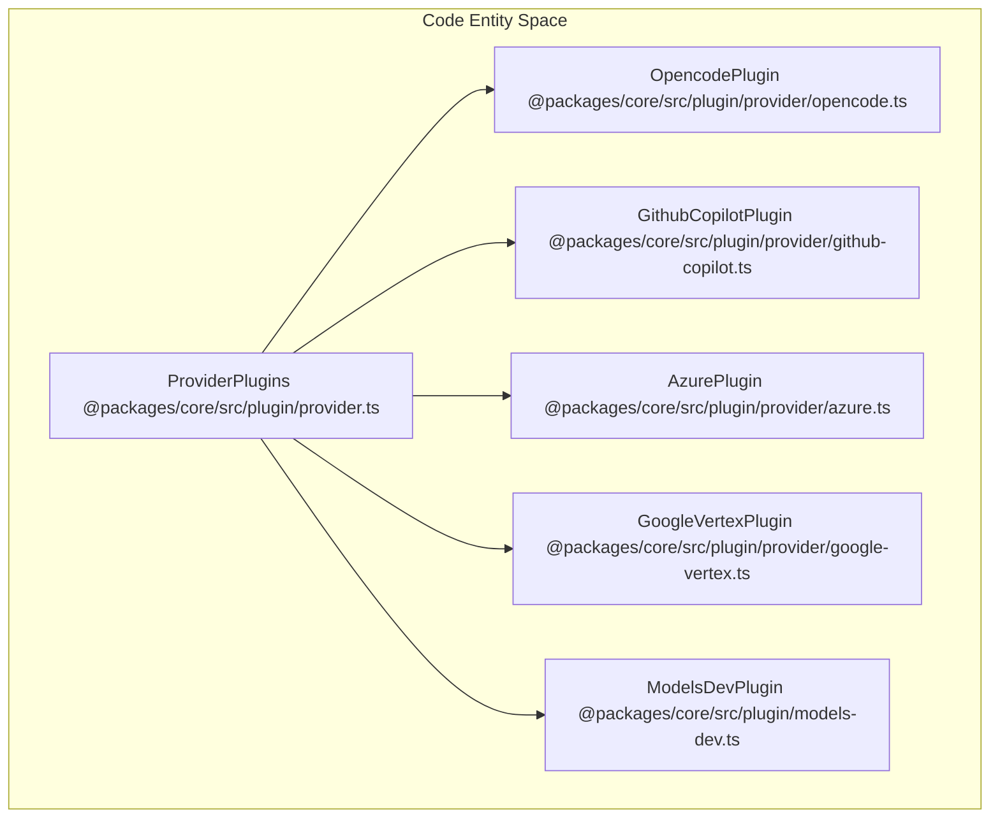
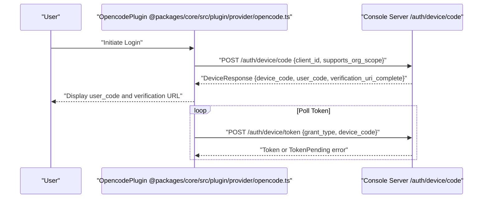
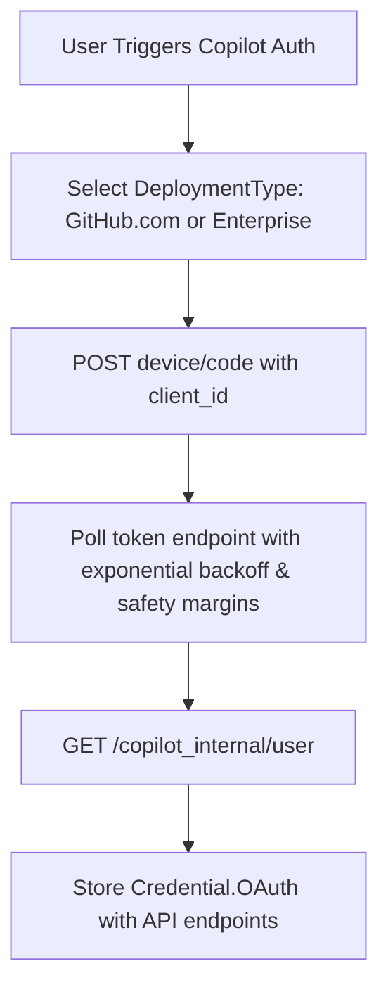
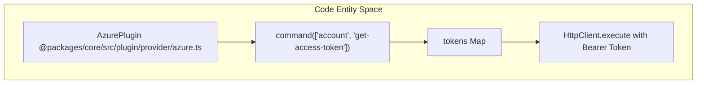
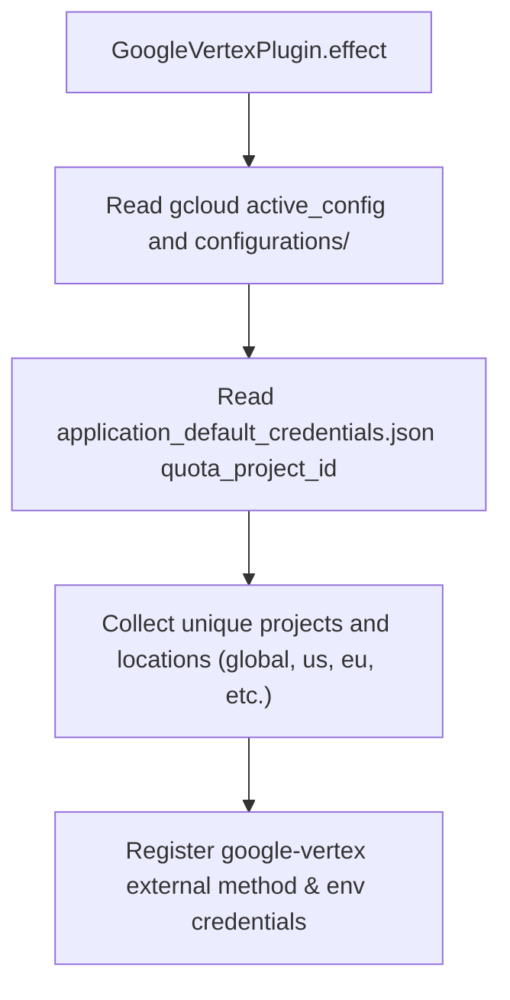

<!-- source: DeepWiki mcp.deepwiki.com · repo anomalyco/opencode · page 3.2 Provider Plugins & Authentication · fetched 2026-10-27 -->

# Provider Plugins & Authentication

<details>
<summary>Relevant source files</summary>

The following files were used as context for generating this wiki page:

- [packages/ai/src/protocols/utils/bedrock-auth.ts](packages/ai/src/protocols/utils/bedrock-auth.ts)
- [packages/ai/src/providers/google-vertex-shared.ts](packages/ai/src/providers/google-vertex-shared.ts)
- [packages/ai/test/lib/env.ts](packages/ai/test/lib/env.ts)
- [packages/core/src/config/plugin/provider.ts](packages/core/src/config/plugin/provider.ts)
- [packages/core/src/github-copilot/models.ts](packages/core/src/github-copilot/models.ts)
- [packages/core/src/model.ts](packages/core/src/model.ts)
- [packages/core/src/models-dev.ts](packages/core/src/models-dev.ts)
- [packages/core/src/plugin/models-dev.ts](packages/core/src/plugin/models-dev.ts)
- [packages/core/src/plugin/provider.ts](packages/core/src/plugin/provider.ts)
- [packages/core/src/plugin/provider/amazon-bedrock.ts](packages/core/src/plugin/provider/amazon-bedrock.ts)
- [packages/core/src/plugin/provider/azure.ts](packages/core/src/plugin/provider/azure.ts)
- [packages/core/src/plugin/provider/cloudflare-ai-gateway.ts](packages/core/src/plugin/provider/cloudflare-ai-gateway.ts)
- [packages/core/src/plugin/provider/cloudflare-workers-ai.ts](packages/core/src/plugin/provider/cloudflare-workers-ai.ts)
- [packages/core/src/plugin/provider/databricks.ts](packages/core/src/plugin/provider/databricks.ts)
- [packages/core/src/plugin/provider/github-copilot.ts](packages/core/src/plugin/provider/github-copilot.ts)
- [packages/core/src/plugin/provider/google-vertex.ts](packages/core/src/plugin/provider/google-vertex.ts)
- [packages/core/src/plugin/provider/nvidia.ts](packages/core/src/plugin/provider/nvidia.ts)
- [packages/core/src/plugin/provider/opencode.ts](packages/core/src/plugin/provider/opencode.ts)
- [packages/core/src/plugin/provider/snowflake-cortex.ts](packages/core/src/plugin/provider/snowflake-cortex.ts)
- [packages/core/test/catalog.test.ts](packages/core/test/catalog.test.ts)
- [packages/core/test/config/provider.test.ts](packages/core/test/config/provider.test.ts)
- [packages/core/test/github-copilot/models.test.ts](packages/core/test/github-copilot/models.test.ts)
- [packages/core/test/models.test.ts](packages/core/test/models.test.ts)
- [packages/core/test/plugin/fixtures/models-dev.json](packages/core/test/plugin/fixtures/models-dev.json)
- [packages/core/test/plugin/models-dev.test.ts](packages/core/test/plugin/models-dev.test.ts)
- [packages/core/test/plugin/provider-amazon-bedrock.test.ts](packages/core/test/plugin/provider-amazon-bedrock.test.ts)
- [packages/core/test/plugin/provider-azure.test.ts](packages/core/test/plugin/provider-azure.test.ts)
- [packages/core/test/plugin/provider-cerebras.test.ts](packages/core/test/plugin/provider-cerebras.test.ts)
- [packages/core/test/plugin/provider-cloudflare-ai-gateway.test.ts](packages/core/test/plugin/provider-cloudflare-ai-gateway.test.ts)
- [packages/core/test/plugin/provider-cloudflare-workers-ai.test.ts](packages/core/test/plugin/provider-cloudflare-workers-ai.test.ts)
- [packages/core/test/plugin/provider-factory.test.ts](packages/core/test/plugin/provider-factory.test.ts)
- [packages/core/test/plugin/provider-github-copilot.test.ts](packages/core/test/plugin/provider-github-copilot.test.ts)
- [packages/core/test/plugin/provider-google-vertex.test.ts](packages/core/test/plugin/provider-google-vertex.test.ts)
- [packages/core/test/plugin/provider-kilo.test.ts](packages/core/test/plugin/provider-kilo.test.ts)
- [packages/core/test/plugin/provider-llmgateway.test.ts](packages/core/test/plugin/provider-llmgateway.test.ts)
- [packages/core/test/plugin/provider-nvidia.test.ts](packages/core/test/plugin/provider-nvidia.test.ts)
- [packages/core/test/plugin/provider-opencode.test.ts](packages/core/test/plugin/provider-opencode.test.ts)
- [packages/core/test/plugin/provider-openrouter.test.ts](packages/core/test/plugin/provider-openrouter.test.ts)
- [packages/core/test/plugin/provider-snowflake-cortex.test.ts](packages/core/test/plugin/provider-snowflake-cortex.test.ts)
- [packages/core/test/plugin/provider-vercel.test.ts](packages/core/test/plugin/provider-vercel.test.ts)
- [packages/core/test/plugin/provider-zenmux.test.ts](packages/core/test/plugin/provider-zenmux.test.ts)
- [packages/schema/src/config/provider.ts](packages/schema/src/config/provider.ts)
- [packages/schema/src/model.ts](packages/schema/src/model.ts)
- [packages/schema/src/provider.ts](packages/schema/src/provider.ts)
- [packages/schema/test/model.test.ts](packages/schema/test/model.test.ts)
- [services/www/src/docs/content/providers.mdx](services/www/src/docs/content/providers.mdx)

</details>


This page details the implementation of core provider plugins located under `packages/core/src/plugin/provider/*` [packages/core/src/plugin/provider.ts:1-68]() and the associated authentication flows, including OAuth2 Device Authorization Grants, PKCE variants, cloud platform credential lookups (Azure CLI and Google Application Default Credentials), and API key integrations.

---

## 1. Provider Plugin Architecture & Registry

OpenCode provider plugins bridge the general provider abstraction layer with specific remote APIs, handle credential provisioning, and register integration methods (OAuth, API keys, or external credentials) into the core plugin host supervisor.

The central registry for all built-in provider plugins is compiled into `ProviderPlugins`, an array of `PluginInternal.InternalPlugin` definitions [packages/core/src/plugin/provider.ts:35-68](). Each plugin utilizes the Effect-based plugin definition helper `define()` provided by `@opencode/plugin/effect/plugin` [packages/core/src/plugin/provider/opencode.ts:3-3]().


*Sources: [packages/core/src/plugin/provider.ts:35-68](), [packages/core/src/plugin/provider/opencode.ts:3-3](), [packages/core/src/plugin/models-dev.ts:33-81]()*

---

## 2. OAuth & Device Authorization Flows

Several providers use OAuth2 Device Code flows to authenticate users without exposing credentials directly or requiring browser callbacks inside the CLI daemon directly.

### OpenCode Console Device Flow (`OpencodePlugin`)
The OpenCode Console integration (`opencode`) uses a device code grant [packages/core/src/plugin/provider/opencode.ts:101-142]().

1.  **Authorization Initialization**: `authorize` issues a POST request to `${server}/auth/device/code` with `client_id` (`opencode-cli`) and `supports_org_scope: true` [packages/core/src/plugin/provider/opencode.ts:121-126]().
2.  **Polling Callback**: Returns an auto mode payload containing verification URIs, user codes, and a `poll` callback function running against `${server}/auth/device/token` [packages/core/src/plugin/provider/opencode.ts:136-141]().


*Sources: [packages/core/src/plugin/provider/opencode.ts:101-160]*

### GitHub Copilot Device Flow (`GithubCopilotPlugin`)
GitHub Copilot implements a specialized device authorization flow targeting GitHub endpoints or GitHub Enterprise instances [packages/core/src/plugin/provider/github-copilot.ts:47-156]().

*   **Client ID**: Uses a static client ID `Ov23li8tweQw6odWQebz` [packages/core/src/plugin/provider/github-copilot.ts:17-17]().
*   **Entitlement Verification**: Upon acquiring an access token, the plugin queries `/copilot_internal/user` to verify that the user has an active chat entitlement (`chat_enabled`), raising an error if subscription or seat limits are violated [packages/core/src/plugin/provider/github-copilot.ts:103-120]().


*Sources: [packages/core/src/plugin/provider/github-copilot.ts:47-156]*

---

## 3. Cloud Platform Integrations (Azure & Google Vertex)

Cloud providers require dynamic discovery of infrastructure parameters (resource names, model deployments, and project IDs) rather than static configuration files.

### Azure CLI & Resource Discovery (`AzurePlugin`)
The Azure plugin (`AzurePlugin`) integrates with the `az` command-line utility to fetch short-lived OAuth bearer tokens and list available OpenAI deployments [packages/core/src/plugin/provider/azure.ts:70-132]().

*   **Token Acquisition**: Executes `az account get-access-token` for scopes such as `https://cognitiveservices.azure.com/.default` or `https://management.azure.com/.default` [packages/core/src/plugin/provider/azure.ts:106-119]().
*   **Deployment Discovery**: Queries Azure Resource Graph or management APIs to enumerate available cognitive services resources and model deployments [packages/core/src/plugin/provider/azure.ts:68-96]().


*Sources: [packages/core/src/plugin/provider/azure.ts:70-132]()*

### Google Vertex ADC (`GoogleVertexPlugin`)
Google Vertex integration resolves projects, regions, and Application Default Credentials (ADC) without requiring explicit API keys [packages/core/src/plugin/provider/google-vertex.ts:52-110]().

*   **Configuration Discovery**: Scans local `gcloud` configuration directories (`$CLOUDSDK_CONFIG` or platform-specific defaults) for active configurations (`active_config`) and parses quota project IDs from `application_default_credentials.json` [packages/core/src/plugin/provider/google-vertex.ts:60-88]().
*   **Endpoint Templating**: Resolves OpenAI-compatible endpoint variables like `${GOOGLE_VERTEX_PROJECT}` and `${GOOGLE_VERTEX_LOCATION}` dynamically at runtime [packages/core/src/plugin/provider/google-vertex.ts:43-50]().


*Sources: [packages/core/src/plugin/provider/google-vertex.ts:52-110]*

---

## 4. Model Catalog Integration (`ModelsDevPlugin`)

The `ModelsDevPlugin` is responsible for loading and integrating the `models.dev` snapshot into the core `Provider` and `Integration` services. This plugin ensures that the application has an up-to-date catalog of supported models and their associated providers and environment variables.

The plugin performs the following key actions:
1.  **Snapshot Loading**: Retrieves the `models.dev` snapshot via `ModelsDev.Service.get()` [packages/core/src/plugin/models-dev.ts:36-36]().
2.  **Integration Registration**: Iterates through the loaded providers and registers environment variable-based authentication methods (`type: "env"`) for each provider that specifies environment variables [packages/core/src/plugin/models-dev.ts:41-57]().
3.  **Provider and Model Registration**: Adds each provider and its associated models from the snapshot to the `Provider.Service` [packages/core/src/plugin/models-dev.ts:59-66]().
4.  **Dynamic Updates**: Subscribes to `ModelsDev.Event.Refreshed` events on the `Bus.Service` to automatically update the provider and integration registries when the `models.dev` catalog is refreshed [packages/core/src/plugin/models-dev.ts:68-75]().
5.  **Snapshot Filtering**: Filters out deprecated providers (e.g., `azure-cognitive-services`, `google-vertex-anthropic`) and models based on their status and capabilities (e.g., `BEDROCK_PROFILE_ONLY_IDS`) [packages/core/src/plugin/models-dev.ts:90-105]().

```mermaid
graph TD
    A[ModelsDevPlugin.effect] --> B{ModelsDev.Service.get()}
    B --> C{Filter Snapshots}
    C --> D[ctx.integration.transform]
    D --> E[Register Env Methods]
    C --> F[ctx.provider.transform]
    F --> G[Add Providers & Models]
    A --> H[Bus.subscribe(ModelsDev.Event.Refreshed)]
    H --> I[Stream.runForEach(modelsDev.get() -> apply)]
    I --> D
    I --> F
```
*Sources: [packages/core/src/plugin/models-dev.ts:33-81](), [packages/core/src/models-dev.ts:96-129](), [packages/core/test/plugin/models-dev.test.ts:127-160]()*

---

## 5. Specialized & Local Provider Plugins

In addition to cloud and OAuth-backed services, OpenCode supports a broad range of custom, local, and gateway providers:

| Provider Name | File Implementation | Auth Method / Notes |
| :--- | :--- | :--- |
| **OpenAI / ChatGPT Codex** | `packages/core/src/plugin/provider/openai.ts` | API Key (`OPENAI_API_KEY`) or Codex session tokens |
| **xAI** | `packages/core/src/plugin/provider/xai.ts` | API Key (`XAI_API_KEY`) |
| **LLM Gateway** | `packages/core/src/plugin/provider/llmgateway.ts` | Gateway token / Headers forwarding |
| **Ollama / Local** | `packages/core/src/plugin/provider/ollama.ts` | Local HTTP binding (no auth required by default) |
| **OpenRouter** | `packages/core/src/plugin/provider/openrouter.ts` | API Key (`OPENROUTER_API_KEY`) |
| **Amazon Bedrock** | `packages/core/src/plugin/provider/amazon-bedrock.ts` | AWS credentials (env vars, shared config, IAM roles) |
| **Cloudflare AI Gateway** | `packages/core/src/plugin/provider/cloudflare-ai-gateway.ts` | API Key (`CLOUDFLARE_AI_GATEWAY_API_KEY`) |
| **Cloudflare Workers AI** | `packages/core/src/plugin/provider/cloudflare-workers-ai.ts` | API Key (`CLOUDFLARE_WORKERS_AI_API_KEY`) |
| **Databricks** | `packages/core/src/plugin/provider/databricks.ts` | API Key (`DATABRICKS_API_KEY`) |
| **NVIDIA** | `packages/core/src/plugin/provider/nvidia.ts` | API Key (`NVIDIA_API_KEY`) |
| **Snowflake Cortex** | `packages/core/src/plugin/provider/snowflake-cortex.ts` | API Key (`SNOWFLAKE_CORTEX_API_KEY`) |

*Sources: [packages/core/src/plugin/provider.ts:35-68](), [packages/core/src/plugin/provider/amazon-bedrock.ts](), [packages/core/src/plugin/provider/cloudflare-ai-gateway.ts](), [packages/core/src/plugin/provider/cloudflare-workers-ai.ts](), [packages/core/src/plugin/provider/databricks.ts](), [packages/core/src/plugin/provider/nvidia.ts](), [packages/core/src/plugin/provider/snowflake-cortex.ts]()*

---

