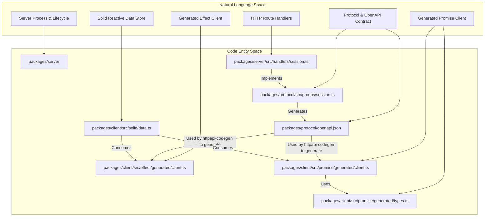

<!-- source: DeepWiki mcp.deepwiki.com · repo anomalyco/opencode · page 4 Server, Protocol & Clients · fetched 2026-10-27 -->

# Server, Protocol & Clients

<details>
<summary>Relevant source files</summary>

The following files were used as context for generating this wiki page:

- [V2_HTTP_API_AUDIT.md](V2_HTTP_API_AUDIT.md)
- [packages/client/src/effect/api/api.ts](packages/client/src/effect/api/api.ts)
- [packages/client/src/effect/generated/client.ts](packages/client/src/effect/generated/client.ts)
- [packages/client/src/promise/generated/client.ts](packages/client/src/promise/generated/client.ts)
- [packages/client/src/promise/generated/types.ts](packages/client/src/promise/generated/types.ts)
- [packages/client/src/solid/data.ts](packages/client/src/solid/data.ts)
- [packages/client/test/effect.test.ts](packages/client/test/effect.test.ts)
- [packages/client/test/promise.test.ts](packages/client/test/promise.test.ts)
- [packages/client/test/solid-data.test.ts](packages/client/test/solid-data.test.ts)
- [packages/core/src/session.ts](packages/core/src/session.ts)
- [packages/core/src/session/message-updater.ts](packages/core/src/session/message-updater.ts)
- [packages/core/src/session/projector.ts](packages/core/src/session/projector.ts)
- [packages/core/test/session-create.test.ts](packages/core/test/session-create.test.ts)
- [packages/core/test/session-projector.test.ts](packages/core/test/session-projector.test.ts)
- [packages/core/test/session-prompt.test.ts](packages/core/test/session-prompt.test.ts)
- [packages/protocol/openapi.json](packages/protocol/openapi.json)
- [packages/protocol/src/groups/session.ts](packages/protocol/src/groups/session.ts)
- [packages/schema/src/session-event.ts](packages/schema/src/session-event.ts)
- [packages/schema/src/session-message.ts](packages/schema/src/session-message.ts)
- [packages/schema/test/event-manifest.test.ts](packages/schema/test/event-manifest.test.ts)
- [packages/server/src/handlers/session.ts](packages/server/src/handlers/session.ts)
- [services/www/openapi.json](services/www/openapi.json)
- [services/www/public/openapi.json](services/www/public/openapi.json)
- [services/www/src/docs/content/models.mdx](services/www/src/docs/content/models.mdx)

</details>


## Purpose and Scope

This page provides a high-level overview of OpenCode's networking, API contract generation, and client SDK architecture. The server layer (`packages/server`) exposes an Effect-based `HttpApi` surface [packages/client/src/effect/api/api.ts:1-46](), managing session lifecycles, filesystem operations, projects, plugins, and PTY terminals with Server-Sent Events (SSE) streaming. The protocol layer (`packages/protocol`) defines canonical Effect HTTP API groups and generates OpenAPI specifications (`openapi.json`) [packages/protocol/openapi.json:1-50]() used by code generation tools (`httpapi-codegen`) to produce type-safe client libraries in `packages/client` and public JavaScript SDKs in `packages/sdk`.

As a PARENT page, this document summarizes the top-level architecture. For detailed technical information, refer to the child pages:
- [packages/server](#4.1) — Server process lifecycle, routes and handlers, transport modes, and SSE event streaming.
- [Protocol & OpenAPI Contract](#4.2) — Effect HttpApi groups, openapi.json generation, and schema package canonical types.
- [Client Libraries & SDK](#4.3) — Effect and promise generated clients, solid reactive data stores, and public JavaScript SDKs.

Sources: [packages/client/src/effect/api/api.ts:1-46](), [packages/protocol/openapi.json:1-50]()

---

## 4.1 packages/server

The `packages/server` package implements the core server process lifecycle, HTTP route handlers, and transport modes. It uses Effect's HTTP server capabilities to bind TCP sockets or provide in-process handlers. Route groups cover sessions, filesystem access, projects, plugins, integrations, and PTY terminals [packages/client/src/effect/api/api.ts:46-245](). It also supports real-time event distribution via Server-Sent Events (SSE) [packages/client/src/effect/generated/client.ts:195-197]().

The `SessionHandler` [packages/server/src/handlers/session.ts:32-55]() is a key component, managing session-related operations such as listing, creating, importing, exporting, and modifying sessions. It handles various session states and errors, including `Session.BusyError` [packages/server/src/handlers/session.ts:43-46]() and `Session.InboxConflictError` [packages/server/src/handlers/session.ts:48-52]().

For deep technical details on route handlers, middleware pipelines, and transport options, see [packages/server](#4.1).

Sources: [packages/client/src/effect/api/api.ts:46-245](), [packages/client/src/effect/generated/client.ts:195-197](), [packages/server/src/handlers/session.ts:32-55](), [packages/server/src/handlers/session.ts:43-46](), [packages/server/src/handlers/session.ts:48-52]()

---

## 4.2 Protocol & OpenAPI Contract

The `packages/protocol` package defines the canonical API surface using Effect `HttpApi` groups [packages/client/src/effect/api/api.ts:1-45](). It acts as the single source of truth for request/response schemas, bridging the Effect core runtime with external consumers. The protocol definition compiles down to standard OpenAPI v3 specifications (`openapi.json`) [packages/protocol/openapi.json:1-10]() through code generation utilities (`httpapi-codegen`), ensuring strict type alignment across the stack alongside canonical types defined in the `schema` package.

The `openapi.json` file [packages/protocol/openapi.json:1-226]() details all available API endpoints, their parameters, and expected responses, including error types like `InvalidRequestError` and `UnauthorizedError`. For example, the `/api/info` endpoint [packages/protocol/openapi.json:9-49]() provides server identity and status, while `/api/pair` [packages/protocol/openapi.json:51-91]() and `/auth/connect/{code}` [packages/protocol/openapi.json:93-142]() handle client pairing. The `makeSessionGroup` function [packages/protocol/src/groups/session.ts:101-112]() defines the API endpoints related to session management, such as `session.list` [packages/protocol/src/groups/session.ts:103-120]() and `session.create` [packages/protocol/src/groups/session.ts:142-162]().

For details on API group definitions, event manifests, and openapi generation, see [Protocol & OpenAPI Contract](#4.2).

Sources: [packages/client/src/effect/api/api.ts:1-45](), [packages/protocol/openapi.json:1-10](), [packages/protocol/openapi.json:1-226](), [packages/protocol/openapi.json:9-49](), [packages/protocol/openapi.json:51-91](), [packages/protocol/openapi.json:93-142](), [packages/protocol/src/groups/session.ts:101-112](), [packages/protocol/src/groups/session.ts:103-120](), [packages/protocol/src/groups/session.ts:142-162]()

---

## 4.3 Client Libraries & SDK

The `packages/client` package provides generated Effect-based and Promise-based clients (`packages/client/src/promise/generated/client.ts`, `packages/client/src/effect/generated/client.ts`) [packages/client/src/promise/generated/client.ts:1-252](), as well as reactive data stores for SolidJS frontends. It handles service discovery, connection probing, and automatic reconnection. Additionally, `packages/sdk` exposes public JavaScript SDK bindings for external integrations.

The generated client types, such as `ServerInfo`, `PairingCode`, and `SessionID`, are defined in `packages/client/src/promise/generated/types.ts` [packages/client/src/promise/generated/types.ts:3-43](). The `createData` function in `packages/client/src/solid/data.ts` [packages/client/src/solid/data.ts:64-81]() is responsible for initializing the Solid data layer, connecting to the `OpenCodeClient` and handling server events. This data layer manages the state of sessions, projects, and locations, including message history, pending actions, and permissions [packages/client/src/solid/data.ts:113-134]().

For details on client generation, reactive stores, and SDK usage, see [Client Libraries & SDK](#4.3).

Sources: [packages/client/src/promise/generated/client.ts:1-252](), [packages/client/src/effect/generated/client.ts:1-5](), [packages/client/src/promise/generated/types.ts:3-43](), [packages/client/src/solid/data.ts:64-81](), [packages/client/src/solid/data.ts:113-134]()

---

## Architecture and Entity Mapping

To bridge natural language concepts to the underlying codebase entities across the server, protocol, and client tiers, the following diagram illustrates the relationship between architectural components and their corresponding code symbols.

### Server Protocol and Client Code Entity Mapping

Sources: [packages/client/src/effect/api/api.ts:1-66](), [packages/protocol/openapi.json:1-15](), [packages/client/src/effect/generated/client.ts:1-10](), [packages/server/src/handlers/session.ts:1-686](), [packages/protocol/src/groups/session.ts:1-830](), [packages/client/src/promise/generated/client.ts:1-2345](), [packages/client/src/promise/generated/types.ts:1-6949](), [packages/client/src/solid/data.ts:1-2024]()

### Session Service Interactions
```mermaid
graph TD
    subgraph "Core Runtime"
        SessionService["Session.Service (packages/core/src/session.ts)"]
        SessionProjector["SessionProjector (packages/core/src/session/projector.ts)"]
        SessionStore["SessionStore (packages/core/src/session/store.ts)"]
        SessionExecution["SessionExecution (packages/core/src/session/execution.ts)"]
        SessionInbox["SessionInbox (packages/core/src/session/inbox.ts)"]
    end

    subgraph "Server"
        SessionHandler["SessionHandler (packages/server/src/handlers/session.ts)"]
    end

    subgraph "Protocol"
        SessionHttpApiGroup["makeSessionGroup (packages/protocol/src/groups/session.ts)"]
    end

    subgraph "Client"
        EffectClient["EffectClient (packages/client/src/effect/generated/client.ts)"]
        PromiseClient["PromiseClient (packages/client/src/promise/generated/client.ts)"]
        SolidDataStore["SolidData (packages/client/src/solid/data.ts)"]
    end

    SessionHandler -- "Calls methods on" --> SessionService
    SessionService -- "Uses" --> SessionProjector
    SessionService -- "Uses" --> SessionStore
    SessionService -- "Uses" --> SessionExecution
    SessionService -- "Uses" --> SessionInbox

    SessionHttpApiGroup -- "Defines API for" --> SessionHandler
    EffectClient -- "Invokes" --> SessionHttpApiGroup
    PromiseClient -- "Invokes" --> SessionHttpApiGroup
    SolidDataStore -- "Uses" --> EffectClient
    SolidDataStore -- "Uses" --> PromiseClient

    SessionService -- "create(input)" --> SessionProjector
    SessionService -- "list(input)" --> SessionStore
    SessionService -- "prompt(input)" --> SessionExecution
    SessionService -- "inbox(sessionID)" --> SessionInbox

    SessionHandler -- "session.list" --> SessionService.list[packages/server/src/handlers/session.ts:58-70]()
    SessionHandler -- "session.create" --> SessionService.create[packages/server/src/handlers/session.ts:93-108]()
    SessionHandler -- "session.get" --> SessionService.get[packages/server/src/handlers/session.ts:158-164]()
    SessionHandler -- "session.remove" --> SessionService.remove[packages/server/src/handlers/session.ts:177-180]()
    SessionHandler -- "session.view" --> SessionService.view[packages/server/src/handlers/session.ts:168-174]()
```
Sources: [packages/core/src/session.ts:1-171](), [packages/core/src/session/projector.ts:1-197](), [packages/server/src/handlers/session.ts:1-183](), [packages/protocol/src/groups/session.ts:1-169](), [packages/client/src/effect/generated/client.ts:1-245](), [packages/client/src/promise/generated/client.ts:1-251](), [packages/client/src/solid/data.ts:1-179]()

---

