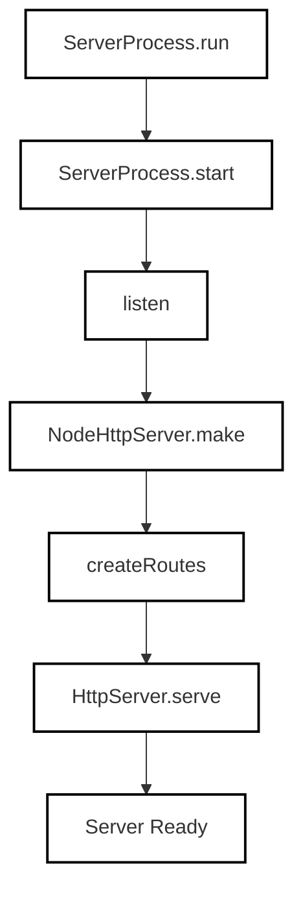
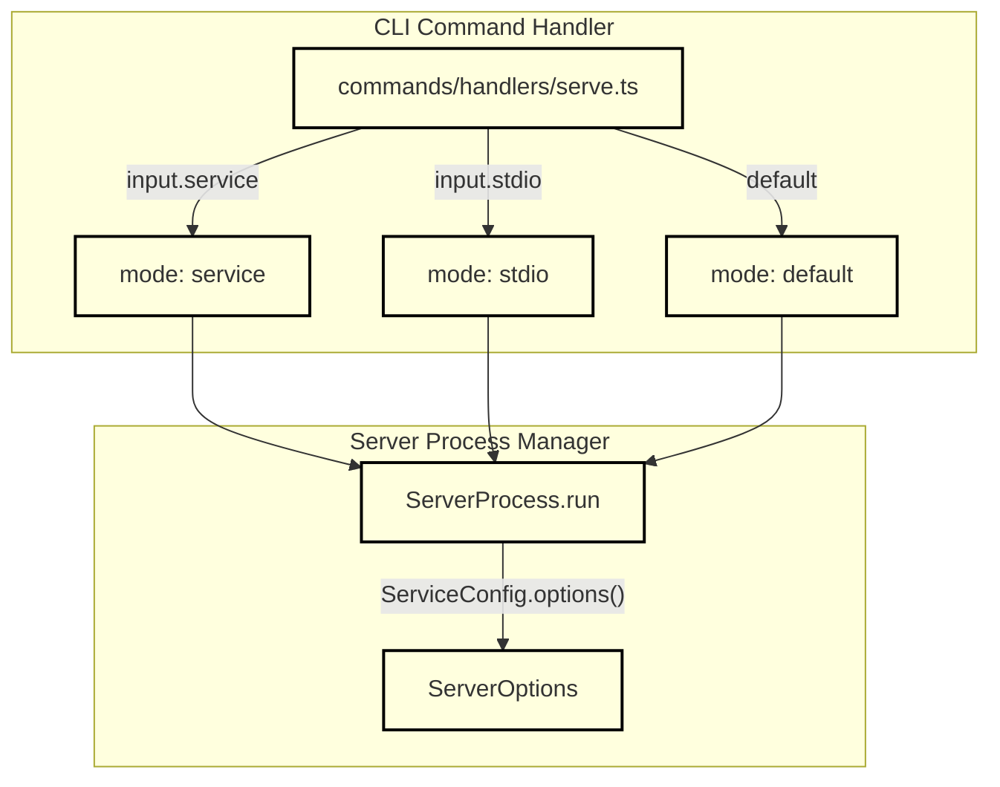
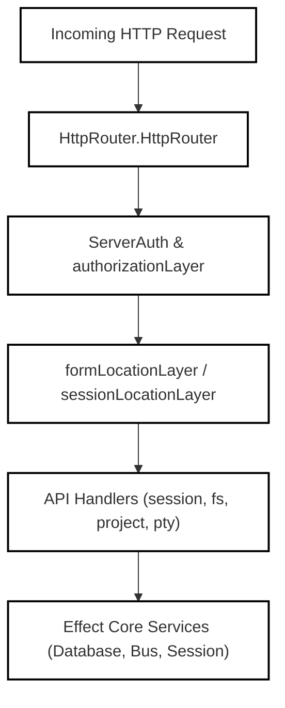

<!-- source: DeepWiki mcp.deepwiki.com · repo anomalyco/opencode · page 4.1 packages/server · fetched 2026-10-27 -->

# packages/server

Relevant source files

The following files were used as context for generating this wiki page:

- [packages/cli/script/app-assets.ts](packages/cli/script/app-assets.ts)
- [packages/cli/script/build-node.ts](packages/cli/script/build-node.ts)
- [packages/cli/script/build.ts](packages/cli/script/build.ts)
- [packages/cli/script/node-assets.ts](packages/cli/script/node-assets.ts)
- [packages/cli/script/service-smoke.ts](packages/cli/script/service-smoke.ts)
- [packages/cli/src/app-archive.ts](packages/cli/src/app-archive.ts)
- [packages/cli/src/app-assets.ts](packages/cli/src/app-assets.ts)
- [packages/cli/src/commands/commands.ts](packages/cli/src/commands/commands.ts)
- [packages/cli/src/commands/handlers/pair.ts](packages/cli/src/commands/handlers/pair.ts)
- [packages/cli/src/commands/handlers/uninstall.ts](packages/cli/src/commands/handlers/uninstall.ts)
- [packages/cli/src/index.ts](packages/cli/src/index.ts)
- [packages/cli/src/server-process.ts](packages/cli/src/server-process.ts)
- [packages/cli/src/services/remote-tunnel.ts](packages/cli/src/services/remote-tunnel.ts)
- [packages/cli/src/services/service-config.ts](packages/cli/src/services/service-config.ts)
- [packages/cli/src/services/web-ui.ts](packages/cli/src/services/web-ui.ts)
- [packages/cli/src/virtual.d.ts](packages/cli/src/virtual.d.ts)
- [packages/cli/test/app-archive.test.ts](packages/cli/test/app-archive.test.ts)
- [packages/cli/test/service.test.ts](packages/cli/test/service.test.ts)
- [packages/cli/test/web-ui.test.ts](packages/cli/test/web-ui.test.ts)
- [packages/cli/vite.node.config.ts](packages/cli/vite.node.config.ts)
- [packages/core/src/config/variable.ts](packages/core/src/config/variable.ts)
- [packages/core/src/filesystem/watcher-binding.ts](packages/core/src/filesystem/watcher-binding.ts)
- [packages/core/src/location-services.ts](packages/core/src/location-services.ts)
- [packages/core/src/plugin/internal.ts](packages/core/src/plugin/internal.ts)
- [packages/core/src/plugin/sdk.ts](packages/core/src/plugin/sdk.ts)
- [packages/core/src/plugin/supervisor.ts](packages/core/src/plugin/supervisor.ts)
- [packages/core/src/session/move.ts](packages/core/src/session/move.ts)
- [packages/core/src/shell/parser-wasm.bun.ts](packages/core/src/shell/parser-wasm.bun.ts)
- [packages/core/src/shell/parser-wasm.node.ts](packages/core/src/shell/parser-wasm.node.ts)
- [packages/core/test/fixture/tmpdir.ts](packages/core/test/fixture/tmpdir.ts)
- [packages/core/test/location-layer.test.ts](packages/core/test/location-layer.test.ts)
- [packages/core/test/plugin/supervisor-reload.test.ts](packages/core/test/plugin/supervisor-reload.test.ts)
- [packages/core/test/plugin/supervisor.test.ts](packages/core/test/plugin/supervisor.test.ts)
- [packages/core/test/session-move.test.ts](packages/core/test/session-move.test.ts)
- [packages/core/test/session-remove.test.ts](packages/core/test/session-remove.test.ts)
- [packages/core/test/session-revert.test.ts](packages/core/test/session-revert.test.ts)
- [packages/protocol/src/api.ts](packages/protocol/src/api.ts)
- [packages/protocol/src/client.ts](packages/protocol/src/client.ts)
- [packages/server/src/handlers.ts](packages/server/src/handlers.ts)
- [packages/server/src/options.ts](packages/server/src/options.ts)
- [packages/server/src/process.ts](packages/server/src/process.ts)
- [packages/server/src/routes.ts](packages/server/src/routes.ts)
- [packages/server/test/options.test.ts](packages/server/test/options.test.ts)
- [packages/server/test/process.test.ts](packages/server/test/process.test.ts)
- [packages/server/test/session-instances.test.ts](packages/server/test/session-instances.test.ts)
- [script/native-arch.ts](script/native-arch.ts)
- [services/www/src/docs/content/agents.mdx](services/www/src/docs/content/agents.mdx)
- [services/www/src/docs/content/attachments.mdx](services/www/src/docs/content/attachments.mdx)
- [services/www/src/docs/content/cli/commands.mdx](services/www/src/docs/content/cli/commands.mdx)
- [services/www/src/docs/content/cli/index.mdx](services/www/src/docs/content/cli/index.mdx)
- [services/www/src/docs/content/cli/theme.mdx](services/www/src/docs/content/cli/theme.mdx)
- [services/www/src/docs/content/cli/web.mdx](services/www/src/docs/content/cli/web.mdx)
- [services/www/src/docs/content/commands.mdx](services/www/src/docs/content/commands.mdx)
- [services/www/src/docs/content/index.mdx](services/www/src/docs/content/index.mdx)
- [services/www/src/docs/content/themes.mdx](services/www/src/docs/content/themes.mdx)

## Purpose and Scope

`packages/server` implements the HTTP server daemon, Effect HTTP API routes, middleware, and request handlers for OpenCode. It manages the server process lifecycle, configures transport modes (standalone, background service, or `stdio`), builds the Effect dependency graph for core services (database, bus, sessions, filesystem, projects), and streams real-time events via Server-Sent Events (SSE).

Sources: `packages/server/src/process.ts:47-140`(), `packages/server/src/routes.ts:81-115`()

---

## Server Process Lifecycle & Initialization

The server process is launched either via the CLI `serve` command or embedded within GUI desktop apps. The entry point for starting the HTTP listener is `ServerProcess.start` defined in `packages/server/src/process.ts:47-140`().

When invoked, the process follows this sequence:
1. Validates authentication parameters (`password`) [packages/server/src/process.ts:53-54]().
2. Resolves or binds the hostname and port using `listen` [packages/server/src/process.ts:59]().
3. Sets up HTTP middleware (compression, CORS via `isAllowedCorsOrigin`, and error logging via `errorResponseLogger`) [packages/server/src/process.ts:72-76]().
4. Builds the Effect layer graph containing application services (`createRoutes`) [packages/server/src/routes.ts:81-94]() and merges it with `NodeHttpServer.layerHttpServices` [packages/server/src/process.ts:97-104]().
5. Exposes lifecycle hooks (`onListen`) and handles graceful shutdown procedures through process scope management [packages/server/src/process.ts:79-94]().

Sources: `packages/server/src/process.ts:47-140`(), `packages/cli/src/server-process.ts:32-45`()

---

## Options and Transport Modes

The server supports multiple runtime transport modes controlled through CLI flags and configuration structures (`ServerOptions`):
- **`default` (Standalone)**: Runs a private foreground server instance.
- **`service` (Background Service)**: Runs as a managed background daemon, registering its listening endpoint and reading service configurations via `ServiceConfig` [packages/cli/src/server-process.ts:65-68]().
- **`stdio`**: Communicates over standard input/output streams, clearing sensitive credentials from inherited tool environments [packages/cli/src/server-process.ts:80-83]().

Sources: `packages/cli/src/commands/handlers/serve.ts:6-17`(), `packages/cli/src/server-process.ts:22-30`(), `packages/server/src/options.ts`()

---

## Routes, API Grouping and Middleware

Routing is defined via Effect `HttpApiBuilder` and `HttpRouter` groups. `createRoutes` (`packages/server/src/routes.ts:81`) builds the core application service layer graph, injecting requirements such as `Database.node`, `Bus.node`, `Project.node`, `Session.node`, `FileSystemSearch.node`, and `PersistentPty.node` [packages/server/src/routes.ts:52-78]().

Middleware layers applied to the route handlers include:
- **`ServerAuth`**: Enforces password or token-based authentication [packages/server/src/routes.ts:87-89]().
- **`authorizationLayer`**: Validates request permissions [packages/server/src/routes.ts:42]().
- **`schemaErrorLayer`**: Standardizes decoding and validation error responses [packages/server/src/routes.ts:43]().
- **`formLocationLayer` / `sessionLocationLayer`**: Resolves execution context based on project locations or session IDs [packages/server/src/routes.ts:47-48]().

Sources: `packages/server/src/routes.ts:35-79`(), `packages/server/src/routes.ts:81-115`()

---

## Handlers and Domain Integrations

The server maps protocol operations to concrete core service implementations across several domain handlers:
- **Session Handlers**: Manage conversation lifecycles, message submission, inbox queues, and state projects.
- **Filesystem Handlers (`handlers/fs.ts`)**: Expose file read, write, list, glob, and grep operations backed by `FileSystem.Service` and ripgrep integration.
- **Project Handlers (`handlers/project.ts`)**: Handle workspace resolution, project discovery, activity tracking, and recency sorting via `Project.Service`.
- **Plugin & Integration Handlers**: Handle loading of npm/local plugins and credential/OAuth integrations. The `PluginSupervisor` [packages/core/src/plugin/supervisor.ts:124-162]() manages the lifecycle of plugins, including resolving, loading, and activating them based on configuration and operations. It combines internal plugins, SDK plugins, and instance-bound plugins, handling duplicates and failures.
- **PTY Handlers**: Manage interactive terminal processes and persistent terminal tickets via `PersistentPty` and `PtyTicket`.

Sources: `packages/server/src/routes.ts:18-34`(), `packages/server/src/handlers/project.ts`(), `packages/server/src/handlers/fs.ts`(), `packages/core/src/plugin/supervisor.ts:124-162`()

---

## SSE Event Streaming

Real-time client synchronization relies on Server-Sent Events (SSE) powered by the core event bus (`Bus.Service`) [packages/server/src/routes.ts:55](). Domain events (such as session updates, project changes, and installation notifications) are published to the bus and streamed to connected HTTP clients over long-lived SSE connections, allowing UI clients to maintain reactive state synchronicity without polling.

Sources: `packages/server/src/routes.ts:55`(), `packages/core/src/bus.ts`()

---

