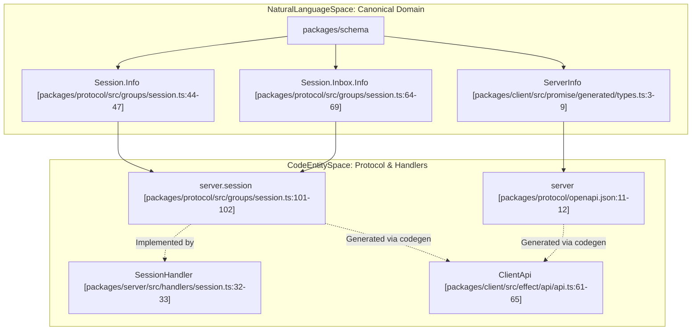
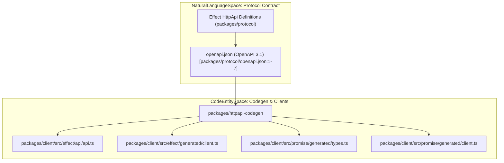

<!-- source: DeepWiki mcp.deepwiki.com · repo anomalyco/opencode · page 4.2 Protocol & OpenAPI Contract · fetched 2026-10-27 -->

# Protocol & OpenAPI Contract

<details>
<summary>Relevant source files</summary>

The following files were used as context for generating this wiki page:

- [V2_HTTP_API_AUDIT.md](V2_HTTP_API_AUDIT.md)
- [packages/client/script/build.ts](packages/client/script/build.ts)
- [packages/client/src/contract.ts](packages/client/src/contract.ts)
- [packages/client/src/effect/api/api.ts](packages/client/src/effect/api/api.ts)
- [packages/client/src/effect/generated/client.ts](packages/client/src/effect/generated/client.ts)
- [packages/client/src/promise/generated/client.ts](packages/client/src/promise/generated/client.ts)
- [packages/client/src/promise/generated/types.ts](packages/client/src/promise/generated/types.ts)
- [packages/client/src/solid/data.ts](packages/client/src/solid/data.ts)
- [packages/client/test/contract-identity.test.ts](packages/client/test/contract-identity.test.ts)
- [packages/client/test/effect.test.ts](packages/client/test/effect.test.ts)
- [packages/client/test/promise.test.ts](packages/client/test/promise.test.ts)
- [packages/client/test/solid-data.test.ts](packages/client/test/solid-data.test.ts)
- [packages/core/src/session.ts](packages/core/src/session.ts)
- [packages/core/src/session/message-updater.ts](packages/core/src/session/message-updater.ts)
- [packages/core/src/session/projector.ts](packages/core/src/session/projector.ts)
- [packages/core/test/session-create.test.ts](packages/core/test/session-create.test.ts)
- [packages/core/test/session-projector.test.ts](packages/core/test/session-projector.test.ts)
- [packages/core/test/session-prompt.test.ts](packages/core/test/session-prompt.test.ts)
- [packages/httpapi-codegen/src/index.ts](packages/httpapi-codegen/src/index.ts)
- [packages/httpapi-codegen/test/generate.test.ts](packages/httpapi-codegen/test/generate.test.ts)
- [packages/protocol/openapi.json](packages/protocol/openapi.json)
- [packages/protocol/src/groups/session.ts](packages/protocol/src/groups/session.ts)
- [packages/protocol/test/session-cursor.test.ts](packages/protocol/test/session-cursor.test.ts)
- [packages/schema/src/session-event.ts](packages/schema/src/session-event.ts)
- [packages/schema/src/session-message.ts](packages/schema/src/session-message.ts)
- [packages/schema/test/contract-hygiene.test.ts](packages/schema/test/contract-hygiene.test.ts)
- [packages/schema/test/event-manifest.test.ts](packages/schema/test/event-manifest.test.ts)
- [packages/schema/test/session-cursor.test.ts](packages/schema/test/session-cursor.test.ts)
- [packages/server/src/handlers/session.ts](packages/server/src/handlers/session.ts)
- [services/www/openapi.json](services/www/openapi.json)
- [services/www/public/openapi.json](services/www/public/openapi.json)
- [services/www/src/docs/content/models.mdx](services/www/src/docs/content/models.mdx)

</details>


## Purpose and Scope
This document covers the technical architecture of OpenCode's v2 protocol contract layer, focusing on `packages/protocol` (Effect HttpApi groups), OpenAPI v3.1 specification generation, `packages/httpapi-codegen` tooling, the canonical data models in `packages/schema`, and event manifests used for real-time synchronization.

---

## 1. Canonical Types & Schema Package (`packages/schema`)
OpenCode adopts a schema-first paradigm where all domain data structures are defined using **Effect Schema**. These models serve as the single source of truth for runtime validation, serialization, and compile-time static types across both core and protocol packages.

Key aspects of canonical type definitions include:
- **Branded Identifiers**: Strongly typed IDs such as `SessionID`, `SessionMessageID`, `AgentID`, and `ProjectID` prevent accidental mixing of distinct entity references [packages/client/src/promise/generated/types.ts:17-20]().
- **Discriminated Unions**: Complex state representations (e.g., `ProviderCompaction`, `PluginSource`, `IntegrationAttemptStatus`) are modeled as discriminated unions [packages/client/src/promise/generated/types.ts:23-24](), [packages/client/src/promise/generated/types.ts:33-38](), [packages/client/src/promise/generated/types.ts:193-198]().
- **Protocol Interop**: Effect Schema handles decoding from HTTP query parameters (e.g., string-to-number or cursor decoding) and encoding back to wire formats [packages/protocol/src/groups/session.ts:78-82](), [packages/protocol/src/groups/session.ts:89-95]().



Sources:
- [packages/client/src/promise/generated/types.ts:3-9]()
- [packages/client/src/promise/generated/types.ts:17-20]()
- [packages/client/src/promise/generated/types.ts:23-24]()
- [packages/client/src/promise/generated/types.ts:33-38]()
- [packages/client/src/promise/generated/types.ts:193-198]()
- [packages/protocol/src/groups/session.ts:44-47]()
- [packages/protocol/src/groups/session.ts:64-69]()
- [packages/protocol/src/groups/session.ts:78-82]()
- [packages/protocol/src/groups/session.ts:89-95]()
- [packages/protocol/src/groups/session.ts:101-102]()
- [packages/protocol/openapi.json:11-12]()
- [packages/server/src/handlers/session.ts:32-33]()
- [packages/client/src/effect/api/api.ts:61-65]()

---

## 2. Effect HttpApi Groups (`packages/protocol`)
The `packages/protocol` package defines the complete RESTful and streaming API surface using **Effect HttpApi**. Endpoints are assembled into functional groups (e.g., `server.session`, `server`, `location`, `plugin`).

### Session Group Endpoint Definition
The `server.session` group (`makeSessionGroup`) defines endpoints for listing, creating, importing, exporting, and operating on agent sessions [packages/protocol/src/groups/session.ts:101-102](). Each endpoint specifies query parameter decoding, request payload schemas, and union response types with explicit error channel declarations. For example, the `session.list` endpoint defines its query parameters using `SessionsQuery` and its success response structure including `PublicSessionInfo` and cursor details [packages/protocol/src/groups/session.ts:103-120]().

```typescript
// Example endpoint structure in protocol groups
HttpApiEndpoint.get("session.list", "/api/session", {
  query: SessionsQuery,
  success: Schema.Struct({
    data: Schema.Array(PublicSessionInfo),
    cursor: Schema.Struct({
      previous: Session.ListCursor.pipe(Schema.optional),
      next: Session.ListCursor.pipe(Schema.optional),
    }),
  }).annotate({ identifier: "SessionsResponse" }),
  error: [InvalidCursorError, InvalidRequestError],
})
```

Sources:
- [packages/protocol/src/groups/session.ts:101-102]()
- [packages/protocol/src/groups/session.ts:103-120]()
- [packages/server/src/handlers/session.ts:58-69]()

---

## 3. OpenAPI Contract & Code Generation (`packages/httpapi-codegen`)
OpenCode avoids manual REST client maintenance by automatically generating both OpenAPI specifications and strongly typed clients directly from the Effect HttpApi definition.

### Generation Pipeline
1. **OpenAPI Spec Emission**: The server compiles the `HttpApi` definitions into an OpenAPI 3.1 contract (`openapi.json`) [packages/protocol/openapi.json:1-7](). This file contains detailed paths, parameters, responses, and schema definitions for all exposed API endpoints [packages/protocol/openapi.json:8-49]().
2. **Client Codegen (`httpapi-codegen`)**: A custom codegen tool consumes `openapi.json` to produce dual client implementations:
   - **Effect Client**: Strongly typed Effect-based API stubs (`packages/client/src/effect/generated/client.ts`) [packages/client/src/effect/generated/client.ts:1-6](). These clients import types from `@opencode/schema` and define operations as `Effect` computations [packages/client/src/effect/api/api.ts:1-44]().
   - **Promise/Async Client**: Standard JavaScript/TypeScript promise-based wrappers (`packages/client/src/promise/generated/client.ts`) [packages/client/src/promise/generated/client.ts:1-251](). These provide a more traditional async/await interface.



Sources:
- [packages/protocol/openapi.json:1-7]()
- [packages/protocol/openapi.json:8-49]()
- [packages/client/src/effect/api/api.ts:1-44]()
- [packages/client/src/effect/generated/client.ts:1-6]()
- [packages/client/src/promise/generated/client.ts:1-251]()
- [packages/client/src/promise/generated/types.ts:1-218]()

---

## 4. Event Manifest & Real-Time Streaming
In addition to REST endpoints, the protocol defines real-time event streams via Server-Sent Events (SSE) and durable session logs.

- **Durable Event Log**: The `session.log` method allows clients to subscribe to a stream of `SessionEvent.DurableEvent`s. It replays durable events from the event store past an exclusive sequence cursor (`after`), emits a `Bus.Synced` marker upon catching up, and switches to live follow mode [packages/core/src/session.ts:165-172](), [packages/core/test/session-create.test.ts:88-92]().
- **Event Manifest**: All session-level, tool, and system events adhere to strict schema structures for reliable consumption by TUI and GUI clients. This is verified via unit tests (`packages/schema/test/event-manifest.test.ts`). The `OpenCodeEvent` type in the client library aggregates all possible event types for a unified event handling mechanism [packages/client/src/solid/data.ts:38-38](), [packages/client/src/solid/data.ts:62-62]().

Sources:
- [packages/core/src/session.ts:165-172]()
- [packages/core/test/session-create.test.ts:88-92]()
- [packages/client/src/solid/data.ts:38-38]()
- [packages/client/src/solid/data.ts:62-62]()

---

