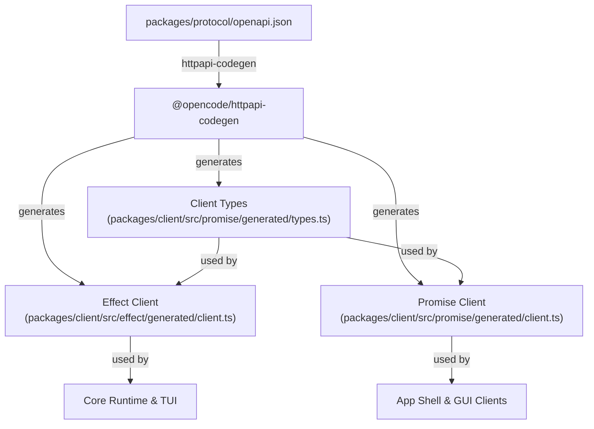
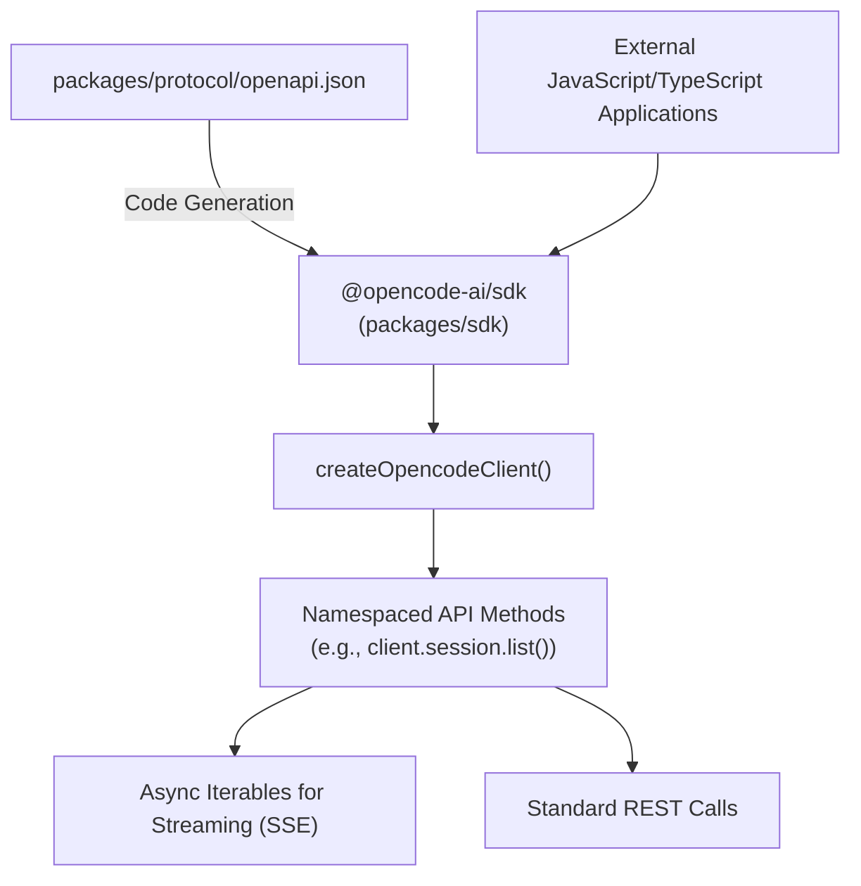

<!-- source: DeepWiki mcp.deepwiki.com · repo anomalyco/opencode · page 4.3 Client Libraries & SDK · fetched 2026-10-27 -->

# Client Libraries & SDK

<details>
<summary>Relevant source files</summary>

The following files were used as context for generating this wiki page:

- [V2_HTTP_API_AUDIT.md](V2_HTTP_API_AUDIT.md)
- [packages/cli/src/services/service-registration.ts](packages/cli/src/services/service-registration.ts)
- [packages/cli/test/fixture/environment.ts](packages/cli/test/fixture/environment.ts)
- [packages/cli/test/fixture/old-protocol-service.ts](packages/cli/test/fixture/old-protocol-service.ts)
- [packages/cli/test/service-lifecycle.test.ts](packages/cli/test/service-lifecycle.test.ts)
- [packages/client/src/effect/api/api.ts](packages/client/src/effect/api/api.ts)
- [packages/client/src/effect/generated/client.ts](packages/client/src/effect/generated/client.ts)
- [packages/client/src/effect/service.ts](packages/client/src/effect/service.ts)
- [packages/client/src/promise/generated/client.ts](packages/client/src/promise/generated/client.ts)
- [packages/client/src/promise/generated/types.ts](packages/client/src/promise/generated/types.ts)
- [packages/client/src/promise/service.ts](packages/client/src/promise/service.ts)
- [packages/client/src/service-contender.ts](packages/client/src/service-contender.ts)
- [packages/client/src/service-probe.ts](packages/client/src/service-probe.ts)
- [packages/client/src/service-timing.ts](packages/client/src/service-timing.ts)
- [packages/client/src/service.ts](packages/client/src/service.ts)
- [packages/client/src/solid/data.ts](packages/client/src/solid/data.ts)
- [packages/client/test/effect.test.ts](packages/client/test/effect.test.ts)
- [packages/client/test/fixture/service-fixture.ts](packages/client/test/fixture/service-fixture.ts)
- [packages/client/test/fixture/service-timing.ts](packages/client/test/fixture/service-timing.ts)
- [packages/client/test/fixture/service.ts](packages/client/test/fixture/service.ts)
- [packages/client/test/promise-service.test.ts](packages/client/test/promise-service.test.ts)
- [packages/client/test/promise.test.ts](packages/client/test/promise.test.ts)
- [packages/client/test/service-contender-pool.test.ts](packages/client/test/service-contender-pool.test.ts)
- [packages/client/test/service-decision.test.ts](packages/client/test/service-decision.test.ts)
- [packages/client/test/service-reconnect.test.ts](packages/client/test/service-reconnect.test.ts)
- [packages/client/test/service.test.ts](packages/client/test/service.test.ts)
- [packages/client/test/solid-data.test.ts](packages/client/test/solid-data.test.ts)
- [packages/core/src/session.ts](packages/core/src/session.ts)
- [packages/core/src/session/message-updater.ts](packages/core/src/session/message-updater.ts)
- [packages/core/src/session/projector.ts](packages/core/src/session/projector.ts)
- [packages/core/test/session-create.test.ts](packages/core/test/session-create.test.ts)
- [packages/core/test/session-projector.test.ts](packages/core/test/session-projector.test.ts)
- [packages/core/test/session-prompt.test.ts](packages/core/test/session-prompt.test.ts)
- [packages/protocol/openapi.json](packages/protocol/openapi.json)
- [packages/protocol/src/groups/session.ts](packages/protocol/src/groups/session.ts)
- [packages/schema/src/session-event.ts](packages/schema/src/session-event.ts)
- [packages/schema/src/session-message.ts](packages/schema/src/session-message.ts)
- [packages/schema/test/event-manifest.test.ts](packages/schema/test/event-manifest.test.ts)
- [packages/server/src/handlers/session.ts](packages/server/src/handlers/session.ts)
- [services/www/openapi.json](services/www/openapi.json)
- [services/www/public/openapi.json](services/www/public/openapi.json)
- [services/www/src/docs/content/models.mdx](services/www/src/docs/content/models.mdx)

</details>


The `packages/client` and `packages/sdk` packages provide the client-side communication layers, generated API clients, service lifecycle management, and reactive stores for OpenCode. `packages/client` powers the internal UI clients, TUI, and desktop app via Effect and Promise-based bindings, while `packages/sdk` provides the public-facing JavaScript/TypeScript SDK (`@opencode-ai/sdk`) for external integrations.

---

## 1. Generated Clients (`packages/client`)

The OpenCode protocol contract defined in `packages/protocol` is compiled into fully typed client interfaces using `@opencode/httpapi-codegen`. Two primary client flavors are generated: an **Effect-based client** leveraging Effect `Effect`, `Stream`, and `Schema`, and a **Promise-based client** standardizing on asynchronous functions and standard JavaScript promises.

### Effect Client vs. Promise Client

- **Effect Client (`packages/client/src/effect/generated/client.ts`)**: Integrates natively with the Effect runtime. Operations return `Effect.Effect<Output, E, R>` or `Stream.Stream<Output, E, R>`, enabling structured error handling, fiber cancellation, and dependency injection [packages/client/src/effect/generated/client.ts:1-245]().
- **Promise Client (`packages/client/src/promise/generated/client.ts`)**: Exposes standard async/await method signatures mapping to HTTP REST endpoints and Server-Sent Events (SSE) [packages/client/src/promise/generated/client.ts:1-251](). The types for these clients are defined in `packages/client/src/promise/generated/types.ts` [packages/client/src/promise/generated/types.ts:1-218]().



Sources:  
[packages/client/src/effect/generated/client.ts:1-245](),  
[packages/client/src/promise/generated/client.ts:1-251](),  
[packages/client/src/promise/generated/types.ts:1-218]()

---

## 2. Service Discovery, Probe & Reconnect

The client management layer (`packages/client/src/effect/service.ts`, `packages/client/src/service-probe.ts`) handles discovering, probing, spawning, and supervising the local OpenCode background daemon [packages/client/src/effect/service.ts:1-146]().

### Key Functions and Lifecycle

- **`discover()`**: Reads the local service registration file from the user's state directory (`~/.local/state/opencode` or equivalent), performs a health check, and validates version compatibility without spawning a new daemon [packages/client/src/effect/service.ts:24-31]().
- **`incumbent()`**: Verifies an authenticated, compatible service bound to an expected URL [packages/client/src/effect/service.ts:34-43]().
- **`ensure()`**: Idempotently ensures a healthy service is running. If missing or version-mismatched, it manages contenders via `contenderPool()` and spawns a background service (`opencode serve --service`) [packages/client/src/effect/service.ts:48-127]().
- **`stop()`**: Terminates the registered local service and handles PTY terminal handoffs (`PtyHandoff`) [packages/client/src/effect/service.ts:130-139]().

```mermaid
graph TD
  Start["Call to Client.Service.ensure()"] --> A{Is a service registered?}
  A -- Yes --> B{Is the registered service running and compatible?}
  A -- No --> C[Spawn new service via contenderPool()]
  B -- Yes --> D[Use incumbent service]
  B -- No --> C
  C --> E[Service starts and registers itself]
  E --> D
  D --> F[Client operates normally]

  subgraph Service Lifecycle
    C -- "opencode serve --service" --> ServiceProcess[OpenCode Daemon Process]
    ServiceProcess -- "Registers URL/PID" --> ServiceRegistration[Service Registration File]
    ServiceRegistration -- "Read by discover()" --> A
  end
```

Sources:  
[packages/client/src/effect/service.ts:1-146]()

---

## 3. Solid Reactive Data Store (`packages/client/src/solid/data.ts`)

The SolidJS data layer (`packages/client/src/solid/data.ts`) bridges server events and API reads into a reactive Solid store (`createStore`) [packages/client/src/solid/data.ts:1-53](). This store is designed for efficient UI updates by applying server events and caching API reads.

### Data Layer Architecture & Sync Queue

- **Caching & Serialization**: Caches API query results by location and session ID, ensuring that invalidated reads revalidate serially so older responses cannot commit after their replacements [packages/client/src/solid/data.ts:1-4]().
- **Event-Driven Updates**: Subscribes to `OpenCodeEvent` streams to incrementally patch session statuses, message transcripts, pending inbox items (`SessionInboxInfo`), tool executions, and permission requests [packages/client/src/solid/data.ts:61-133](). The `OpenCodeEvent` types are defined in `packages/client/src/promise/generated/types.ts` [packages/client/src/promise/generated/types.ts:125-126]().
- **Sync Serializer (`createSync`)**: Manages pending asynchronous reloads, tracking whether an invalidation occurred while a load was in flight [packages/client/src/solid/data.ts:175-179](). This mechanism ensures data consistency by preventing stale data from overwriting newer updates.

```mermaid
graph TD
  ServerEvents["OpenCodeEvent Stream\n(packages/client/src/promise/generated/types.ts)"] -->|on() / listen()| DataLayer["Solid Store (packages/client/src/solid/data.ts)"]
  DataLayer -->|reconcile / produce| SolidStore["Reactive Store State\n(session, project, location)"]
  SolidStore -->|reacts| SolidUI["SolidJS UI Components"]

  subgraph Store Structure
    SolidStore -- "session: Record<string, SessionInfo>" --> SessionInfo["Session.Info\n(packages/core/src/session.ts)"]
    SolidStore -- "session.message: Record<string, SessionMessageInfo[]>" --> SessionMessageInfo["SessionMessage.Info\n(packages/core/src/session/message-updater.ts)"]
    SolidStore -- "session.pending: Record<string, SessionInboxInfo[]>" --> SessionInboxInfo["SessionInbox.Info\n(packages/core/src/session/projector.ts)"]
    SolidStore -- "project: Record<string, Project>" --> ProjectInfo["Project.Info\n(packages/core/test/session-create.test.ts)"]
    SolidStore -- "location: Record<string, LocationData>" --> LocationData["Location.PublicInfo\n(packages/protocol/src/groups/session.ts)"]
  end
```

Sources:  
[packages/client/src/solid/data.ts:1-179](),  
[packages/client/src/promise/generated/types.ts:125-126](),  
[packages/core/src/session.ts:122-130](),  
[packages/core/src/session/message-updater.ts](),  
[packages/core/src/session/projector.ts:65-67](),  
[packages/core/test/session-create.test.ts:121-122](),  
[packages/protocol/src/groups/session.ts:44-47]()

---

## 4. Public JavaScript SDK (`packages/sdk`)

The `@opencode-ai/sdk` package provides the official public SDK for external TypeScript/JavaScript integrations. It wraps the OpenAPI client contract into a developer-friendly SDK.

### SDK Client Architecture

The SDK client is built upon the OpenAPI specification generated from the `packages/protocol` package [packages/protocol/openapi.json:1-226]().

- **`createOpencodeClient`**: Instantiates the SDK client with custom base URLs, request options, and header interceptors (`x-opencode-directory`, `x-opencode-workspace`).
- **Namespaced API Methods**: Exposes domains such as `session`, `auth`, `config`, `file`, `mcp`, and `pty`. For example, the `session` domain provides methods like `list`, `create`, `get`, `remove`, `prompt`, and `log` [packages/protocol/src/groups/session.ts:101-169]().
- **Async Iterables for Streaming**: Supports streaming AI token deltas and global event feeds via Server-Sent Events (SSE) mapped to async iterables.



Sources:  
[packages/protocol/openapi.json:1-226](),  
[packages/protocol/src/groups/session.ts:101-169]()

---

## Summary of Key Source Files

| Module / Component | Path | Role |
| :----------------- | :--- | :--- |
| Effect Client Contract & Client | `packages/client/src/effect/generated/client.ts` | Effect-typed client definitions |
| Promise Client | `packages/client/src/promise/generated/client.ts` | Promise-based client methods |
| Client Types | `packages/client/src/promise/generated/types.ts` | Shared type definitions for generated clients |
| Service Discovery & Ensure | `packages/client/src/effect/service.ts` | Daemon discovery, probing, and lifecycle supervision |
| Solid Reactive Data Store | `packages/client/src/solid/data.ts` | SolidJS store binding events and REST cache |
| OpenAPI Spec | `packages/protocol/openapi.json` | Canonical API specification contract |
| Session Protocol Group | `packages/protocol/src/groups/session.ts` | Defines session-related API endpoints and schemas |
| Session Core Service | `packages/core/src/session.ts` | Core session logic and interface |
| Session Projector | `packages/core/src/session/projector.ts` | Handles session event projection to database |
| Session Message Updater | `packages/core/src/session/message-updater.ts` | Updates session messages |

Sources:  
[packages/client/src/effect/generated/client.ts:1-245](),  
[packages/client/src/promise/generated/client.ts:1-251](),  
[packages/client/src/promise/generated/types.ts:1-218](),  
[packages/client/src/effect/service.ts:1-146](),  
[packages/client/src/solid/data.ts:1-179](),  
[packages/protocol/openapi.json:1-226](),  
[packages/protocol/src/groups/session.ts:1-169](),  
[packages/core/src/session.ts:1-171](),  
[packages/core/src/session/projector.ts:1-197](),  
[packages/core/src/session/message-updater.ts]()

---

