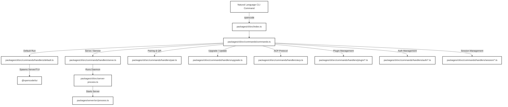
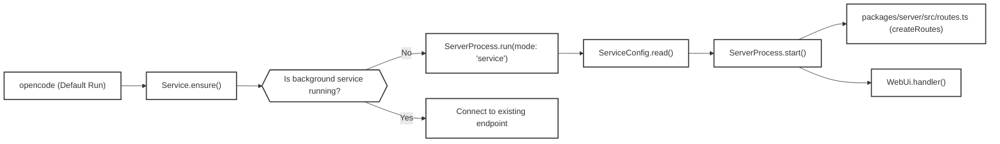

<!-- source: DeepWiki mcp.deepwiki.com · repo anomalyco/opencode · page 5 CLI & Terminal Experience · fetched 2026-10-27 -->

# CLI & Terminal Experience

Relevant source files

The following files were used as context for generating this wiki page:

- [packages/cli/src/commands/commands.ts](packages/cli/src/commands/commands.ts)
- [packages/cli/src/commands/handlers/pair.ts](packages/cli/src/commands/handlers/pair.ts)
- [packages/cli/src/commands/handlers/uninstall.ts](packages/cli/src/commands/handlers/uninstall.ts)
- [packages/cli/src/index.ts](packages/cli/src/index.ts)
- [packages/cli/src/server-process.ts](packages/cli/src/server-process.ts)
- [packages/cli/src/services/remote-tunnel.ts](packages/cli/src/services/remote-tunnel.ts)
- [packages/cli/src/services/service-config.ts](packages/cli/src/services/service-config.ts)
- [packages/cli/test/service.test.ts](packages/cli/test/service.test.ts)
- [packages/server/src/options.ts](packages/server/src/options.ts)
- [packages/server/src/routes.ts](packages/server/src/routes.ts)
- [packages/server/test/options.test.ts](packages/server/test/options.test.ts)
- [services/www/src/docs/content/agents.mdx](services/www/src/docs/content/agents.mdx)
- [services/www/src/docs/content/attachments.mdx](services/www/src/docs/content/attachments.mdx)
- [services/www/src/docs/content/cli/commands.mdx](services/www/src/docs/content/cli/commands.mdx)
- [services/www/src/docs/content/cli/index.mdx](services/www/src/docs/content/cli/index.mdx)
- [services/www/src/docs/content/cli/theme.mdx](services/www/src/docs/content/cli/theme.mdx)
- [services/www/src/docs/content/cli/web.mdx](services/www/src/docs/content/cli/web.mdx)
- [services/www/src/docs/content/commands.mdx](services/www/src/docs/content/commands.mdx)
- [services/www/src/docs/content/index.mdx](services/www/src/docs/content/index.mdx)
- [services/www/src/docs/content/themes.mdx](services/www/src/docs/content/themes.mdx)

This page provides a high-level overview of the `opencode` CLI binary, its daemon/service model, supervision infrastructure, and the terminal user interface (TUI). The CLI is built on Effect CLI and Effect platform nodes, routing user commands to background server processes, local runtime handlers, or remote connections [packages/cli/src/index.ts:28-82](), [packages/cli/src/commands/commands.ts:1-59]().

As a parent page, this section covers architectural concepts and links out to detailed child pages:
- **CLI Commands & Service Management ([CLI Commands & Service Management](#5.1))** — Command registry, handlers (`default`, `serve`, `pair`, `upgrade`, `stats`, `plugin add`), background service supervision, tunneling, and build scripts.
- **TUI Architecture ([TUI Architecture](#5.2))** — SolidJS and `@opentui` runtime powering the terminal interface, app bootstrap, routes, contexts, and prompt composer.
- **ACP (Agent Client Protocol) ([ACP (Agent Client Protocol)](#5.3))** — JSON-RPC agent server implementation in `packages/cli/src/acp` for editor integrations like Zed.

---

## Architecture & Binary Entrypoint

The `opencode` executable bootstrap script initializes global services, observability, and error handlers using Node/Bun runtimes [packages/cli/src/index.ts:84-151](). It resolves command specifications defined via Effect CLI [packages/cli/src/commands/commands.ts:38-59]() and dispatches them to lazy-loaded handlers [packages/cli/src/index.ts:28-82]().

### Natural Language Space to Code Entity Space: CLI Routing

The following diagram bridges user commands to their corresponding implementation files and Effect handlers in the codebase:

**Sources:** [packages/cli/src/index.ts:1-151](), [packages/cli/src/commands/commands.ts:1-186](), [packages/cli/src/server-process.ts:1-45](), [packages/server/src/routes.ts:81-106]()

---

## Daemon & Service Supervision Model

The CLI manages long-running background server processes to coordinate workspace sessions, persistent PTY terminals, and API endpoints. 

- **Background Services:** The CLI automatically supervises a background daemon service when executing commands like `opencode` (default) or via explicit service commands [packages/cli/src/commands/handlers/service/start.ts:6-14]() and [packages/cli/src/commands/handlers/serve.ts:6-16]().
- **Service Configuration:** Configuration parameters such as port binding, authentication passwords, and CORS rules are stored securely in state paths managed by `ServiceConfig` [packages/cli/src/services/service-config.ts:15-28](), [packages/cli/src/services/service-config.ts:103-120](). The default port varies by channel and platform [packages/cli/src/services/service-config.ts:46-59](), [packages/cli/test/service.test.ts:20-42]().
- **Server Process Startup:** The server process lifecycle is orchestrated by `ServerProcess.run` and `ServerProcess.start`, initializing Effect HTTP routing, database layers, and process supervision [packages/cli/src/server-process.ts:32-45](), [packages/cli/src/server-process.ts:100-144](). The server options are defined in `packages/server/src/options.ts` [packages/server/src/options.ts:6-48]().
- **Remote Tunneling:** The `opencode pair --remote` command initiates a secure tunnel using `RemoteTunnel` to expose the local server to the internet, requiring user consent [packages/cli/src/commands/handlers/pair.ts:22-26](), [packages/cli/src/commands/handlers/pair.ts:72-76](), [packages/cli/src/services/remote-tunnel.ts:1-10]().

### Natural Language Space to Code Entity Space: Daemon Supervision

**Sources:** [packages/cli/src/commands/handlers/default.ts:35-52](), [packages/cli/src/server-process.ts:32-62](), [packages/cli/src/services/service-config.ts:136-150](), [packages/server/src/routes.ts:81-106](), [packages/cli/src/server-process.ts:98-98]()

---

## Child Pages & Detailed Documentation

For deep technical dives into each sub-system, refer to the designated child pages:

1. **[CLI Commands & Service Management](#5.1)** — Covers the complete command registry (default, `serve`, `pair`, `upgrade`, `stats`, `plugin add`), process supervision, remote tunneling, and build scripts [packages/cli/src/commands/commands.ts](), [packages/cli/src/server-process.ts]().
2. **[TUI Architecture](#5.2)** — Explores the SolidJS and `@opentui` runtime powering the terminal UI, session row rendering, prompt composer, and UI contexts (`packages/tui`). This includes details on theming [services/www/src/docs/content/cli/theme.mdx:1-206]() and keybindings.
3. **[ACP (Agent Client Protocol)](#5.3)** — Documents the JSON-RPC agent server (`packages/cli/src/acp`), session mapping, turns, permissions, and editor integrations.

**Sources:** [packages/cli/package.json:1-86](), [packages/cli/src/commands/commands.ts:1-186](), [packages/tui/package.json:1-79](), [services/www/src/docs/content/cli/theme.mdx:1-206]()

---

