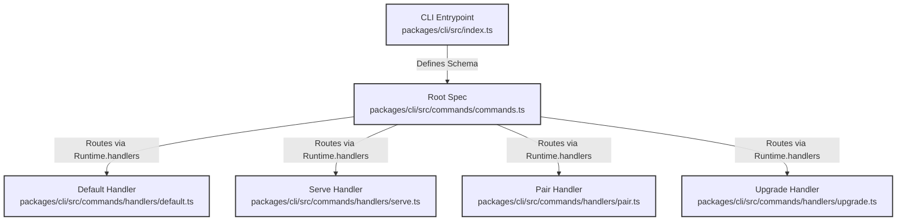
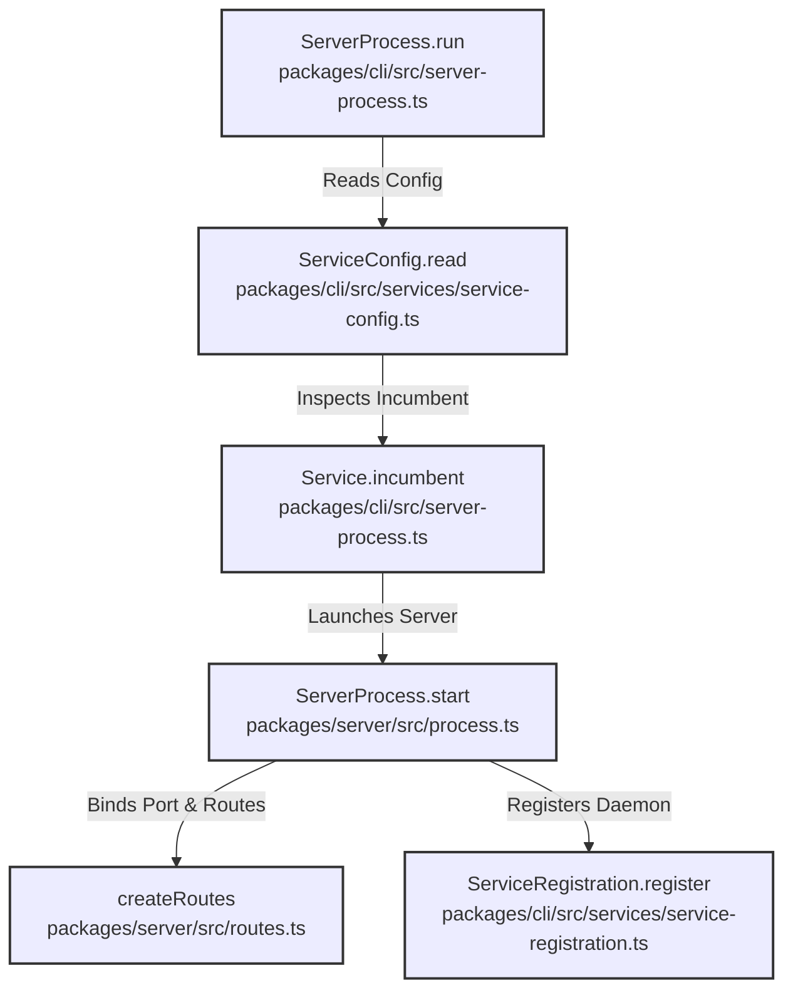
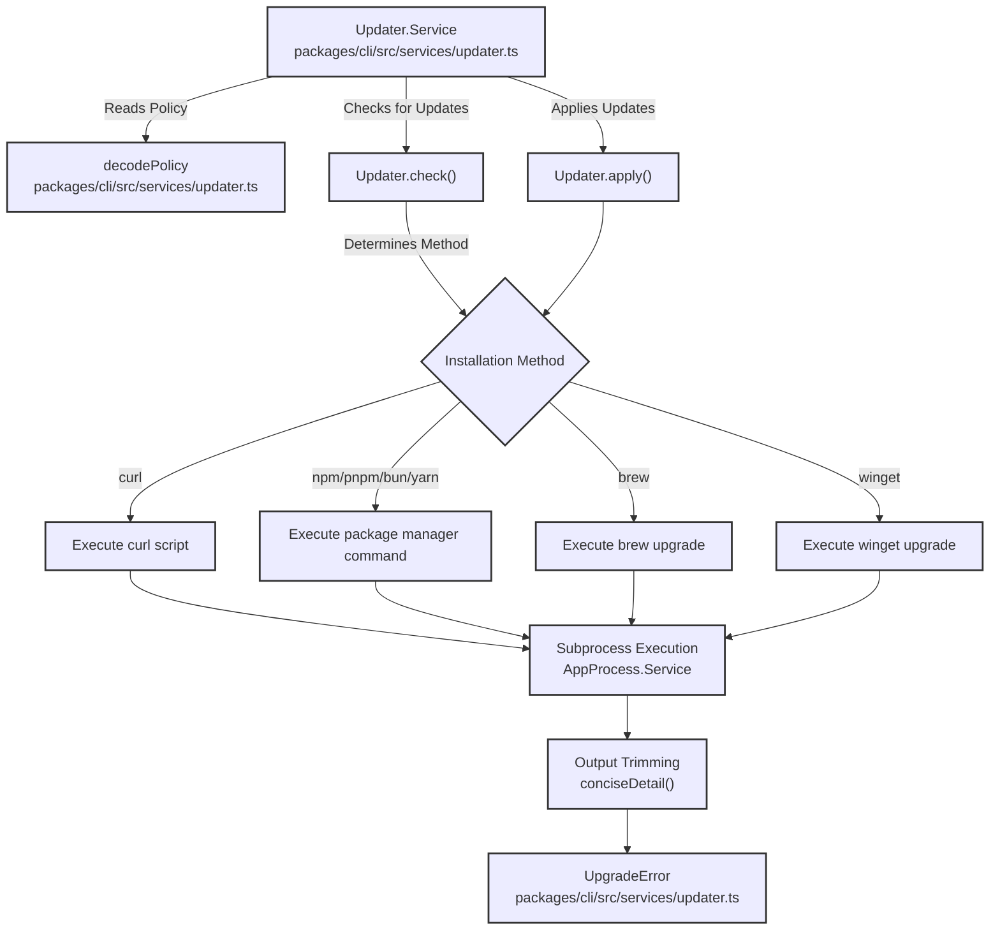

<!-- source: DeepWiki mcp.deepwiki.com · repo anomalyco/opencode · page 5.1 CLI Commands & Service Management · fetched 2026-10-27 -->

# CLI Commands & Service Management

Relevant source files

The following files were used as context for generating this wiki page:

- [packages/cli/script/app-assets.ts](packages/cli/script/app-assets.ts)
- [packages/cli/script/build-node.ts](packages/cli/script/build-node.ts)
- [packages/cli/script/build.ts](packages/cli/script/build.ts)
- [packages/cli/script/node-assets.ts](packages/cli/script/node-assets.ts)
- [packages/cli/script/publish-homebrew.ts](packages/cli/script/publish-homebrew.ts)
- [packages/cli/script/service-smoke.ts](packages/cli/script/service-smoke.ts)
- [packages/cli/src/app-archive.ts](packages/cli/src/app-archive.ts)
- [packages/cli/src/app-assets.ts](packages/cli/src/app-assets.ts)
- [packages/cli/src/commands/commands.ts](packages/cli/src/commands/commands.ts)
- [packages/cli/src/commands/handlers/auth/account.ts](packages/cli/src/commands/handlers/auth/account.ts)
- [packages/cli/src/commands/handlers/auth/form.ts](packages/cli/src/commands/handlers/auth/form.ts)
- [packages/cli/src/commands/handlers/auth/list.ts](packages/cli/src/commands/handlers/auth/list.ts)
- [packages/cli/src/commands/handlers/auth/login.ts](packages/cli/src/commands/handlers/auth/login.ts)
- [packages/cli/src/commands/handlers/auth/logout.ts](packages/cli/src/commands/handlers/auth/logout.ts)
- [packages/cli/src/commands/handlers/auth/shared.ts](packages/cli/src/commands/handlers/auth/shared.ts)
- [packages/cli/src/commands/handlers/auth/switch.ts](packages/cli/src/commands/handlers/auth/switch.ts)
- [packages/cli/src/commands/handlers/default.ts](packages/cli/src/commands/handlers/default.ts)
- [packages/cli/src/commands/handlers/pair.ts](packages/cli/src/commands/handlers/pair.ts)
- [packages/cli/src/commands/handlers/serve.ts](packages/cli/src/commands/handlers/serve.ts)
- [packages/cli/src/commands/handlers/uninstall.ts](packages/cli/src/commands/handlers/uninstall.ts)
- [packages/cli/src/commands/handlers/upgrade.ts](packages/cli/src/commands/handlers/upgrade.ts)
- [packages/cli/src/env.ts](packages/cli/src/env.ts)
- [packages/cli/src/index.ts](packages/cli/src/index.ts)
- [packages/cli/src/node/index.ts](packages/cli/src/node/index.ts)
- [packages/cli/src/server-process.ts](packages/cli/src/server-process.ts)
- [packages/cli/src/services/remote-tunnel.ts](packages/cli/src/services/remote-tunnel.ts)
- [packages/cli/src/services/retained-image.ts](packages/cli/src/services/retained-image.ts)
- [packages/cli/src/services/service-config.ts](packages/cli/src/services/service-config.ts)
- [packages/cli/src/services/standalone.ts](packages/cli/src/services/standalone.ts)
- [packages/cli/src/services/updater-action.ts](packages/cli/src/services/updater-action.ts)
- [packages/cli/src/services/updater.test.ts](packages/cli/src/services/updater.test.ts)
- [packages/cli/src/services/updater.ts](packages/cli/src/services/updater.ts)
- [packages/cli/src/services/web-ui.ts](packages/cli/src/services/web-ui.ts)
- [packages/cli/src/ui/prompt.ts](packages/cli/src/ui/prompt.ts)
- [packages/cli/src/virtual.d.ts](packages/cli/src/virtual.d.ts)
- [packages/cli/test/app-archive.test.ts](packages/cli/test/app-archive.test.ts)
- [packages/cli/test/auth-form.test.ts](packages/cli/test/auth-form.test.ts)
- [packages/cli/test/auth.test.ts](packages/cli/test/auth.test.ts)
- [packages/cli/test/env.test.ts](packages/cli/test/env.test.ts)
- [packages/cli/test/fixture/upgrade.ts](packages/cli/test/fixture/upgrade.ts)
- [packages/cli/test/prompt-open-url.test.ts](packages/cli/test/prompt-open-url.test.ts)
- [packages/cli/test/retained-image.test.ts](packages/cli/test/retained-image.test.ts)
- [packages/cli/test/service.test.ts](packages/cli/test/service.test.ts)
- [packages/cli/test/updater-install.test.ts](packages/cli/test/updater-install.test.ts)
- [packages/cli/test/upgrade.test.ts](packages/cli/test/upgrade.test.ts)
- [packages/cli/test/web-ui.test.ts](packages/cli/test/web-ui.test.ts)
- [packages/cli/vite.node.config.ts](packages/cli/vite.node.config.ts)
- [packages/core/src/filesystem/watcher-binding.ts](packages/core/src/filesystem/watcher-binding.ts)
- [packages/core/src/shell/parser-wasm.bun.ts](packages/core/src/shell/parser-wasm.bun.ts)
- [packages/core/src/shell/parser-wasm.node.ts](packages/core/src/shell/parser-wasm.node.ts)
- [packages/server/src/options.ts](packages/server/src/options.ts)
- [packages/server/src/process.ts](packages/server/src/process.ts)
- [packages/server/src/routes.ts](packages/server/src/routes.ts)
- [packages/server/test/options.test.ts](packages/server/test/options.test.ts)
- [packages/server/test/process.test.ts](packages/server/test/process.test.ts)
- [packages/tui/src/component/dialog-model.tsx](packages/tui/src/component/dialog-model.tsx)
- [packages/tui/src/component/use-connected.tsx](packages/tui/src/component/use-connected.tsx)
- [packages/tui/src/context/local.tsx](packages/tui/src/context/local.tsx)
- [packages/tui/src/util/connected-provider.ts](packages/tui/src/util/connected-provider.ts)
- [packages/tui/test/cli/cmd/tui/integration-options.test.ts](packages/tui/test/cli/cmd/tui/integration-options.test.ts)
- [packages/tui/test/cli/cmd/tui/model-options.test.ts](packages/tui/test/cli/cmd/tui/model-options.test.ts)
- [packages/tui/test/context/local-selection.test.tsx](packages/tui/test/context/local-selection.test.tsx)
- [packages/tui/test/util/connected-provider.test.ts](packages/tui/test/util/connected-provider.test.ts)
- [script/native-arch.ts](script/native-arch.ts)
- [script/publish-winget.ts](script/publish-winget.ts)
- [services/www/src/docs/content/agents.mdx](services/www/src/docs/content/agents.mdx)
- [services/www/src/docs/content/attachments.mdx](services/www/src/docs/content/attachments.mdx)
- [services/www/src/docs/content/cli/commands.mdx](services/www/src/docs/content/cli/commands.mdx)
- [services/www/src/docs/content/cli/index.mdx](services/www/src/docs/content/cli/index.mdx)
- [services/www/src/docs/content/cli/theme.mdx](services/www/src/docs/content/cli/theme.mdx)
- [services/www/src/docs/content/cli/web.mdx](services/www/src/docs/content/cli/web.mdx)
- [services/www/src/docs/content/commands.mdx](services/www/src/docs/content/commands.mdx)
- [services/www/src/docs/content/index.mdx](services/www/src/docs/content/index.mdx)
- [services/www/src/docs/content/themes.mdx](services/www/src/docs/content/themes.mdx)

This page documents the architecture of `packages/cli`, covering command-line interface parsing (`effect/cli`), command routing and execution handlers, server process supervision, daemon management, remote tunneling, pairing workflows, the `Updater` service, and the compilation build scripts.

---

## 1. CLI Command Registry & Runtime Routing

The OpenCode CLI binary is bootstrapped via Bun [packages/cli/src/index.ts:1]() and uses `effect/cli` definitions via `Spec` wrappers [packages/cli/src/commands/commands.ts:3-38](). The root specification defines global parameters (such as `standalone`, `server`, and permission flags like `auto` and `yolo`) as well as a directory argument [packages/cli/src/commands/commands.ts:15-58]().

Command routing is mapped dynamically in `packages/cli/src/index.ts` using `Runtime.handlers`, connecting CLI AST structures to lazy-loaded Effect handlers for actions such as `upgrade`, `uninstall`, `acp`, `api`, `auth`, `debug`, `mcp`, `plugin`, `models`, `stats`, `pair`, `session`, `service`, and `serve` [packages/cli/src/index.ts:28-82]().

*Figure 1: CLI command dispatch flow from entrypoint to execution handlers.*

Sources: `packages/cli/src/commands/commands.ts` [packages/cli/src/commands/commands.ts:1-58](), `packages/cli/src/index.ts` [packages/cli/src/index.ts:1-82]()

---

## 2. Server-Process Supervision & Daemon Management

The CLI manages long-running background server processes through `ServerProcess` (`packages/cli/src/server-process.ts`) and `@opencode/server` (`packages/server/src/process.ts`). 

### Execution Modes

`ServerProcess` supports three primary modes [packages/cli/src/server-process.ts:22]():
- `default`: Standard foreground execution or ephemeral connection.
- `service`: Background supervisor mode where configuration, port bindings, and lease credentials are managed in the user state directory (`Global.Service`) [packages/cli/src/server-process.ts:60-68]().
- `stdio`: Pipe-based transport mode where server output streams over standard input/output and credentials are scrubbed from the environment [packages/cli/src/server-process.ts:80-83]().

### Supervision Lifecycle

When running in `service` mode, `ServerProcess.run` reads service configuration via `ServiceConfig.read()` [packages/cli/src/server-process.ts:65-66](), checks for incumbent server processes, generates or reuses authentication tokens, and invokes `ServerProcess.start` (`packages/server/src/process.ts`) [packages/server/src/process.ts:47-52]().

*Figure 2: Server supervision and daemon startup lifecycle.*

Sources: `packages/cli/src/server-process.ts` [packages/cli/src/server-process.ts:22-100](), `packages/server/src/process.ts` [packages/server/src/process.ts:47-86](), `packages/cli/src/services/service-config.ts` [packages/cli/src/services/service-config.ts:136-150]()

---

## 3. Standalone & Remote Tunnel Services

The `serve` command handler (`packages/cli/src/commands/handlers/serve.ts`) delegates directly to `ServerProcess.run`, mapping CLI flags (`--service`, `--stdio`, `--hostname`, `--port`, `--cors`) to process options [packages/cli/src/commands/handlers/serve.ts:6-17]().

### Pairing & Remote Access

The `pair` command (`packages/cli/src/commands/handlers/pair.ts`) coordinates secure connections between CLI clients and remote or local servers:
1. Validates that the background service is enabled [packages/cli/src/commands/handlers/pair.ts:14-18]().
2. Ensures the service endpoint is active via `Service.ensure()` [packages/cli/src/commands/handlers/pair.ts:23]().
3. Requests a pairing token from the server via `client.server.pair()` [packages/cli/src/commands/handlers/pair.ts:26]().
4. Renders terminal connection URLs and a compact QR code using `uqr` [packages/cli/src/commands/handlers/pair.ts:30-47]().
5. If `--remote` is requested, it polls `RemoteTunnel` readiness until a secure public endpoint is established [packages/cli/src/commands/handlers/pair.ts:78-95]().

Sources: `packages/cli/src/commands/handlers/serve.ts` [packages/cli/src/commands/handlers/serve.ts:1-17](), `packages/cli/src/commands/handlers/pair.ts` [packages/cli/src/commands/handlers/pair.ts:1-101]()

---

## 4. Default Command & TUI Bootstrap

When `opencode` is invoked without a subcommand, the default handler (`packages/cli/src/commands/handlers/default.ts`) initializes the terminal user experience:
- Changes working directories if a target directory argument is provided [packages/cli/src/commands/handlers/default.ts:21-23]().
- Resolves or spawns the background server connection using `ServerConnection.resolve()` [packages/cli/src/commands/handlers/default.ts:35-52]().
- Configures background update checks running on a 10-minute interval via `Updater.Service` [packages/cli/src/services/updater.ts]() and `Semaphore` [packages/cli/src/commands/handlers/default.ts:62-86]().
- Boots the SolidJS-based TUI runtime via `run()` from `@opencode/tui`, passing server endpoints, config bindings, package installation managers, and terminal loggers [packages/cli/src/commands/handlers/default.ts:96-155]().

Sources: `packages/cli/src/commands/handlers/default.ts` [packages/cli/src/commands/handlers/default.ts:1-157]()

---

## 5. Updater Service & Build Scripts

### Updater Service (`packages/cli/src/services/updater.ts`)

The `Updater` service manages self-updates, binary acquisition, and version compatibility across multiple distribution channels. 

| Installation Method | Description |
| :--- | :--- |
| `curl` | Shell installer script execution |
| `npm` / `pnpm` / `bun` / `yarn` | Node/Bun package manager global upgrades |
| `vp` | Vite+ package management |
| `brew` | Homebrew formula upgrades |
| `winget` | Windows Package Manager (WinGet) |

The service evaluates user policies (`disable`, `notify`, `auto`) read from configuration files (`config.json`, `opencode.json`) [packages/cli/src/services/updater.ts:110-158]() and executes subprocess upgrades with captured output trimming [packages/cli/src/services/updater.ts:58-94]().

*Figure 3: Updater service flow, including policy evaluation and method-specific upgrade execution.*

Sources: `packages/cli/src/services/updater.ts` [packages/cli/src/services/updater.ts:1-170](), `packages/cli/src/services/updater.ts` [packages/cli/src/services/updater.ts:58-94](), `packages/cli/src/services/updater.ts` [packages/cli/src/services/updater.ts:110-158]()

### Build Scripts (`packages/cli/script/build.ts`)

The build script compiles multi-platform standalone binaries using Bun's native compilation target [packages/cli/script/build.ts:1-176]():
- Pre-bundles web UI assets into an app archive (`bun-app-archive.bin`) via `buildAppArchive()` [packages/cli/script/build.ts:68-69]().
- Resolves architecture-specific native bindings for `opencode-pty` (`resolveOpencodePty`) and filesystem watchers (`@parcel/watcher`) [packages/cli/script/build.ts:112-148]().
- Compiles standalone ESM bundles with bytecode generation and tree-shaking enabled [packages/cli/script/build.ts:153-176]().

Sources: `packages/cli/src/services/updater.ts` [packages/cli/src/services/updater.ts:1-170](), `packages/cli/script/build.ts` [packages/cli/script/build.ts:1-176]()

---

