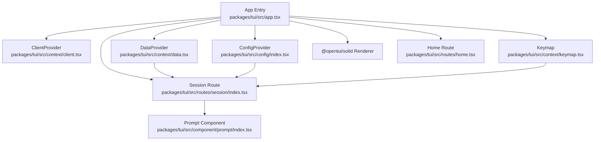
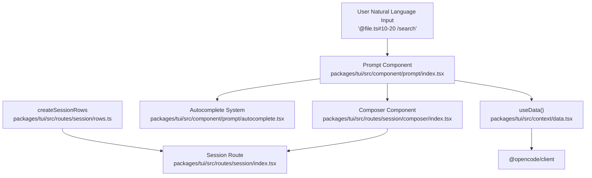

<!-- source: DeepWiki mcp.deepwiki.com · repo anomalyco/opencode · page 5.2 TUI Architecture · fetched 2026-10-27 -->

# TUI Architecture

Relevant source files

The following files were used as context for generating this wiki page:

- [AGENTS.md](AGENTS.md)
- [packages/plugin/src/tui/context.ts](packages/plugin/src/tui/context.ts)
- [packages/tui/src/app.tsx](packages/tui/src/app.tsx)
- [packages/tui/src/component/command-palette.tsx](packages/tui/src/component/command-palette.tsx)
- [packages/tui/src/component/devtools-bar.tsx](packages/tui/src/component/devtools-bar.tsx)
- [packages/tui/src/component/dialog-config.tsx](packages/tui/src/component/dialog-config.tsx)
- [packages/tui/src/component/prompt/index.tsx](packages/tui/src/component/prompt/index.tsx)
- [packages/tui/src/component/prompt/move.tsx](packages/tui/src/component/prompt/move.tsx)
- [packages/tui/src/config/index.tsx](packages/tui/src/config/index.tsx)
- [packages/tui/src/config/keybind.ts](packages/tui/src/config/keybind.ts)
- [packages/tui/src/context/data.tsx](packages/tui/src/context/data.tsx)
- [packages/tui/src/context/keymap.tsx](packages/tui/src/context/keymap.tsx)
- [packages/tui/src/context/location.tsx](packages/tui/src/context/location.tsx)
- [packages/tui/src/feature-plugins/home/footer.tsx](packages/tui/src/feature-plugins/home/footer.tsx)
- [packages/tui/src/feature-plugins/sidebar/context.tsx](packages/tui/src/feature-plugins/sidebar/context.tsx)
- [packages/tui/src/feature-plugins/sidebar/footer.tsx](packages/tui/src/feature-plugins/sidebar/footer.tsx)
- [packages/tui/src/feature-plugins/sidebar/mcp.tsx](packages/tui/src/feature-plugins/sidebar/mcp.tsx)
- [packages/tui/src/feature-plugins/system/notifications.ts](packages/tui/src/feature-plugins/system/notifications.ts)
- [packages/tui/src/feature-plugins/system/storybook/session-location-missing.tsx](packages/tui/src/feature-plugins/system/storybook/session-location-missing.tsx)
- [packages/tui/src/mini/footer.command.tsx](packages/tui/src/mini/footer.command.tsx)
- [packages/tui/src/mini/footer.ts](packages/tui/src/mini/footer.ts)
- [packages/tui/src/mini/footer.view.tsx](packages/tui/src/mini/footer.view.tsx)
- [packages/tui/src/mini/footer.width.ts](packages/tui/src/mini/footer.width.ts)
- [packages/tui/src/mini/runtime.boot.ts](packages/tui/src/mini/runtime.boot.ts)
- [packages/tui/src/mini/runtime.lifecycle.ts](packages/tui/src/mini/runtime.lifecycle.ts)
- [packages/tui/src/mini/runtime.ts](packages/tui/src/mini/runtime.ts)
- [packages/tui/src/mini/stream-v2.transport.ts](packages/tui/src/mini/stream-v2.transport.ts)
- [packages/tui/src/mini/types.ts](packages/tui/src/mini/types.ts)
- [packages/tui/src/plugin/api.tsx](packages/tui/src/plugin/api.tsx)
- [packages/tui/src/plugin/context.tsx](packages/tui/src/plugin/context.tsx)
- [packages/tui/src/routes/home.tsx](packages/tui/src/routes/home.tsx)
- [packages/tui/src/routes/session/composer/context.ts](packages/tui/src/routes/session/composer/context.ts)
- [packages/tui/src/routes/session/composer/index.tsx](packages/tui/src/routes/session/composer/index.tsx)
- [packages/tui/src/routes/session/composer/shell-tab.tsx](packages/tui/src/routes/session/composer/shell-tab.tsx)
- [packages/tui/src/routes/session/composer/subagents-tab.tsx](packages/tui/src/routes/session/composer/subagents-tab.tsx)
- [packages/tui/src/routes/session/composer/terminals-tab.tsx](packages/tui/src/routes/session/composer/terminals-tab.tsx)
- [packages/tui/src/routes/session/form.tsx](packages/tui/src/routes/session/form.tsx)
- [packages/tui/src/routes/session/index.tsx](packages/tui/src/routes/session/index.tsx)
- [packages/tui/src/routes/session/location-missing.tsx](packages/tui/src/routes/session/location-missing.tsx)
- [packages/tui/src/routes/session/permission.tsx](packages/tui/src/routes/session/permission.tsx)
- [packages/tui/src/routes/session/rows.ts](packages/tui/src/routes/session/rows.ts)
- [packages/tui/src/routes/session/sidebar.tsx](packages/tui/src/routes/session/sidebar.tsx)
- [packages/tui/test/app-lifecycle.test.tsx](packages/tui/test/app-lifecycle.test.tsx)
- [packages/tui/test/cli/cmd/tui/notifications.test.ts](packages/tui/test/cli/cmd/tui/notifications.test.ts)
- [packages/tui/test/cli/tui/command-palette.test.tsx](packages/tui/test/cli/tui/command-palette.test.tsx)
- [packages/tui/test/cli/tui/composer-keymap.test.tsx](packages/tui/test/cli/tui/composer-keymap.test.tsx)
- [packages/tui/test/cli/tui/data.test.tsx](packages/tui/test/cli/tui/data.test.tsx)
- [packages/tui/test/cli/tui/form.test.tsx](packages/tui/test/cli/tui/form.test.tsx)
- [packages/tui/test/cli/tui/prompt-move.test.tsx](packages/tui/test/cli/tui/prompt-move.test.tsx)
- [packages/tui/test/cli/tui/session-rows.test.ts](packages/tui/test/cli/tui/session-rows.test.ts)
- [packages/tui/test/component/dialog-shell-output.test.tsx](packages/tui/test/component/dialog-shell-output.test.tsx)
- [packages/tui/test/config-v2.test.tsx](packages/tui/test/config-v2.test.tsx)
- [packages/tui/test/feature-plugins/sidebar-context.test.tsx](packages/tui/test/feature-plugins/sidebar-context.test.tsx)
- [packages/tui/test/mini/fixture/footer-api.ts](packages/tui/test/mini/fixture/footer-api.ts)
- [packages/tui/test/mini/footer-keymap.test.tsx](packages/tui/test/mini/footer-keymap.test.tsx)
- [packages/tui/test/mini/footer.responsive.test.tsx](packages/tui/test/mini/footer.responsive.test.tsx)
- [packages/tui/test/mini/footer.test.ts](packages/tui/test/mini/footer.test.ts)
- [packages/tui/test/mini/footer.view.test.tsx](packages/tui/test/mini/footer.view.test.tsx)
- [packages/tui/test/mini/footer.width.test.ts](packages/tui/test/mini/footer.width.test.ts)
- [packages/tui/test/mini/runtime.boot.test.ts](packages/tui/test/mini/runtime.boot.test.ts)
- [packages/tui/test/mini/runtime.test.ts](packages/tui/test/mini/runtime.test.ts)
- [packages/tui/test/mini/stream-v2.transport.test.ts](packages/tui/test/mini/stream-v2.transport.test.ts)
- [packages/tui/test/plugin-model.test.tsx](packages/tui/test/plugin-model.test.tsx)
- [services/www/src/docs/content/build/plugins/cli.mdx](services/www/src/docs/content/build/plugins/cli.mdx)
- [services/www/src/docs/content/cli/keybinds.mdx](services/www/src/docs/content/cli/keybinds.mdx)
- [services/www/src/docs/content/cli/tui.mdx](services/www/src/docs/content/cli/tui.mdx)
- [specs/v2/session.md](specs/v2/session.md)

The Terminal User Interface (TUI) is OpenCode's primary interactive terminal environment implemented in `packages/tui` using SolidJS and the `@opentui` runtime [packages/tui/src/app.tsx:3-3](). It delivers a high-performance, reactive interface for managing coding agent sessions, prompt composition, tool executions, and interactive dialogs.

> [!NOTE]
> This is a parent page. For deep technical details on specific components, dialogs, theming, and keybinds, refer to the child pages:
> - [TUI Components & Dialogs](#5.2.1)
> - [TUI Theming & Keybinds](#5.2.2)

---

## 1. App Bootstrap, Runtime & Routes

The TUI application initializes via `packages/tui/src/app.tsx`, which sets up the root SolidJS reactive context, terminal renderers, lifecycle providers, and client connection bindings [packages/tui/src/app.tsx:3-112](). Routing manages views such as the home dashboard (`packages/tui/src/routes/home.tsx`) and active session transcripts (`packages/tui/src/routes/session/index.tsx`), handling virtualized lists and message boundaries [packages/tui/src/routes/session/index.tsx:1-147](). The `@opentui/solid` library provides the rendering primitives for the terminal environment [packages/tui/src/app.tsx:3-3]().

### Diagram: App Bootstrap and Context Topology

Sources: [packages/tui/src/app.tsx:3-112](), [packages/tui/src/routes/session/index.tsx:1-147](), [packages/tui/src/routes/home.tsx]()

---

## 2. Data, Configuration & Keymap Contexts

State synchronization is anchored by `packages/tui/src/context/data.tsx`, which leverages `@opencode/client/solid` to bind reactive stores to backend events and REST endpoints [packages/tui/src/context/data.tsx:1-52](). This context provides access to session data, location information, and project details [packages/tui/src/context/data.tsx:25-49](). Configuration loading, validation via Effect schemas, and user overrides are managed in `packages/tui/src/config/index.tsx` [packages/tui/src/config/index.tsx:1-160](). Keybindings, key sequences, and the leader-key model are defined in `packages/tui/src/config/keybind.ts` [packages/tui/src/config/keybind.ts:1-48](), with commands like `session.list` and `command.palette.show` being globally available [packages/tui/src/app.tsx:114-176]().

For detailed theme resolution and keybinding configurations, see [TUI Theming & Keybinds](#5.2.2).

Sources: [packages/tui/src/context/data.tsx:1-52](), [packages/tui/src/config/index.tsx:1-160](), [packages/tui/src/config/keybind.ts:1-48](), [packages/tui/src/app.tsx:114-176]()

---

## 3. Session Rows Rendering & Prompt Composer

Session transcripts are projected into renderable rows (`packages/tui/src/routes/session/rows.ts`), grouping user prompts, assistant turns, tool calls, and pending actions [packages/tui/src/routes/session/rows.ts:47-81](). The `createSessionRows` function dynamically reduces session messages into a structured list for display [packages/tui/src/routes/session/rows.ts:47-81](). User input is handled by the `Prompt` component (`packages/tui/src/component/prompt/index.tsx`), which processes mentions, attachments, drafts, and autocomplete triggers [packages/tui/src/component/prompt/index.tsx:1-98](). The `Composer` component (`packages/tui/src/routes/session/composer/index.tsx`) integrates the prompt with session-specific functionalities like subagent and shell tabs [packages/tui/src/routes/session/composer/index.tsx]().

### Diagram: Natural Language Prompt to Code Entity Mapping

Sources: [packages/tui/src/component/prompt/index.tsx:1-98](), [packages/tui/src/routes/session/rows.ts:47-81](), [packages/tui/src/context/data.tsx:1-52](), [packages/tui/src/routes/session/composer/index.tsx]()

For component and dialog specifics, see [TUI Components & Dialogs](#5.2.1).

---

## 4. Feature Plugins & Mini Runtime

The TUI supports an extensible feature plugin system (`packages/tui/src/plugin/context.tsx`) that discovers, loads, and manages UI extensions, custom slots, markdown renderers, and dedicated page routes [packages/tui/src/plugin/context.tsx:1-88](). Plugins can register `Slot` components to inject custom UI elements [packages/tui/src/plugin/render.tsx](). A lightweight mini runtime (`packages/tui/src/mini/runtime.ts`) powers embedded or secondary CLI surfaces, providing a minimal environment for specific TUI features like the footer [packages/tui/src/mini/runtime.ts](). This mini runtime is used for testing specific TUI components in isolation [packages/tui/test/mini/runtime.test.ts]().

Sources: [packages/tui/src/plugin/context.tsx:1-88](), [packages/tui/src/plugin/render.tsx](), [packages/tui/src/mini/runtime.ts](), [packages/tui/test/mini/runtime.test.ts]()

---

## Child Pages

- [TUI Components & Dialogs](#5.2.1)
- [TUI Theming & Keybinds](#5.2.2)

---

