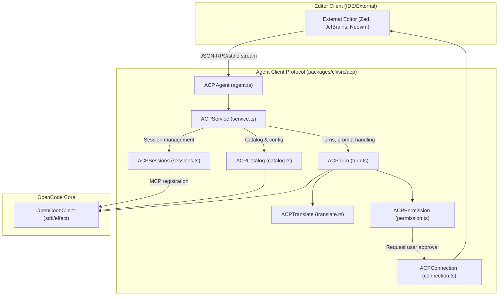
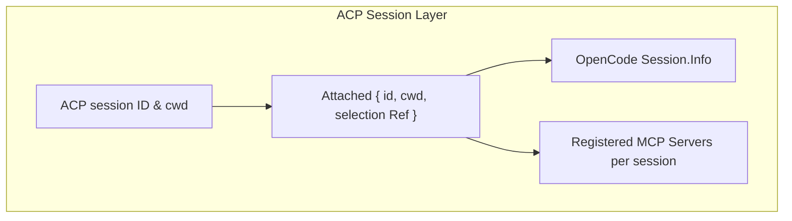
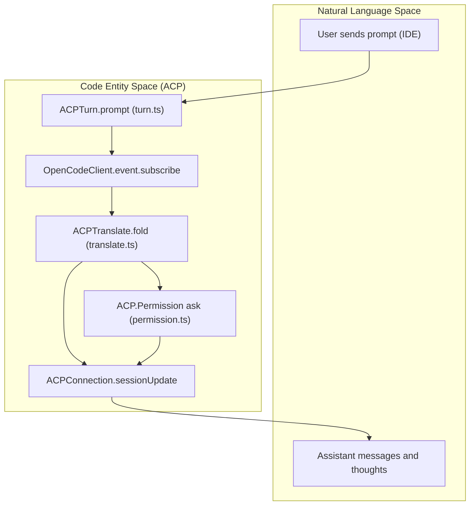
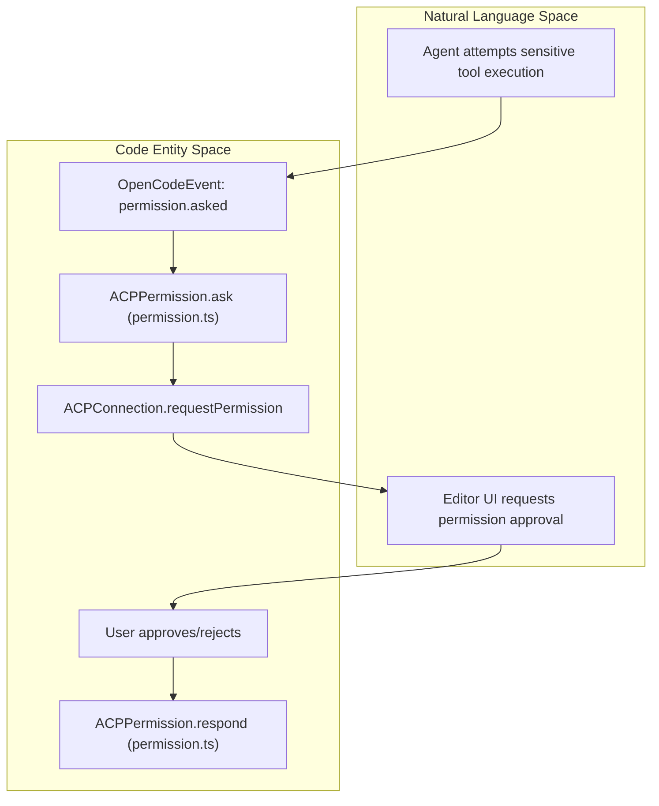
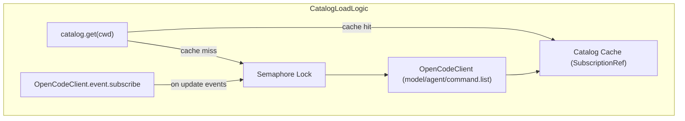

<!-- source: DeepWiki mcp.deepwiki.com · repo anomalyco/opencode · page 5.3 ACP (Agent Client Protocol) · fetched 2026-10-27 -->

# ACP (Agent Client Protocol)

Relevant source files

The following files were used as context for generating this wiki page:

- [packages/cli/src/acp/agent.ts](packages/cli/src/acp/agent.ts)
- [packages/cli/src/acp/catalog.ts](packages/cli/src/acp/catalog.ts)
- [packages/cli/src/acp/config-option.ts](packages/cli/src/acp/config-option.ts)
- [packages/cli/src/acp/connection.ts](packages/cli/src/acp/connection.ts)
- [packages/cli/src/acp/content.ts](packages/cli/src/acp/content.ts)
- [packages/cli/src/acp/elicitation.ts](packages/cli/src/acp/elicitation.ts)
- [packages/cli/src/acp/error.ts](packages/cli/src/acp/error.ts)
- [packages/cli/src/acp/permission.ts](packages/cli/src/acp/permission.ts)
- [packages/cli/src/acp/replay.ts](packages/cli/src/acp/replay.ts)
- [packages/cli/src/acp/service.ts](packages/cli/src/acp/service.ts)
- [packages/cli/src/acp/sessions.ts](packages/cli/src/acp/sessions.ts)
- [packages/cli/src/acp/tool.ts](packages/cli/src/acp/tool.ts)
- [packages/cli/src/acp/translate.ts](packages/cli/src/acp/translate.ts)
- [packages/cli/src/acp/turn.ts](packages/cli/src/acp/turn.ts)
- [packages/cli/test/acp/additional-directories.test.ts](packages/cli/test/acp/additional-directories.test.ts)
- [packages/cli/test/acp/catalog.test.ts](packages/cli/test/acp/catalog.test.ts)
- [packages/cli/test/acp/compaction.test.ts](packages/cli/test/acp/compaction.test.ts)
- [packages/cli/test/acp/elicitation.test.ts](packages/cli/test/acp/elicitation.test.ts)
- [packages/cli/test/acp/error.test.ts](packages/cli/test/acp/error.test.ts)
- [packages/cli/test/acp/permission.test.ts](packages/cli/test/acp/permission.test.ts)
- [packages/cli/test/acp/prompt-content.subprocess.test.ts](packages/cli/test/acp/prompt-content.subprocess.test.ts)
- [packages/cli/test/acp/prompt.test.ts](packages/cli/test/acp/prompt.test.ts)
- [packages/cli/test/acp/replay.test.ts](packages/cli/test/acp/replay.test.ts)
- [packages/cli/test/acp/session.test.ts](packages/cli/test/acp/session.test.ts)
- [packages/cli/test/acp/subprocess.ts](packages/cli/test/acp/subprocess.ts)
- [packages/cli/test/acp/translate.test.ts](packages/cli/test/acp/translate.test.ts)
- [packages/cli/test/acp/turn.test.ts](packages/cli/test/acp/turn.test.ts)
- [packages/cli/test/acp/wire-fixture.ts](packages/cli/test/acp/wire-fixture.ts)

The Agent Client Protocol (ACP) subsystem, located in `packages/cli/src/acp/`, implements a JSON-RPC-based agent server that facilitates communication between external editors/IDEs (such as Zed, JetBrains, and Neovim) and the OpenCode core. It manages session lifecycle, capability negotiation, user prompt turns, permissions, catalog fetching, and integrates with the Zed editor environment. ACP abstracts the internal OpenCode session and event model into a protocol understandable by client editors, providing robust control over AI agent-driven coding workflows.

---

## Core Architecture & Module Organization

ACP is built with a modular Effect-based architecture using the Effect library for concurrency and error management. The key modules and their responsibilities are:

- **`ACP.Agent` (`packages/cli/src/acp/agent.ts`)**: Entrypoint that instantiates the ACP agent application, registering JSON-RPC handlers for methods like `initialize`, `authenticate`, and session commands. It binds to an underlying stream and maps RPC calls into calls to the core service. [packages/cli/src/acp/agent.ts:26-130]()

- **`ACPService.Interface` (`packages/cli/src/acp/service.ts`)**: Implements the main business logic for session management (create, load, resume, fork), authentication, configuration option setting, and prompt handling. It acts as a façade to the OpenCode client, catalog, sessions, and turn management. [packages/cli/src/acp/service.ts:50-66]()

- **`ACPTurn.Interface` (`packages/cli/src/acp/turn.ts`)**: Controls prompt turns, handling the subscription to OpenCode events, maintaining the lifecycle of prompt requests, cancellations, and background draining. It manages concurrency and interprets event outputs into protocol messages. [packages/cli/src/acp/turn.ts:32-37]()

- **`ACPTranslate` (`packages/cli/src/acp/translate.ts`)**: The translation layer responsible for folding OpenCode core events into ACP protocol outputs. It maintains turn state and provides structured outputs such as session updates, child session updates, permission requests, and form interactions. [packages/cli/src/acp/translate.ts:47-81]()

- **`ACPSessions.Interface` (`packages/cli/src/acp/sessions.ts`)**: Maps ACP session identifiers to internal OpenCode sessions with associated directory contexts, tracks selections of models and modes, and manages MCP server registrations. Handles attach/detach lifecycles. [packages/cli/src/acp/sessions.ts:21-32]()

- **`ACPCatalog.Interface` (`packages/cli/src/acp/catalog.ts`)**: Discovers and caches AI models, agents (modes), and commands available in the workspace, automatically reloading on update events. Provides concurrency-safe catalog reads and subscriptions. [packages/cli/src/acp/catalog.ts:25-29]()

- **`ACPPermission` (`packages/cli/src/acp/permission.ts`)**: Bridges permission requests from OpenCode into ACP permission dialogs by computing file diffs previews and communicating with the client to approve or reject actions like tool executions or file modifications. [packages/cli/src/acp/permission.ts:47-81]()

- **`ACPConnection.Interface` (`packages/cli/src/acp/connection.ts`)**: Handles low-level JSON-RPC message management, including writing notifications, request-permission RPCs, and tracking request completions for confirmation messages. [packages/cli/src/acp/connection.ts:20-30]()

### Overall Architecture Diagram

Sources:  
[packages/cli/src/acp/agent.ts:26-130](),  
[packages/cli/src/acp/service.ts:50-66](),  
[packages/cli/src/acp/turn.ts:32-37](),  
[packages/cli/src/acp/sessions.ts:21-32](),  
[packages/cli/src/acp/catalog.ts:25-29](),  
[packages/cli/src/acp/permission.ts:47-81](),  
[packages/cli/src/acp/connection.ts:20-30]()

---

## Session Lifecycle & Capability Negotiation

When an external editor connects, it sends an `initialize` request that informs the ACP server about client capabilities and requests the server's capabilities and authentication methods. The ACP server responds with support information, including session management abilities and available authentication (usually a terminal-based login flow) [packages/cli/src/acp/service.ts:106-131]().

The ACP server manages sessions keyed by canonical directory paths and session IDs. The service maintains strict ownership, ensuring sessions belong to the declared working directory (validated on load) [packages/cli/src/acp/service.ts:97-103]().

### Session Management Operations

- **New Session**: Creates a new session in the specified directory, validates additional directories and MCP servers, and attaches it to internal state for tracking [packages/cli/src/acp/service.ts:137-147]().

- **Load Session**: Loads an existing session with paginated replay of historic messages via the underlying OpenCode client. Ensures the requested working directory matches session location [packages/cli/src/acp/service.ts:148-160]().

- **Resume / Fork Session**: Allows for resuming sessions without replay and forking existing sessions to create new ones; these do not replay messages to improve performance [packages/cli/test/acp/session.test.ts:52-113]().

### Session Mapping

`ACPSessions` maintains an in-memory mapping from ACP session IDs to internal sessions and tracks selected models and modes (agents). It handles MCP tool registrations by deduplicating per session and config [packages/cli/src/acp/sessions.ts:42-154]().

Sources:  
[packages/cli/src/acp/service.ts:97-160](),  
[packages/cli/src/acp/sessions.ts:42-154](),  
[packages/cli/test/acp/session.test.ts:52-113]()

---

## Turn Management & Event Translation Layer

`ACPTurn` manages prompt turns by subscribing to the OpenCode core event stream and maintains state per turn using a fold over incoming events implemented in `ACPTranslate.fold` [packages/cli/src/acp/turn.ts:32-168](), [packages/cli/src/acp/translate.ts:93-130]().

### Turn Lifecycle

- When a prompt is received, `ACPTurn` opens a turn context that subscribes to events on the OpenCode client, queues permission ask requests, and tracks cancellations.
- Each event updates the turn state, producing outputs such as session updates, child session updates, permission requests, and form requests.
- Turn cancellation triggers cleanup and draining of background tasks.
- Implements retries, compaction tracking, and child session tracking.

### Event Folding Model

The translation layer consumes events like `session.created`, `permission.asked`, and session messages. It distinguishes root session events from child session events to produce the appropriate protocol message types.

Sources:  
[packages/cli/src/acp/turn.ts:32-168](),  
[packages/cli/src/acp/translate.ts:93-130]()  

---

## Permission Handling Integration

ACP intercepts permission events (`permission.asked`) emitted by OpenCode core for sensitive tool executions or file modifications. The permissions module computes preview diffs using file system snapshots and patch parsing to help the user decide whether to allow or reject actions.

Key steps include:  
- Decode the tool input and compute file diff previews for display.  
- Compose a permission request wrapped as a `pendingToolCall` with metadata such as title and content previews.  
- Issue a `requestPermission` RPC to the external editor client.  
- Process user reply (`once`, `always`, `reject`), relaying the response back to the core.  

### Permission Flow Diagram

Sources:  
[packages/cli/src/acp/permission.ts:47-81]()

---

## Catalog & Configuration System

The catalog subsystem tracks the available AI models, agent modes, and commands for a given working directory. It caches responses from the OpenCode client and auto-reloads on pertinent events (`model.updated`, `agent.updated`, `command.updated`).

- Uses a Semaphore and `SubscriptionRef` to serialize catalog reloads and propagate changes reactively.
- Supports getting the current catalog snapshot, reloading on demand, and subscribing to catalog changes as a stream [packages/cli/src/acp/catalog.ts:25-29, 41-125]().
- Provides a function to find matching models based on provider ID and model ID.
- Builtin commands like `compact` are statically declared and merged with dynamically loaded commands.

Sources:  
[packages/cli/src/acp/catalog.ts:13-85]()

---

# Summary

The ACP system in `packages/cli/src/acp` is a comprehensive JSON-RPC server implementation that exposes OpenCode's AI agent capabilities and session management to external editors. It abstracts and translates complex event streams and stateful interactions into a protocol-friendly format with full support for session lifecycle, capability negotiation, turn management, permission control with previews, and dynamic catalog integration. Leveraging Effect-based concurrency, ACP provides robust, cancellable, and concurrent interactions suited for high-performance editor integrations such as Zed.

This detailed design enables editors to launch, control, and communicate with OpenCode agents in a full-featured programmable environment via JSON-RPC over standard IO or HTTP protocols, making ACP the critical glue between editor clients and the OpenCode core runtime.

---

Sources summary:  
- [packages/cli/src/acp/agent.ts:26-130]()  
- [packages/cli/src/acp/service.ts:50-160]()  
- [packages/cli/src/acp/turn.ts:32-168]()  
- [packages/cli/src/acp/translate.ts:93-130]()  
- [packages/cli/src/acp/sessions.ts:15-154]()  
- [packages/cli/src/acp/permission.ts:47-81]()  
- [packages/cli/src/acp/catalog.ts:13-85]()  
- [packages/cli/src/acp/connection.ts:20-30]()  
- [packages/cli/test/acp/session.test.ts:52-113]()

---

