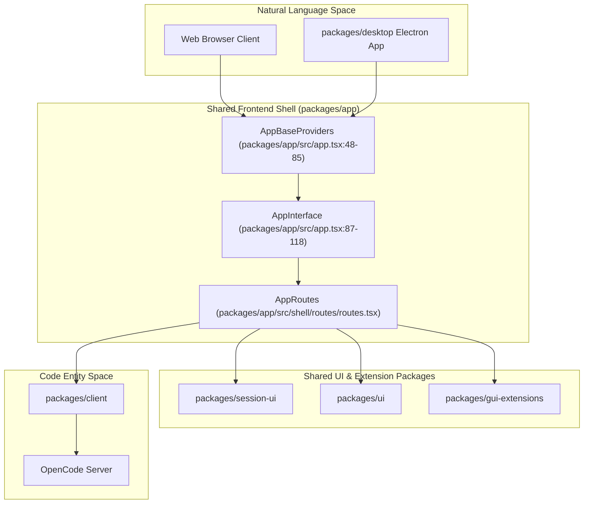
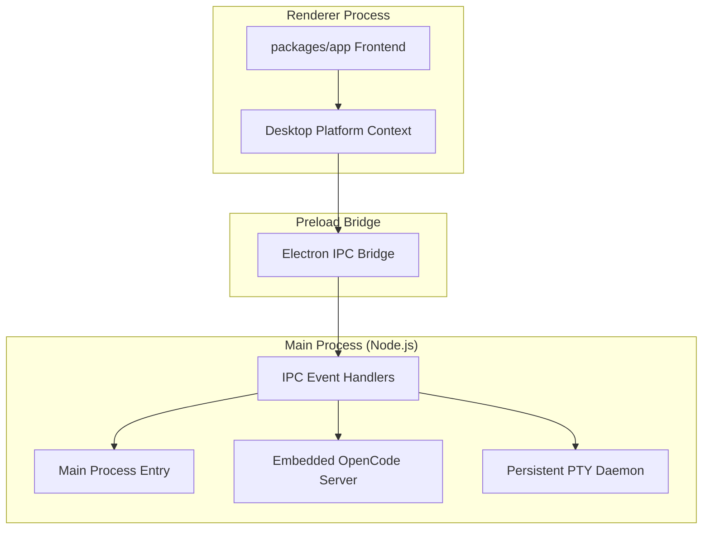

<!-- source: DeepWiki mcp.deepwiki.com · repo anomalyco/opencode · page 6 Graphical Clients · fetched 2026-10-27 -->

# Graphical Clients

Relevant source files

The following files were used as context for generating this wiki page:

- [packages/app/src/app.tsx](packages/app/src/app.tsx)

This page provides an orientation to the graphical client architecture of OpenCode, centering around the SolidJS application shell (`packages/app`), shared component libraries (`packages/session-ui`, `packages/ui`), rich feature extensions (`packages/gui-extensions`), desktop packaging (`packages/desktop`), and internationalization frameworks. All graphical clients communicate with the OpenCode backend server via the generated client SDKs and share a unified reactive architecture.

For detailed technical implementations, see the corresponding child pages:  
- App package & runtime shell → [App Package (Shared Frontend)](#6.1)  
- Turn and message timeline rendering → [Session UI Library](#6.2)  
- Reusable primitives & styling → [UI Component Library](#6.3)  
- Feature extensions & panels → [GUI Extensions](#6.4)  
- Electron desktop packaging & IPC → [Desktop Application](#6.5)  
- Cross-package localization → [Internationalization](#6.6)

---

## Graphical Client Architecture

The graphical client architecture bridges user actions in the application shell to server-side code entities and model execution loops. It relies on a modular monorepo structure where `packages/app` serves as the central router and provider container, leveraging specialized libraries for UI primitives, session timelines, and native desktop bridges.

This architecture highlights how both browser and desktop clients bootstrap onto the same `AppBaseProviders` context layer managing themes, localization, errors, dialogs, file rendering, extensions, and queries. The `AppInterface` composes global UI context providers like tabs, commands, and settings, under the routing scope defined by `AppRoutes`. The route components then orchestrate UI rendering by delegating to the UI primitives, session UI timelines, and GUI extensions. The client SDK handles communication to the backend server processes.

Sources: [packages/app/src/app.tsx:1-118](), [packages/app/package.json:1-93]()

---

## 6.1. App Package (Shared Frontend)

The `packages/app` package contains the primary SolidJS application shell, routing logic, and global providers. It is structured around two main exported components: `AppBaseProviders` and `AppInterface`.

- **`AppBaseProviders`** establishes top-level contexts including:
  - Meta tags and font injection (`MetaProvider`, `Font`)
  - Theme and color scheme management (`ThemeProvider`)
  - Localization and i18n (`LanguageProvider`, `UiI18nBridge`)
  - Global error boundaries with Sentry integration
  - Query client for server data caching (`QueryClientProvider`)
  - Modal dialog contexts (`DialogProvider`)
  - Extension runtime root
  - File component rendering override (`FileComponentProvider`)

- **`AppInterface`** defines nested UI contexts and layout providers:
  - Tabs management (`TabsProvider`)
  - Server connection and registry (`ServersProvider`)
  - Global application state (`GlobalProvider`)
  - Command handling and desktop command registration (`CommandProvider`, `DesktopCommands`)
  - Settings state management (`SettingsProvider`)
  - Core routes rendering (`AppRoutes`) via Solid Router or custom router replacement

This layering ensures consistent context sharing and state isolation between core providers and route-specific UI.

For comprehensive details, see [App Package (Shared Frontend)](#6.1).

### 6.1.1. Composer & Input

The prompt composer subsystem supports complex user input handling including multi-line prompts, command submission pipelines, queued inputs, drag-and-drop file attachments, and mention/autocomplete adapters. It is shared between the new session creation flow and active session timeline inputs.

### 6.1.2. Settings & Preferences

Settings and preferences cover user configurations via dedicated UI surfaces that include general app options, LLM model selections, keybinding customization, shell integrations, workspace and project inventories, server connection management, experimental feature toggles, and robust fuzzy search capability.

Sources: [packages/app/src/app.tsx:1-118](), [packages/app/package.json:1-93]()

---

## 6.2. Session UI Library

`packages/session-ui` provides advanced timeline rendering components. It manages projection of session events into rows, rendering of composite message parts, execution feedback UI for tools, and a performant markdown rendering pipeline supported by a dedicated worker process. This package is well-covered by Storybook fixtures and component tests to validate rendering correctness across complex session histories.

For detailed technical documentation, see [Session UI Library](#6.2).

Sources: [packages/app/package.json:67-67]()

---

## 6.3. UI Component Library

The `packages/ui` package offers low-level UI primitives used throughout graphical clients. It exports widely-used components such as lists, buttons, dialogs, tab controls, and iconography, alongside React hooks and state utilities. Styling is implemented on a Tailwind CSS foundation layered with a design token system and the custom `oc-2` theme. Additionally, it hosts i18n catalogs and theme resolution logic for consistent branding and localization.

For comprehensive details, see [UI Component Library](#6.3).

Sources: [packages/app/package.json:68-68]()

---

## 6.4. GUI Extensions

The `packages/gui-extensions` package contains rich feature panels and integrations that extend the base app shell capabilities. These include:

- Browser automation panels
- Terminal multiplexer tabs supporting persistent PTY sessions
- SSH and Windows Subsystem for Linux (WSL) sidecar sessions
- Pairing dialogs for collaborative workflows
- Code review and diff panels for artifact inspections
- File and artifact viewer enhancements
- Document rendering integrations for Microsoft Office and LaTeX/Merman documents
- Updater and debug panels to assist developers and users

For full technical details, see [GUI Extensions](#6.4).

Sources: [packages/app/package.json:66-66]()

---

## 6.5. Desktop Application

The `packages/desktop` package packages the shared `@opencode/app` frontend into a native Electron application. It orchestrates three main Electron processes:

- **Renderer Process:** Runs the full SolidJS app UI (`packages/app`), enhanced with desktop platform context bridges.
- **Preload Process:** Exposes Electron IPC APIs safely bridging renderer and main processes.
- **Main Process:** Node.js environment managing IPC event routing, spawning and supervising a persistent PTY daemon for terminal sessions, and embedding an OpenCode server instance as a sidecar.

Electron build tooling integrates `electron-vite` for development and `electron-builder` for multi-platform packaging, including auto-update mechanisms and icon management.

For complete details, see [Desktop Application](#6.5).

Sources: [packages/app/package.json:8-10]()

---

## 6.6. Internationalization

Internationalization is implemented across the graphical clients spanning `packages/app`, `packages/ui`, and backend services. This system manages:

- Language catalog structures with hierarchical JSON resources
- Runtime language selection and dynamic locale switching
- RTL-aware UI layout adjustments and development tooling support
- Localized user documentation to aid global adoption

For deep technical details, see [Internationalization](#6.6).

Sources: [packages/app/src/app.tsx:63-64](), [packages/app/package.json:74-74]()

---

