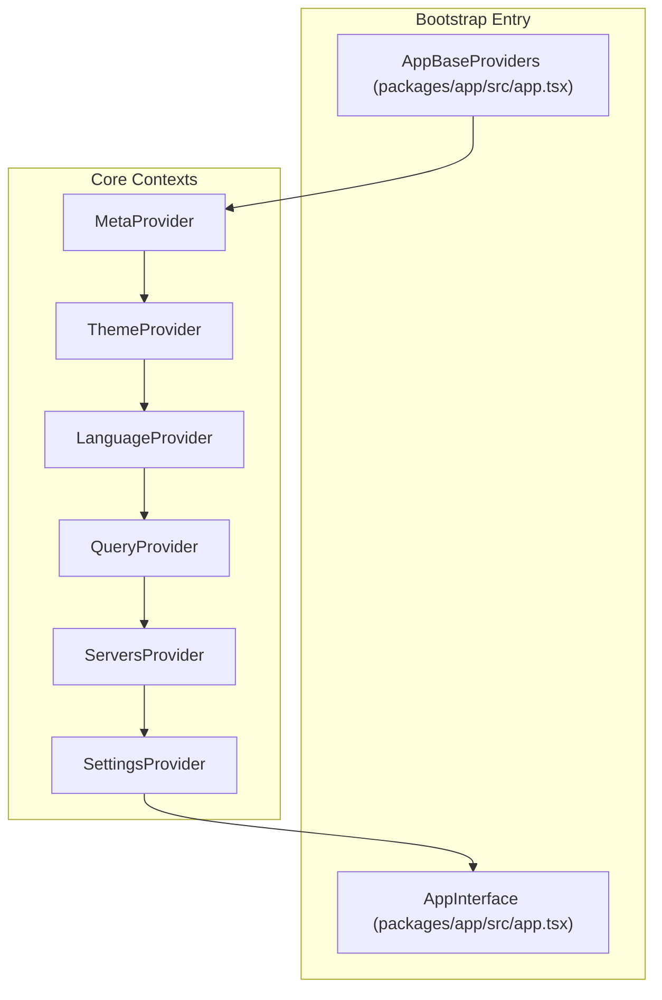
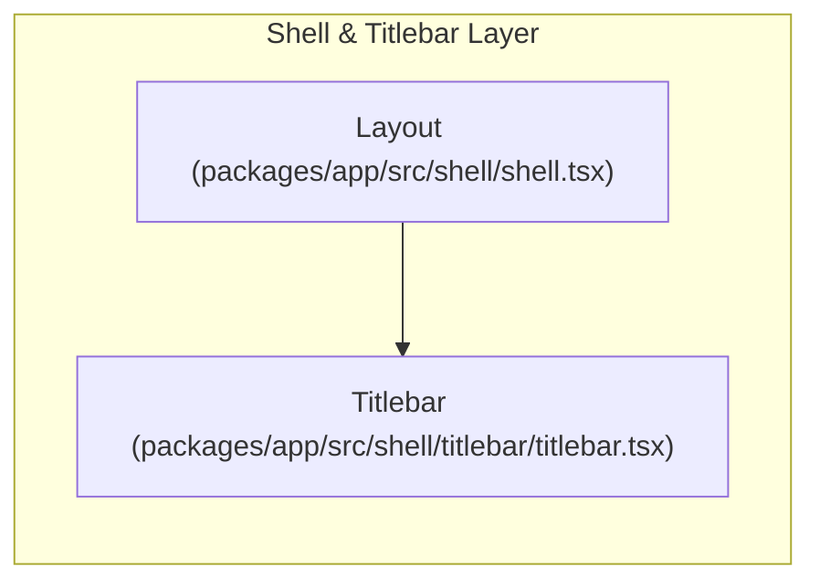
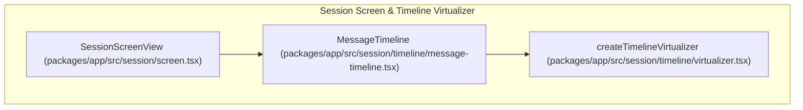
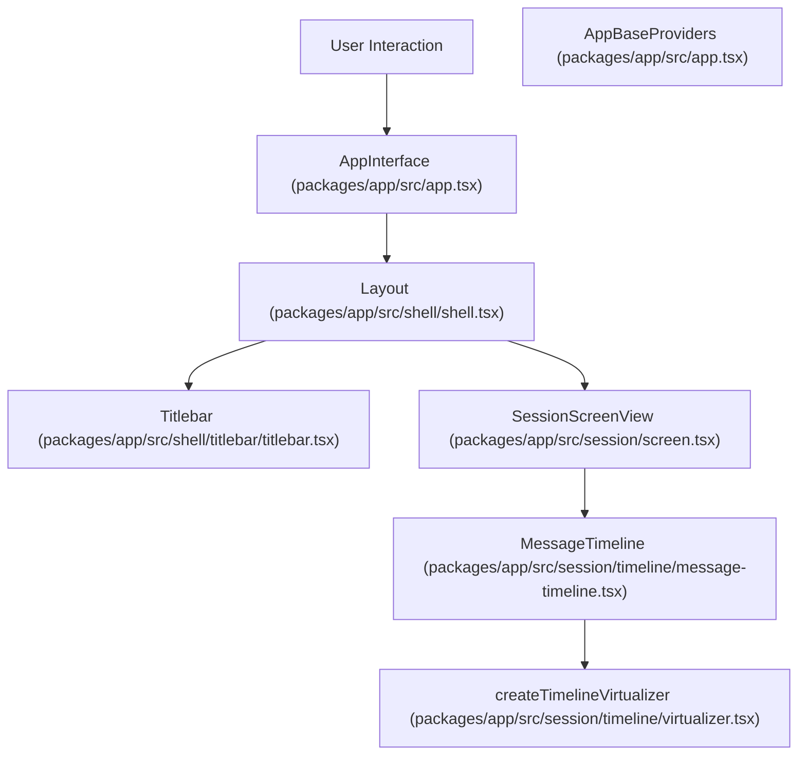

<!-- source: DeepWiki mcp.deepwiki.com · repo anomalyco/opencode · page 6.1 App Package (Shared Frontend) · fetched 2026-10-27 -->

# App Package (Shared Frontend)

Relevant source files

The following files were used as context for generating this wiki page:

- [packages/app/e2e/regression/side-panels.spec.ts](packages/app/e2e/regression/side-panels.spec.ts)
- [packages/app/e2e/regression/tabs.spec.ts](packages/app/e2e/regression/tabs.spec.ts)
- [packages/app/e2e/service-worker/cache.spec.ts](packages/app/e2e/service-worker/cache.spec.ts)
- [packages/app/e2e/service-worker/playwright.config.ts](packages/app/e2e/service-worker/playwright.config.ts)
- [packages/app/index.html](packages/app/index.html)
- [packages/app/manifest.json](packages/app/manifest.json)
- [packages/app/public/_headers](packages/app/public/_headers)
- [packages/app/public/oc-theme-preload.js](packages/app/public/oc-theme-preload.js)
- [packages/app/src/app.tsx](packages/app/src/app.tsx)
- [packages/app/src/index.css](packages/app/src/index.css)
- [packages/app/src/runtime/extension/side-region.tsx](packages/app/src/runtime/extension/side-region.tsx)
- [packages/app/src/runtime/platform/keyboard.ts](packages/app/src/runtime/platform/keyboard.ts)
- [packages/app/src/session/model.ts](packages/app/src/session/model.ts)
- [packages/app/src/session/screen-layout.ts](packages/app/src/session/screen-layout.ts)
- [packages/app/src/session/screen.tsx](packages/app/src/session/screen.tsx)
- [packages/app/src/shell/mobile-drawer.css](packages/app/src/shell/mobile-drawer.css)
- [packages/app/src/shell/mobile-drawer.tsx](packages/app/src/shell/mobile-drawer.tsx)
- [packages/app/src/shell/mobile-panel-drawer.css](packages/app/src/shell/mobile-panel-drawer.css)
- [packages/app/src/shell/mobile-panel-drawer.tsx](packages/app/src/shell/mobile-panel-drawer.tsx)
- [packages/app/src/shell/shell.tsx](packages/app/src/shell/shell.tsx)
- [packages/app/src/shell/tabs/closed.ts](packages/app/src/shell/tabs/closed.ts)
- [packages/app/src/shell/tabs/schema.ts](packages/app/src/shell/tabs/schema.ts)
- [packages/app/src/shell/tabs/tabs.test.ts](packages/app/src/shell/tabs/tabs.test.ts)
- [packages/app/src/shell/tabs/tabs.tsx](packages/app/src/shell/tabs/tabs.tsx)
- [packages/app/src/shell/titlebar/recently-closed-tabs-menu.tsx](packages/app/src/shell/titlebar/recently-closed-tabs-menu.tsx)
- [packages/app/src/shell/titlebar/tab-nav.css](packages/app/src/shell/titlebar/tab-nav.css)
- [packages/app/src/shell/titlebar/tab-nav.tsx](packages/app/src/shell/titlebar/tab-nav.tsx)
- [packages/app/src/shell/titlebar/tab-order.test.ts](packages/app/src/shell/titlebar/tab-order.test.ts)
- [packages/app/src/shell/titlebar/tab-order.ts](packages/app/src/shell/titlebar/tab-order.ts)
- [packages/app/src/shell/titlebar/tab-popover.css](packages/app/src/shell/titlebar/tab-popover.css)
- [packages/app/src/shell/titlebar/tab-popover.tsx](packages/app/src/shell/titlebar/tab-popover.tsx)
- [packages/app/src/shell/titlebar/tab-strip.tsx](packages/app/src/shell/titlebar/tab-strip.tsx)
- [packages/app/src/shell/titlebar/titlebar.css](packages/app/src/shell/titlebar/titlebar.css)
- [packages/app/src/shell/titlebar/titlebar.tsx](packages/app/src/shell/titlebar/titlebar.tsx)
- [packages/app/vite.config.ts](packages/app/vite.config.ts)
- [packages/app/vite.icons.test.ts](packages/app/vite.icons.test.ts)
- [packages/app/vite.icons.ts](packages/app/vite.icons.ts)
- [packages/app/vite.js](packages/app/vite.js)
- [packages/app/vite.pwa.ts](packages/app/vite.pwa.ts)
- [packages/desktop/src/renderer/index.html](packages/desktop/src/renderer/index.html)
- [packages/gui-extensions/src/file/label.tsx](packages/gui-extensions/src/file/label.tsx)
- [packages/gui-extensions/src/file/tabs.css](packages/gui-extensions/src/file/tabs.css)
- [packages/gui-extensions/src/terminal/panel.tsx](packages/gui-extensions/src/terminal/panel.tsx)
- [packages/session-ui/src/components/markdown-worker.ts](packages/session-ui/src/components/markdown-worker.ts)
- [packages/session-ui/src/v2/components/session-file-panel-v2.tsx](packages/session-ui/src/v2/components/session-file-panel-v2.tsx)
- [packages/session-ui/src/v2/components/session-review-file-preview-v2.tsx](packages/session-ui/src/v2/components/session-review-file-preview-v2.tsx)
- [packages/session-ui/src/v2/components/session-review-v2.css](packages/session-ui/src/v2/components/session-review-v2.css)
- [packages/session-ui/src/v2/components/session-review-v2.tsx](packages/session-ui/src/v2/components/session-review-v2.tsx)
- [packages/ui/src/assets/favicon/site.webmanifest](packages/ui/src/assets/favicon/site.webmanifest)
- [packages/ui/src/navigation/tabs/tabs.css](packages/ui/src/navigation/tabs/tabs.css)
- [packages/ui/src/theme/context.tsx](packages/ui/src/theme/context.tsx)
- [packages/ui/src/theme/default-themes.ts](packages/ui/src/theme/default-themes.ts)
- [packages/ui/src/theme/index.ts](packages/ui/src/theme/index.ts)
- [packages/ui/src/theme/themes/amoled.json](packages/ui/src/theme/themes/amoled.json)
- [packages/ui/src/theme/themes/aura.json](packages/ui/src/theme/themes/aura.json)
- [packages/ui/src/theme/themes/carbonfox.json](packages/ui/src/theme/themes/carbonfox.json)
- [packages/ui/src/theme/themes/gruvbox.json](packages/ui/src/theme/themes/gruvbox.json)
- [packages/ui/src/theme/themes/nightowl.json](packages/ui/src/theme/themes/nightowl.json)
- [packages/ui/src/theme/themes/vesper.json](packages/ui/src/theme/themes/vesper.json)

The `packages/app` package forms the shared frontend foundation for OpenCode client applications, including Desktop and Web. Implemented in **SolidJS**, it provides bootstrap logic, application shell components, titlebar and tabs navigation, routing, session screen orchestration, timeline virtualization, workspace file management, runtime platform abstractions, and internationalization.

---

## Purpose and Scope

This package encapsulates the high-level reactive presentation tier for OpenCode. It coordinates global state providers, multi-server connections, theme and language context, and window layout management.

As a **parent page**, this document provides a high-level architectural overview of the package. For specific implementation details on child domains, refer to:
- [Composer & Input](#6.1.1) — Prompt composer editor, submit pipeline, queueing, dropzone, and mentions shared across screens.
- [Settings & Preferences](#6.1.2) — Application settings surfaces, model management, keybinds, shell configurations, and project inventories.

---

## Entry & Bootstrap Architecture

The application bootstrap starts in `packages/app/src/app.tsx`, where `AppBaseProviders` sets up core contexts including meta tags, fonts, themes, localization, error boundaries integrated with Sentry, query clients, and extension roots. This provider hierarchy wraps all other components to establish a shared global environment [packages/app/src/app.tsx:48-85](). 

The main interface container, `AppInterface`, mounts the router, tab management, global command systems, and server connection stores. It ensures multi-server support and global application state wrapping [packages/app/src/app.tsx:87-118]().

**Sources:**  
[packages/app/src/app.tsx:48-118]()

---

## Shell, Titlebar & Tabs

The application shell manages the overall layout and user interface framework. The `Layout` component at `packages/app/src/shell/shell.tsx` controls the main content container, including safe-area insets, padding, and the rendering of optional vertical or horizontal tabs. It supports responsive designs for mobile and desktop, managing the place and size of tabs and content areas [packages/app/src/shell/shell.tsx:15-95]().

The `Titlebar` component (`packages/app/src/shell/titlebar/titlebar.tsx`) implements window controls tailored for platform differences, including macOS traffic lights, Windows native caption buttons, and customizable OS integrations. It maintains a navigation history stack for back/forward navigation and manages the tab strip with dynamic tab rendering and extension points for custom titlebar items [packages/app/src/shell/titlebar/titlebar.tsx:57-118]().

Tabs for sessions are rendered and managed through a modular tab system supporting rename, close actions, unread indication, and drag-and-drop reordering, connecting deeply with server-managed session information.

**Sources:**  
[packages/app/src/shell/shell.tsx:15-95](), [packages/app/src/shell/titlebar/titlebar.tsx:57-118]()

---

## Session Screen & Timeline Virtualizer

The session screen acts as the main area where chat, code generation, and AI interactions happen. The `SessionScreenView` component (`packages/app/src/session/screen.tsx`) coordinates the rendering of message timelines, side panels, session header, and interaction regions. It integrates with an extension host for flexible side panel and mobile view management [packages/app/src/session/screen.tsx:42-56]().

The timeline interface uses virtualization techniques to efficiently render large sequences of chat messages and assistant interactions. The timeline virtualizer manages scrolling, item measurement, and pinned anchoring to provide smooth, performant UIs for session conversations.

**Sources:**  
[packages/app/src/session/screen.tsx:42-56](), [packages/app/src/session/timeline/message-timeline.tsx:94-116](), [packages/app/src/session/timeline/virtualizer.tsx:93-180]()

---

## Composer & Input

The text prompt composer and input subsystem handle message composition, submission pipeline, task queueing, attachment dropzones, mentions, and input adapters that are shared between session and new-session screens.

This domain includes complex features such as the adapter system between UI inputs and data models, queueing submission to AI providers, and integration with file attachments.

For in-depth details, see the dedicated child page: [Composer & Input](#6.1.1).

---

## Settings & Preferences

Settings management surfaces control various aspects of the application including general preferences, model selections, keybinding configurations, shell integrations, workspace and project inventories, server connection management, and experimental feature toggles.

Settings are integrated via reactive providers that dynamically update app behavior and appearance.

For detailed implementation and configuration, see the child page: [Settings & Preferences](#6.1.2).

---

## Runtime Platform Abstraction & Internationalization

`packages/app` supports running on different platforms — Web, Electron desktop, Tauri, and CLI-hosted UI views — via a runtime platform abstraction layer that adapts to the current environment gracefully.

Internationalization is provided by the language and UI i18n systems. The OpenCode app includes translation dictionaries and bridges native translations into SolidJS stores using `LanguageProvider` and `UiI18nBridge`. This infrastructure enables multi-lingual support and dynamic locale switching [packages/app/src/app.tsx:63-64]().

**Sources:**  
[packages/app/src/app.tsx:63-64]()

---

## Natural Language to Code Entity Mapping

The following diagram maps key user interaction concepts and frontend architecture terminologies to specific code entities within the `packages/app` source tree.

| System Concept             | Code Symbol / Path                            | Role                                                  |
|---------------------------|----------------------------------------------|-------------------------------------------------------|
| App Bootstrap Root        | `AppBaseProviders` (`packages/app/src/app.tsx`)     | Sets up global contexts for theme, language, queries |
| Application Interface     | `AppInterface` (`packages/app/src/app.tsx`)          | Wraps router, global commands, server connections     |
| UI Shell & Layout         | `Layout` (`packages/app/src/shell/shell.tsx`)        | Main layout container, tab management, padding        |
| Window Titlebar           | `Titlebar` (`packages/app/src/shell/titlebar/titlebar.tsx`) | OS-specific window controls and tab strip management   |
| Session Screen UI         | `SessionScreenView` (`packages/app/src/session/screen.tsx`) | Coordinates message timeline and side panels           |
| Timeline Renderer         | `MessageTimeline` (`packages/app/src/session/timeline/message-timeline.tsx`) | Renders chat messages with virtualization              |
| Timeline Virtualizer      | `createTimelineVirtualizer` (`packages/app/src/session/timeline/virtualizer.tsx`) | Manages virtual scrolling and item measurement         |

---

**Sources:**  
[packages/app/src/app.tsx:48-118](), [packages/app/src/shell/shell.tsx:15-95](), [packages/app/src/shell/titlebar/titlebar.tsx:57-118](), [packages/app/src/session/screen.tsx:42-56](), [packages/app/src/session/timeline/message-timeline.tsx:94-116](), [packages/app/src/session/timeline/virtualizer.tsx:93-180]()

---

