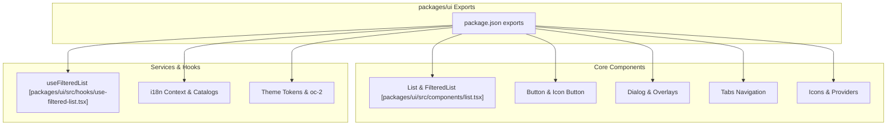
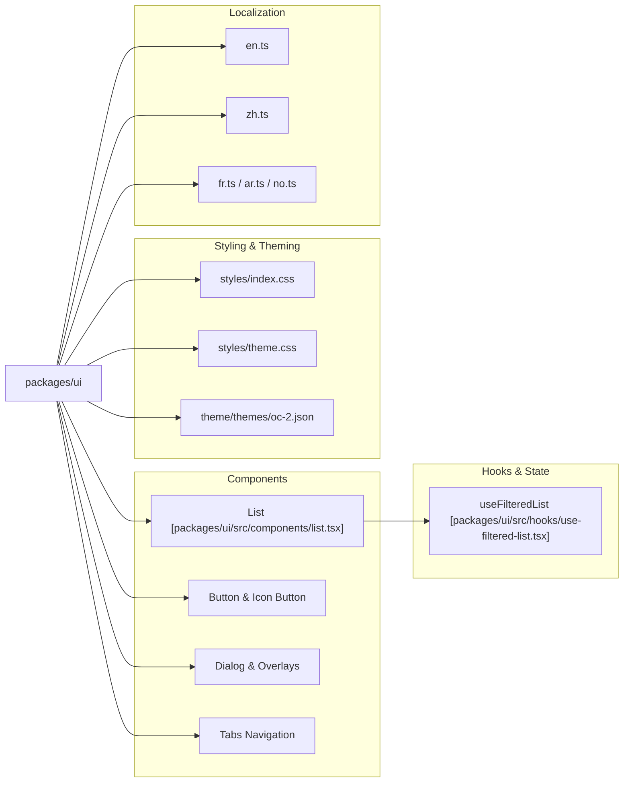
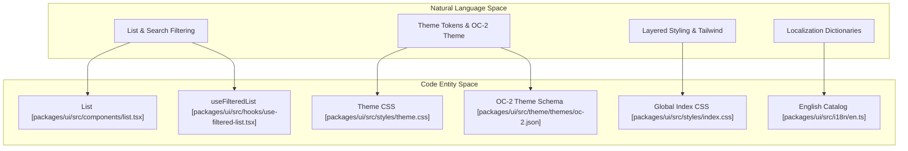

<!-- source: DeepWiki mcp.deepwiki.com · repo anomalyco/opencode · page 6.3 UI Component Library · fetched 2026-10-27 -->

# UI Component Library

<details>
<summary>Relevant source files</summary>

The following files were used as context for generating this wiki page:

- [packages/session-ui/src/components/basic-tool.css](packages/session-ui/src/components/basic-tool.css)
- [packages/session-ui/src/components/markdown-inline-code-kind.test.ts](packages/session-ui/src/components/markdown-inline-code-kind.test.ts)
- [packages/session-ui/src/components/markdown-inline-code-kind.ts](packages/session-ui/src/components/markdown-inline-code-kind.ts)
- [packages/ui/script/colors.txt](packages/ui/script/colors.txt)
- [packages/ui/src/components/list.css](packages/ui/src/components/list.css)
- [packages/ui/src/components/list.tsx](packages/ui/src/components/list.tsx)
- [packages/ui/src/hooks/use-filtered-list.tsx](packages/ui/src/hooks/use-filtered-list.tsx)
- [packages/ui/src/styles/index.css](packages/ui/src/styles/index.css)
- [packages/ui/src/styles/tailwind/colors.css](packages/ui/src/styles/tailwind/colors.css)
- [packages/ui/src/styles/tailwind/index.css](packages/ui/src/styles/tailwind/index.css)
- [packages/ui/src/styles/theme.css](packages/ui/src/styles/theme.css)
- [packages/ui/src/styles/tokens/theme.css](packages/ui/src/styles/tokens/theme.css)
- [packages/ui/src/theme/themes/oc-2.json](packages/ui/src/theme/themes/oc-2.json)
- [packages/ui/src/theme/v2/default-primitives.ts](packages/ui/src/theme/v2/default-primitives.ts)
- [packages/ui/src/theme/v2/foreground.ts](packages/ui/src/theme/v2/foreground.ts)
- [packages/ui/src/theme/v2/mapping.ts](packages/ui/src/theme/v2/mapping.ts)
- [packages/ui/src/theme/v2/resolve.test.ts](packages/ui/src/theme/v2/resolve.test.ts)
- [packages/ui/src/theme/v2/resolve.ts](packages/ui/src/theme/v2/resolve.ts)

</details>


## Purpose & Scope

This document provides a comprehensive technical overview of `@opencode-ai/ui` (`packages/ui`), the shared UI component library for OpenCode. It details the component export topology (including list, button, dialog, tabs, and icons), reactive hooks like `useFilteredList`, the layered styling architecture with Tailwind CSS, theme tokens and the canonical `oc-2` theme definition, and internationalization (i18n) catalogs.

Sources: [packages/ui/package.json:1-80](), [packages/ui/src/styles/index.css:1-37]()

---

## Component Exports & Architecture

The `@opencode-ai/ui` package exposes a modular export structure optimized for granular imports and tree-shaking by downstream consumers such as `packages/app` and `packages/tui`.

### Key Component Modules
- **List (`./*`)**: A performant, keyboard-navigable list component supporting filtering, grouping, and active selection. It integrates tightly with the `useFilteredList` hook for reactive filtered views. The `List` component supports search inputs, add-item rendering, customizable item wrappers, and group headers [packages/ui/src/components/list.tsx:18-232]().
- **Button & Icon Buttons**: Accessible button components built atop Kobalte "button" primitives, providing consistent styling, variant support, and icon support.
- **Dialog & Overlays**: Layered dialog and modal components that manage stacking order through context providers and portal layers.
- **Tabs (`./navigation/tabs/*`)**: Implements tab bars with dynamic tab closing, drag-and-drop reordering, and active tab tracking.
- **Icons (`./icons/*`)**: Organized SVG icon sets including provider brand icons, file type icons, and generic app icons for menu, status, and interface cues.



Sources: [packages/ui/package.json:1-80](), [packages/ui/src/components/list.tsx:1-232]()

---

## Hooks Architecture

Stateful interactions and logic shared across components are encapsulated in reusable hooks. The primary hook is `useFilteredList`, which manages filtered and grouped list data with active selection state.

### Filtered List Hook (`useFilteredList`)
The `useFilteredList` hook provides:
- **Support for async or synchronous data**: The `items` prop can be either a direct array or a function returning an array or promise, allowing dynamic data sources [packages/ui/src/hooks/use-filtered-list.tsx:8-14]().
- **Fuzzy Searching**: Uses the `fuzzysort` library to perform fast fuzzy matching across configured item keys (`filterKeys`) [packages/ui/src/hooks/use-filtered-list.tsx:45-49]().
- **Grouping and Sorting**: Items can be grouped via a user-provided grouping function and sorted within groups and groups themselves sorted according to custom comparators [packages/ui/src/hooks/use-filtered-list.tsx:37-56]().
- **Keyboard Navigation**: Integration with `solid-list` for managing the currently active item, handling keyboard events including arrow keys, enter, and shortcut key sequences (Ctrl+n, Ctrl+p) for navigation and selection [packages/ui/src/hooks/use-filtered-list.tsx:82-124]().
- **State exposed**: The hook returns reactive accessors for grouped data, flat item arrays, current filter, active item key, and handlers to reset or refetch list content.

This hook underpins the `List` component’s interactive behavior described above.

Sources: [packages/ui/src/hooks/use-filtered-list.tsx:20-148](), [packages/ui/src/components/list.tsx:59-225]()

---

## Styling Architecture & Tailwind CSS

OpenCode’s UI library adopts a layered CSS approach combining native CSS variables, component CSS modules, and a customized Tailwind CSS setup.

### Layered CSS Structure

Defined in `packages/ui/src/styles/index.css`, styles are organized with CSS cascading layers for control over specificity and overrides [packages/ui/src/styles/index.css:1-37]():
1. `@layer theme`: Imports color palette definitions (`colors.css`) and design tokens (`theme.css`).
2. `@layer base`: Fundamental resets, typography, and third-party global styles (like KaTeX).
3. `@layer components`: Component-scoped styles referring to data attributes such as `[data-component="list"]` and slots like `[data-slot="list-search"]` for modularity and style encapsulation [packages/ui/src/styles/index.css:9-34]().
4. `@layer utilities`: Animation keyframes, timeline controls, and utility helper classes for flexibility.

Component-specific stylesheets such as `list.css` provide in-depth styling for controls like the List [packages/ui/src/components/list.css:1-257]().

### Tailwind CSS Integration

Tailwind is configured to use OpenCode's CSS custom properties for colors, spacing, typography, and breakpoints, ensuring utility classes map to foundational design tokens. Tailwind layers import these tokens with the `@theme` directive and generate utility classes accordingly [packages/ui/src/styles/tailwind/colors.css:1-122](), [packages/ui/src/styles/tailwind/index.css:1-98]().

This architecture enables consistent theming and adaptive styling without sacrificing runtime performance or style encapsulation.

Sources: [packages/ui/src/styles/index.css:1-37](), [packages/ui/src/styles/tailwind/colors.css:1-122](), [packages/ui/src/styles/tailwind/index.css:1-98](), [packages/ui/src/components/list.css:1-257]()

---

## Theme Tokens & OC-2 Theme

OpenCode maintains a centralized set of CSS design tokens exposed as native CSS variables plus declarative themes defined in JSON.

### Theme Tokens (`theme.css`)

`theme.css` defines base typography, spacing, breakpoints, shadows, and surface colors as CSS custom properties on the `:root` selector [packages/ui/src/styles/theme.css:1-162]():
- Font families (`--font-family-sans`, `--font-family-mono`)
- Font sizes and weights
- Border radii
- Shadow styles for elevation states (e.g., xs, md, lg)
- Surface colors for base backgrounds, interactive states, success/warning/error surfaces
- Text colors with light scheme defaults

These tokens provide a standardized language for styling primitives at runtime with design system consistency.

### OC-2 Theme Schema (`oc-2.json`)

The canonical OpenCode theme (id: `oc-2`) is a JSON schema mapping semantic color roles and tokens into specific hex and RGBA values accommodating light-mode user interfaces [packages/ui/src/theme/themes/oc-2.json:1-180]():
- A palette defining core colors: neutral, ink, primary brand, success, warning, error, info, and interactive.
- Overrides for text colors, borders, syntax highlighting tokens, and UI surface layers.
- Extended v2 color tokens covering multiple shades of gray, red, blue, purple, pink, green, yellow, cyan.
- Theme roles like `v2-background-bg-base`, `v2-text-text-base`, `v2-border-border-base`, etc., mapped to palette tokens.
- Agent-specific color tokens for various agent states and UI elements.

Combined with the theme CSS tokens, this scheme supports composable and dynamic theming across apps.

Sources: [packages/ui/src/styles/theme.css:1-162](), [packages/ui/src/theme/themes/oc-2.json:1-180]()

---

## Internationalization (i18n) Catalogs

The UI library features multilingual support using flat JSON-like key-value catalogs with parameterized templates.

### Catalog Structure & Locales

Located under `packages/ui/src/i18n/`, these catalogs provide localized text strings for UI components and domain areas:
- English (`en.ts`)
- Chinese Simplified (`zh.ts`)
- Norwegian (`no.ts`)
- French (`fr.ts`)
- Arabic (`ar.ts`)
- Traditional Chinese (`zht.ts`)

Each catalog consists of nested keys separated by dots, grouping strings by domain or component:
```ts
ui.sessionReview.title = "Session Review"
ui.list.empty = "No items"
ui.promptInput.disabledTooltip = "Input is disabled"
ui.list.clearAll.one = "Clear 1 Filter"
ui.list.clearAll.other = "Clear {{count}} Filters"
```
Supports plural forms (e.g., `.one`, `.other`) and string interpolation with parameters like `{{count}}` and `{{limit}}` [packages/ui/src/i18n/en.ts:1-128]().

### i18n Implementation Details

The localized strings are consumed by components via an i18n context provider (`useI18n`). This abstracts locale choice and dictionary lookup, ensuring dynamic translation rendering in UI components.

Sources: [packages/ui/src/i18n/en.ts:1-128](), [packages/ui/src/i18n/zh.ts:1-167](), [packages/ui/src/i18n/no.ts:1-127](), [packages/ui/src/i18n/fr.ts:1-114](), [packages/ui/src/i18n/ar.ts:1-128](), [packages/ui/src/i18n/zht.ts:1-167]()

---

## Summary Diagram: UI Component Library Architecture



Sources: [packages/ui/package.json:1-80](), [packages/ui/src/components/list.tsx:59-225](), [packages/ui/src/hooks/use-filtered-list.tsx:20-148](), [packages/ui/src/styles/theme.css:1-162](), [packages/ui/src/theme/themes/oc-2.json:1-180]()

---

## Linking Natural Language to Code Entities



Sources: [packages/ui/src/components/list.tsx:1-232](), [packages/ui/src/hooks/use-filtered-list.tsx:1-148](), [packages/ui/src/styles/theme.css:1-162](), [packages/ui/src/theme/themes/oc-2.json:1-180](), [packages/ui/src/styles/index.css:1-37](), [packages/ui/src/i18n/en.ts:1-128]()

---

