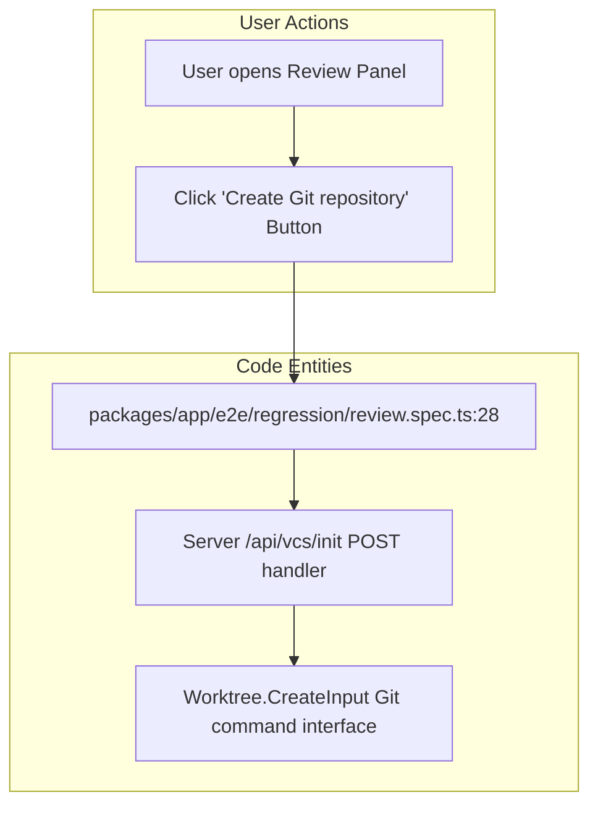
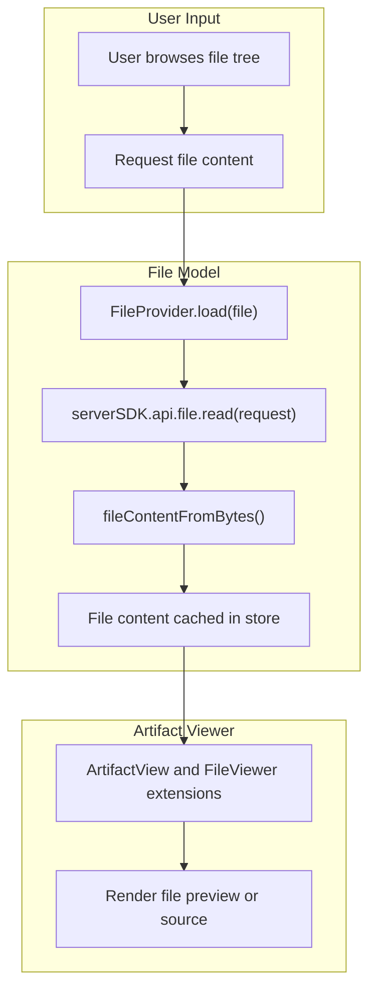
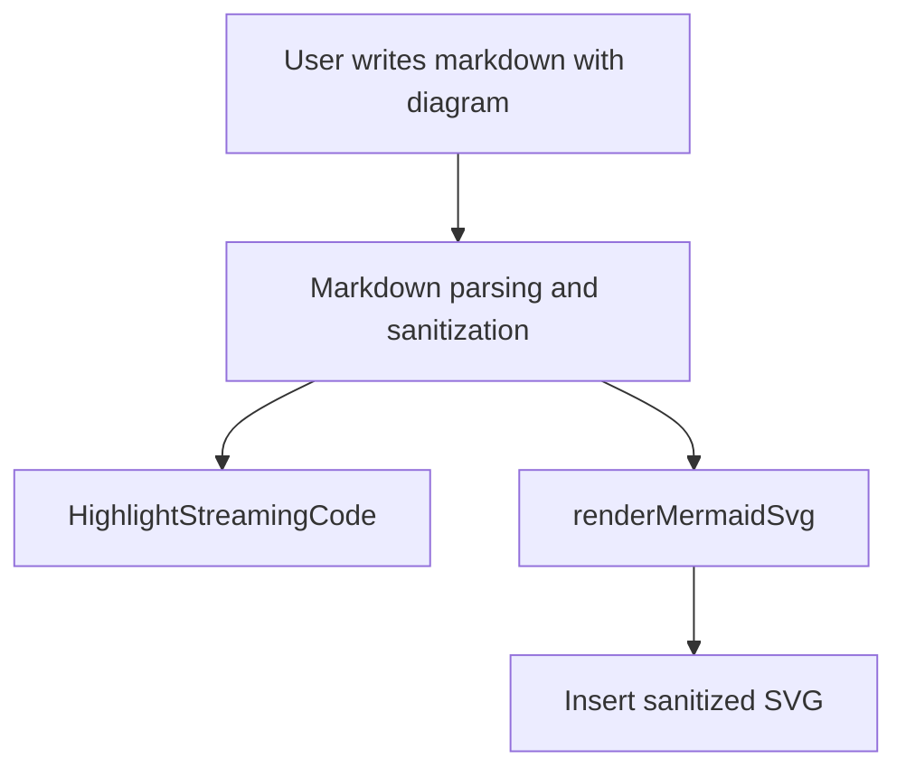

<!-- source: DeepWiki mcp.deepwiki.com · repo anomalyco/opencode · page 6.4 GUI Extensions · fetched 2026-10-27 -->

# GUI Extensions

Relevant source files

The following files were used as context for generating this wiki page:

- [.github/workflows/nix-eval.yml](.github/workflows/nix-eval.yml)
- [.github/workflows/nix-hashes.yml](.github/workflows/nix-hashes.yml)
- [flake.lock](flake.lock)
- [flake.nix](flake.nix)
- [nix/desktop.nix](nix/desktop.nix)
- [nix/electron.nix](nix/electron.nix)
- [nix/hashes.json](nix/hashes.json)
- [nix/node_modules.nix](nix/node_modules.nix)
- [nix/opencode.nix](nix/opencode.nix)
- [packages/app/README.md](packages/app/README.md)
- [packages/app/e2e/regression/review.spec.ts](packages/app/e2e/regression/review.spec.ts)
- [packages/app/e2e/regression/whats-new.spec.ts](packages/app/e2e/regression/whats-new.spec.ts)
- [packages/app/e2e/utils/settings-wsl.fixture.tsx](packages/app/e2e/utils/settings-wsl.fixture.tsx)
- [packages/app/e2e/utils/settings-wsl.html](packages/app/e2e/utils/settings-wsl.html)
- [packages/app/src/workspaces/files/artifact.test.ts](packages/app/src/workspaces/files/artifact.test.ts)
- [packages/app/src/workspaces/files/artifact.ts](packages/app/src/workspaces/files/artifact.ts)
- [packages/app/src/workspaces/files/content-cache.ts](packages/app/src/workspaces/files/content-cache.ts)
- [packages/app/src/workspaces/files/model.tsx](packages/app/src/workspaces/files/model.tsx)
- [packages/app/src/workspaces/files/types.ts](packages/app/src/workspaces/files/types.ts)
- [packages/desktop/README.md](packages/desktop/README.md)
- [packages/gui-extensions/src/details/panel.tsx](packages/gui-extensions/src/details/panel.tsx)
- [packages/gui-extensions/src/file/artifact-view.css](packages/gui-extensions/src/file/artifact-view.css)
- [packages/gui-extensions/src/file/artifact-view.tsx](packages/gui-extensions/src/file/artifact-view.tsx)
- [packages/gui-extensions/src/file/artifact.test.ts](packages/gui-extensions/src/file/artifact.test.ts)
- [packages/gui-extensions/src/file/artifact.ts](packages/gui-extensions/src/file/artifact.ts)
- [packages/gui-extensions/src/file/browser.tsx](packages/gui-extensions/src/file/browser.tsx)
- [packages/gui-extensions/src/file/context.ts](packages/gui-extensions/src/file/context.ts)
- [packages/gui-extensions/src/file/contract.ts](packages/gui-extensions/src/file/contract.ts)
- [packages/gui-extensions/src/file/i18n/en.ts](packages/gui-extensions/src/file/i18n/en.ts)
- [packages/gui-extensions/src/file/index.ts](packages/gui-extensions/src/file/index.ts)
- [packages/gui-extensions/src/file/open-in-app.tsx](packages/gui-extensions/src/file/open-in-app.tsx)
- [packages/gui-extensions/src/file/renderer.tsx](packages/gui-extensions/src/file/renderer.tsx)
- [packages/gui-extensions/src/review/index.ts](packages/gui-extensions/src/review/index.ts)
- [packages/gui-extensions/src/review/mobile.tsx](packages/gui-extensions/src/review/mobile.tsx)
- [packages/gui-extensions/src/review/model.ts](packages/gui-extensions/src/review/model.ts)
- [packages/gui-extensions/src/review/panel.tsx](packages/gui-extensions/src/review/panel.tsx)
- [packages/gui-extensions/src/review/parts.tsx](packages/gui-extensions/src/review/parts.tsx)
- [packages/gui-extensions/src/sdk/host-apis.ts](packages/gui-extensions/src/sdk/host-apis.ts)
- [packages/gui-extensions/src/sdk/solid.ts](packages/gui-extensions/src/sdk/solid.ts)
- [packages/gui-extensions/src/updater/main.ts](packages/gui-extensions/src/updater/main.ts)
- [packages/gui-extensions/src/updater/platform.ts](packages/gui-extensions/src/updater/platform.ts)

## Purpose and Scope

`packages/gui-extensions` provides a rich set of specialized UI subsystems that extend the core OpenCode chat timeline experience. These include browser automation interfaces, terminal emulation, SSH and WSL remote connection managers, pairing interfaces, review panels for version control system (VCS) integration and file diffs, artifact and file views with advanced rendering, Microsoft Office and LaTeX/Mermaid document rendering integrations, as well as updater and debug panels.

Together with complementary modules in `@opencode/session-ui` and `@opencode/app`, these GUI extensions enable advanced, contextual interactions for code editing, review, collaboration, and session diagnostics within the graphical clients.

---

## Review Panels and VCS Integration

The review panel subsystem integrates workspace Git status, file diffs, and VCS initialization workflows directly into the UI shell. It manages session-scoped review states and triggers Git initialization when a project lacks a VCS.

When users click to open the review tab and the underlying project directory has no VCS detected, the UI exposes a **Create Git repository** button. Activating this button calls the server API endpoint `/api/vcs/init` to create a new Git repository in the project folder. The UI asynchronously awaits confirmation, disables the init button during the request, and refreshes diff views upon success.

*Figure 1: Review Panel Git Repository Initialization Call Flow*

Review panel state updates dynamically follow session switches, ensuring that Git initialization and diff tracking are session-specific. If Git init is rejected (e.g., error status 501), the UI resets button state without showing redundant errors on other sessions.

The panel also tracks file changes, allowing users to view and undo edits within the workspace, supporting robust code review workflows.

Sources: [packages/app/e2e/regression/review.spec.ts:16-87]()

---

## Terminal, SSH, and WSL Integrations

The GUI extensions package integrates terminal emulators that connect to persistent shell environments, enabling local terminal access and remote sessions via SSH or Windows Subsystem for Linux (WSL).

Key features include:

- Querying shell configurations from `/api/config/shell` to list available login shells.
- Persistent PTY management for local and remote sessions, identified by unique `Pty.ID`s, isolating streams per workspace scope.
- Remote SSH/WSL connection management UI with credential and tunnel configuration.
- Terminal data flow streams bi-directionally between UI terminal components and backend server PTYs.

These integrations ensure seamless terminal and remote shell access contextualized within project sessions.

Sources: [packages/app/e2e/utils/mock-api.ts:43-70](), [packages/app/e2e/utils/mock-server.ts:44-56]()

---

## File and Artifact Views

The file and artifact viewer subsystem offers advanced browsing, viewing, and rendering for files within the workspace and their associated artifacts.

### Core File Model

The `FileProvider` context in `packages/app/src/workspaces/files/model.tsx` manages:

- File tree stores for directory listings.
- Cached file content and LRU eviction policies.
- Lazy loading of text and binary file contents from the server with error handling.
- Integration with extension-driven viewers for specialized artifact kinds.

### Data Flow

*Figure 2: File Loading and Artifact Viewing Data Flow*

### Viewer Features

- Supports previewable artifact kinds: SVG, HTML, Markdown, Mermaid, tables, images, videos, audio, PDFs, fonts.
- Displays metadata such as image dimensions, table rows/columns, PDF page counts.
- Provides toggling between source code views and rendered previews for appropriate kinds.
- On failure to decode media or unsupported binary files, falls back to placeholders.

The file viewer uses SolidJS reactive primitives (`createSignal`, `createMemo`) to track viewer modes and content states, updating UI smoothly.

Sources: [packages/app/src/workspaces/files/model.tsx:60-215](), [packages/gui-extensions/src/file/artifact-view.tsx:1-180]()

---

## Rendering Integrations: LaTeX, Mermaid, and Office Documents

Advanced rendering integrations for documents and diagrams are part of the GUI extensions, primarily facilitated by the markdown pipeline in `@opencode/session-ui` and custom viewers.

### Markdown and Mermaid Processing

- Markdown blocks are parsed and sanitized, supporting secure inline HTML.
- Code blocks are syntax-highlighted incrementally using streaming highlighters.
- Mermaid diagrams are rendered to sanitized SVG using the `renderMermaidSvg` utility.
- Tables and other supported markup are parsed and displayed with metadata.

*Figure 3: Markdown and Mermaid Diagram Rendering Pipeline*

### Microsoft Office and LaTeX

- Office document artifacts are rendered with custom viewers ensuring format fidelity.
- LaTeX mathematical notation and formulas render inline in messages.
- These are exposed as pluggable viewers inside file/artifact panes.

Sources: [packages/session-ui/src/components/markdown.tsx:30-112](), [packages/session-ui/component-tests/markdown.spec.ts:50-128]()

---

## Updater and Debug Panels

The GUI extensions also include diagnostic panels and update management UI:

- **Session Summary Panels** display metadata about the active session, including server connections, MCP servers, and session details.
- Keybinds configured by user or defaults toggle summary visibility (`Ctrl+Shift+Y` or `F8`).
- Disclosures such as project sections, server inventory, and MCP items maintain persistent expanded/collapsed state across sessions using extension local storage.
- Debug panels provide UI for inspecting active event streams, error boundaries (`SessionRouteErrorBoundary`), and error messages in session routes.
- The updater panel monitors for application updates and handles background background update workflows.

These panels enhance developer insight and control within the GUI.

Sources: [packages/app/src/session/route.tsx:101-113](), [packages/app/e2e/regression/session-summary.spec.ts:9-136]()

---

# Summary Diagram: GUI Extensions by Subsystem and Code Entities

```mermaid
graph TD
    subgraph "Review Panels"
        ReviewUI["Review Panel UI\n(packages/app/e2e/regression/review.spec.ts)"] --> GitInit["VCS Init API\n/api/vcs/init"]
    end
    subgraph "Terminal & Remote Shell"
        TerminalUI["Terminal UI and PTY Streams\n(packages/app/e2e/utils/mock-api.ts)"] --> RemotePty["SSH/WSL PTY Backends"]
    end
    subgraph "File & Artifact Views"
        FileModel["FileProvider & Model\n(packages/app/src/workspaces/files/model.tsx)"] --> FileReadAPI["serverSDK.api.file.read()"]
        FileView["ArtifactView Component\n(packages/gui-extensions/src/file/artifact-view.tsx)"] --> FileModel
        FileView --> ExtensionViewers["FileViewer Extensions\n(renderers for images, markdown, pdf, etc.)"]
    end
    subgraph "Rendering & Docs"
        MarkdownPipe["MarkdownPipeline\n(packages/session-ui/src/components/markdown.tsx)"] --> MermaidRender["renderMermaidSvg"]
        MarkdownPipe --> Highlighting["HighlightStreamingCode"]
    end
    subgraph "Updater & Debug Panels"
        DebugUI["Debug & Updater Panels\n(packages/app/src/session/route.tsx)"] --> EventStreams["Session Event Streams"]
        DebugUI --> UpdateManager["Background Updater Logic"]
    end
```

*Figure 4: GUI Extensions Subsystems Mapped to Key Code Entities*

---

# Notes on Packaging and Build

- `packages/gui-extensions` works alongside `@opencode/session-ui` components for markdown rendering, timeline rows, and tool renderers.
- The package integrates within the desktop application built with Electron (`packages/desktop`) providing native app experience.
- It complements server APIs exposed from the main `packages/server` process, particularly for file management, version control, shell sessions, and pairing.

---

# References

- Review panels and VCS integration testing: `packages/app/e2e/regression/review.spec.ts:16-87`  
- File model and loading: `packages/app/src/workspaces/files/model.tsx:60-215`  
- Artifact view component: `packages/gui-extensions/src/file/artifact-view.tsx:1-180`  
- Terminal and PTY session mocks: `packages/app/e2e/utils/mock-api.ts:43-70`  
- Markdown and Mermaid rendering pipeline: `packages/session-ui/src/components/markdown.tsx:30-112`  
- Debug and updater panel integration: `packages/app/src/session/route.tsx:101-113`  

Sources:  
[packages/app/e2e/regression/review.spec.ts:16-87](),  
[packages/app/src/workspaces/files/model.tsx:60-215](),  
[packages/gui-extensions/src/file/artifact-view.tsx:1-180](),  
[packages/app/e2e/utils/mock-api.ts:43-70](),  
[packages/session-ui/src/components/markdown.tsx:30-112](),  
[packages/app/src/session/route.tsx:101-113]()

---

