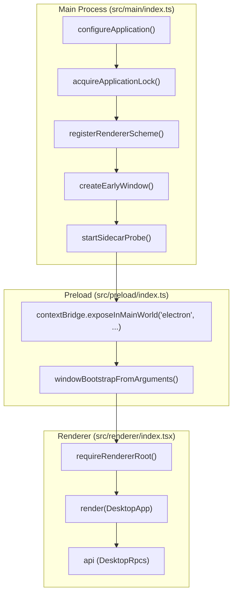
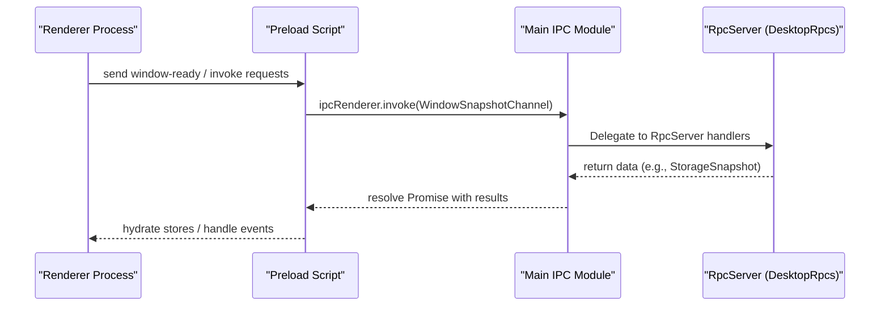
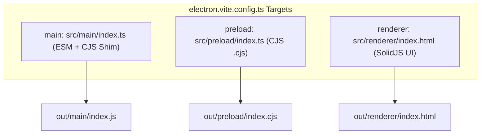
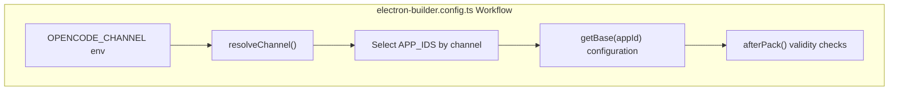

<!-- source: DeepWiki mcp.deepwiki.com · repo anomalyco/opencode · page 6.5 Desktop Application · fetched 2026-10-27 -->

# Desktop Application

Relevant source files

The following files were used as context for generating this wiki page:

- [bunfig.toml](bunfig.toml)
- [packages/app/src/entry.tsx](packages/app/src/entry.tsx)
- [packages/app/src/index.ts](packages/app/src/index.ts)
- [packages/cli/script/opencode-pty.ts](packages/cli/script/opencode-pty.ts)
- [packages/cli/src/node/target.ts](packages/cli/src/node/target.ts)
- [packages/cli/test/node-assets.test.ts](packages/cli/test/node-assets.test.ts)
- [packages/core/src/persistent-pty/binary.bun.ts](packages/core/src/persistent-pty/binary.bun.ts)
- [packages/core/src/persistent-pty/binary.node.ts](packages/core/src/persistent-pty/binary.node.ts)
- [packages/desktop/.gitignore](packages/desktop/.gitignore)
- [packages/desktop/electron-builder.config.test.ts](packages/desktop/electron-builder.config.test.ts)
- [packages/desktop/electron-builder.config.ts](packages/desktop/electron-builder.config.ts)
- [packages/desktop/electron.vite.config.test.ts](packages/desktop/electron.vite.config.test.ts)
- [packages/desktop/electron.vite.config.ts](packages/desktop/electron.vite.config.ts)
- [packages/desktop/scripts/copy-metainfo.ts](packages/desktop/scripts/copy-metainfo.ts)
- [packages/desktop/scripts/dev-electron.ts](packages/desktop/scripts/dev-electron.ts)
- [packages/desktop/scripts/dev.ts](packages/desktop/scripts/dev.ts)
- [packages/desktop/scripts/prebuild.ts](packages/desktop/scripts/prebuild.ts)
- [packages/desktop/scripts/utils.ts](packages/desktop/scripts/utils.ts)
- [packages/desktop/src/main/env.d.ts](packages/desktop/src/main/env.d.ts)
- [packages/desktop/src/main/index.ts](packages/desktop/src/main/index.ts)
- [packages/desktop/src/main/ipc.ts](packages/desktop/src/main/ipc.ts)
- [packages/desktop/src/preload/index.ts](packages/desktop/src/preload/index.ts)
- [packages/desktop/src/preload/types.ts](packages/desktop/src/preload/types.ts)
- [packages/desktop/src/renderer/index.tsx](packages/desktop/src/renderer/index.tsx)
- [packages/server/test/fetch.test.ts](packages/server/test/fetch.test.ts)

This page documents the desktop application implementation for OpenCode (`packages/desktop`), an Electron-based native wrapper embedding the SolidJS web application (`packages/app`) and coordinating native system capabilities, IPC bridges, a persistent PTY daemon, and bundled CLI/sidecar runtimes.

---

## Overview & Process Architecture

The `packages/desktop` package is structured into three distinct runtime environments:

- **Main Process** (`src/main/index.ts`): Initial setup, application locking, custom protocol registration, window creation, lifecycle management, and sidecar CLI probing.
- **Preload Script** (`src/preload/index.ts`): Bridges Electron's IPC safely exposing native APIs and snapshots to the renderer context.
- **Renderer Process** (`src/renderer/index.tsx`): Hosts the SolidJS-based UI, establishes frontend IPC clients, menus, deep links, and error monitoring.

Electron’s main process bootstraps configuration and locking immediately synchronously, registers a custom URL scheme for the renderer, creates an "early" BrowserWindow at ready event, starts a background sidecar probe for CLI availability, and then dynamically imports the main desktop module graph. This design prioritizes first-window display speed and concurrency with resource loading [packages/desktop/src/main/index.ts:1-35]().

### Process Architecture & Key Code Entities

The bootstrap context is derived from the command line arguments of the Electron renderer and hydration snapshots for window and storage state are provided for immediate store setup before the UI renders. The renderer imports and renders the main `DesktopApp` SolidJS component, passing an IPC API client to it [packages/desktop/src/preload/index.ts:1-32](), [packages/desktop/src/renderer/index.tsx:1-23]().

Sources:  
[packages/desktop/src/main/index.ts:1-35](), [packages/desktop/src/preload/index.ts:1-32](), [packages/desktop/src/renderer/index.tsx:1-23]()

---

## IPC Layer & RPC Server

IPC between renderer and main operates via the `effect/rpc` library to provide a typed RPC server on the main side exposing `DesktopRpcs`. Electron's `MessageChannelMain` is used to establish message ports for multiplexed communication.

### IPC Handler Composition and Wiring

The IPC server layer merges a broad set of handler layers each managing application state slices and functionality: app lifecycle, storage, files, windows, menus, events, and extensions [packages/desktop/src/main/ipc.ts:24-40]().

A key function `registerIpcHandlers` performs the wiring of message ports for every browser window created or existing, listening for the `did-finish-load` event of web contents to inject IPC ports via `postMessage`. It also installs behavior such as intercepting "Escape" key input to cancel drag events [packages/desktop/src/main/ipc.ts:42-90]().

### IPC Data Flow Diagram

This IPC mechanism supports request-response patterns and streaming updates via the `effect/rpc` framework that integrates deeply into the desktop application's state and command handling.

Sources:  
[packages/desktop/src/main/ipc.ts:1-90](), [packages/desktop/src/preload/index.ts:1-32]()

---

## Persistent PTY Daemon Integration

A crucial native feature is the persistent PTY daemon managed by a bundled CLI binary (`opencode-cli`) working as a sidecar process. This binary exposes PTY and other native OS capabilities.

- The main process probes the sidecar's availability upon start (`startSidecarProbe`).
- The bundled CLI is platform- and architecture-specific, with prebuilt target binaries listed in `scripts/utils.ts`.
- The CLI binary and version manifest are copied into `resources/opencode-cli` and verified during packaging and startup.

This integration enables stable, performant native terminal sessions hosting shell interactions within the desktop app, bridging the UI with native PTY features.

Sources:  
[packages/desktop/src/main/index.ts:1-35](), [packages/desktop/scripts/utils.ts:20-145]()

---

## Build Configuration with electron-vite

Building the desktop app uses `electron-vite` for efficient bundling of the three targets:

- **Main Process**: Entry `src/main/index.ts`, ES module format with injected CommonJS shim banner enabling Node internals (`__filename`, `__dirname`, `require()` compatibility). Bundling excludes core Effect libraries but includes the architecture-specific node-pty package [packages/desktop/electron.vite.config.ts:55-87]().

- **Preload Script**: Outputs a CommonJS `.cjs` file (`src/preload/index.ts`). This single-file approach matches Electron’s preload script loading requirements when sandboxing is enabled [packages/desktop/electron.vite.config.ts:100-115]().

- **Renderer Process**: Bundles the SolidJS-based UI shell alongside vendor chunks. Environment variables pass channel identity and version into the build. The renderer public directory links to the `packages/app/public` folder for assets [packages/desktop/electron.vite.config.ts:116-146]().

This separation allows optimized startup performance and compatibility with Electron’s multi-process architecture.

Sources:  
[packages/desktop/electron.vite.config.ts:1-146]()

---

## Packaging & electron-builder Configuration

Packaging and release are controlled by a comprehensive `electron-builder.config.ts`. This config manages:

- **App Identifiers and Channels**: Uses `OPENCODE_CHANNEL` environment variable to resolve release channels (`dev`, `beta`, `prod`) with corresponding app IDs (`ai.opencode.desktop.dev`, `ai.opencode.desktop.beta`, `ai.opencode.desktop`).
- **Resource Filters**: Excludes unnecessary source maps, TypeScript typings, and development-only files to reduce package size.
- **Signing**: Conditional codesigning for macOS and Windows, including hardened runtime entitlements customized per internal CLI binary [packages/desktop/electron-builder.config.ts:20-170]().
- **Validation**: Post-pack phase checks that the bundled CLI and node-pty native libraries are valid and non-empty.
- **Extra Resources**: Copies CLI executables and version files into packaging resources.
- **Legacy Support**: Maintains hidden Linux desktop files for backward compatibility with GNOME/KDE launchers [packages/desktop/electron-builder.config.ts:1-170]().

The configuration ensures production-grade builds aligned with platform conventions, security policies, and deployment constraints.

Sources:  
[packages/desktop/electron-builder.config.ts:1-170]()

---

## Development Scripts & CLI Integration

Local development is orchestrated via `scripts/dev.ts`, which performs:

- Ensuring the bundled CLI binary is present (calls utilities in `scripts/utils.ts` to copy or download binaries based on platform and architecture).
- Launching the Electron app with environment variables set for local development and isolated server mode (`OPENCODE_CHANNEL=local`, `OPENCODE_DESKTOP_ISOLATED_SERVER=1`).
- Runs Electron in watch mode with live reload to support rapid frontend and backend iteration [packages/desktop/scripts/dev.ts:1-92](), [packages/desktop/scripts/utils.ts:1-131]().

The CLI provisioning supports:

- Multiple platform targets including macOS (arm64/x64), Windows (arm64/x64), and Linux (arm64/x64).
- Versioned bundles with manifest files beside executables for quick version lookup.
- Automatic permissions and codesigning on different platforms (e.g., `chmod` on Unix, PowerShell signing scripts on Windows, `codesign` on macOS).

Sources:  
[packages/desktop/scripts/dev.ts:1-92](), [packages/desktop/scripts/utils.ts:1-131]()

---

## Renderer Application Shell

The renderer entry point (`src/renderer/index.tsx`) starts by registering diagnostics and styles, sets up the IPC API client, initializes the desktop menu system, deep link handlers, and then renders the `DesktopApp` component into the root HTML element.

It also initializes Sentry for error monitoring with version and platform tags. The root element is guarded to prevent multiple mounts, and locale resolution is performed to load appropriate language dictionaries before render [packages/desktop/src/renderer/index.tsx:1-23]().

Sources:  
[packages/desktop/src/renderer/index.tsx:1-23]()

---

## Iconography and Auto-Updater (Summary)

- Icons for the desktop app are located under the `resources/icons` folder referenced during packaging.
- Auto-update use relies on channel-specific app IDs to select update feeds.
- Windows signing uses custom PowerShell scripts triggered automatically in CI environments.
- macOS builds apply hardened runtime and entitlements including exceptions for bundled CLI helper binaries.

These features are integrated within `electron-builder.config.ts` and the packaging pipeline to provide a polished native app experience.

Sources:  
[packages/desktop/electron-builder.config.ts:1-170]()

---

# Summary

`packages/desktop` provides a full Electron-based desktop client for OpenCode that embeds the SolidJS frontend, manages a persistent PTY sidecar CLI, and bridges via powerful IPC using `effect/rpc`. Its build and packaging setups via electron-vite and electron-builder produce cross-platform native apps with auto-updating and signing facilities. Development workflows automate CLI provisioning and live reload.

This leaf page details the implementation breakdown, integration layers, data flow, and build/packaging configurations ensuring a seamless native extension of OpenCode’s core AI coding agent architecture.

---

# References and Further Reading

- Main process bootstrap: `src/main/index.ts` [1-35]  
- IPC setup and handlers: `src/main/ipc.ts` [1-90]  
- Preload bridging: `src/preload/index.ts` [1-32]  
- Renderer entry & UI mount: `src/renderer/index.tsx` [1-23]  
- Electron vite build config: `electron.vite.config.ts` [1-146]  
- Electron builder config & signing: `electron-builder.config.ts` [1-170]  
- Development and CLI provisioning: `scripts/dev.ts` [1-92], `scripts/utils.ts` [1-131]

---

