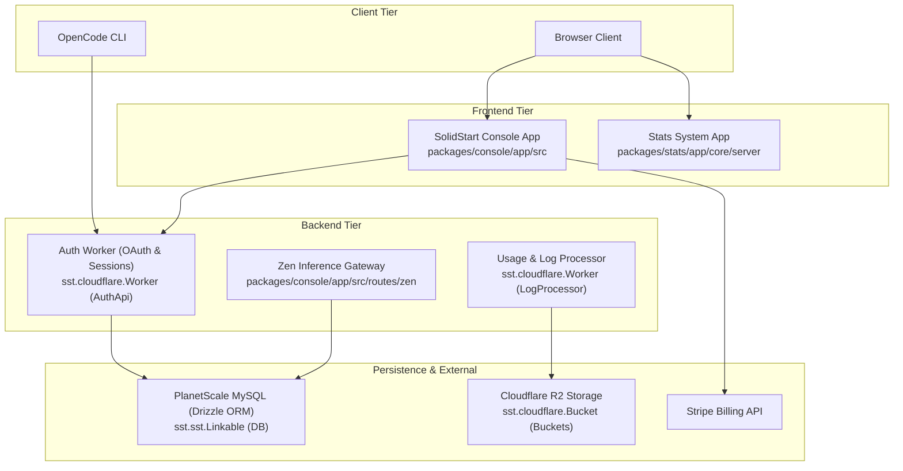
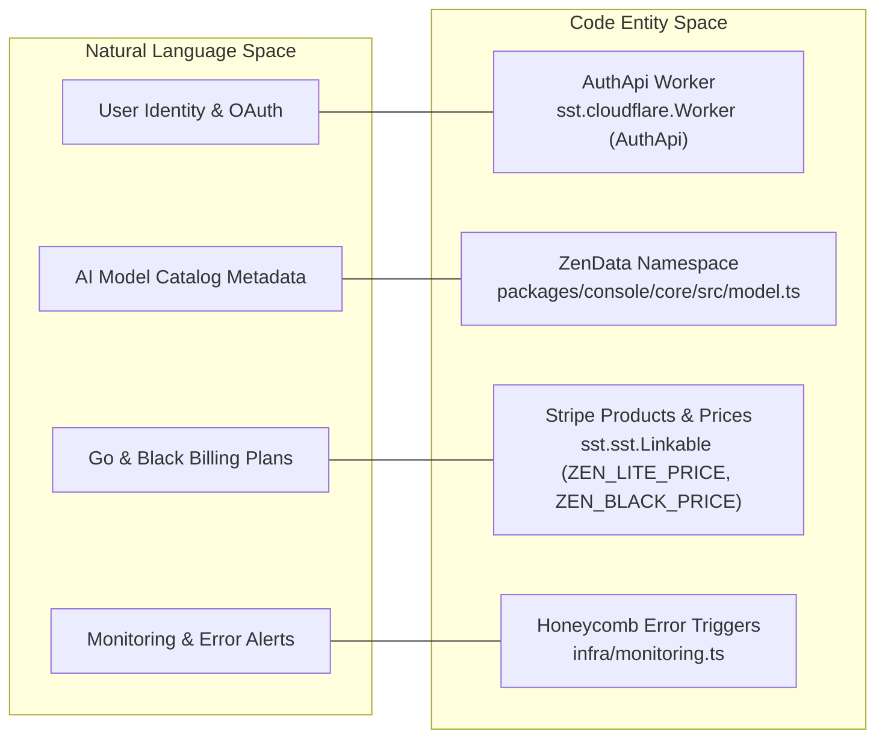

<!-- source: DeepWiki mcp.deepwiki.com · repo anomalyco/opencode · page 7 Console & Cloud Services · fetched 2026-10-27 -->

# Console & Cloud Services

Relevant source files

The following files were used as context for generating this wiki page:

- [packages/console/app/src/component/language-picker.tsx](packages/console/app/src/component/language-picker.tsx)
- [packages/console/app/src/component/social-meta.tsx](packages/console/app/src/component/social-meta.tsx)
- [packages/console/app/src/context/language.tsx](packages/console/app/src/context/language.tsx)
- [packages/console/app/src/entry-server.tsx](packages/console/app/src/entry-server.tsx)
- [packages/console/app/src/i18n/index.ts](packages/console/app/src/i18n/index.ts)
- [packages/console/app/src/lib/language.ts](packages/console/app/src/lib/language.ts)
- [packages/console/app/src/routes/brand/index.tsx](packages/console/app/src/routes/brand/index.tsx)
- [packages/console/app/src/routes/docs/[...path].ts](packages/console/app/src/routes/docs/[...path].ts)
- [packages/console/app/src/routes/docs/index.ts](packages/console/app/src/routes/docs/index.ts)
- [packages/console/app/src/routes/download/index.tsx](packages/console/app/src/routes/download/index.tsx)
- [packages/console/app/src/routes/download/types.ts](packages/console/app/src/routes/download/types.ts)
- [packages/console/app/src/routes/enterprise/index.tsx](packages/console/app/src/routes/enterprise/index.tsx)
- [packages/console/app/src/routes/index.tsx](packages/console/app/src/routes/index.tsx)
- [packages/console/app/src/routes/s/[id].ts](packages/console/app/src/routes/s/[id].ts)
- [packages/console/app/src/routes/zen/index.tsx](packages/console/app/src/routes/zen/index.tsx)
- [packages/console/app/test/language.test.ts](packages/console/app/test/language.test.ts)
- [packages/web/src/i18n/locales.ts](packages/web/src/i18n/locales.ts)
- [packages/web/src/middleware.ts](packages/web/src/middleware.ts)

The OpenCode Console & Cloud Services layer is a multi-tenant SaaS platform delivering managed access to OpenCode Zen and Go AI inference gateways, workspace management, user billing, real-time telemetry, and supporting cloud infrastructure. This parent page provides a high-level overview of the core services involved: the Zen inference gateway that routes AI requests, the billing and workspace management console, the telemetry stats system, and the infrastructure deployment using SST and Cloudflare Workers. Detailed technical information and implementation specifics are covered in separate child pages linked below.

**Child pages for details:**

- For request handling, provider adapters, streaming, and trial management, see [Zen Inference Gateway](#7.1)  
- For the SolidStart frontend console, billing integration with Stripe, and workspace management, see [Console Web App & Billing](#7.2)  
- For usage ingestion, model normalization, telemetry dashboards, and comparison routes, see [Stats System](#7.3)  
- For SST-defined infrastructure, deployment workflow, and Cloudflare Workers functions, see [Infrastructure & Deployment (SST)](#7.4)  

---

## SaaS Architecture Overview

OpenCode SaaS is architected in multiple tiers, combining Cloudflare Workers for API gateways and authentication, SolidStart apps for console and telemetry, PlanetScale as the persistent database with Drizzle ORM, Stripe for billing, and Honeycomb and R2 for observability and data storage. The key logical components interact as depicted below:

- **Client Tier:** User-facing tools including the OpenCode CLI and browsers accessing the console web app or stats dashboards.  
- **Frontend Tier:** SolidStart React-based apps hosting the billing console and stats visualization UI.  
- **Backend Tier:** Cloudflare Workers providing OAuth authentication, inference request gateway, and asynchronous log processing.  
- **Persistence & External:** PlanetScale MySQL database with Drizzle ORM for metadata and billing, Stripe as payment gateway, and Cloudflare R2 for object storage of telemetry logs.

Sources: [infra/console.ts:9-73](), [sst-env.d.ts:37-40](), [sst-env.d.ts:83](), [sst-env.d.ts:83]()

---

## Natural Language to Code Entity Mapping

This diagram maps key domain concepts from the SaaS platform to their corresponding code artifacts and infrastructure components, enabling easy navigation between conceptual and implementation views.

- **User Identity & OAuth:** Managed by the `AuthApi` Cloudflare Worker handling OAuth flows, JWT sessions, and user persistence in KV storage.  
- **AI Model Catalog Metadata:** Defined via Zod schemas in `ZenData.list` within the core console model, parsed from SST secret blobs for validation.  
- **Subscription Tiers:** Go and Black product pricing encapsulated in SST linkable price entities like `ZEN_LITE_PRICE` and `ZEN_BLACK_PRICE`.  
- **Telemetry Alerts:** Honeycomb trigger definitions monitor HTTP error rates and low request throughput to alert on failures or anomalies.

Sources: [infra/console.ts:60-66](), [packages/console/core/src/model.ts:10-85](), [infra/console.ts:73](), [infra/monitoring.ts:160-224]()

---

## Core Cloud Sub-Systems

### 7.1 Zen Inference Gateway

The Zen gateway is the core inference API endpoint managing multi-provider AI request handling. It performs provider adaptation for Anthropic, OpenAI, Google, and compatible providers, implements request body streaming rewrite, sticky provider load balancing, trial usage limitation, and usage accounting.

This gateway lives in `packages/console/app/src/routes/zen` and orchestrates request processing and usage control.

- For details, see [Zen Inference Gateway](#7.1).

Sources: [packages/console/core/src/model.ts:10-67]()

---

### 7.2 Console Web App & Billing

The billing and management console is a SolidStart frontend app in `packages/console/app` running under SST Cloudflare Workers. It serves marketing pages, product description pages (Go, Zen), workspace and API key management, usage display, and Stripe-powered billing integration including subscription management and payment handling.

The business logic uses `console-core` packages for models, billing domains, and database migrations, integrating with Stripe via webhooks and API calls.

- For details, see [Console Web App & Billing](#7.2).

Sources: [infra/console.ts:72-73](), [packages/console/app/src/routes/zen/index.tsx:1-2]()

---

### 7.3 Stats System

The Stats system ingests inference and usage telemetry using a multi-step pipeline with log processing Cloudflare Workers, Honeycomb backfill jobs, and a performant R2-SQL ingestion path. It normalizes model metadata, aggregates inference metrics, and provides public dashboards and interactive model comparison routes.

The main app backend lives in `packages/stats/app/core/server` exposing API endpoints and UI routes for model catalog browsing and telemetry review.

- For details, see [Stats System](#7.3).

Sources: [infra/monitoring.ts:41-158]()

---

### 7.4 Infrastructure & Deployment (SST)

The entire SaaS stack is configured and deployed via SST, defined in the `infra/` directory and `sst.config.ts`. This declarative setup includes Cloudflare Workers (`AuthApi`, `LogProcessor`, `Console`, `Stats`), KV namespaces, PlanetScale databases linked with Drizzle ORM, Stripe webhook integrations, and R2 buckets.

Cloudflare Workers functions are implemented for authentication, inference gateway, update services, file services, and changelog publishing. Deployment workflows integrate SST with GitHub Actions and infrastructure as code best practices.

- For details, see [Infrastructure & Deployment (SST)](#7.4).

Sources: [infra/console.ts:1-73]()

---

This completes the high-level overview of the Console & Cloud Services layer, tying together the primary components and their code and infrastructure loci. Subsequent child pages provide deep dives into each system section for contributors and operators.

Sources Summary:  
[packages/console/app/src/routes/zen/index.tsx:1-94](), [infra/console.ts:1-73](), [infra/monitoring.ts:41-224](), [packages/console/core/src/model.ts:10-85](), [sst-env.d.ts:37-40](), [sst-env.d.ts:83](), [sst-env.d.ts:83]()

---

