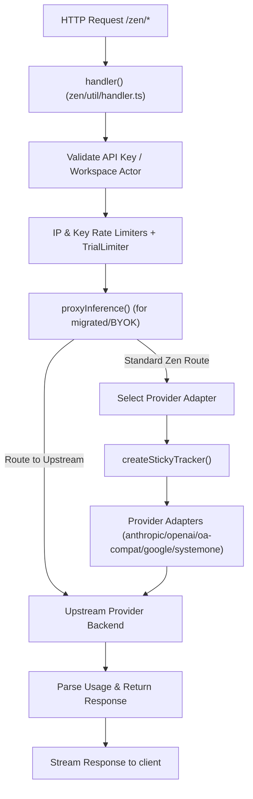
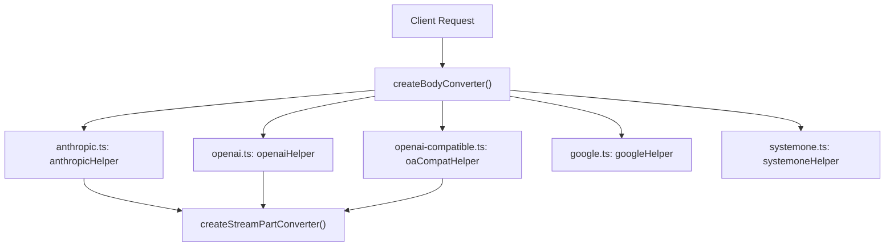
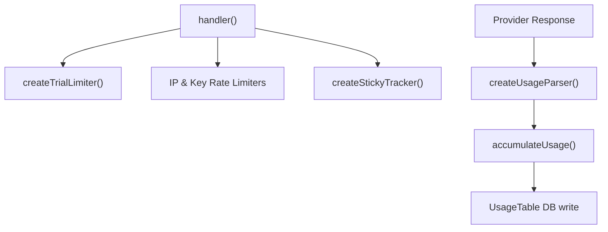
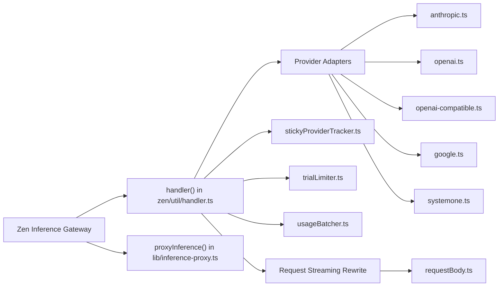
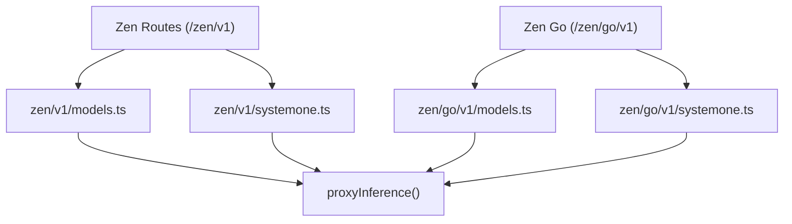

<!-- source: DeepWiki mcp.deepwiki.com · repo anomalyco/opencode · page 7.1 Zen Inference Gateway · fetched 2026-10-27 -->

# Zen Inference Gateway

Relevant source files

The following files were used as context for generating this wiki page:

- [packages/console/app/src/lib/inference-proxy.ts](packages/console/app/src/lib/inference-proxy.ts)
- [packages/console/app/src/lib/server-action.ts](packages/console/app/src/lib/server-action.ts)
- [packages/console/app/src/middleware.ts](packages/console/app/src/middleware.ts)
- [packages/console/app/src/routes/go/index.css](packages/console/app/src/routes/go/index.css)
- [packages/console/app/src/routes/go/index.tsx](packages/console/app/src/routes/go/index.tsx)
- [packages/console/app/src/routes/zen/go/v1/models.ts](packages/console/app/src/routes/zen/go/v1/models.ts)
- [packages/console/app/src/routes/zen/go/v1/systemone.ts](packages/console/app/src/routes/zen/go/v1/systemone.ts)
- [packages/console/app/src/routes/zen/go/v1/usage.ts](packages/console/app/src/routes/zen/go/v1/usage.ts)
- [packages/console/app/src/routes/zen/util/modelsHandler.ts](packages/console/app/src/routes/zen/util/modelsHandler.ts)
- [packages/console/app/src/routes/zen/v1/models.ts](packages/console/app/src/routes/zen/v1/models.ts)
- [packages/console/app/src/routes/zen/v1/systemone.ts](packages/console/app/src/routes/zen/v1/systemone.ts)
- [packages/console/app/test/serverAction.test.ts](packages/console/app/test/serverAction.test.ts)

## Purpose and Scope

The Zen Inference Gateway located at `packages/console/app/src/routes/zen` is OpenCode’s central API gateway and proxy handler for managed AI inference services, primarily the "Zen" and "Go" inference products. It integrates and normalizes multiple AI provider APIs, enforces multi-tenant authentication, trial restrictions, sticky routing for provider affinity, and performs usage accounting.

Key features implemented include:

- Request validation, parsing, and routing
- Provider API adapters supporting Anthropic, OpenAI, OpenAI-compatible (e.g., Moonshot, xAI), Google, and SystemOne formats
- Streaming request body transformation (to rewrite or inject model identifiers and streaming options)
- Sticky provider selection to maintain affinity and maximize cache hits for consistent client sessions
- Trial usage limiting and IP/api-key rate limiting
- Usage metrics parsing and batch accounting with durability

This gateway layer acts as the core multi-tenant inference API for the OpenCode SaaS console.

---

## Gateway Request Handler & Proxy Routing

The main request entrypoint is the `handler()` function defined in `packages/console/app/src/routes/zen/util/handler.ts`. It processes incoming HTTP requests to the `/zen` route namespace, extracts and verifies authentication tokens and workspace context, and determines the backend provider to forward the request.

The handler performs these steps:

- Parses incoming request URL and method
- Validates the workspace and API key or OAuth token actor
- Checks usage limits via IP and key rate limiters plus trial limits
- Determines if the request is a direct proxy to migrated or BYOK (bring-your-own-key) workspaces and reroutes via `proxyInference()` if so
- Maps the request to a provider adapter for normalizing request and response
- Applies sticky provider routing based on the client key and model
- Invokes the provider helper to rewrite request headers, URLs and bodies as needed
- Passes the request to the provider backend and awaits a streamed response
- Wraps and extracts usage information for accounting

### Request Flow Diagram

**Sources:** [packages/console/app/src/routes/zen/util/handler.ts:69-141](), [packages/console/app/src/lib/inference-proxy.ts:18-61]()

---

## Provider Adapters

Zen supports multiple provider formats by employing adapter helpers under the `zen/util/provider` directory. Each helper transforms requests and responses to/from the provider's native API format and handles streaming event decoding plus usage token accounting. These adapters implement the `ProviderHelper` interface.

| Provider ID | Helper Module | Responsibilities |
|-------------|---------------|------------------|
| `anthropic` | `anthropic.ts` ([lines 19-177]()) | Requests adaptation for Bedrock ARN/ID format; AWS EventStream binary decoding of Claude streams; Claude 1M Beta header injection. |
| `openai` | `openai.ts` ([lines 16-65]()) | Maps to OpenAI Responses API; usage token normalization including cached prefixes and reasoning tokens. |
| `oa-compat` | `openai-compatible.ts` ([lines 26-80]()) | Handles OpenAI-compatible providers such as Moonshot, xAI, Alibaba; parses detailed usage data; supports session affinity via headers. |
| `google` | `google.ts` ([lines 29-75]()) | Adapts Google Generative AI endpoints; extracts usage metadata from responses. |
| `systemone` | `systemone.ts` ([lines 1-10]()) | Supports SystemOne backend routing and request adaptation. |

### Provider Adapter Flow

These helpers abstract away provider-specific wire format differences, enabling Zen’s core handler logic to remain consistent across backends.

**Sources:** [packages/console/app/src/routes/zen/util/provider/anthropic.ts:19-177](), [packages/console/app/src/routes/zen/util/provider/openai.ts:16-65](), [packages/console/app/src/routes/zen/util/provider/openai-compatible.ts:26-80](), [packages/console/app/src/routes/zen/util/provider/google.ts:29-75](), [packages/console/app/src/routes/zen/util/provider/systemone.ts:1-10](), [packages/console/app/src/routes/zen/util/provider/provider.ts:36-53]()

---

## Request Body Streaming Rewrite

The Zen gateway employs streaming JSON parsing and rewrite to efficiently handle large payloads without buffering the whole request. This is implemented in the `prepareRequestBody()` function in `zen/util/requestBody.ts`.

Key implementation details:

- **On-the-fly JSON Scan:** `prepareRequestBody()` consumes the request body as a stream, tracking JSON bracket depth and token positions to locate the top-level `"model"` key inside the JSON request ([lines 20-70]()).
- **Model String Patch:** Once the `model` property string offset is located, the function rewrites the model ID in-flight in `stream()`, replacing the client model ID with the normalized provider model ID beneath the streaming data ([line 99]()).
- **Stream Option Injection:** For streaming requests, the function supports injection of `stream_options: { include_usage: true }` into the JSON to enable detailed usage reporting from provider responses ([lines 173-218]()).

This streaming rewrite avoids waiting for full payloads and enables seamless modification of key request fields in the proxy layer.

**Sources:** [packages/console/app/src/routes/zen/util/requestBody.ts:4-218]()

---

## Sticky Provider Tracking, Trial Limiter & Usage Accounting

Zen enforces usage limits, billing, and consistent routing with three key components:

### Sticky Provider Tracker

Implemented via `createStickyTracker()` ([lines 1-30]()), this module records and persists affinity between client keys (e.g., API keys or sessions) and a provider instance. This affinity ensures:

- Subsequent requests from the same key/model route to the same upstream provider endpoint
- Improves cache efficiency and reduces backend load by avoiding scattered sessions

### Trial Limiter

A trial usage guard is implemented via `createTrialLimiter()` ([lines 1-30]()). It enforces limits on free/trial tier clients to prevent abuse by:

- Tracking usage per IP or client key
- Blocking request overages gracefully before forwarding upstream

### Rate Limiters

Zen also composes two other limiters:

- **IP-based limiter:** `createIpRateLimiter()` protects against brute force or excessive queries on a per-IP basis.
- **API key limiter:** `createKeyRateLimiter()` throttles based on API key usage bands.

### Usage Accounting

Token consumption is extracted from each provider’s response by their usage parsers (`createUsageParser()` implementations). Parsed usage data is fed into a batched accumulator `accumulateUsage()` defined in `usageBatcher.ts`. This batcher asynchronously commits usage events into durable storage tables (`UsageTable`).

### Interaction Diagram: Usage & Limits

**Sources:** [packages/console/app/src/routes/zen/util/handler.ts:37-48](), [packages/console/app/src/routes/zen/util/stickyProviderTracker.ts:1-30](), [packages/console/app/src/routes/zen/util/trialLimiter.ts:1-30](), [packages/console/app/src/routes/zen/util/ipRateLimiter.ts:1-30](), [packages/console/app/src/routes/zen/util/keyRateLimiter.ts:1-30](), [packages/console/app/src/routes/zen/util/usageBatcher.ts:1-60]() (implied)

---

## Client to Code Entity Mapping

Two diagrams bridging natural language concepts of providers and core request handling to code entities in the source tree:

### Natural Language Concepts to Code Modules for Zen Gateway

### Key Endpoints Mapping to Proxy & Models

**Sources:** [packages/console/app/src/routes/zen/util/handler.ts](), [packages/console/app/src/lib/inference-proxy.ts](), [packages/console/app/src/routes/zen/v1/models.ts](), [packages/console/app/src/routes/zen/go/v1/models.ts](), [packages/console/app/src/routes/zen/v1/systemone.ts](), [packages/console/app/src/routes/zen/go/v1/systemone.ts]()

---

## Summary

The `zen` route folder in the OpenCode console package forms the backbone of OpenCode’s managed AI inference SaaS offering. It consolidates authentication, provider normalization, streaming request rewriting, sticky routing, trial and rate limiting, and usage tracking. By abstracting provider differences using modular adapters and implementing streaming proxy techniques, Zen offers highly performant and scalable inference APIs for hosted AI models from multiple providers under a unified system.

---

# Sources

- [packages/console/app/src/routes/zen/util/handler.ts:1-141]()
- [packages/console/app/src/lib/inference-proxy.ts:1-61]()
- [packages/console/app/src/routes/zen/util/provider/anthropic.ts:19-177]()
- [packages/console/app/src/routes/zen/util/provider/openai.ts:16-65]()
- [packages/console/app/src/routes/zen/util/provider/openai-compatible.ts:26-80]()
- [packages/console/app/src/routes/zen/util/provider/google.ts:29-75]()
- [packages/console/app/src/routes/zen/util/provider/systemone.ts:1-10]()
- [packages/console/app/src/routes/zen/util/provider/provider.ts:36-53]()
- [packages/console/app/src/routes/zen/util/requestBody.ts:4-218]()
- [packages/console/app/src/routes/zen/util/stickyProviderTracker.ts:1-30]()
- [packages/console/app/src/routes/zen/util/trialLimiter.ts:1-30]()
- [packages/console/app/src/routes/zen/util/ipRateLimiter.ts:1-30]()
- [packages/console/app/src/routes/zen/util/keyRateLimiter.ts:1-30]()
- [packages/console/app/src/routes/zen/util/usageBatcher.ts:1-60]() (implied)
- [packages/console/app/src/routes/zen/v1/models.ts:1-11]()
- [packages/console/app/src/lib/inference-proxy.ts:18-61]()
- [packages/console/app/src/routes/zen/v1/systemone.ts:1-6]()
- [packages/console/app/src/routes/zen/go/v1/models.ts:1-11]()
- [packages/console/app/src/routes/zen/go/v1/systemone.ts:1-6]()

---

