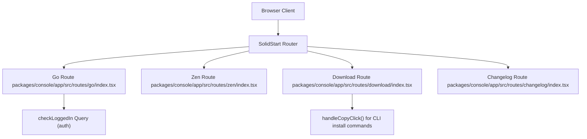
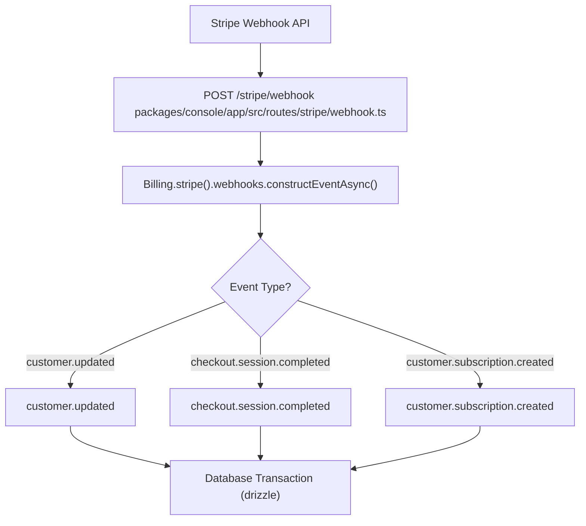
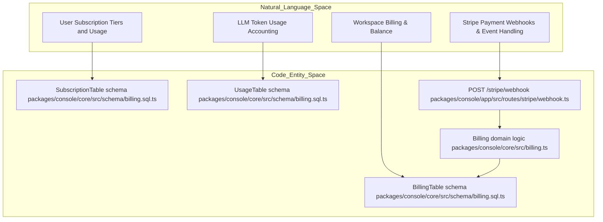
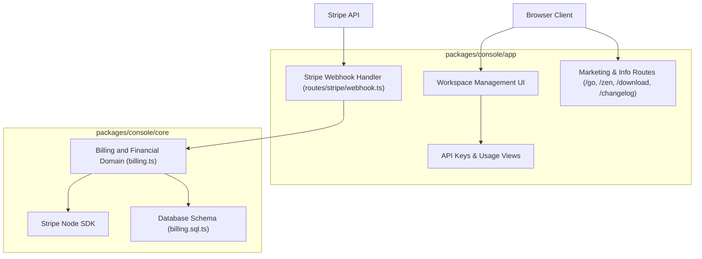

<!-- source: DeepWiki mcp.deepwiki.com · repo anomalyco/opencode · page 7.2 Console Web App & Billing · fetched 2026-10-27 -->

# Console Web App & Billing

<details>
<summary>Relevant source files</summary>

The following files were used as context for generating this wiki page:

- [packages/console/app/src/component/faq.tsx](packages/console/app/src/component/faq.tsx)
- [packages/console/app/src/component/footer.tsx](packages/console/app/src/component/footer.tsx)
- [packages/console/app/src/component/header.tsx](packages/console/app/src/component/header.tsx)
- [packages/console/app/src/component/language-picker.tsx](packages/console/app/src/component/language-picker.tsx)
- [packages/console/app/src/component/social-meta.tsx](packages/console/app/src/component/social-meta.tsx)
- [packages/console/app/src/context/language.tsx](packages/console/app/src/context/language.tsx)
- [packages/console/app/src/entry-server.tsx](packages/console/app/src/entry-server.tsx)
- [packages/console/app/src/i18n/index.ts](packages/console/app/src/i18n/index.ts)
- [packages/console/app/src/lib/changelog.ts](packages/console/app/src/lib/changelog.ts)
- [packages/console/app/src/lib/language.ts](packages/console/app/src/lib/language.ts)
- [packages/console/app/src/routes/brand/index.css](packages/console/app/src/routes/brand/index.css)
- [packages/console/app/src/routes/brand/index.tsx](packages/console/app/src/routes/brand/index.tsx)
- [packages/console/app/src/routes/changelog.json.ts](packages/console/app/src/routes/changelog.json.ts)
- [packages/console/app/src/routes/changelog/index.css](packages/console/app/src/routes/changelog/index.css)
- [packages/console/app/src/routes/changelog/index.tsx](packages/console/app/src/routes/changelog/index.tsx)
- [packages/console/app/src/routes/docs/[...path].ts](packages/console/app/src/routes/docs/[...path].ts)
- [packages/console/app/src/routes/docs/index.ts](packages/console/app/src/routes/docs/index.ts)
- [packages/console/app/src/routes/download/index.css](packages/console/app/src/routes/download/index.css)
- [packages/console/app/src/routes/download/index.tsx](packages/console/app/src/routes/download/index.tsx)
- [packages/console/app/src/routes/download/types.ts](packages/console/app/src/routes/download/types.ts)
- [packages/console/app/src/routes/enterprise/index.css](packages/console/app/src/routes/enterprise/index.css)
- [packages/console/app/src/routes/enterprise/index.tsx](packages/console/app/src/routes/enterprise/index.tsx)
- [packages/console/app/src/routes/feishu.ts](packages/console/app/src/routes/feishu.ts)
- [packages/console/app/src/routes/go/index.css](packages/console/app/src/routes/go/index.css)
- [packages/console/app/src/routes/go/index.tsx](packages/console/app/src/routes/go/index.tsx)
- [packages/console/app/src/routes/index.css](packages/console/app/src/routes/index.css)
- [packages/console/app/src/routes/index.tsx](packages/console/app/src/routes/index.tsx)
- [packages/console/app/src/routes/s/[id].ts](packages/console/app/src/routes/s/[id].ts)
- [packages/console/app/src/routes/zen/index.css](packages/console/app/src/routes/zen/index.css)
- [packages/console/app/src/routes/zen/index.tsx](packages/console/app/src/routes/zen/index.tsx)
- [packages/console/app/src/style/component/faq.css](packages/console/app/src/style/component/faq.css)
- [packages/console/app/src/style/component/focus.css](packages/console/app/src/style/component/focus.css)
- [packages/console/app/src/style/index.css](packages/console/app/src/style/index.css)
- [packages/console/app/test/language.test.ts](packages/console/app/test/language.test.ts)
- [packages/web/src/i18n/locales.ts](packages/web/src/i18n/locales.ts)
- [packages/web/src/middleware.ts](packages/web/src/middleware.ts)

</details>


## Purpose and Scope

The Console Frontend (`packages/console/app`) together with its core domain (`packages/console/core`) is the administrative, marketing, billing, and user workspace management SaaS platform for OpenCode. This system hosts public-facing marketing and information routes and provides operational UI for managing user workspaces, API keys, billing, usage tracking, and subscriptions.

Responsibilities include:

- Hosting marketing/product pages for Go and Zen products, download routes, and changelog (`/go`, `/zen`, `/download`, `/changelog`) [packages/console/app/src/routes/go/index.tsx:1-146](), [packages/console/app/src/routes/zen/index.tsx:1-94](), [packages/console/app/src/routes/download/index.tsx:1-128](), [packages/console/app/src/routes/changelog/index.tsx:1-174]().
- Workspace lifecycle management including roles and API keys.
- Tracking usage limits and billing with Stripe integration and webhooks.
- Defining the billing schema, handling transactions, usage records, coupon redemptions, and balance reloads.
- State and migration management for billing domain data.

---

## Technology Stack & Configuration

| Technology             | Role                                       | Key Files/Packages                                       |
|-----------------------|--------------------------------------------|---------------------------------------------------------|
| **SolidStart**         | Reactivity/SSR framework and routing        | `packages/console/app`                                   |
| **SolidJS**            | UI reactive library                         | `solid-js`                                              |
| **Stripe Node SDK**    | Billing, payment intent, webhook handling | `packages/console/core/src/billing.ts`, Stripe webhook  |
| **Drizzle ORM**        | Strongly-typed DB schema & queries          | `packages/console/core/src/schema/billing.sql.ts`       |
| **OpenAuth**           | User auth & sessions                        | `packages/console/app/src/routes/auth`                   |
| **I18next**            | Internationalization                        | `packages/console/app/src/i18n/en.ts`                    |

Configuration constants centralize global settings in `packages/console/app/src/config.ts`:

```typescript
export const config = {
  consoleMarketingEnabled: import.meta.env.VITE_CONSOLE_MARKETING_ENABLED === "true",
  baseUrl: "https://opencode.ai",
  github: {
    repoUrl: "https://github.com/anomalyco/opencode",
    starsFormatted: { compact: "208K", full: "208,000" },
  },
  social: { twitter: "https://x.com/opencode", discord: "https://discord.gg/opencode" },
  stats: { contributors: "950", commits: "13,000", monthlyUsers: "16M" },
} as const
```

Sources: [packages/console/app/src/config.ts:4-31](), [packages/console/core/src/billing.ts:1-33](), [packages/console/core/src/schema/billing.sql.ts:1-58]()

---

## Marketing, Download, & Changelog Routes

### Go Product Page

- The Go page (`/go`, implemented in `packages/console/app/src/routes/go/index.tsx`) displays marketing content, pricing tiers ("Go" and "Go Plus"), curated model lists with details about training and data retention, and user sign-up flows. It uses SolidJS components like `Header`, `Faq`, `EmailSignup`, icons for supported models, and localized text via i18n.
- The page conditionally shows a referral ended notice if a URL ref parameter is present.
- Plans are displayed with names, prices, CTAs, and feature lists.
- Models are listed as constants with meta properties used in descriptions.
- SEO metadata and social sharing meta tags are provided for rich previews.

### Zen Product Page

- Similarly, Zen (`/zen`) uses a SolidJS route at `packages/console/app/src/routes/zen/index.tsx` featuring promotional content, hero sections highlighting Zen brand, supported models, and call-to-actions.
- Includes video and avatar assets for marketing. 

### Download Routes

- The `/download` route and subpaths serve installation instructions for CLI tool installation via `curl`, `npm`, `bun`, `brew`, `paru`, and `yay`.
- It also provides platform-specific downloadable desktop packages (e.g., macOS Apple Silicon DMG).
- Copy-to-clipboard functionality is implemented using a localized `handleCopyClick` handler, providing user-friendly installs.
- Routing and downloads are dynamically adapted for different platforms and channels.

### Changelog Routes

- The `/changelog` route loads JSON changelog data asynchronously and renders releases and highlights, grouped by source.
- Releases can be expanded collapsibly to show detailed change items with optional GitHub user annotations.
- Supports video/image media embeds for rich changelog presentations.

**Route Resolution and Rendering Flow**



Sources: [packages/console/app/src/routes/go/index.tsx:1-146](), [packages/console/app/src/routes/zen/index.tsx:1-94](), [packages/console/app/src/routes/download/index.tsx:1-128](), [packages/console/app/src/routes/changelog/index.tsx:1-174]()

---

## Workspace Management, Keys & Usage UI

Workspaces are a key organizational unit aggregating user seats, billing credits, API keys, and usage limits.

- UI modals and server actions handle workspace selection and creation (`workspace.select`, `workspace.createNew`) with i18n labels that appear in the app [packages/console/app/src/i18n/en.ts:58-62]().
- API keys are linked to specific workspaces and enable controlled, auditable inference API usage.
- Usage limits (rolling, weekly, monthly) are stored in the database schema and enforced in the backend [packages/console/core/src/schema/billing.sql.ts:27-29]().
- The workspace model supports relational associations with subscriptions, payments, and usage records.

Sources: [packages/console/app/src/i18n/en.ts:58-62](), [packages/console/core/src/schema/billing.sql.ts:17-40]()

---

## Console Core Model & Billing Domain

The core billing domain logic is implemented in `packages/console/core/src/billing.ts`. This namespace provides:

- Stripe client initialization for API calls, configured via environment secrets.
- Reload logic: automated creation and payment of invoices to top up workspace balances based on thresholds.
- Credit granting: ability to add balance credits to a workspace.
- Coupon redemption: validating promo codes tied to user emails, for campaigns.

### Main Billing Constants & Functions

```typescript
export namespace Billing {
  export const RELOAD_AMOUNT = 20
  export const RELOAD_AMOUNT_MIN = 10
  export const RELOAD_TRIGGER = 5
  export const RELOAD_TRIGGER_MIN = 5
  
  export const calculateFeeInCents = (x: number) => {
    return Math.round(((x + 30) / 0.956) * 0.044 + 30)
  }
}
```

- `Billing.stripe()` returns a configured Stripe API client instance with fetch-based transport.
- `Billing.reload(workspaceID)` creates an invoice of `RELOAD_AMOUNT`, applies calculated fees, finalizes it, and attempts to pay off-session.
- Database transactions increment balances atomically.
- Coupon functions check existing redemptions and validate coupon types or expiration.

Sources: [packages/console/core/src/billing.ts:22-202]()

---

## Stripe Integration & Webhooks

The Stripe webhook endpoint (`packages/console/app/src/routes/stripe/webhook.ts`) listens for events and updates billing state accordingly.

### Handled Stripe Events

- `customer.updated`: When customers modify payment methods, updates local records of last4 digits and card type [packages/console/app/src/routes/stripe/webhook.ts:23-44]().
- `checkout.session.completed`: On successful payment, reloads workspace balances and records payment details in `PaymentTable` [packages/console/app/src/routes/stripe/webhook.ts:46-107]().
- `customer.subscription.created`: Records subscription details for Lite or Black tiers, updating subscription IDs and entitlements [packages/console/app/src/routes/stripe/webhook.ts:108-154]().

### Webhook Event Processing Flow



Sources: [packages/console/app/src/routes/stripe/webhook.ts:14-154]()

---

## Database Schema & Migrations

The billing domain database schema is declared using Drizzle ORM in `packages/console/core/src/schema/billing.sql.ts`. The relational schema supports balances, subscriptions, payments, usage, and coupons.

### Core Tables Overview

| Table              | Purpose                                                                                      |
|--------------------|----------------------------------------------------------------------------------------------|
| `BillingTable`     | Stores workspace billing metadata: customer ID, card info, balance (in microcents), limits, reload config, subscriptions payload [lines 17-58]() |
| `SubscriptionTable`| Tracks user subscription rolling and fixed usage per workspace [lines 60-72]()              |
| `LiteTable`        | Manages Go/Lite tier usage metrics: rolling, weekly, monthly per user [lines 74-88]()        |
| `PaymentTable`     | Logs payments: financial transactions, invoice references, refund status, payment enrichments [lines 90-112]() |
| `UsageTable`       | Detail per-call usage accounting: input, output, reasoning tokens, model, provider, key, session info [lines 114-136]() |
| `CouponTable`      | Enforces unique promo coupon redemption per email and coupon type [lines 138-154]()         |

### BillingTable Columns Highlights

- `customerID`: Stripe customer identifier string.
- `paymentLast4`: Last 4 digits of payment card.
- `balanceMicroCents`: Current credit balance in microcents.
- `monthlyLimitMicroCents`: Monthly spending cap.
- `reloadAmountDollars` & `reloadTriggerDollars`: Auto-reload batch and trigger levels.
- `subscriptionsPayload`: JSON payload with subscription details.

### Natural Language to Code Entity Mapping



Sources: [packages/console/core/src/schema/billing.sql.ts:1-154](), [packages/console/core/src/billing.ts:22-202](), [packages/console/app/src/routes/stripe/webhook.ts:14-154]()

---

# Summary Architecture Diagram: Console Frontend and Billing Domain



This diagram shows the separation between the frontend marketing/workspace UI and the core billing domain logic with Stripe integration. The database schema underpins financial data and usage accounting.

---

# Conclusion

The Console Web App and Billing system is a comprehensive solution integrating SolidJS-driven marketing pages, workspace and API key management, and a robust billing domain with Stripe payment handling. Its design enables scalability through clearly separated routes, modular billing logic, and strong database modeling for managing usage and subscriptions at fine granularity.

This foundation supports OpenCode's SaaS infrastructure for subscription, usage, and financial management tightly coupled with billing webhooks from Stripe and workspace entity modeling.

---

# References

- [packages/console/app/src/routes/go/index.tsx](packages/console/app/src/routes/go/index.tsx)
- [packages/console/app/src/routes/zen/index.tsx](packages/console/app/src/routes/zen/index.tsx)
- [packages/console/app/src/routes/download/index.tsx](packages/console/app/src/routes/download/index.tsx)
- [packages/console/app/src/routes/changelog/index.tsx](packages/console/app/src/routes/changelog/index.tsx)
- [packages/console/app/src/routes/stripe/webhook.ts](packages/console/app/src/routes/stripe/webhook.ts)
- [packages/console/core/src/schema/billing.sql.ts](packages/console/core/src/schema/billing.sql.ts)
- [packages/console/core/src/billing.ts](packages/console/core/src/billing.ts)
- [packages/console/app/src/config.ts](packages/console/app/src/config.ts)
- [packages/console/app/src/i18n/en.ts](packages/console/app/src/i18n/en.ts)

---

