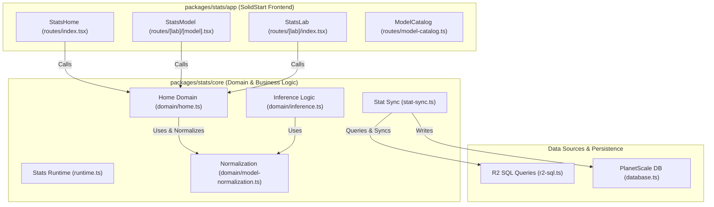
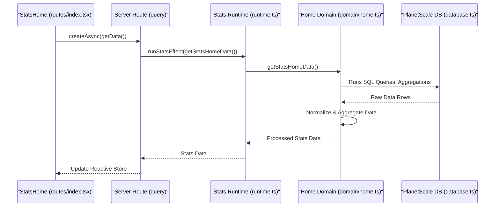
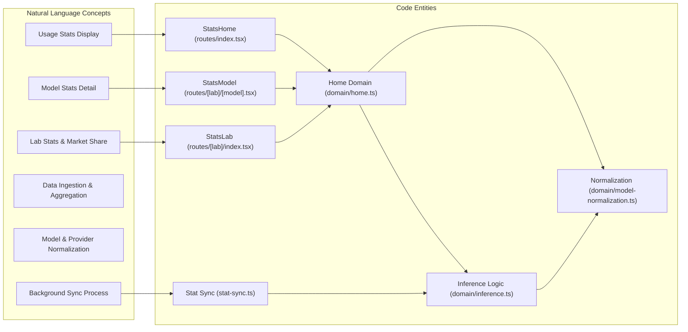

<!-- source: DeepWiki mcp.deepwiki.com · repo anomalyco/opencode · page 7.3 Stats System · fetched 2026-10-27 -->

# Stats System

Relevant source files

The following files were used as context for generating this wiki page:

- [STATS.md](STATS.md)
- [infra/stats.ts](infra/stats.ts)
- [packages/console/app/src/config.ts](packages/console/app/src/config.ts)
- [packages/stats/app/package.json](packages/stats/app/package.json)
- [packages/stats/app/src/app.tsx](packages/stats/app/src/app.tsx)
- [packages/stats/app/src/component/model-compare-detail.tsx](packages/stats/app/src/component/model-compare-detail.tsx)
- [packages/stats/app/src/component/pattern-ripple.tsx](packages/stats/app/src/component/pattern-ripple.tsx)
- [packages/stats/app/src/lib/page-data.ts](packages/stats/app/src/lib/page-data.ts)
- [packages/stats/app/src/routes/[lab]/[model].tsx](packages/stats/app/src/routes/[lab]/[model].tsx)
- [packages/stats/app/src/routes/[lab]/index.tsx](packages/stats/app/src/routes/[lab]/index.tsx)
- [packages/stats/app/src/routes/api/health.ts](packages/stats/app/src/routes/api/health.ts)
- [packages/stats/app/src/routes/compare-cards.tsx](packages/stats/app/src/routes/compare-cards.tsx)
- [packages/stats/app/src/routes/compare-radar.tsx](packages/stats/app/src/routes/compare-radar.tsx)
- [packages/stats/app/src/routes/compare/[firstLab]/[firstModel]/[secondLab]/[secondModel].tsx](packages/stats/app/src/routes/compare/[firstLab]/[firstModel]/[secondLab]/[secondModel].tsx)
- [packages/stats/app/src/routes/compare/index.tsx](packages/stats/app/src/routes/compare/index.tsx)
- [packages/stats/app/src/routes/index.css](packages/stats/app/src/routes/index.css)
- [packages/stats/app/src/routes/index.tsx](packages/stats/app/src/routes/index.tsx)
- [packages/stats/app/src/routes/model-catalog.ts](packages/stats/app/src/routes/model-catalog.ts)
- [packages/stats/app/src/routes/stats-shell.tsx](packages/stats/app/src/routes/stats-shell.tsx)
- [packages/stats/app/src/stats-runtime.ts](packages/stats/app/src/stats-runtime.ts)
- [packages/stats/app/test/compare-radar.test.ts](packages/stats/app/test/compare-radar.test.ts)
- [packages/stats/app/test/model-catalog.test.ts](packages/stats/app/test/model-catalog.test.ts)
- [packages/stats/core/package.json](packages/stats/core/package.json)
- [packages/stats/core/src/database/schema.ts](packages/stats/core/src/database/schema.ts)
- [packages/stats/core/src/domain/catalog-identity.test.ts](packages/stats/core/src/domain/catalog-identity.test.ts)
- [packages/stats/core/src/domain/catalog-identity.ts](packages/stats/core/src/domain/catalog-identity.ts)
- [packages/stats/core/src/domain/geo.ts](packages/stats/core/src/domain/geo.ts)
- [packages/stats/core/src/domain/home.test.ts](packages/stats/core/src/domain/home.test.ts)
- [packages/stats/core/src/domain/home.ts](packages/stats/core/src/domain/home.ts)
- [packages/stats/core/src/domain/inference.test.ts](packages/stats/core/src/domain/inference.test.ts)
- [packages/stats/core/src/domain/inference.ts](packages/stats/core/src/domain/inference.ts)
- [packages/stats/core/src/domain/model-normalization.ts](packages/stats/core/src/domain/model-normalization.ts)
- [packages/stats/core/src/domain/model.ts](packages/stats/core/src/domain/model.ts)
- [packages/stats/core/src/domain/provider.ts](packages/stats/core/src/domain/provider.ts)
- [packages/stats/core/src/domain/stat.ts](packages/stats/core/src/domain/stat.ts)
- [packages/stats/core/src/honeycomb-backfill.ts](packages/stats/core/src/honeycomb-backfill.ts)
- [packages/stats/core/src/resource.d.ts](packages/stats/core/src/resource.d.ts)
- [packages/stats/core/src/stat-sync.ts](packages/stats/core/src/stat-sync.ts)
- [packages/stats/server/package.json](packages/stats/server/package.json)
- [packages/stats/server/src/stat-sync.ts](packages/stats/server/src/stat-sync.ts)

The Stats System is a specialized subsystem within the OpenCode repository designed to track, aggregate, and visualize usage statistics of OpenCode’s AI models and services. It monitors model inference usage, token consumption, cost efficiency, user retention, and geographic distribution across the OpenCode ecosystem. The system is implemented as a solidly structured multi-package solution involving a SolidStart frontend, Effect-based core domain logic with Drizzle ORM for database interaction, and server Lambdas for background data synchronization and API.

---

## System Architecture

The Stats System is split principally into three functional packages:

1. **Frontend (`packages/stats/app`)**  
   A SolidStart application providing a public-facing dashboard for browsing aggregated statistics such as market share, model usage, cost and efficiency metrics, and geographic breakdowns. Pages include the homepage, model-specific pages, lab-specific pages, and comparison views for models. Data fetching relies on the SolidJS `createAsync` and the router `query` utilities to load data reactively on the server and client [packages/stats/app/src/routes/index.tsx:72-159](), [packages/stats/app/src/routes/[lab]/[model].tsx:67-130](), [packages/stats/app/src/routes/[lab]/index.tsx:62-110]().

2. **Core Domain (`packages/stats/core`)**  
   Contains core domain logic, typed data schemas, normalization rules, and Effect-based API for fetching and manipulating stats data. It handles data querying, aggregation, normalization of model and provider names, and retention analysis. Built upon Effect for declarative asynchronous runtime and Drizzle ORM for strong-typed database queries [packages/stats/core/src/domain/home.ts:1-213](), [packages/stats/core/src/domain/model-normalization.ts:1-69](), [packages/stats/core/src/domain/inference.ts:1-186]().

3. **Server (`packages/stats/server`)**  
   Hosts Lambda functions for background synchronization tasks such as scheduled data imports, aggregation updates, and health checks. These handlers coordinate execution of SQL queries via the core domain and orchestrate database writes. The sync process schedules complex SQL queries and consolidates data aggregates to keep stats up-to-date with minimal data lag [packages/stats/core/src/stat-sync.ts:1-163]().

### Components to Code Entities Map

Sources:  
[packages/stats/app/src/routes/index.tsx:72-159](),  
[packages/stats/core/src/domain/home.ts:1-213](),  
[packages/stats/core/src/stat-sync.ts:1-163](),  
[packages/stats/core/src/domain/model-normalization.ts:1-69](),  
[packages/stats/app/src/routes/[lab]/[model].tsx:67-130](),  
[packages/stats/app/src/routes/[lab]/index.tsx:62-110]()

---

## Data Ingestion & Synchronization

The system aggregates raw AI model inference events from a cloud data source and syncs these into a structured relational database for efficient consumption.

### Synchronization Process (`stat-sync.ts`)

- **Sync Entry Function**: `syncStats()` coordinates incremental or full data sync. It operates over sliding windows aligned to ISO weeks or uses full historical ranges for backfill purposes [packages/stats/core/src/stat-sync.ts:41-103]().
- **SQL Query Generation**: Leverages `buildStatsQueries()` from `domain/inference.ts` to generate detailed time-windowed SQL queries covering daily and weekly aggregations grouped by dimension (model, provider, geo) [packages/stats/core/src/domain/inference.ts:48-63]().
- **Parallel Data Fetching and Aggregation**: Executes batches of queries concurrently against the R2 SQL-like data lake [packages/stats/core/src/stat-sync.ts:65-86]().
- **Retention Analysis**: Uses cohort-based SQL queries to calculate user retention by weekly activity and return periods [packages/stats/core/src/stat-sync.ts:95-121]().
- **Upsert and Cleanup**: Writes aggregated rows into PlanetScale via Drizzle ORM repositories. Periodically deletes retired or unknown model/provider data to enforce data hygiene [packages/stats/core/src/stat-sync.ts:130-163]().

### Model Normalization & Mapping

OpenCode uses a normalization layer to unify multiple model naming variations for reporting consistency:

- **Alias Mapping**: Normalizes legacy or variant model names into canonical public names to unify analytics (e.g., `"ox-alpha"` → `"glm-5.3-flash"`) [packages/stats/core/src/domain/model-normalization.ts:21-31]().
- **Author and Provider Resolution**: Infers model author/provider from naming heuristics. Filters out stealth models and excludes specific models from reporting by masking as `"unknown"` [packages/stats/core/src/domain/model-normalization.ts:1-20]().
- **Suffix Stripping**: Removes experimental or free trial suffixes (`-free`, `:global`, etc.) for consistent aggregation [packages/stats/core/src/domain/model-normalization.ts:35-50]().

Sources:  
[packages/stats/core/src/stat-sync.ts:1-163](),  
[packages/stats/core/src/domain/inference.ts:48-83](),  
[packages/stats/core/src/domain/model-normalization.ts:1-69]()

---

## Core Domain Logic

### Domain Data Types (`domain/home.ts`)

The core domain defines rich TypeScript types capturing all facets of stats data used by frontend and backend:

| Type Name                  | Description                                                  |
|----------------------------|--------------------------------------------------------------|
| `UsageProduct`             | Categories usage data for "All Users", "Zen", "Go", "Enterprise" [packages/stats/core/src/domain/home.ts:9-9]() |
| `TokenProduct`             | Categories token cost data for product tiers [packages/stats/core/src/domain/home.ts:10-10]()       |
| `UsageRange`               | Aggregation ranges like 1D, 1W, 1M … ALL for time series [packages/stats/core/src/domain/home.ts:11-11]()  |
| `UsagePoint`               | Time series usage point with model segments [packages/stats/core/src/domain/home.ts:12-12]()        |
| `MarketDay`                | Daily market share snapshot by author [packages/stats/core/src/domain/home.ts:13-13]()              |
| `LeaderboardEntry`         | Ranked models by tokens with rank changes [packages/stats/core/src/domain/home.ts:14-21]()      |
| `TokenCostEntry`           | Breakdown of token cost by model [packages/stats/core/src/domain/home.ts:22-22]()                   |
| `CacheRatioEntry`          | Cache efficiency ratios [packages/stats/core/src/domain/home.ts:23-23]()                            |
| `SessionCostEntry`         | Cost per inference session statistics [packages/stats/core/src/domain/home.ts:24-24]()              |
| `RetentionEntry`           | User retention metrics by cohort [packages/stats/core/src/domain/home.ts:25-32]()                |
| `CountryEntry`             | Usage metrics broken down by country [packages/stats/core/src/domain/home.ts:33-33]()                |
| `ModelUsagePoint`          | Detailed usage data per model per date [packages/stats/core/src/domain/home.ts:34-34]()              |
| `StatsModelData`           | Aggregated comprehensive model stats including peers and retention [packages/stats/core/src/domain/home.ts:54-80]() |
| `StatsLabData`             | Provider-level aggregated stats [packages/stats/core/src/domain/home.ts:81-94]()                 |
| `StatsHomeData`            | Aggregated data for homepage and overview [packages/stats/core/src/domain/home.ts:118-129]()     |

### Core Data Flow for Stats Fetching

The layered system for stats data fetching consists of:

- The **Frontend pages** asynchronously invoke server-side data fetches using `createAsync` and routing `query`.
- These invoke the **Effect runtime execution layer**, which runs the core domain Effect computations.
- The **Domain layer** executes structured SQL queries against the PlanetScale and backend services, performs normalization, aggregation, and returns strongly typed data objects.
- Data flows back reactively updating the frontend UI.

Sources:  
[packages/stats/core/src/domain/home.ts:1-213](),  
[packages/stats/app/src/routes/index.tsx:72-159]()

---

## Frontend Application

The frontend package (`packages/stats/app`) provides an interactive, SEO-friendly dashboard built with SolidJS and SolidStart.

- **Homepage (`routes/index.tsx`)** shows top models, unique user counts, user retention, cost statistics, cache ratios, market share, geo-country breakdowns, and model comparison cards [packages/stats/app/src/routes/index.tsx:77-158]().
- **Model Detail Page (`routes/[lab]/[model].tsx`)** includes detailed trends on usage, momentum, unique users, efficiency, peer models comparison, and geography [packages/stats/app/src/routes/[lab]/[model].tsx:67-131]().
- **Lab Page (`routes/[lab]/index.tsx`)** displays aggregated statistics at the provider (lab) level, including token share and models usage [packages/stats/app/src/routes/[lab]/index.tsx:62-111]().

### Styling and Theming

- The app uses IBM Plex Mono font for monospace numeric data and tables, embedded via CSS `@font-face` declarations [packages/stats/app/src/routes/index.css:1-239]().
- Implements user selectable theme preferences (light, dark, system) saved in `localStorage` and applied on page load dynamically [packages/stats/app/src/routes/index.tsx:86-123]().
- Defines color palettes for usage bars and market slices aligned with brand styling [packages/stats/app/src/routes/index.tsx:48-60]().

Sources:  
[packages/stats/app/src/routes/index.tsx:72-159](),  
[packages/stats/app/src/routes/index.css:1-239]()

---

## Historical Tracking

In addition to automated statistical tracking, the project maintains a manual ledger (`STATS.md`) enumerating GitHub and npm download counts over time, providing context on package distribution and adoption trends. This serves as a simple human-readable historical record complementing the detailed internal stats [STATS.md:1-88]().

---

# Summary Diagram: Natural Language to Code Entities

Sources:  
[packages/stats/app/src/routes/index.tsx:72-159](),  
[packages/stats/app/src/routes/[lab]/[model].tsx:67-130](),  
[packages/stats/app/src/routes/[lab]/index.tsx:62-110](),  
[packages/stats/core/src/domain/home.ts:1-213](),  
[packages/stats/core/src/domain/inference.ts:1-186](),  
[packages/stats/core/src/domain/model-normalization.ts:1-69](),  
[packages/stats/core/src/stat-sync.ts:1-163]()

---

# Detailed Implementation Notes

### Key Functions & Classes

| Function/Entity              | Location                                        | Role & Description                                                         |
|-----------------------------|------------------------------------------------|---------------------------------------------------------------------------|
| `getStatsHomeData`           | `domain/home.ts` [packages/stats/core/src/domain/home.ts:196-206]()                   | Fetches aggregated home page stats combining model, retention, and geo data.    |
| `getStatsModelData`          | `domain/home.ts` [packages/stats/core/src/domain/home.ts:208-213]()                   | Fetches detailed data for individual models.                              |
| `statModel`, `statProvider`  | `domain/model-normalization.ts` [packages/stats/core/src/domain/model-normalization.ts:35-68]()      | Perform normalization and canonical mapping of model & provider names.  |
| `buildStatsQueries`          | `domain/inference.ts` [packages/stats/core/src/domain/inference.ts:48-63]()                 | Compose SQL queries for different aggregation dimensions and periods.    |
| `syncStats`                  | `stat-sync.ts` [packages/stats/core/src/stat-sync.ts:41-163]()                       | Background sync flow coordinating data import, aggregation, normalization, and database writes. |
| `runStatsEffect`             | `runtime.ts` [packages/stats/core/src/runtime.ts:1-18]() | Executes core Effect-powered asynchronous queries called by frontend routes.   |

### Data Flow Recap

- Client UI components invoke async queries (`createAsync` + `query`) to fetch stats.
- Server-side APIs call into Effect runtime to run domain-level computations for stats data.
- The domain layer executes complex SQL queries and formats the results as typed objects.
- Background Lambda sync functions periodically refresh data by querying raw logs/events and upserting aggregates.
- Normalization ensures metrics remain coherent even as model and provider names evolve.

Sources:  
[packages/stats/core/src/domain/home.ts:196-213](),  
[packages/stats/core/src/domain/model-normalization.ts:35-68](),  
[packages/stats/core/src/domain/inference.ts:48-63](),  
[packages/stats/core/src/stat-sync.ts:41-163](),  
[packages/stats/core/src/runtime.ts:1-18]()

---

# Conclusion

The Stats System in OpenCode exemplifies a modern, effectful, and strongly typed data platform tightly integrated with the broader AI coding ecosystem. Its layered architecture isolates UI concerns from domain logic and from ingestion/persistence. Extensive normalization ensures consistent metrics despite complex underlying data variations. SolidStart plus SolidJS provide a responsive and SEO-optimized frontend for exploring detailed usage insights across models, providers, and geographies.

---

# References

- Source code:  
  [packages/stats/app/src/routes/index.tsx](),  
  [packages/stats/app/src/routes/[lab]/[model].tsx](),  
  [packages/stats/app/src/routes/[lab]/index.tsx](),  
  [packages/stats/core/src/domain/home.ts](),  
  [packages/stats/core/src/domain/inference.ts](),  
  [packages/stats/core/src/domain/model-normalization.ts](),  
  [packages/stats/core/src/stat-sync.ts](),  
  [packages/stats/app/src/routes/index.css](),  
  [STATS.md]()

---

